<p align="center">
  
</p>

<h1 align="center">Localix</h1>

<p align="center">
  <strong>One workspace for you and a team of agents.</strong><br>
  Localix is an open source Agentic Development Environment: one workspace where you and a team of
  agents share the editor, terminals, preview, and databases.
</p>

<p align="center">
  <a href="LICENSE"></a>
  
  
</p>

<p align="center">
  <a href="#quick-start">Quick start</a>
  ·
  <a href="docs/README.md">Documentation</a>
  ·
  <a href="CONTRIBUTING.md">Contributing</a>
  ·
  <a href="https://localix.ai">Website</a>
</p>

<p align="center">
  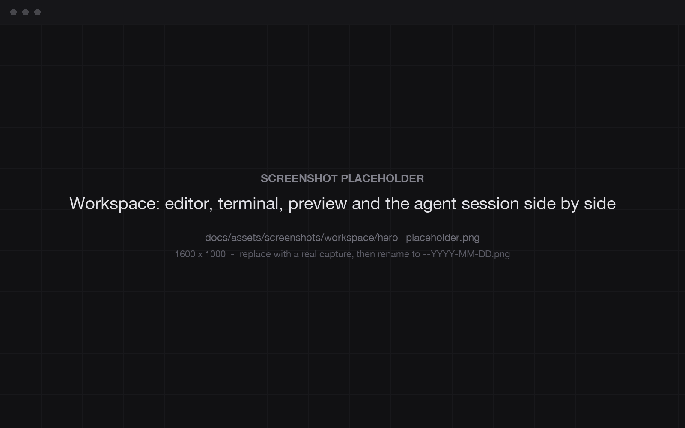
</p>

## Why Localix

Most agent tools live in a chat box and describe your work from the outside. Localix puts the agent
inside the workspace, next to the things it is working on.

- **A team of agents, one conversation.** Add several agents as participants, address them with
  `@handle`, and let an agent invite a colleague. Each keeps its own role, rules and model.
- **The agent sees what you see.** Link a file, a diff, a terminal, a table or a preview element to
  a message. Results point back to the surface that produced them.
- **A board you share with the agents.** Project Space is one spatial board per project that you and
  the agent edit together, and the agent can walk you through it.
- **The agent can use the app it builds.** It drives the built-in preview the way you do, and you
  can point at an element with Visual Feedback instead of describing it.
- **You choose the model, per job.** Sessions, titles, inline completion and delegated agents each
  get their own provider, model and reasoning level.
- **Tool calls are bounded.** Declarative `allow` / `ask` / `deny` rules and approval prompts decide
  what a run may do. Keys live in an encrypted vault.
- **It runs on your machine.** The API, the database and the vault live under `~/.localix`. Model
  requests go to the providers you connect, and other requests go to the tools and servers you
  enable.
- **It extends, and the agent can do the extending.** Describe a plugin and an agent builds its
  native interface and tools together. Localix's own board, DevOps, Project Space and Code Graph are
  plugins built with agents on the same contract.

## What you get

### A team of agents in one conversation

A conversation can have several agents as participants, all reading one shared transcript. Add one
from the composer, address one with `@handle` or everyone with `@all`, and remove one with a button;
the session, its title and its transcript carry on. An agent can invite an installed agent and hand
over the turn, and your next message outranks a handoff chain, which stops after 12 handoffs without
you. Participants read each other's public replies, not each other's tool calls or reasoning.

Each agent has its own role, its own ordered `allow` / `ask` / `deny` rules and its own model. Start
from shipped roles such as lead, backend, frontend, design, qa and devops, or define your own. The
permission mode applies to the whole conversation, approvals are asked of you, and a denial stays
denied in every mode.

<p align="center">
  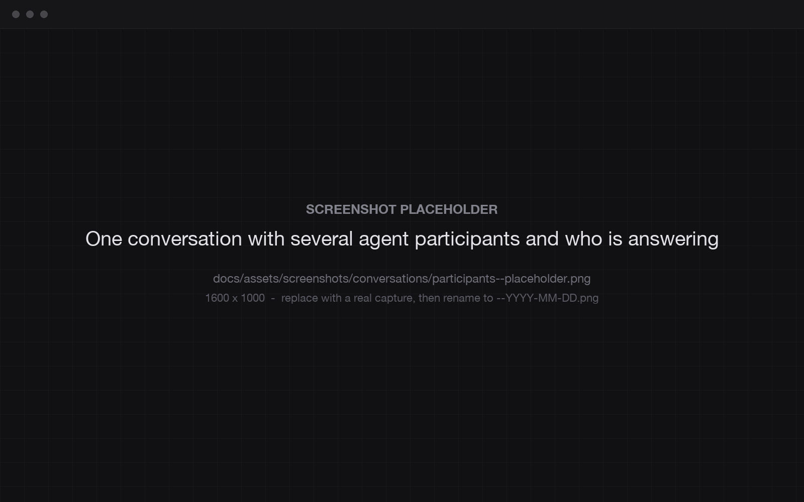
</p>

[Conversations with several agents](docs/features/conversations.md) ·
[Capabilities](docs/features/capabilities.md) · [Delegation](docs/features/delegation.md)

### Context that stays connected to the work

Attach files, folders, diffs, commits, sessions, terminals, tool calls and plugin resources to a
message as structured references. See what is attached, how large it is, and remove any of it before
you send. Long sessions are checkpointed without a model call: older turns collapse into short
cards, pinned messages stay whole, and anything evicted is one recall away.

<p align="center">
  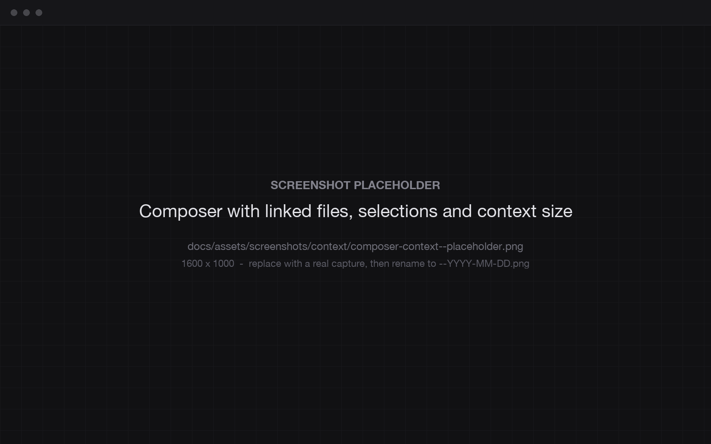
</p>

[Workspace and context](docs/features/workspace.md) ·
[Context checkpoints](docs/features/context-checkpoints.md)

### Your external agent conversations, in the same workspace

Switch history between **Localix** and **External**. Installed coding-agent CLIs appear with their
sessions grouped by day and agent. Read a native transcript, import it into Localix, or resume that
exact session in a terminal where the adapter supports it. Drag a session into a chat or choose it
with `@resource:`: the Localix agent can investigate its recorded conversation and tool results.
Usage & Spend has matching tabs for Localix and recorded external usage.

<p align="center">
  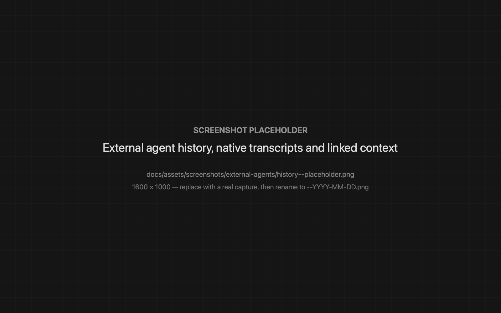
</p>

[External agent sessions](docs/features/external-agents.md) ·
[Run an external agent CLI](docs/recipes/bring-your-own-agent-cli.md)

### A board that you and the agents share

Every project has one spatial board for notes, diagrams, mind maps, tables and live cards for its
files, folders, images and documents. You and the agent edit the same file with the same operations,
and the agent can walk you through it: it moves your view and lights up what it points at. Its
changes glow on screen, with a count of what happened off screen. A card is a reference, not a copy,
so it re-reads the file when it changes, and a session, message, terminal or tool call dropped on
the board lands as a card with **Open**. The board is one file under `.localix/project-space`, so
the repository can hold it.

<p align="center">
  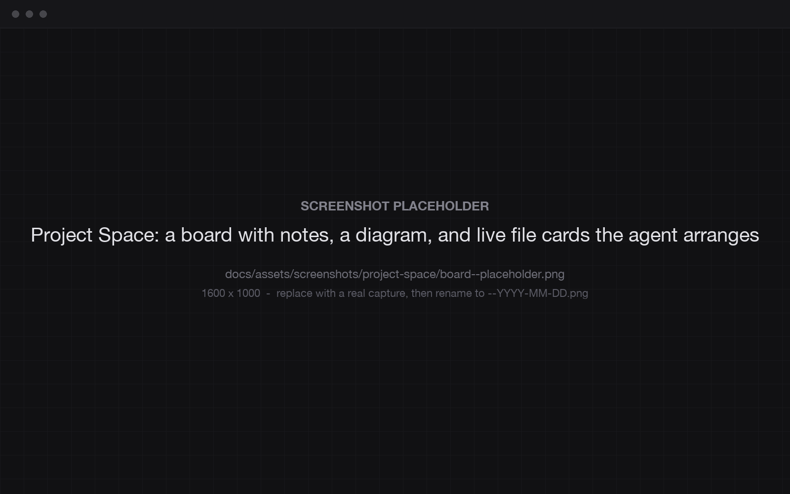
</p>

[Project Space](docs/features/project-space.md)

### The right model for each job

The model browser shows connections, capabilities, modalities, limits and pricing from the live
catalog, and stores a reasoning level per provider and model.

| Workload              | What you choose                                               |
| --------------------- | ------------------------------------------------------------- |
| **Direct session**    | Provider, model and reasoning level for the conversation.     |
| **Session titles**    | Their own model; an unset route uses the documented fallback. |
| **Inline completion** | An opt-in model for code and text completion.                 |
| **Delegated agents**  | Their own route, with the parent session as the boundary.     |

<p align="center">
  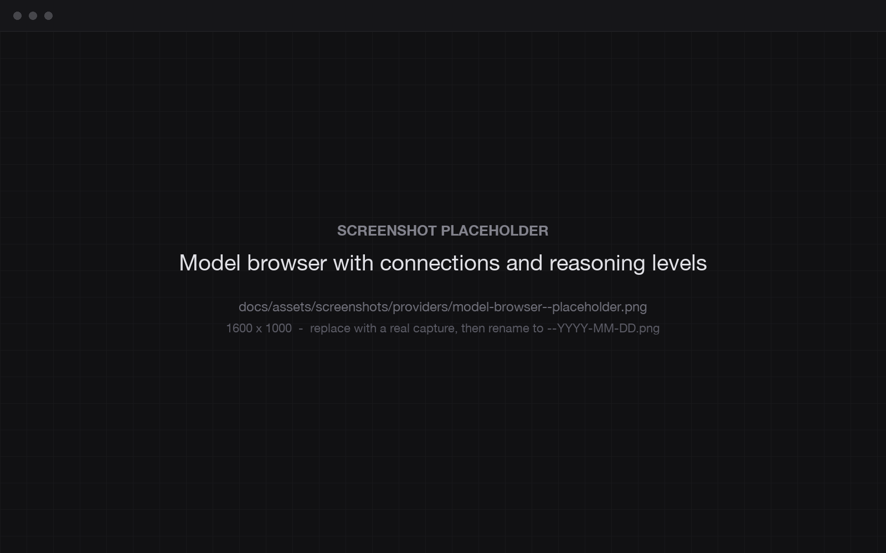
</p>

[Providers and model selection](docs/features/providers.md)

### A workspace, not a chat window

Editor, source control, diffs, split workbench tabs and persistent terminals share one window.

On macOS, **Command+T** opens a native workspace tab with its own project, conversation and editor
layout. Detach a tab into a window or merge workspace windows. A clean quit restores their groups,
order and selected tabs. The native window buttons and workspace breadcrumb share one compact row.

<p align="center">
  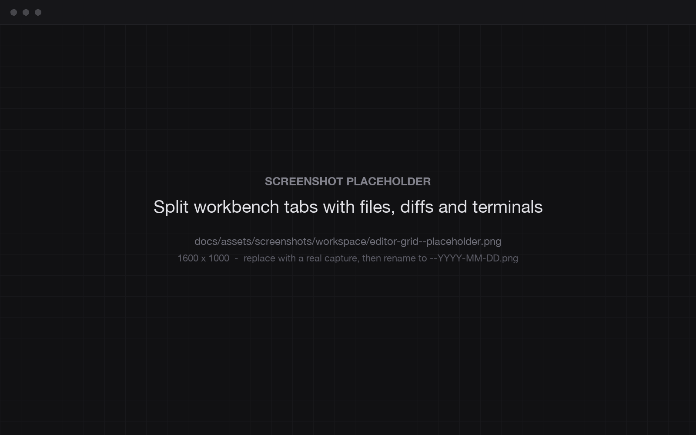
</p>

[Workspace](docs/features/workspace.md) ·
[Native workspace tabs](docs/features/native-workspace-tabs.md)

### A browser the agent drives, and Visual Feedback

The preview opens your running app beside the session, and the agent drives that same page. It reads
a compact tree of the elements (a ref for each, capped at 800 nodes) instead of raw HTML, runs
clicks, typing and scrolls as one batch that returns a short diff, finds a stale element again by
selector and then by role and name, and checks the console, a screenshot and a CSS viewport before
it reports back. There is no separate browser to install.

Visual Feedback goes the other way: pick an element, a region or several in the preview and attach
the screenshot, selector, styles and, where the page exposes it, the source location. It needs a
Localix preview with the probe connected.

<p align="center">
  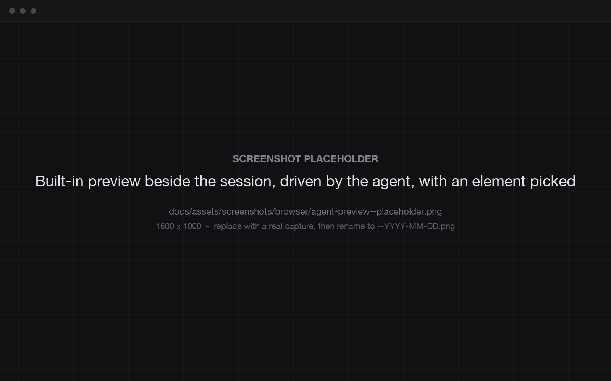
</p>

[Visual Feedback and the agent browser](docs/features/visual-feedback.md)

### Plan multi-part work on a board

Give a chat its own Kanban board. Create tasks yourself or hand the agent a goal and let it build
the epic. The board is passive: an agent takes a card or delegates it with a self-contained brief,
and nothing on the board starts a run on its own.

<p align="center">
  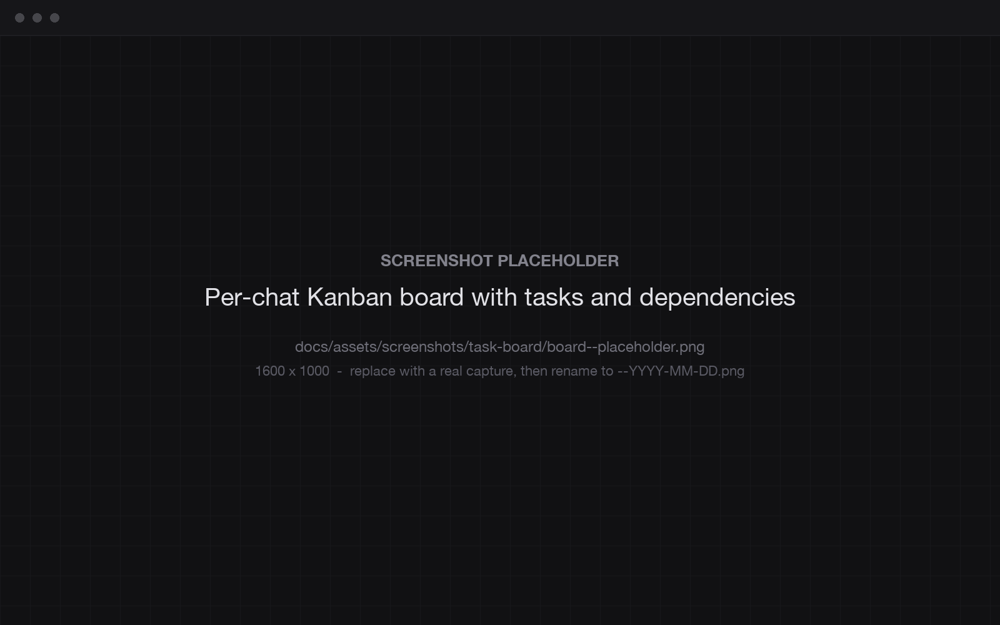
</p>

[Task board](docs/features/task-board.md) · [Delegation](docs/features/delegation.md)

### Whatever you work on gets its own workbench

Describe what you need, such as a calorie tracker, a release dashboard or a board for your team, and
run `/plugin create`. An agent scaffolds a plugin from a template, writes its tools, builds a native
interface from the app's own components, tests it, opens it and looks at the result. The plugin's
tools reach the agent with no glue code. Because the agent already reads the files and photos you
attach, a meal photo can arrive, with a model that accepts images, as a structured call to the
tracker's own tool. A plugin can also start an agent turn, which is how the bundled chess, checkers,
battleship, tic-tac-toe and 2048 play against you. A build that fails never replaces the one that
works.

The same contract carries Localix itself: the Kanban board, DevOps, Project Space, Code Graph,
Database and Git are plugins built with agents on it, and the larger ones run to tens of thousands
of lines.

<p align="center">
  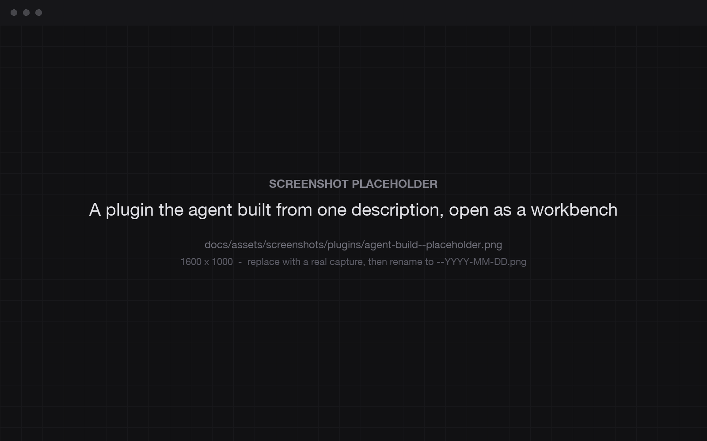
</p>

A plugin the agent creates is enabled at once and runs unsandboxed in the API process.
[Build a plugin with the agent](docs/extending/build-with-the-agent.md)

### A workbench for each domain

Bundled plugins add the interface people use and give the agent bounded access to the same
resources.

| Workbench                                       | What it covers                                                                   |
| ----------------------------------------------- | -------------------------------------------------------------------------------- |
| [**Database**](docs/features/database.md)       | Connections, schemas, SQL and non-SQL consoles, tables, diagrams, result sets.   |
| [**API client**](docs/features/api.md)          | Saved requests, environments, imports, responses, vault-backed references.       |
| [**DevOps**](docs/features/devops.md)           | Containers, images, volumes, Kubernetes workloads, logs; dangerous commands ask. |
| [**Documents**](docs/features/documents.md)     | PDF, document, spreadsheet, presentation, CSV and chart inspection.              |
| [**Learning**](docs/features/learning-loop.md)  | File-authored courses with durable progress that can re-enter agent context.     |
| [**Market research**](docs/features/trading.md) | Read-only public venues, charts, indicators, order books and trades.             |

<p align="center">
  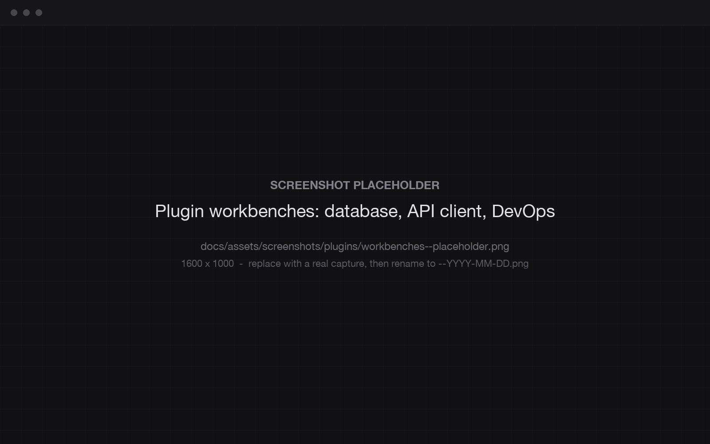
</p>

Plugins run inside the trusted API process, so enable only the ones you trust.
[Plugin system](docs/extending/plugins.md)

### Built as one system

The workspace, the Project Space board and every plugin draw from one design kit of more than eighty
modules, and a style check rejects hand-rolled controls and raw colors in a generated plugin.
Repository tests fail on raw pixel heights, hard-coded colors and literal durations, so the
interface does not drift as it grows. There are dark and light themes, a glass material on macOS,
handling for reduced motion, reduced transparency and forced colors, a command palette, global
search and rebindable shortcuts.

[The design kit](docs/extending/ui-kit.md)

### Work that keeps going

Loops run a prompt on a cron schedule or at a pace the agent sets between one minute and one hour,
and survive a restart with one catch-up run. A monitor polls a command and wakes the agent when it
passes, and secrets reach the command through the environment, not the model. Plan mode is read-only
except the plan file, and versions carry inline comments and diffs. A durable queue holds wakes
while you type, and your message always goes first. All of it runs while Localix is open.

[Loops](docs/features/loops.md) · [Monitors](docs/features/monitors.md) ·
[Permission modes and plans](docs/features/permission-modes.md)

## Quick start

Localix runs from source today. No signed desktop build has been published yet.

**You need:** [Bun](https://bun.sh) 1.3.14, a Rust toolchain, and the
[Tauri system dependencies](https://tauri.app/start/prerequisites/) for your platform.

```bash
git clone https://github.com/rsaryev/localix.git
cd localix
bun install --frozen-lockfile
bun run dev
```

`bun run dev` opens the native desktop app. Connect a model provider from the model picker and start
a session.

<details>
<summary>More ways to run it</summary>

```bash
bun run dev:web         # API on 127.0.0.1:5051 and UI on localhost:5050, in a browser
bun run dev:workspace   # API and UI dev servers without the desktop shell
bun run build:desktop   # an unsigned bundle for your own machine
```

`dev:web` keeps its own git-ignored database at `.data/dev/localix.db`, so it never touches an
installed app's data. `LOCALIX_DB_FILE` overrides the location.

After the desktop app is installed it can add a `localix` launcher:

```bash
localix          # open the current directory
localix file.ts  # open a file
```

</details>

[Installation and platform requirements](docs/getting-started/installation.md) ·
[Troubleshooting](docs/getting-started/troubleshooting.md)

## Project status

Localix is in **beta**. Releases are cut from `main`, listed on the
[Releases](https://github.com/rsaryev/localix/releases) page and described in
[CHANGELOG.md](CHANGELOG.md). The first beta ships installers for macOS (Apple silicon), which is
the only platform tested; the Linux installer is experimental and Windows is built from source. To
build it yourself, follow [Run Localix from source](docs/getting-started/installation.md). Expect
rough edges and breaking changes before 1.0.

## Security and privacy

- API keys and OAuth tokens are stored in an encrypted credential vault, and environment-backed
  credentials stay on the server side.
- Permission rules use `allow`, `ask` and `deny`. Bypass mode removes confirmation prompts but never
  lifts a `deny` rule or the host protections.
- Approvals are not an operating-system sandbox. Review what you let an agent run.

Read the [permission rules](docs/features/permissions.md), the
[privacy notes](docs/getting-started/privacy.md) and [SECURITY.md](SECURITY.md). Please report
vulnerabilities privately through GitHub Security Advisories, not in public issues.

## Repository

```text
apps/
  api/            Hono backend and agent runtime
  ui/             React workspace
  desktop-tauri/  Native desktop shell
  landing/        Product and documentation site
packages/         Shared runtime, UI kit, CLI and plugin SDK
plugins/          Bundled workbenches and the plugin template
docs/             Guides and reference
```

Built with Bun, TypeScript, React, Hono, Tauri and Turbo.

## Contributing

Contributions are welcome. Read [CONTRIBUTING.md](CONTRIBUTING.md) for the workflow and the checks a
change must pass, and the [Code of Conduct](CODE_OF_CONDUCT.md). The
[architecture overview](docs/internals/architecture.md) is the fastest way into the code.

## License

[MIT](LICENSE)
