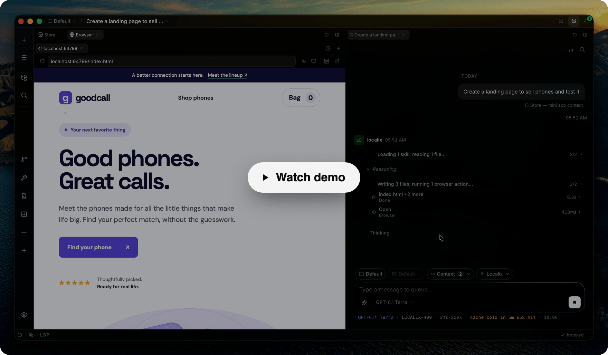

<p align="center">
  
</p>

<h1 align="center">Localix</h1>

<p align="center">
  <strong>The Agentic Development Environment</strong>
</p>

<p align="center">
  A team of AI agents works with you in one desktop app: your editor, terminals and browser. Any model, or run one on your own computer.
</p>

<p align="center">
  <a href="https://github.com/rsaryev/localix/releases/latest">Download</a> ·
  <a href="docs/README.md">Documentation</a> ·
  <a href="#run-from-source">Run from source</a>
</p>

<p align="center">
  <a href="https://localix.ai">
    
  </a>
</p>

<table>
  <tr>
    <td width="33%" valign="top">
      <strong>Agent teams</strong><br>
      Specialists share one chat; a clear request goes straight to the right one.<br>
      <a href="docs/features/group-routing.md">Group routing →</a>
    </td>
    <td width="33%" valign="top">
      <strong>A fast Browser</strong><br>
      Agents drive any page step by step and check the result.<br>
      <a href="docs/features/workspace.md#the-browser">The Browser →</a>
    </td>
    <td width="33%" valign="top">
      <strong>Decision models</strong><br>
      Small, cheap models make the quick calls across the app.<br>
      <a href="docs/features/decision-models.md">Decision models →</a>
    </td>
  </tr>
  <tr>
    <td valign="top">
      <strong>Plugins, built by the agent</strong><br>
      Describe one with <code>/plugin create</code> — from a game to an API client.<br>
      <a href="docs/extending/build-with-the-agent.md">Build a plugin →</a>
    </td>
    <td valign="top">
      <strong>Your coding agents</strong><br>
      Claude Code, Codex, Gemini CLI and more, linked to your chats.<br>
      <a href="docs/features/external-agents.md">External agents →</a>
    </td>
    <td valign="top">
      <strong>Any model</strong><br>
      Sign in or bring a key, or run models on this computer.<br>
      <a href="docs/features/providers.md">Providers →</a> · <a href="docs/features/local-models.md">Local models →</a>
    </td>
  </tr>
</table>

## On this computer

- **Local models.** Settings → Models picks Gemma 4 at the size your machine runs well, with a
  Fastest–Smartest slider, and adds any GGUF model by its Hugging Face id. Nothing you send them
  leaves the computer. See [local models](docs/features/local-models.md).
- **Search by meaning.** On by default: an embedding model downloads in the background, and search
  then finds chats, messages, skills, plugins, MCP servers and agents by what they mean, in any
  language. See [semantic search](docs/features/semantic-search.md).
- **For plugins.** A plugin can index its own items and follow its own changes through
  `ctx.host.semantic` and `ctx.host.changes`. See
  [semantic index and change feed](docs/extending/plugin-semantics.md).

## Download

- **macOS, Apple silicon:** `Localix-macos-arm64.dmg` from the
  [latest release](https://github.com/rsaryev/localix/releases/latest), signed and notarized
- **macOS Intel, Linux, Windows:** no installer yet, [run from source](#run-from-source)

Each release lists checksums in `SHA256SUMS.txt`.

## Run from source

For the desktop app, install [Bun](https://bun.sh) **1.3.14**, a Rust toolchain, and your platform's
[Tauri prerequisites](https://tauri.app/start/prerequisites/).

```bash
git clone https://github.com/rsaryev/localix.git
cd localix
bun install --frozen-lockfile
bun run dev
```

Connect a provider through the model picker — or download a model in Settings → Models to run one on
this computer — choose a model, and start a conversation.

To use the browser workspace instead of the desktop shell:

```bash
bun run dev:web
```

Open `http://localhost:5050` after the servers start; the API listens on `127.0.0.1:5051`. This uses
a separate, git-ignored database at `.data/dev/localix.db`.

See [installation](docs/getting-started/installation.md) for platform requirements and local builds,
and [troubleshooting](docs/getting-started/troubleshooting.md) for startup problems.

## Contributing

Localix is in beta. Start with [CONTRIBUTING.md](CONTRIBUTING.md) and
[the code map](docs/internals/code-map.md). Report vulnerabilities as [SECURITY.md](SECURITY.md)
describes; participation follows the [Code of Conduct](CODE_OF_CONDUCT.md). Localix is released
under the [MIT License](LICENSE).
