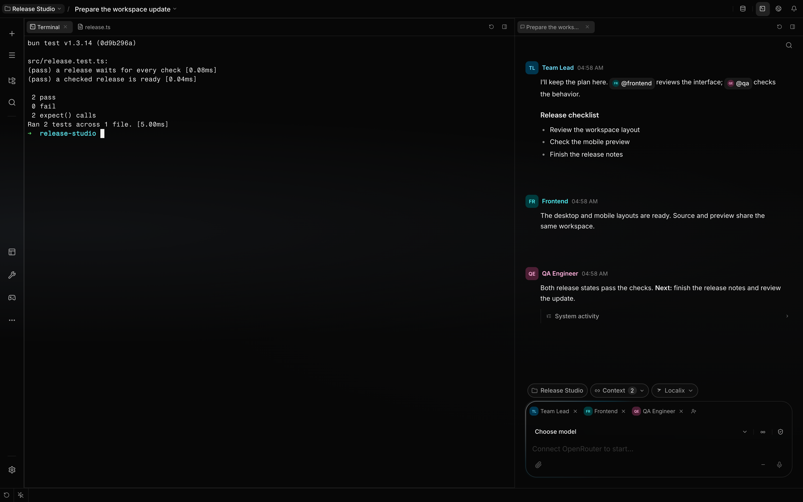
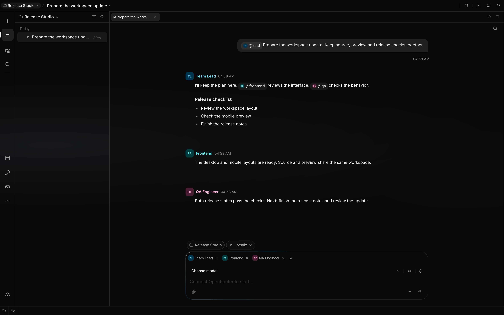
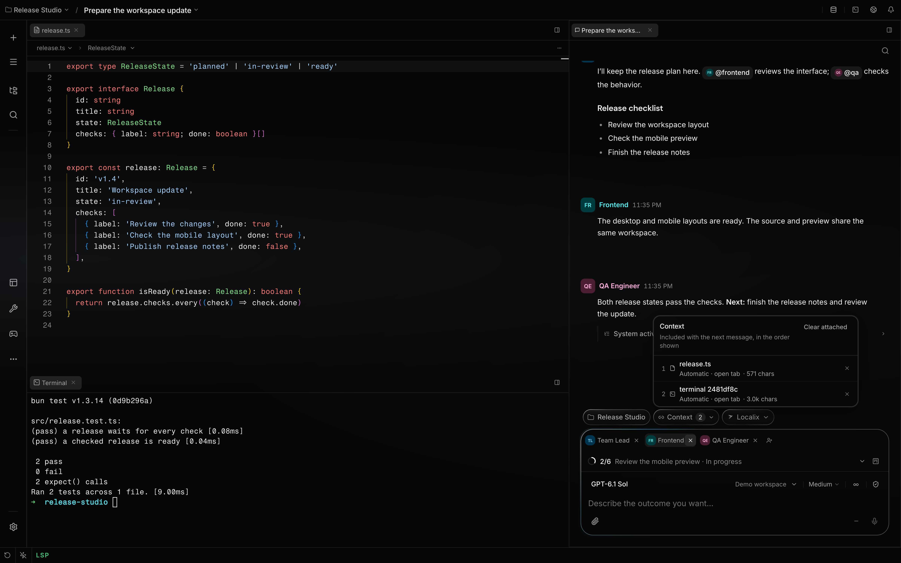
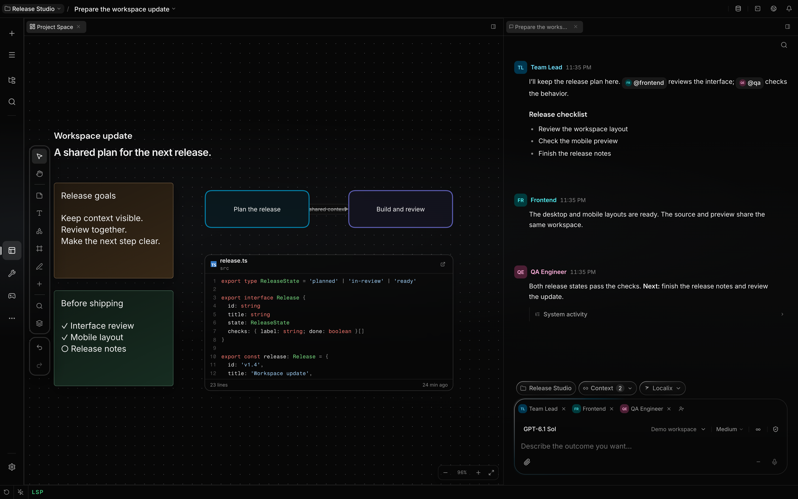
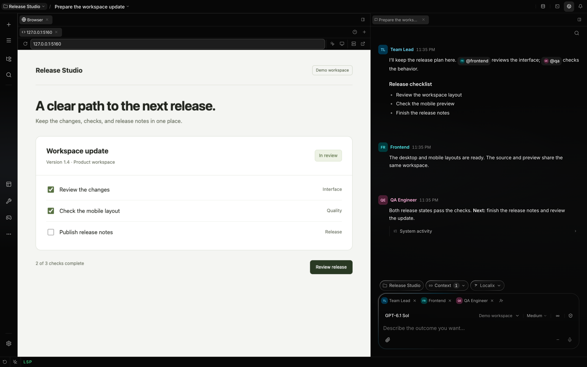
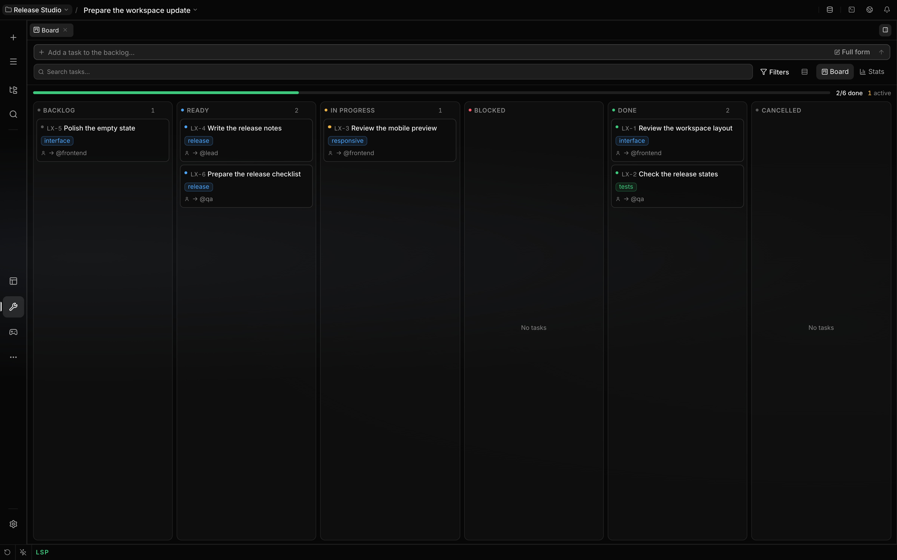
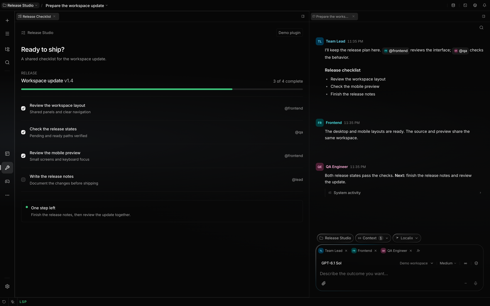

<p align="center">
  
</p>

<h1 align="center">Localix</h1>

<p align="center">
  <strong>One workspace for you and a team of agents.</strong><br>
  An open source workspace where you and your agents share the editor, terminals, preview, and databases.
</p>

<p align="center">
  <a href="LICENSE"></a>
  
</p>

<p align="center">
  <a href="#quick-start">Quick start</a> ·
  <a href="docs/README.md">Documentation</a> ·
  <a href="CONTRIBUTING.md">Contributing</a> ·
  <a href="https://localix.ai">Website</a>
</p>

<p align="center">
  
</p>

## What you can do

| Capability                                               | In the workspace                                                                                      |
| -------------------------------------------------------- | ----------------------------------------------------------------------------------------------------- |
| [Agent teams](docs/features/conversations.md)            | Give participants their own roles and models; address them with `@handle` in one shared conversation. |
| [Connected context](docs/features/workspace.md)          | Link files, diffs, terminals, and live resources to a message.                                        |
| [Project Space](docs/features/project-space.md)          | Arrange notes and live file cards on a board you and the agents edit together.                        |
| [Preview and feedback](docs/features/visual-feedback.md) | Let an agent use your running app, or point at an element and attach feedback.                        |
| [Kanban](docs/features/task-board.md)                    | Track tasks, owners, and dependencies on each conversation's board.                                   |
| [Model routing](docs/features/providers.md)              | Choose models separately for conversations, delegated agents, and inline completion.                  |
| [Custom plugins](docs/extending/build-with-the-agent.md) | Describe a tool; an agent builds its interface and tools with Localix's UI kit.                       |

Included workbenches cover [databases](docs/features/database.md),
[API requests](docs/features/api.md), [DevOps](docs/features/devops.md), and
[documents](docs/features/documents.md). You can also link
[external coding-agent sessions](docs/features/external-agents.md) and run
[scheduled prompts](docs/features/loops.md) while Localix is open.

<details>
<summary>See the workspace</summary>

### Agent conversation



### Message context



### Project Space



### Live preview



### Task board



### Custom plugin



These are real product captures using English demo data. The Release Checklist is a demo plugin, not
an included workbench.

The hero was captured on 9 October 2026 with a seeded conversation and two passing fixture tests.

</details>

## Quick start

For the desktop app, install [Bun](https://bun.sh) **1.3.14**, a Rust toolchain, and your platform's
[Tauri prerequisites](https://tauri.app/start/prerequisites/).

```bash
git clone https://github.com/rsaryev/localix.git
cd localix
bun install --frozen-lockfile
bun run dev
```

Connect a provider through the model picker, choose a model, and start a conversation.

To use the browser workspace instead of the desktop shell:

```bash
bun run dev:web
```

Open `http://localhost:5050` after the servers start; the API listens on `127.0.0.1:5051`. This uses
a separate, git-ignored database at `.data/dev/localix.db`.

See [installation](docs/getting-started/installation.md) for platform requirements and local builds,
and [troubleshooting](docs/getting-started/troubleshooting.md) for startup problems.

## Data and permissions

Localix stores conversations and configuration on your machine. Model requests go to the providers
you connect; enabled tools, plugins, and servers can make their own requests. Localix-managed
credentials are stored in an encrypted vault; external coding-agent CLIs manage their own login
data.

Tool permissions use `allow`, `ask`, and `deny`. Approvals are not an operating-system sandbox;
native plugin backend and UI code runs with the access of its Localix host. HTML views use a
separate [sandboxed iframe boundary](docs/extending/sandboxed-views.md). See
[permissions](docs/features/permissions.md), [privacy](docs/getting-started/privacy.md), and
[SECURITY.md](SECURITY.md).

## Contributing

Localix is in beta. Read [CONTRIBUTING.md](CONTRIBUTING.md) for the workflow and
[the code map](docs/internals/code-map.md) to find the owning module. Changes are recorded in
[CHANGELOG.md](CHANGELOG.md).

Follow the [Code of Conduct](CODE_OF_CONDUCT.md).

[MIT license](LICENSE).
