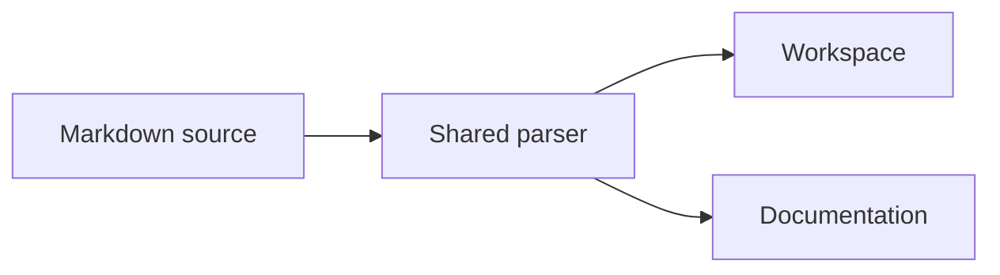

# Shared Markdown

The workspace and this documentation use `@localixai/markdown`. The package owns the syntax; each
host chooses its links, images and reading layout. Mini apps use the host's
[MarkdownRenderer](ui-kit.md) from the UI kit.

## Render Markdown in a mini app

Use the renderer served by the running host:

```tsx
import { MarkdownRenderer } from '@localixai/kit/markdown'

export function MiniAppNotes({ source }: { source: string }) {
  return <MarkdownRenderer>{source}</MarkdownRenderer>
}
```

The host supplies its links, media resolution, code controls, and styles. If the Markdown itself is
an editable store, pass `onSourceChange` and save the returned source to that store. Without that
callback, checkboxes outside a conversation message are read-only.

## Render a standalone document

Inside a workspace host that owns document presentation, use the shared package directly:

```tsx
import { Markdown } from '@localixai/markdown/react'

export function Document({ source }: { source: string }) {
  return (
    <article className="markdown-renderer">
      <Markdown headingIds>{source}</Markdown>
    </article>
  )
}
```

Supply the kit stylesheet and document wrapper styles; this component does not install a theme. Pass
a `components` map to resolve application links, render images or add a code-copy toolbar. GFM,
callouts, figures, tabs, file trees, math and diagrams keep the same grammar in every host.
`headingIds` enables anchors derived from heading text; repeated headings receive distinct ids.
Changing a heading or the order of duplicates can change its anchor. Build a matching outline with
`extractMarkdownHeadings` from the package root.

> [!NOTE] Host behavior stays local
>
> The document renderer does not open workspace files, address agents or save checklist changes. The
> workspace adds those behaviors to the shared parser.

## Notes and steps

GitHub alert markers become quiet notes. Use `NOTE`, `TIP`, `IMPORTANT`, `WARNING` or `CAUTION`. A
title after the marker is optional.

```markdown
> [!TIP] Keep the source portable
>
> Write ordinary Markdown beneath the marker.
```

> [!TIP] Keep the source portable
>
> Write ordinary Markdown beneath the marker.

A `STEPS` block uses bold step titles and an optional italic subtitle:

> [!STEPS]
>
> 1. **Write the source** Keep the document readable as plain Markdown.
> 2. **Choose host components** Resolve links and images where the document is displayed.
> 3. **Render and verify** Check anchors, keyboard controls and narrow screens.

## Variants

Use a `TABS` marker with a fourth-level heading for each variant. Everything inside each variant
remains Markdown. The tab bar supports the keyboard and labels its panels.

```markdown
> [!TABS]
>
> #### First variant
>
> Content for the first panel.
>
> #### Second variant
>
> Content for the second panel.
```

> [!TABS]
>
> #### Parser
>
> Import `remarkPluginsFor` and `rehypePluginsFor` when the host already owns a ReactMarkdown
> renderer, as the workspace does.
>
> #### Document
>
> Import `Markdown` from `@localixai/markdown/react` for a complete document with host component
> overrides, as the documentation does.

## Trees and diagrams

A `tree` fence becomes a foldable directory tree. Arrow keys move between visible rows.

```tree
packages/markdown/
├── src/
│   ├── dialect.ts          # grammar shared with the agent prompt
│   ├── markdownPlugins.ts  # safe parsing and lazy math
│   └── react.tsx           # document rendering
└── README.md
```

A `mermaid` fence draws a diagram using the kit's color tokens. The engine loads on demand. Invalid
source remains readable with an error message.



## Math, quotes and figures

Inline math uses dollar delimiters, such as $E = mc^2$. Display math uses double dollars:

$$
\sum_{i=1}^{n} i = \frac{n(n+1)}{2}
$$

Prices such as $5 and $10, shell variables such as `$HOME`, and fenced code stay literal. Formulas
share a bounded KaTeX cache, including when the workspace streams a reply.

Math loads asynchronously on first use. A failed math chunk leaves readable source; a new document
can retry the load. Rendering a formula is not a synchronous guarantee of the standalone component.

A quote's closing `— Author` line becomes its attribution:

> Keep one grammar and let each host own its behavior.
>
> — Localix Markdown contract

An image alone in a paragraph becomes a figure. Its title, or an italic line directly beneath it,
becomes the caption. Numbered headings keep the author's number; nothing is numbered automatically.

## Reading documentation

Use **Reading options** beside the breadcrumb to increase text size. **Focus on reading** hides both
desktop navigation rails; use the same control to restore them. The mobile page picker opens the
documentation sections without covering the article with a permanent sidebar.

The first page keeps its rendered article while the interactive renderer loads. Subsequent pages
show a skeleton inside the same reading column, with navigation available throughout.

## Safety and boundaries

Raw HTML is parsed and sanitized. Script tags, event handlers and unsafe links are removed. Diagrams
use Mermaid's strict security mode. Documents render GFM checkboxes as read-only; message
persistence and source-editing checklists belong to the workspace.

The shared package supplies steps, tabs, statistics and pros/cons containers. It does not add new
product behavior merely because a Markdown block is present.

## Source of truth

- [`packages/markdown/README.md`](https://github.com/rsaryev/localix/blob/main/packages/markdown/README.md)
  — entry points and ownership.
- [`packages/markdown/src/dialect.ts`](https://github.com/rsaryev/localix/blob/main/packages/markdown/src/dialect.ts)
  — markers and fences.
- [`packages/markdown/src/markdownPlugins.ts`](https://github.com/rsaryev/localix/blob/main/packages/markdown/src/markdownPlugins.ts)
  — parsing and sanitization.
- [`packages/markdown/src/react.tsx`](https://github.com/rsaryev/localix/blob/main/packages/markdown/src/react.tsx)
  — document renderer.
- [Plugin host entry](https://github.com/rsaryev/localix/blob/main/apps/ui/src/app/kit/markdown.ts)
  and
  [workspace renderer props](https://github.com/rsaryev/localix/blob/main/apps/ui/src/shared/ui/MarkdownRendererImpl.tsx).
- [Heading ids and outline](https://github.com/rsaryev/localix/blob/main/packages/markdown/src/headings.ts).
- [Answer formatting](../features/answer-formatting.md) — workspace behavior and limits.
