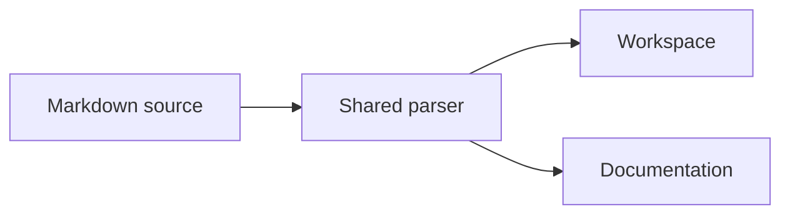

# Shared Markdown

The workspace and this documentation use the `llx-markdown` package. It owns the syntax; each host
chooses its links, images and reading layout. Mini apps use the host's [MarkdownRenderer](ui-kit.md)
from the UI kit.

## Render Markdown in a mini app

Use the renderer served by the running host:

```tsx
import { MarkdownRenderer } from '@localixai/kit/markdown'

export function MiniAppNotes({ source }: { source: string }) {
  return <MarkdownRenderer>{source}</MarkdownRenderer>
}
```

The host supplies its links, media resolution, code controls, and styles. If the Markdown itself is
an editable store, pass `onSourceChange` and save the returned source to that store. Without that
callback, checkboxes outside a conversation message are read-only.

## Render a standalone document

Inside a workspace host that owns document presentation, use the package directly:

```tsx
import { Markdown } from 'llx-markdown'
import 'llx-markdown/styles.css'

export function Document({ source }: { source: string }) {
  return (
    <article>
      <Markdown headingIds>{source}</Markdown>
    </article>
  )
}
```

The package's stylesheet draws every form from `--llx-*` colour tokens; the workspace sets them to
its theme in `apps/ui/src/app/markdown.css`. Pass a `components` map to resolve application links,
render images or add a code-copy toolbar. GFM, callouts, figures, tabs, file trees, math and
diagrams keep the same grammar in every host. `headingIds` enables anchors derived from heading
text; repeated headings receive distinct ids. Changing a heading or the order of duplicates can
change its anchor. Build a matching outline with `extractHeadings` from the package root.

> [!NOTE] Host behavior stays local
>
> The document renderer does not open workspace files, address agents or save checklist changes. The
> workspace adds those behaviors through the renderer's `components` and `extensions`.

## Notes and steps

GitHub alert markers become quiet notes. Use `NOTE`, `TIP`, `IMPORTANT`, `WARNING` or `CAUTION`. A
title after the marker is optional.

```markdown
> [!TIP] Keep the source portable
>
> Write ordinary Markdown beneath the marker.
```

> [!TIP] Keep the source portable
>
> Write ordinary Markdown beneath the marker.

A `STEPS` block uses bold step titles and an optional italic subtitle:

> [!STEPS]
>
> 1. **Write the source** Keep the document readable as plain Markdown.
> 2. **Choose host components** Resolve links and images where the document is displayed.
> 3. **Render and verify** Check anchors, keyboard controls and narrow screens.

## Variants

Use a `TABS` marker with a fourth-level heading for each variant. Everything inside each variant
remains Markdown. The tab bar supports the keyboard and labels its panels.

```markdown
> [!TABS]
>
> #### First variant
>
> Content for the first panel.
>
> #### Second variant
>
> Content for the second panel.
```

> [!TABS]
>
> #### Parser
>
> `llx-markdown` reads Markdown with its own parser. A host that owns a unified pipeline imports
> `remarkLlx` from `llx-markdown/remark` to get the same forms there.
>
> #### Document
>
> Import `Markdown` from `llx-markdown` for a complete document with host components and plugins, as
> the workspace and the documentation do.

## Trees and diagrams

A `tree` fence becomes a foldable directory tree. Arrow keys move between visible rows.

```tree
apps/ui/src/
├── app/
│   ├── markdown.css        # the workspace's tokens and typography
│   └── markdown-forms.css  # steps, tabs, stats, trees, checklists
└── shared/ui/
    ├── MarkdownRendererImpl.tsx  # links, mentions, checklists, actions
    └── markdownStages.ts         # math and diagrams on first use
```

A `mermaid` fence draws a diagram using the kit's color tokens. The engine loads on demand. Invalid
source remains readable with an error message.



## Math, quotes and figures

Inline math uses dollar delimiters, such as $E = mc^2$. Display math uses double dollars:

$$
\sum_{i=1}^{n} i = \frac{n(n+1)}{2}
$$

Prices such as $5 and $10, shell variables such as `$HOME`, and fenced code stay literal. Formulas
share a bounded KaTeX cache, including when the workspace streams a reply.

Math loads asynchronously on first use. Until it arrives, and if its chunk fails to load, formulas
stay readable as source; a failed load is tried again a few times. Rendering a formula is not a
synchronous guarantee of the standalone component.

A quote's closing `— Author` line becomes its attribution:

> Keep one grammar and let each host own its behavior.
>
> — Localix Markdown contract

An image alone in a paragraph becomes a figure. Its title, or an italic line directly beneath it,
becomes the caption. Numbered headings keep the author's number; nothing is numbered automatically.

## Reading documentation

Use **Reading options** beside the breadcrumb to increase text size. **Focus on reading** hides both
desktop navigation rails; use the same control to restore them. The mobile page picker opens the
documentation sections without covering the article with a permanent sidebar.

The first page keeps its rendered article while the interactive renderer loads. Subsequent pages
show a skeleton inside the same reading column, with navigation available throughout.

## Safety and boundaries

Raw HTML is parsed and sanitized. Script tags, event handlers and unsafe links are removed. Diagrams
use Mermaid's strict security mode. Documents render GFM checkboxes as read-only; message
persistence and source-editing checklists belong to the workspace.

The shared package supplies steps, tabs, statistics and pros/cons containers. It does not add new
product behavior merely because a Markdown block is present.

## Source of truth

- [The `llx-markdown` dependency](https://github.com/rsaryev/localix/blob/main/apps/ui/package.json)
  — the package owns entry points, markers, fences, parsing, sanitization and the document renderer.
- [Plugin host entry](https://github.com/rsaryev/localix/blob/main/apps/ui/src/app/kit/markdown.ts)
  and
  [workspace renderer props](https://github.com/rsaryev/localix/blob/main/apps/ui/src/shared/ui/MarkdownRendererImpl.tsx).
- [Answer formatting](../features/answer-formatting.md) — workspace behavior and limits.
