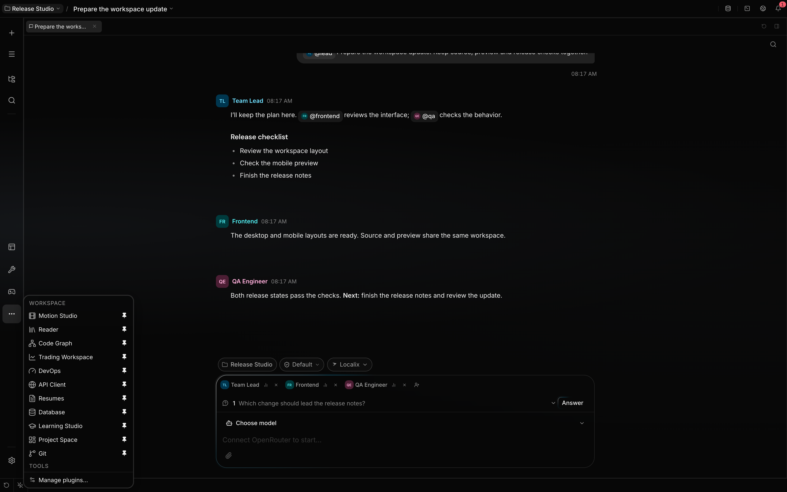
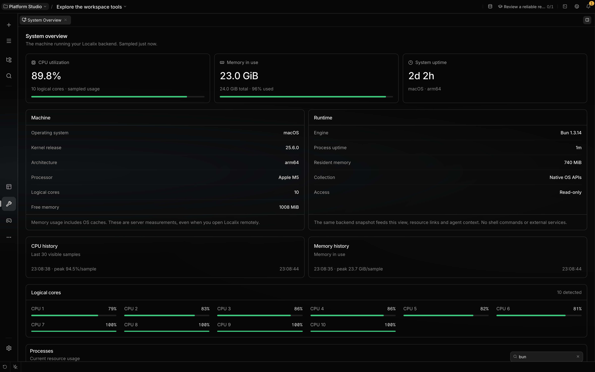

# Build a mini app

A **mini app** is Localix's own application format: screens for the person, a native backend, agent
tools over Localix's APIs, a guide for the agent and commands with pickers. It is not a plugin. A
[Claude Code plugin](claude-code-plugins.md) gives the agent skills, commands, agents, hooks and
servers in Claude Code's format; the two share nothing. Use this page to write a mini app's manifest
and backend and to see what the host gives it. To install, switch on or remove mini apps, see
[Mini apps](../features/mini-apps.md).

**Trust boundary:** A mini app you add awaits your yes before its code runs; one the agent builds
for you starts enabled. A mini app's native backend runs as trusted code in the API process.



## Terminology

| Term             | Meaning                                                                                  | Boundary                                                           |
| ---------------- | ---------------------------------------------------------------------------------------- | ------------------------------------------------------------------ |
| Mini app         | A folder with one `mini-app.json`: backend, screens, views, settings, commands.          | Localix only. It holds no `.claude-plugin/`, skills or hooks.      |
| Guide            | A mini app's `guide.md`, read by the agent with `mini_app_guide` before it uses the app. | Read on demand; the prompt lists only that the app has one.        |
| Native backend   | A JavaScript or TypeScript module whose `register(ctx)` the API process loads.           | Declared by a mini app's `backend`; not sandboxed.                 |
| Workbench        | A mini app's screen in the workspace, built from `ui/register.tsx`.                      | Opens as a tab; a rail screen can also become a Mac app.           |
| Bundled mini app | A first-party mini app synchronized from the packaged set.                               | Its managed copy lives in `~/.localix/mini-apps/` with yours.      |
| Plugin           | A Claude Code plugin, `.claude-plugin/plugin.json` and its components.                   | Not a mini app; see [Claude Code plugins](claude-code-plugins.md). |

## What you can do

| Capability                  | Mechanism                                                                                                  | Boundary                                                                      |
| --------------------------- | ---------------------------------------------------------------------------------------------------------- | ----------------------------------------------------------------------------- |
| Have the agent build one    | Run `/mini-app create <what it should do>`; see [Build with the agent](build-with-the-agent.md).           | The new mini app is enabled at once and runs unsandboxed.                     |
| Add tools over Localix APIs | A mini app's `backend` exports `register(ctx)` returning `tools`.                                          | Native code runs in process and is not sandboxed.                             |
| Teach the agent your app    | Write the mini app's `guide.md`; long material goes in pages under `guide/`.                               | The agent reads it with `mini_app_guide`; nothing of it sits in every prompt. |
| Offer a mini app command    | Declare it under `commands` in `mini-app.json`, with its `prompt` and argument pickers.                    | It runs as `/<app>:<command>`.                                                |
| Shape runtime behavior      | Return lifecycle hooks, a channel, or one memory provider from `register`.                                 | Hook timeouts and optional host services limit these contributions.           |
| Register native agents      | Declare typed `contributions` in the mini app.                                                             | Availability, invocation policy and review remain separate.                   |
| Add a native workbench      | Ship `ui/register.tsx`; the app builds the artifact and swaps it in place.                                 | Bundled mini apps, and your own under `~/.localix/mini-apps` once enabled.    |
| Add portable UI             | Declare sandboxed HTML `views`; each opens as a work-item tab.                                             | A sandboxed view cannot use the host kit or native React registrations.       |
| Run as its own Mac app      | The person installs the mini app as an app; see [Mini apps as Mac apps](../features/mini-app-mac-apps.md). | macOS only; the mini app needs a rail viewlet, its main screen.               |

## What you can build

A mini app can be anything from a calorie counter to a database client, and it is part of Localix
from its first build. Every chat already has an agent that reads files and images, so a mini app
keeps state, shows it and gives that agent tools; it needs no model, upload pipeline or OCR of its
own. A calorie counter is a `log_meal` tool and a screen: you send a meal photo, the agent reads it
with a model that accepts images and calls the tool. The bundled DevOps, Database, Trading and
Kanban workbenches and the games are mini apps on the same contract, and the larger ones run to tens
of thousands of lines.

| What a mini app uses             | Through                                                                                    | Guide                                                            |
| -------------------------------- | ------------------------------------------------------------------------------------------ | ---------------------------------------------------------------- |
| The chat agent                   | `tools` from `register(ctx)` register with the agent; no glue code                         | [Native module contract](#native-module-contract)                |
| A turn started by the app        | `ctx.host.wake` with a message and the app's own tools                                     | [Wakes](mini-app-wakes.md)                                       |
| Decision models                  | `ctx.host.decisions.decide`: typed `choice` and `bool` questions, spend recorded per chat  | [Semantics](mini-app-semantics.md#ask-a-decision-model)          |
| Embeddings and semantic search   | `ctx.host.semantic`: index its own items, `query` by meaning, `rank` or `embed` texts      | [Semantics](mini-app-semantics.md)                               |
| Suggestions in its own fields    | `textInputCompletionSurfaces` and `useMiniAppTextInputCompletion`                          | [Workbench UI](mini-app-ui.md#what-you-can-do)                   |
| Vault secrets                    | `ctx.host.resolveSecret`, `storeSecret` (a free key only) and `bindSecret`                 | [Vault](../features/secrets.md)                                  |
| Storage per chat and per project | `ctx.dataDir`, `ctx.sessionStorage`, `ctx.host.workspaceScope` and `workspaces`            | [One chat's data](mini-app-ui.md#a-tab-that-belongs-to-one-chat) |
| Change feeds and live push       | `ctx.host.changes`, the store feed, `wsFrames` streams on Localix's one socket             | [Sync](mini-app-sync.md)                                         |
| Context for the agent            | `resourceProvider`, `searchProvider` and `contextProviders` from `backend`                 | [Native module contract](#native-module-contract)                |
| Chat media                       | `ctx.host.media.getBytes(id)` for an upload it was handed; `putBytes` for what it produced | —                                                                |
| Terminals and files              | `ctx.terminalRead` (read-only), `ctx.watchPath`, `host.fileEditors` for a file family      | [Watching files](#watching-files)                                |
| Routes and screens               | `routeMount` with `routeValidator`; `ui/register.tsx` built against the host's kit         | [Routes](mini-app-routes.md), [UI](mini-app-ui.md)               |
| Its own Mac app                  | **Install _Name_ as App** from its tab, rail button or the command palette                 | [Mac apps](../features/mini-app-mac-apps.md)                     |

**Availability:** `ctx.host` and most of its services are optional; a per-run load can lack the
boot-time ones, so a backend checks before it calls. Decision models need a connection that serves
one; semantic search answers once its model is on this computer.

## How it works

### Mini app or plugin

A mini app is what the person uses, in Localix's format; a plugin is what the agent uses, in Claude
Code's. A folder is one or the other: a folder with both `mini-app.json` and
`.claude-plugin/plugin.json` loads nothing and says why. A mini app tells the agent how to use it in
its `guide.md`, not in skills; the prompt lists each enabled mini app in one line, marked when it
has a guide, and the agent reads the guide with `mini_app_guide` before it first uses the app. The
[contract](https://github.com/rsaryev/localix/blob/main/docs/internals/plugins-and-mini-apps.md)
records the rules.

Tools over Localix's APIs, settings or a screen make a mini app; skills, commands, hooks and MCP
servers for any agent make a [plugin](claude-code-plugins.md). For a workbench,
`/mini-app create <what it should do>` forks the System Overview template into
`~/.localix/mini-apps/<name>`; see [workbench UI](mini-app-ui.md).

### A minimal mini app

A mini app is its own folder, with no plugin in it: `mini-app.json`, `guide.md`, `backend/index.ts`.

```json
{
  "name": "calorie-counter",
  "version": "0.1.0",
  "description": "Logs meals and their calories.",
  "apiVersion": 1,
  "category": "utilities",
  "backend": "./backend/index.ts"
}
```

`guide.md` is plain Markdown for the agent: when to call `log_meal`, what to extract from a meal
photo, and what to tell the person afterwards. The backend gives the agent that tool:

```ts
import { appendFile } from 'node:fs/promises'
import { join } from 'node:path'
import type { MiniAppContext } from '@localixai/mini-app-sdk/backend'

export function register({ z, defineTool, dataDir }: MiniAppContext) {
  return {
    tools: [
      defineTool({
        name: 'log_meal',
        activeVerb: 'Logging a meal',
        description: 'Record a meal the person ate, with its items and estimated calories.',
        inputSchema: z.object({ items: z.array(z.string()), calories: z.number() }),
        mutates: true,
        classify: () => ({ effect: 'host' }),
        async execute(_toolCallId, input) {
          const entry = { at: new Date().toISOString(), ...input }
          await appendFile(join(dataDir, 'meals.jsonl'), `${JSON.stringify(entry)}\n`)
          return { content: `Logged ${input.calories} kcal.` }
        },
      }),
    ],
  }
}
```

`classify` tells the permission gate where the change lands (`host`: the app's own data), so a
session that refuses network effects still allows it. An installed backend has no repository
dependency tree: use relative modules and built-in modules only, or pre-bundle dependencies.

### Scope and enablement

| Session scope | Mini app folder                        | Also visible                                    |
| ------------- | -------------------------------------- | ----------------------------------------------- |
| Project       | `<project>/.localix/mini-apps/<name>/` | Your own and the bundled ones                   |
| No project    | `~/.localix/mini-apps/<name>/`         | The bundled ones, synchronized into this folder |

A project session sees your personal mini apps as well as its own. On a name collision yours wins
and the project's copy is hidden, so a repository cannot run its code under a permission you gave
your own app. A mini app keeps its data in `~/.localix/mini-apps-data/<name>/`, which outlives
updates and reinstalls. A personal mini app has one configuration in every project; a `secret`
setting is kept in the [vault](../features/secrets.md). Use Settings → Capabilities → Mini apps or
[`/mini-app`](../features/mini-apps.md) to switch one on or off and configure it; after copying a
folder into a root, run `/mini-app reload`.

### Native module contract

`register(ctx)` may return these contributions:

| Return field | Effect                                                                                    | Boundary                                                             |
| ------------ | ----------------------------------------------------------------------------------------- | -------------------------------------------------------------------- |
| `tools`      | Adds validated model-facing tools.                                                        | Tool names cannot shadow built-ins.                                  |
| `hooks`      | Observes or transforms supported message and tool lifecycle points.                       | Each invocation is isolated and capped at five seconds.              |
| `backend`    | Adds routes, resource and search providers, context providers, completions, live streams. | Optional boot-time host services may be absent during per-run loads. |
| `channels`   | Starts long-running messaging bridges.                                                    | Channels come from native code, not a manifest field.                |
| `memory`     | Adds one external memory provider.                                                        | The first enabled provider wins; output and waits are capped.        |

Import SDK contracts with `import type` from `@localixai/mini-app-sdk/backend`; runtime values (`z`,
`defineTool`, config, helpers, paths, logging, UI intents, OAuth) come from `ctx`; `hono`, `zod` and
the SDK are the host's instances. The host calls `register(ctx)` more than once and reuses the
module: keep what a person creates under `ctx.dataDir`
([one chat's data](mini-app-ui.md#a-tab-that-belongs-to-one-chat) under `ctx.sessionStorage`), a
warm service at module scope. `execute` takes the call id, then input.

[Hooks and commands](../features/hooks-and-commands.md) owns hook timing and command behavior;
[the SDK](https://github.com/rsaryev/localix/blob/main/packages/mini-app-sdk/) owns the types.

### Results a tool reports

The transcript shows a call with `isError: true` as failed, so keep it for a call that did nothing
because the model got it wrong. The bundled game and board tools follow these rules:

| Case                                                                  | Report                                                                                           |
| --------------------------------------------------------------------- | ------------------------------------------------------------------------------------------------ |
| A batch whose later step is refused after earlier steps changed state | Success: what the earlier steps did, then which step was not run and why.                        |
| A step the model could not predict (a random tile, a sunk ship)       | Skip it or stop the batch there; do not fail the call.                                           |
| Control passes to someone else mid-batch (a new game the user opens)  | Stop the batch and report it as success.                                                         |
| A lookup that finds nothing (no connection configured)                | A plain answer, not an error.                                                                    |
| The same input that changes state on every call (a list of moves)     | Declare `behaviorHints: { idempotentHint: false }`; the repeat guard then also compares results. |

Without that hint, the host's repeat guard counts identical calls regardless of their results and
stops the run on the eighth in a row.

A tool that produced something to look at offers it with `ctx.ui.offer({ uri, label })`. Returned as
`details`, the transcript draws it as a button; under `details.reveal`, beside other data, the app's
own tool card decides how to show it. Either way the host appends `App view: <uri>` to the model's
result unless the content already names the URI. An app never opens a view itself; the agent gives
the person that `localix://` link, and the person opens it.

### Identity the host binds

An app that records who acted, or streams someone's own data, must not read that identity from model
or client input. The host binds it; the [Kanban board](../features/task-board.md) uses all three:

| Seam                                                                                                                                                           | Answer                                                                                            | Boundary                                                        |
| -------------------------------------------------------------------------------------------------------------------------------------------------------------- | ------------------------------------------------------------------------------------------------- | --------------------------------------------------------------- |
| [`ctx.agents.list(userId, sessionId)`](https://github.com/rsaryev/localix/blob/main/packages/mini-app-sdk/src/backend/context.ts)                              | The enabled agents of the session's scope, its project's included: `{ id, handle, description? }` | Read-only; rejects a session the user does not own. Store `id`. |
| [`context.session.speaker`](https://github.com/rsaryev/localix/blob/main/packages/agent/src/agents/types.ts) in `execute`                                      | `{ agentId, handle }` of the agent whose turn it is                                               | Absent when the run has no addressable speaker.                 |
| [`start(params, send, { userId })`](https://github.com/rsaryev/localix/blob/main/packages/mini-app-sdk/src/backend/ws-frame-registry.ts) on a `wsFrames` entry | The host-supplied Localix user ID of the socket                                                   | Tags `s`, `r` and `n` are core's; registration rejects them.    |

### Watching files

A backend that reacts to files changing — logs it tails, a folder another program writes — uses
`ctx.watchPath(path, recursive, onEvent, onError)`, never `node:fs.watch`: Bun's recursive
`fs.watch` on macOS delivers only part of a burst. The host's watcher (FSEvents, inotify,
ReadDirectoryChangesW) reports every change and calls `onError` when events may have been lost;
re-read once there. It exists on the boot-time load only, so a backend singleton keeps the one it
was given, with a slow backstop poll for loads without it. To push a change to an open view, use
[a live stream](mini-app-ui.md#a-live-stream-of-your-own).

### UI paths

| UI path             | Authoring form                                                       | Availability                        |
| ------------------- | -------------------------------------------------------------------- | ----------------------------------- |
| Sandboxed view      | A mini app `views` entry pointing to an HTML file                    | Installed and bundled mini apps     |
| Native workbench UI | `ui/register.tsx`, built into an artifact ([guide](mini-app-ui.md))  | Bundled, or enabled by the user     |
| Keyboard ownership  | `@localixai/mini-app-sdk/ui/focus` claims the keyboard for a surface | Host and extensions share one stack |

A sandboxed view uses `acquireLocalixApi()` for theme events, its owning chat, scratch state,
context publication, and same-app backend actions. See
[Build a sandboxed HTML view](sandboxed-views.md) for the bridge, scope rules, CSP and limits.

## Configuration

All paths are relative to the mini app's folder and confined to it.

### Mini app manifest

`mini-app.json` at the folder root (`miniAppManifestSchema`, `@localixai/mini-app-sdk/app-manifest`)
refuses unknown keys, a plugin's `skills` or `hooks` among them:

| Field                    | Shape                                                     | Effect and boundary                                                                                                                  |
| ------------------------ | --------------------------------------------------------- | ------------------------------------------------------------------------------------------------------------------------------------ |
| `name`                   | string, required                                          | Letters, numbers, dashes or underscores; the namespace of its tools and commands.                                                    |
| `version`, `description` | string, required                                          | The app's version, and what it does, shown in Settings and in the agent's listing.                                                   |
| `displayName`, …         | `author`, `homepage`, `repository`, `license`, `keywords` | Display fields; a published `homepage` is an `https://` address.                                                                     |
| `icon`                   | path in the folder                                        | The app's icon in the store, Settings and its Mac app. Required to publish; see [icon](mini-app-publishing.md#icon-and-screenshots). |
| `screenshots`            | `{ path, caption? }` array; max 10                        | Shown on the app's store page at their own resolution; `.png`, `.jpg` or `.webp`, ≤5 MB each.                                        |
| `tags`                   | string array; max 8                                       | Lower-case words joined by dashes; the store filters and searches by them.                                                           |
| `apiVersion`             | positive integer                                          | Targets the contract, currently `1`. A newer version blocks loading; omission warns.                                                 |
| `category`               | `development`, `data`, `content`, `utilities` or `games`  | Groups workbenches in the rail's tools menu; one per app.                                                                            |
| `surfaces`               | string array; `['agent']`                                 | `workbench` adds a screen. Unknown values are retained.                                                                              |
| `private`                | boolean                                                   | Keeps an authoring scaffold out of packaging.                                                                                        |
| `backend`                | string or string array                                    | The native entrypoint(s) exporting `register(ctx)`; `mini_app_build` writes it.                                                      |
| `guide`                  | path; `./guide.md`                                        | The agent's guide; pages it links live in `guide/<page>.md`.                                                                         |
| `config`                 | config-option map                                         | Settings delivered through `ctx.config`.                                                                                             |
| `commands`               | map keyed by command name                                 | Each `{ prompt, description?, args?, argumentHint?, featured?, activateTools? }` (max 8 tools).                                      |
| `views`                  | view array; max 6                                         | Sandboxed iframe UI, each a work-item tab; HTML capped at 1.5 MiB.                                                                   |
| `promptSections`         | `{ title, content }` array; max 3                         | Static text under the app's prompt section; title max 80, content max 2,000 characters.                                              |
| `contributions`          | typed declaration array; max 1,000                        | Native values through host-owned schemas; unknown kinds fail closed.                                                                 |
| `fileAssociations`       | association array                                         | File types projected into desktop packaging; only bundled declarations reach the OS.                                                 |

The native UI is found by convention at `ui/register.tsx`. A `views[]` entry is
`{ id, title, file, icon?, agentDescription? }`; a `fileAssociations[]` entry is
`{ ext, name, description?, mimeType?, role?, rank? }` with `role` `Editor`, `Viewer`, `Shell` or
`None` and `rank` `Owner`, `Default`, `Alternate` or `None`.

### Config options

| Field         | Type and default                                                | Effect                                      | Boundary                                                    |
| ------------- | --------------------------------------------------------------- | ------------------------------------------- | ----------------------------------------------------------- |
| `type`        | `string`, `number`, `boolean`, `directory`, or `file`; `string` | Selects the editor and scalar type.         | `directory` and `file` still store strings.                 |
| `description` | string; empty                                                   | Explains the field.                         | Empty text produces a warning.                              |
| `required`    | boolean; `false`                                                | Warns when no effective value exists.       | A missing value does not itself block loading.              |
| `secret`      | boolean; `false`                                                | Masks the value in API responses.           | Native code receives the value; avoid defaults for secrets. |
| `default`     | string, number, or boolean                                      | Supplies an initial effective value.        | Match the declared type yourself.                           |
| `title`       | string, optional                                                | Supplies a human-readable label.            | Rendering hint.                                             |
| `multiple`    | boolean, optional                                               | Marks a field as accepting multiple values. | Hint only; storage remains scalar.                          |
| `min`, `max`  | number, optional                                                | Supplies numeric bounds.                    | Hints; stored values are not checked against them.          |

### Commands and their pickers

A mini app's command lives in `mini-app.json`: its `prompt` takes `${name}` for each declared
argument, and `$ARGUMENTS` and `$1` as in Claude Code. `args` adds chips and pickers: `text` or
`choice`, static `options` or an `optionsScript`, and an optional `{ arg, equals }` condition. The
command runs as `/<app>:<command>`, and `activateTools` switches on up to eight deferred tools while
it runs.

### Native agent contributions

A `contributions` entry
`{ "kind": "agent", "key": "reviewer", "value": { "definition": { "handle": "reviewer", "instructions": "Review changes." }, "policyProposals": [] } }`
registers a native agent. The registry issues its ID and keeps it while the key stays. Policy
proposals need review in Capabilities; definitions reject tool allowlists. An invalid entry rejects
the installation, and files dropped into a directory register nothing: use the install operation.

### Earlier layouts

A `.localix-app/app.json` or a root `plugin.json` is not read. A folder without `mini-app.json` is
not a mini app, and one with both `mini-app.json` and `.claude-plugin/plugin.json` loads nothing.

### Test and package

In the repository, run `bun test ./path/to/my-app`, then `bun run test`, `type-check` and `lint`. A
standalone mini app brings its own tests; bundle any package dependencies into the backend and point
`backend` at that file. To offer it to others, pack it into a catalog: see
[Publish a mini app](mini-app-publishing.md).

## First-party mini apps

Localix publishes these in its catalog; none is installed until you add it from the store. Each has
its own `mini-app.json` and `guide.md` and runs once installed; `surfaces` decides whether it adds a
workbench. Its native code still runs in the trusted API process. Fifteen workbenches complement the
four [games](../features/games.md):

| Mini app            | Guide                                           | What the workbench shows                                                              |
| ------------------- | ----------------------------------------------- | ------------------------------------------------------------------------------------- |
| **2048**            | [2048](../features/game-2048.md)                | A tile puzzle with human-play and agent-play modes                                    |
| **Snake**           | [Snake](../features/game-snake.md)              | A snake steered by the person or by a decision model                                  |
| **API Client**      | [API client](../features/api.md)                | Saved requests, environments, imports, parameters, responses, vault-backed references |
| **Code Graph**      | [Code Graph](../features/code-graph.md)         | Directories, files and symbols with imports, calls, inheritance, impact and cycles    |
| **Database**        | [Database](../features/database.md)             | Connections, schemas, SQL and non-SQL consoles, tables, diagrams, result sets         |
| **DevOps**          | [DevOps](../features/devops.md)                 | Containers, images, volumes, networks, Kubernetes workloads, logs                     |
| **Documents**       | [Documents](../features/documents.md)           | PDF, document, spreadsheet, presentation, CSV, table, and chart surfaces              |
| **Resumes**         | [Resumes](../features/resumes.md)               | Six templates, structured editing, source import, A4 preview, PDF and Word export     |
| **Git**             | [Source control](../features/source-control.md) | Changes, conflicts, history, branches, and review context                             |
| **Kanban board**    | [Kanban board](../features/task-board.md)       | One passive task board per chat: epics, tasks, dependencies, owners and blockers      |
| **Learning Studio** | [Learning loop](../features/learning-loop.md)   | File-authored courses, lessons, and durable progress                                  |
| **Project Space**   | [Project Space](../features/project-space.md)   | One board per project: notes, shapes, connectors and live references to its files     |
| **Reader**          | [Reader](../features/reader.md)                 | EPUB, PDF, MOBI/AZW3, FB2, CBZ, Markdown, HTML, and text with annotations             |
| **Trading**         | [Market research](../features/trading.md)       | Read-only public venues, charts, indicators, order books, and trades                  |
| **System Overview** | this guide                                      | OS history, process context and a guide for the agent                                 |



## Limits

- Native tools, hooks, channels and backends run as trusted local code; allowing a mini app is
  consent, not isolation. One you installed awaits your yes with its code not imported, and the
  agent can offer the approval through `configure`. Its tools stay unknown until then.
- A `secret: true` config value is masked in API responses but stored with the mini app's settings
  and supplied to trusted native code. Use the vault host service when a backend needs vault
  semantics.
- File associations from installed mini apps are inert: desktop handlers are fixed at bundle build.
- An installed backend cannot assume repository packages are available at runtime.

## Related guides

- [Mini apps](../features/mini-apps.md)
- [Build with the agent](build-with-the-agent.md)
- [Publish a mini app](mini-app-publishing.md)
- [Build workbench UI](mini-app-ui.md)
- [Mini apps as Mac apps](../features/mini-app-mac-apps.md)
- [Claude Code plugins](claude-code-plugins.md)

## Source of truth

- [Mini app manifest schema](https://github.com/rsaryev/localix/blob/main/packages/mini-app-sdk/src/manifest/app.ts)
- [Discovery and scope rules](https://github.com/rsaryev/localix/blob/main/apps/api/src/features/mini-apps/discovery.ts)
- [Trust and enable state](https://github.com/rsaryev/localix/blob/main/apps/api/src/features/mini-apps/catalog.ts)
- [Runtime loader](https://github.com/rsaryev/localix/blob/main/apps/api/src/features/mini-apps/loader.ts)
- [Where mini apps live](https://github.com/rsaryev/localix/blob/main/apps/api/src/features/mini-apps/paths.ts)
- [Backend context](https://github.com/rsaryev/localix/blob/main/packages/mini-app-sdk/src/backend/context.ts)
  and
  [host services](https://github.com/rsaryev/localix/blob/main/packages/mini-app-sdk/src/backend/host-services.ts)
