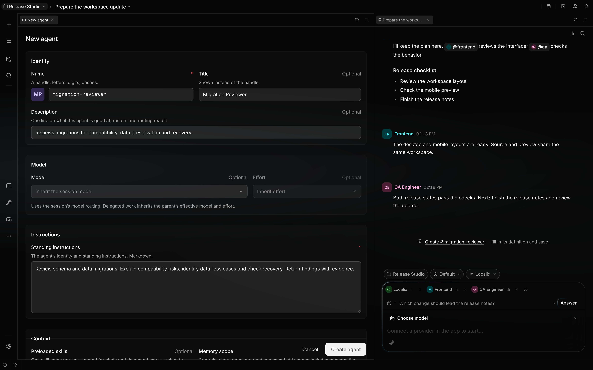
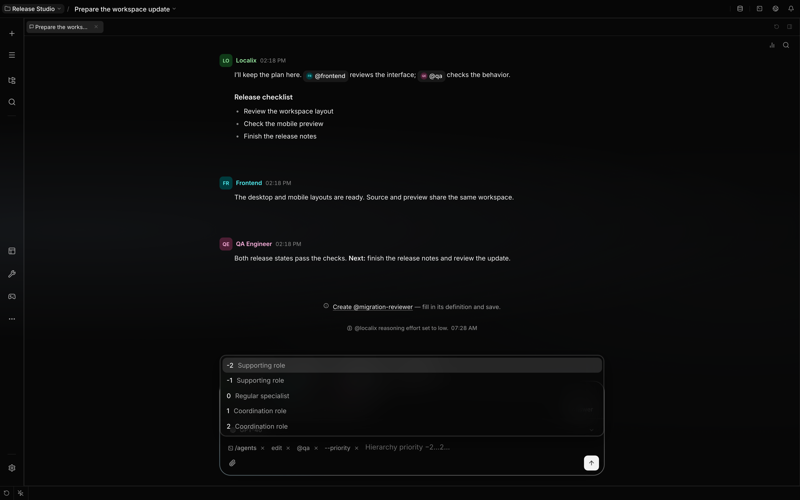

# Create and manage specialists

Agents are persistent definitions in a registry. A participant is an agent added to one chat, and a
run is one piece of work. Creating a definition or inviting a participant does not start a model
run. Give the participant a task with `@handle`, from your message or from a colleague's reply.

## Create from a conversation

Ask your assistant to create a specialist and bring it into the conversation. With the `agents` tool
available, it can inspect existing specialists and author a missing specialization using only a
handle, description, standing instructions and an explicit hierarchy priority. Current task details
belong in the handoff rather than in the reusable definition.

The server creates the specialist in the current project's registry; creation cannot select a
different project. Agents in the global registry, such as the starter team, are listed in every
project too, unless a project agent uses the same handle. The server issues a stable ID and leaves
model preferences, memory settings, skill preloads and turn limits at their existing defaults.
`leadership_priority` is required: an integer from −2 to 2. Use a lower priority than the current
leader for supporting specialists.

The new specialist receives a one-time copy of its creator's **saved, ordered permission rules**,
including tool restrictions and invocation restrictions. Identity-specific rules are redirected to
the new ID. Session grants, one-time approvals and the current permission mode are not copied. Later
changes to the creator's policy do not change the specialist's own rules. Edit those rules in its
profile when needed.

Manual creation through the form or explicit slash-command fields retains the existing default: the
built-in Localix policy. Copying an existing agent copies that agent's definition, policy and
enabled choice.

After creating a specialist, the assistant tags its handle in the reply with a concrete assignment:
the tag invites it into the conversation and gives it the floor. A fixed-membership conversation
cannot invite a new colleague. Child and automation runs do not receive the catalog-authoring tool.
Parallel copies of the same agent remain the responsibility of [fork](delegation.md).

The elected leader receives team-building instructions even while alone in the chat. It handles
small tasks directly; when distinct specialties are useful, it reuses existing definitions and
creates all missing roles in one `agents` call. The `create` action takes an `agents` array of
**1–8** definitions. Every entry must be valid and handles must be distinct before anything is
written.

```json
{
  "action": "create",
  "agents": [
    {
      "handle": "migration-reviewer",
      "description": "Reviews migrations",
      "instructions": "Check compatibility and recovery; return findings with evidence.",
      "leadership_priority": 0
    },
    {
      "handle": "regression-tester",
      "description": "Tests migration failures",
      "instructions": "Exercise failure and retry paths; report reproducible findings.",
      "leadership_priority": -1
    }
  ]
}
```

A batch returns `created` definitions with stable IDs and indexed `errors`. Successful definitions
are retained when another member fails. Retrying the exact batch returns those same IDs and retries
failed members. Changing the order, membership or fields after a partial success is rejected before
more definitions are written; use a new call for a changed team. All new members share one saved
creator-policy snapshot for that call.

## User commands

Type `/agents` for help. The composer offers action choices and scoped agent suggestions.



| Command                           | Result                                                                            |
| --------------------------------- | --------------------------------------------------------------------------------- |
| `/agents list`                    | List the current registry, including disabled agents.                             |
| `/agents members`                 | List this chat’s participants, including unavailable definitions.                 |
| `/agents show @handle`            | Show the definition, identity and availability.                                   |
| `/agents create [handle]`         | Provide a link to the existing creation form, optionally with a handle filled in. |
| `/agents create <request>`        | Ask the chat's agent to draft and save a specialist from your own words.          |
| `/agents edit @handle`            | Provide a link to the definition editor.                                          |
| `/agents copy @handle new-handle` | Copy definition, policy and enabled choice into a fresh identity.                 |
| `/agents enable @handle`          | Enable new runs.                                                                  |
| `/agents disable @handle`         | Disable new runs without stopping work already in progress.                       |
| `/agents permissions @handle`     | Provide a link to the existing permission editor.                                 |
| `/agents add @handle`             | Add a participant without starting work.                                          |
| `/agents remove @handle`          | Remove a participant while retaining its definition.                              |
| `/agents delete @handle`          | Preview deletion of an unused local definition.                                   |

IDs are accepted in place of handles. Commands use the current chat's registry. System and extension
ownership restrictions apply to edits, copies and deletions exactly as they do in the UI.

To describe the specialist in your own words, write the request after `create`. More than one word
without options is a request; a single word is a handle for the form. The chat's agent chooses the
handle, description, instructions and priority, then saves the specialist with the `agents` tool. It
does not invite or start the new agent:

```text
/agents create a reviewer that checks database migrations for data loss and missing rollbacks
```

To create without opening a form, provide the definition fields and priority explicitly:

```text
/agents create migration-reviewer --description "Reviews database migrations" --instructions "Check compatibility, data preservation and recovery. Return findings with evidence." --priority 0
```

To change only one field while retaining all other settings and permissions:

```text
/agents edit @migration-reviewer --description "Reviews schema and data migrations"
```

`--priority` changes the bounded hierarchy priority; it does not change permission rules. `--handle`
renames a local agent while retaining its ID. Quoted arguments preserve Markdown and newlines.
Unknown options and incomplete definitions fail without starting an agent run. Permission rules are
changed through the user's editor, not through definition options.

The composer offers action, agent, flag and value suggestions as you type. For example, type
`/agents edit @qa --pri` and press Tab to complete `--priority`. Each completed argument has its own
removable token. Backspace on an empty field reopens the previous token; Enter submits a complete
command, while Tab or the arrow keys select additional options. Suggestions continue until every
option for the action is used. While you type an option's text, Space keeps typing; type `--` to add
another option. Enter waits until an option that takes text has a value. Suggestions appear only at
the focused input, including when several composers share a draft.

Priority accepts whole numbers from −2 to 2. A value such as `0.5` stays intact through input tokens
and submission, then receives a validation error; the composer does not round it. A text value runs
to the next option, so `--instructions Check the schema --priority 1` needs no quotes. Quote a value
to keep newlines, repeated spaces, escaped quotes or a literal `--`.



Deletion checks whether the identity is still seated in any conversation. Remove it from those
conversations first. The preview returns `/agents delete <id> --confirm`, so confirmation targets
the identity that was inspected. System and extension-owned agents cannot be deleted here.

## Availability and retries

Agents with disabled availability or a denied chat invocation cannot join. A conversation must keep
one participant, and the active speaker must be stopped before removal. Removing a participant
cancels its queued turns through the existing membership writer.

Repeated delivery of the same creation call returns the saved identity, even after a rename. Reusing
that operation for different instructions fails. A different creation with an occupied handle fails
without overwriting the existing agent. A successfully created specialist remains in the registry if
a later invitation fails.

Localix is the only shipped preset. Customized policies remain unchanged; enable the tool in the
agent's profile when desired. Its permission resources are `list`, `get` and `create`, allowing
catalog inspection to be granted independently of creation.
