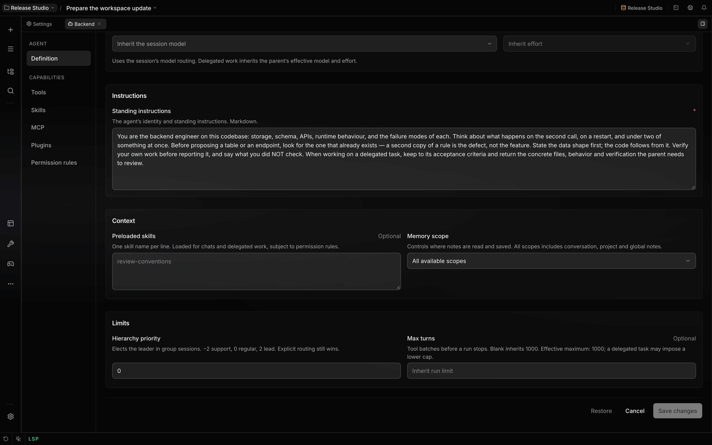

# Agent presets

Open an agent profile to edit its **Definition**, tools, skills, plugins, MCP access and ordered
permission rules. Instructions describe the work; permission rules decide which actions can run.
Each turn resolves the current definition and policy together.

## Shipped roles

| Handle      | Responsibility                                          | Default scope of file changes                 |
| ----------- | ------------------------------------------------------- | --------------------------------------------- |
| `localix`   | Main orchestration, team coordination and final outcome | Authorized workspace work                     |
| `lead`      | Engineering quality, review and integration             | Integration and uncovered implementation work |
| `pm`        | Scope, dependencies, ownership and acceptance criteria  | Documentation                                 |
| `architect` | Boundaries, contracts, trade-offs and migrations        | Documentation and disposable prototypes       |
| `backend`   | Storage, schemas, APIs and runtime behavior             | Backend implementation and its tests          |
| `frontend`  | Components, state, layout and interaction               | Frontend implementation and its tests         |
| `qa`        | Reproductions, missing cases and verification           | Tests, fixtures and documentation             |
| `design`    | Flows, interface states and rendered mockups            | Mockups, prototypes and documentation         |
| `devops`    | Builds, environments, deployment and recovery           | Operational implementation and its tests      |

Localix coordinates complex work with available specialists and handles small tasks directly. Its
shipped hierarchy priority is **2**; Team Lead, PM and Architect use **1**, and the other
specialists use **0**. Explicit routing takes precedence over leader election. Each specialist
returns delegated results and evidence to its parent; Localix owns user decisions and the final
outcome. Customized definitions retain their authored instructions until restored.

The bundled **Code Review** plugin contributes `reviewer` to the same native agent directory. It
inspects a scoped diff and returns findings and a structured verdict. Its default policy allows
`bash`, `read`, `search` and `tool_output`; shell calls with external effects are denied. The
`/review` command delegates an explicit review brief to this registered agent.

## Default tool candidates

The eight specialists share inspection, context and coordination candidates: `ask`,
`context_budget`, `read`, `search`, `tool_output`, `memory`, `history_search`, `skill`, `agents`,
`conversation_control`, `configure`, `plan`, `research` and `mcp_resources`.

| Roles                       | Additional candidates                                           |
| --------------------------- | --------------------------------------------------------------- |
| `pm`, `architect`, `design` | `write`, `edit`, `apply_patch`, `bash`, `browser`, `view_image` |
| `lead`                      | File tools, `bash`, `jobs`, `browser`, `view_image`, `vault`    |
| `backend`, `devops`         | File tools, `bash`, `jobs`, `vault`                             |
| `frontend`, `qa`            | File tools, `bash`, `jobs`, `browser`, `view_image`             |

`localix` has an open candidate policy, so newly installed tools can join its runs. Specialist lists
are closed. A candidate still needs a compatible run shape, host port and model. A child cannot
acquire a tool that requires direct human interaction merely by allowing it in policy.

File tools for PM, architect, QA and design are restricted by artifact classes. Documentation means
Markdown, MDX, reStructuredText or text files. Tests include test/spec files and files under test or
fixture directories. Prototypes live under `mockups/`, `prototypes/`, `design/`, or in a
`mockup.html` file. A patch must satisfy the restriction for every target. PM shell calls must
observe, and PM browser calls may observe or change the view, rather than run page actions with
external or durable host effects.

These rules are application policy. They classify declared actions and paths; they do not isolate
the effects of arbitrary programs executed by a tool. See [Permissions](permissions.md).

## Definitions, copies and updates

Native definitions belong to one exact registry: a project, or sessions without a project. Editing a
shipped definition in a project saves an override for that project and retains its stable agent ID.
A repository file cannot claim this override's authority without an authenticated save. External
edits invalidate the saved override and the shipped definition applies again. Global definition
edits do not replace a project's definition.

Permission rules belong to the agent ID. Shipped identities are stable across registries, so their
permission choices follow them across projects. A duplicated agent receives a fresh identity and
copies its definition, permission constraints, invocation restrictions and enabled choice. A copy of
a disabled agent stays disabled. Local agents can change their handle while retaining their ID;
shipped handles stay fixed. Extension-owned definitions are updated through their extension.

**Restore** fills the definition form with shipped values for review. Saving that restored draft
removes the override in the selected registry and preserves permission choices. The permission rules
tab has a separate reset for the shipped policy.

Definition fields stack in narrow panes and share aligned control tracks when the section is wide
enough for two columns. Restore remains in place while defaults load and after restoring, with its
availability reflected by its disabled state.

On upgrade, untouched shipped policies can advance to new defaults. Explicit enabled choices
survive. Customized ordered policies are retained rather than merged in a way that changes their
exceptions. Legacy policies with no known baseline are preserved. Bundled contribution updates use
the same principle; third-party contributions still require policy review and activation.

## Model, limits and context

In a new chat, the model route resolves from session choices, recent choices for that agent, its
card preference, the project and the primary route. A delegated child snapshots the parent's
effective route and effort, unless the caller explicitly selects a route. Editing a card therefore
does not silently reroute work already delegated. External aliases such as `opus`, `sonnet` or
`haiku` require an explicit catalog model before native import.

**Max turns** can lower a run's limit. Blank inherits the run limit, whose built-in default is 1,000
tool-loop turns; user settings and delegated task caps can lower it. The editor shows the inherited
and effective maximum before task-specific caps.

In the composer, click the turn-limit control to cycle through **1 → 5 → 20 → 100 → ∞ → 1**. The
tooltip shows the next value. **∞** uses the built-in 1,000-turn ceiling; the agent normally stops
when its work is finished.

**Preloaded skills** are applied to this agent in ordinary and delegated turns. Session-pinned
skills are added, duplicates are removed, and denied skills remain unavailable. A team's members do
not inherit one another's skill preload lists. Loading a skill never grants denied tools or silences
outside-workspace and dangerous-command confirmations.

**Memory scope** limits both recall and saved notes to conversation, project or global notes. With
**All available scopes**, recall searches conversation, project and global notes, while default
writes stay in the project or conversation. A selected scope does not fall back to another scope
when unavailable. Changing it refreshes the agent's saved memory context immediately. Unscoped
external memory providers are used only with **All available scopes**.

## Delegated teams

A delegated team shares one child session and a fixed membership. The elected leader receives the
first ordinary task turn. Members publish an actionable handoff and use `conversation_control` to
queue a teammate; mentions alone start no work. They cannot invite or remove members. The team
cannot delegate further and reports to its parent when its queue has finished. Decisions requiring
the user go through the parent. The host's handoff limit also bounds team conversations.

`conversation_control` is a required conversation protocol. Its model exposure and execution agree
even if an old permission list denies it; membership and scheduling are checked by the host.

See [Delegation](delegation.md), [Capabilities](capabilities.md) and
[Permission modes](permission-modes.md) for the execution and policy contracts.
