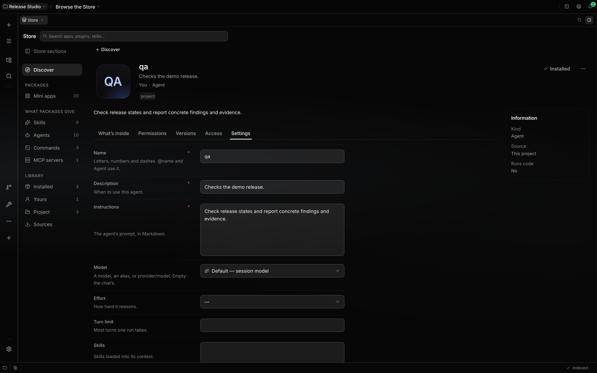

# Agents

An agent is a Claude Code agent file: a Markdown file whose front matter names it and describes it
and whose body is its standing instructions. Localix reads the same folders Claude Code does, so an
agent you write for one works in the other. There is no second agent format and no Agents page in
Settings: agents are Store items, found and edited in the [Store](store.md).

Create specialists from a conversation and manage them with `/agents`; see
[Create and manage specialists](agent-management.md).

## Where agents live

| Kept in                      | Folder                                                        | You can edit it |
| ---------------------------- | ------------------------------------------------------------- | --------------- |
| Yours                        | `~/.claude/agents/` (or the folder `CLAUDE_CONFIG_DIR` names) | Yes             |
| This project                 | `<project>/.claude/agents/`, up to the repository root        | Yes             |
| Managed by your organisation | the managed `.claude/agents/` folder                          | No              |
| From a plugin                | the `agents/` folder of an enabled plugin                     | No              |
| Built in                     | `general-purpose`, `Explore`, `Plan` and `localix`            | No              |

A file needs a `name` and a `description`. As in Claude Code, a name is valid unless it starts with
`-`, contains `:` or is longer than 256 characters; such a file is skipped. Localix identifies an
agent by that name, as written, so `Code Reviewer` and `reviewer.v2` load under those names. A
plugin's agent is `plugin:name`.

`description` is the only text that says when to delegate: an agent has no `when_to_use`. Of the
`skills` list the first 32 distinct names preload.

When two agents share a name, Claude Code's precedence decides which one runs: managed, then the
project (the closest folder wins), then yours, then plugins. A file with the name of a built-in type
replaces it. Folders are watched: an agent you add or edit in an editor appears in the Store within
a moment, and a file you delete leaves every list at once.

Localix keeps in its own database only what a file cannot hold: the agent's **access** rules, a
stable identity that survives a rename, and chat history. The identity is why a renamed or moved
file keeps its place in a conversation and its permission choices. A file that disappears is treated
as missing for a grace period (10 minutes for your own folder, 7 days for a project) before its
rules and conversation links are cleaned up; a disabled plugin or an unreachable project folder is
never a deletion. Deleting an agent in the Store or with `/agents delete` cleans up at once.
Messages it wrote stay, under its last name.

## What your own agent files can set

Some front matter is honoured only in a file you or your organisation own (yours, the project's or a
managed one). A plugin's agent loads without it, as in Claude Code, because a plugin is code you did
not write.

| Field            | Effect while the agent runs as a delegated child                                 |
| ---------------- | -------------------------------------------------------------------------------- |
| `hooks`          | Run only during that child's runs. `Stop` hooks fire as `SubagentStop`.          |
| `mcpServers`     | Servers named by reference, or defined inline, for that child's runs only.       |
| `permissionMode` | `plan` makes the child read-only when the conversation is in Default; see below. |

Project agents' `hooks` and inline `mcpServers` wait until Claude Code trusts the project folder, as
a project's own settings do. A [fork](delegation.md) is its delegator rather than the agent, so it
ignores all of these and keeps the delegator's hooks, servers and mode.

An inline MCP server connects when the child starts and disconnects when its run ends. A name must
refer to a server that is already configured here; the child shares that server's connection, and
the organisation's allow and deny lists apply to both kinds. A `tools` list that does not name a
server's tools still withholds them.

A child runs in its conversation's [permission mode](permission-modes.md). Only a conversation in
Default lets the agent's own `permissionMode` apply, and only `default` and `plan` have a Localix
mode: `acceptEdits`, `auto`, `dontAsk` and `bypassPermissions` change nothing. A conversation in
Plan, Bypass or Autonomous keeps its mode in every child, whatever the file says.

Two more fields apply to every agent, a plugin's included. In `disallowedTools`, an entry removes
the tool, with or without a specifier: `Bash(rm *)` removes `Bash` from the agent. In `tools`,
`Agent(worker, researcher)` is an allowlist: an agent that runs as the main thread can delegate only
to the types it names, and a call with no `agent` counts as `general-purpose`, so it is refused
unless listed. A child cannot delegate at all, so the list has no other use.

## The agent's page

Open **Store → Agents**, or follow an `@name` link in a chat. The page has these tabs:

- **Overview**: description, where the file is, how many chats use it, and the actions that fit:
  Edit, Duplicate, Copy to Yours, Move to a project or to Yours, Delete.
- **Settings**: the definition, written back to the file. Name, description, instructions, model,
  effort, turn limit and preloaded skills are fields; front matter Localix does not edit (`tools`,
  `hooks`, `mcpServers` and unknown keys) is kept as it is. A save that would overwrite a change
  made in an editor in the meantime is refused, and the page asks you to reload.
- **Access**: per-agent switches for tools, skills, MCP servers, plugins and mini apps. A switch is
  a rule for this agent only. Use **Open** on a row to go to that item's own page.

Agents from a plugin or a managed folder are read-only: **Copy to Yours** makes an editable copy
with a fresh identity and no inherited permissions beyond the Localix default.

## Localix, and the built-in types

`localix` is the main loop, not a file. It coordinates the requested outcome and handles
straightforward work directly, and it cannot be deleted or disabled. Every conversation can fall
back to it. To change how it behaves, edit `CLAUDE.md` or an output style, or set `"agent"` in your
Claude Code settings.

`general-purpose` (also `claude`), `Explore`, `Plan`, `statusline-setup` and `claude-code-guide` are
Claude Code's built-in subagent types and behave as in Claude Code. `Explore` and `Plan` answer
once: a message to one is refused. `Loops` is not available to a subagent. See
[Claude Code compatibility](../extending/claude-code-compatibility.md).

You are not an agent. There is no `@human` record: describe yourself and your preferences in
`~/.claude/CLAUDE.md` or the project's `CLAUDE.md`. Agents never address you with an `@` mention; to
get your answer, a decision or an approval they use the `AskUserQuestion` tool ([HITL](hitl.md));
otherwise they report and stop, and the reply returns to you. A task-board mini app may still assign
a card to you.

## Starter agents

The `team` plugin in the `localix` marketplace is Recommended in the Store. It adds `architect`,
`backend`, `frontend`, `design` and `devops` as ordinary plugin agents. Nothing is added to your
folders until you install it, and uninstalling removes them. Use **Copy to Yours** to change one.
Pick one when you start a conversation, or name one as a subagent type.

## Default tool candidates

Localix has an open candidate policy, so newly installed tools can join its runs. A candidate still
needs a compatible run shape, host port and model. A child cannot acquire a tool that requires
direct human interaction merely by allowing it in policy.

An agent-authored specialist receives a copy of its creator's saved permission rules. An agent made
in the Store starts from the Localix default; narrow it on its **Access** tab and in
[Permissions](permissions.md). Definitions and priorities never grant permission.

## Model, limits and context

In a new chat, the model route resolves from the choice you make in the composer, the model and
effort you chose for the agent (its page in the Store), recent choices, the project and the primary
route. A subagent runs on the model and effort you chose for it, else on its parent's route. Editing
an agent therefore does not silently reroute work already delegated.

The choice is kept in your Localix settings, never in the agent's file. The file's own `model` and
`effort`, which Claude Code reads, are not read here and stay as they are. A `localix:` key in an
agent file is not read.

**Turn limit** (`maxTurns`) can lower a run's limit. Blank inherits the run limit, whose built-in
default is 1,000 tool-loop turns; user settings and delegated task caps can lower it.

In the composer, click the turn-limit control to cycle through **1 → 5 → 20 → 100 → ∞ → 1**. The
tooltip shows the next value. **∞** uses the built-in 1,000-turn ceiling; the agent normally stops
when its work is finished.

**Skills** (`skills`, at most 32) are preloaded for this agent in ordinary and delegated turns.
Session-pinned skills are added, duplicates are removed, and denied skills remain unavailable.
Agents do not inherit one another's skill lists. Loading a skill never grants denied tools or
silences outside-workspace and dangerous-command confirmations.

Every agent in a chat shares the repository's [memory](learning-loop.md#memory) folder. Claude
Code's `memory:` key gives an agent run as a subagent a memory folder of its own. See
[stored context](learning-loop.md#recall).

Agents [delegate](delegation.md) self-contained tasks to child sessions, run by themselves or by an
agent file named in the task. An agent file is persistent; it is not a child run.

See [Forks](delegation.md), [Capabilities](capabilities.md) and
[Permission modes](permission-modes.md) for the execution and policy contracts.
