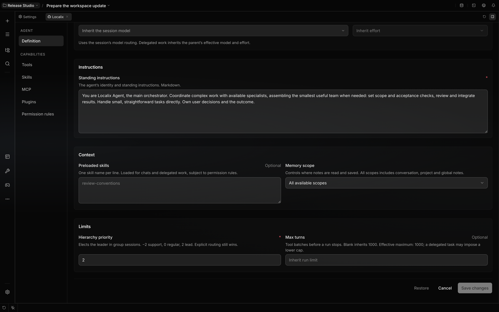

# Agent presets

Open an agent profile to edit its **Definition**, tools, skills, plugins, MCP access and ordered
permission rules. Instructions describe the work; permission rules decide which actions can run.
Each turn resolves the current definition and policy together.

Create specialists from a conversation and manage the registry with `/agents`; see
[Create and manage specialists](agent-management.md).

## Shipped assistant

`localix` is the only shipped agent. It coordinates the requested outcome and handles
straightforward work directly. Its default hierarchy priority is **2**. The elected leader in a chat
owns team assembly regardless of its handle: for work that needs distinct specialties, it reuses
suitable definitions or creates the smallest useful team and invites it into the chat.

`localix` is built in: it cannot be deleted or disabled, and every conversation can fall back to it.

## Starter team

On first start, Localix adds a starter team to your global registry: `pm`, `architect` and `lead`
(priority **1**), and `backend`, `frontend`, `design`, `qa` and `devops` (priority **0**). They are
ordinary agents, created exactly like one from `/agents create`, with the same default permission
rules. Edit or delete any of them; a deleted role is not added again, and a handle you already use
keeps your definition. Tag one in a conversation to bring it in.

Specialists have explicit priorities from **−2** to **2**. Higher priority elects the leader; equal
priorities retain participant order. Explicit user routing and existing work ownership still take
precedence. Supporting specialists should have a lower priority than the coordinator.

The bundled **Code Review** plugin adds the `/review` command, not an agent: the speaking agent
forks itself with the review procedure as the fork's task, and the fork returns findings and a
structured verdict.

## Default tool candidates

Localix has an open candidate policy, so newly installed tools can join its runs. A candidate still
needs a compatible run shape, host port and model. A child cannot acquire a tool that requires
direct human interaction merely by allowing it in policy.

An agent-authored specialist receives a copy of its creator's saved permission rules. Manual
creation starts from the Localix default; the user can narrow an agent's ordered rules in its
profile. Definitions and priorities never grant permission. See [Permissions](permissions.md).

## Definitions, copies and updates

Native definitions belong to one registry: a project, or the installation. Every project also lists
the installation's agents, including the starter team; a project agent with the same handle takes
its place there. Editing an installation agent from a project still edits the installation's
definition. Editing a shipped definition in a project saves an override for that project and retains
its stable agent ID. A repository file cannot claim this override's authority without an
authenticated save. External edits invalidate the saved override and the shipped definition applies
again. Global definition edits do not replace a project's definition.

Permission rules belong to the agent ID. Shipped identities are stable across registries, so their
permission choices follow them across projects. A duplicated agent receives a fresh identity and
copies its definition, permission constraints, invocation restrictions and enabled choice. A copy of
a disabled agent stays disabled. Local agents can change their handle while retaining their ID;
shipped handles stay fixed. Extension-owned definitions are updated through their extension.

**Restore** fills the definition form with shipped values for review. Saving that restored draft
removes the override in the selected registry and preserves permission choices. The permission rules
tab has a separate reset for the shipped policy.

Definition fields stack in narrow panes and share aligned control tracks when the section is wide
enough for two columns. Restore remains in place while defaults load and after restoring, with its
availability reflected by its disabled state.

On upgrade, untouched shipped policies can advance to new defaults. Explicit enabled choices
survive. Customized ordered policies are retained rather than merged in a way that changes their
exceptions. Legacy policies with no known baseline are preserved. Bundled contribution updates use
the same principle; third-party contributions still require policy review and activation.

## Model, limits and context

In a new chat, the model route resolves from session choices, recent choices for that agent, its
card preference, the project and the primary route. A delegated child snapshots the parent's
effective route and effort, unless the caller explicitly selects a route. Editing a card therefore
does not silently reroute work already delegated. External aliases such as `opus`, `sonnet` or
`haiku` require an explicit catalog model before native import.

**Max turns** can lower a run's limit. Blank inherits the run limit, whose built-in default is 1,000
tool-loop turns; user settings and delegated task caps can lower it. The editor shows the inherited
and effective maximum before task-specific caps.

In the composer, click the turn-limit control to cycle through **1 → 5 → 20 → 100 → ∞ → 1**. The
tooltip shows the next value. **∞** uses the built-in 1,000-turn ceiling; the agent normally stops
when its work is finished.

**Preloaded skills** are applied to this agent in ordinary and delegated turns. Session-pinned
skills are added, duplicates are removed, and denied skills remain unavailable. A team's members do
not inherit one another's skill preload lists. Loading a skill never grants denied tools or silences
outside-workspace and dangerous-command confirmations.

**Memory scope** limits both recall and saved notes to conversation, project or global notes. With
**All available scopes**, recall searches conversation, project and global notes, while default
writes stay in the project or conversation. A selected scope does not fall back to another scope
when unavailable. Changing it refreshes the agent's saved memory context on the next run. Unscoped
external memory-provider prompt recall is used only with **All available scopes**. This selection
does not disable an enabled provider’s completion hook, which can still receive the finished turn.
See [stored context](learning-loop.md#recall-and-courses).

## Older conversations

The former shipped specialist roles are no longer preset definitions. Saved conversation history,
user-created agents and permission decisions are retained. A participant whose definition is no
longer available remains visible in `/agents members`; in an open roster, add `localix` with
`/agents add localix` before removing unavailable participants. A fixed historical roster remains
readable and cannot invite replacement agents; continue its work in a new chat.

Agents [fork themselves](delegation.md) for parallel copies, or invite authored colleagues into the
conversation. A specialist definition is persistent; it is not a child run.

Handing the floor between participants needs no tool: the host routes each reply by its `@handle`
addresses (see [Conversations](conversations.md)). Two protocol tools stay available even if an old
permission list denies them: `set_topic` for the leader or sole agent, and `skip_answer`, a
participant's pass when it is named but asked nothing.

See [Forks](delegation.md), [Capabilities](capabilities.md) and
[Permission modes](permission-modes.md) for the execution and policy contracts.
