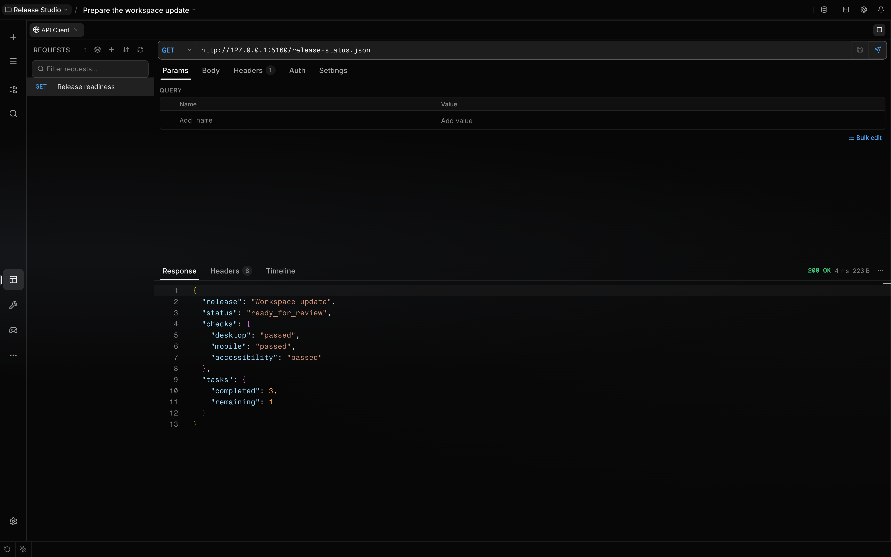

# Use the API workbench

The bundled API plugin adds a REST client for saved HTTP requests, response inspection, imports,
repository exports, and bounded agent access. Use it when an API workflow should stay visible and
addressable inside the Localix workspace.

**Availability:** The bundled `api` plugin is enabled by default and can be disabled in **Settings →
Capabilities → Plugins**. Requests to private or local hosts require the plugin’s **Allow
private/internal hosts** option; enable it only for services you intend to call.

## What you can do

| Capability             | Mechanism                                                                  | Boundary                                                                   |
| ---------------------- | -------------------------------------------------------------------------- | -------------------------------------------------------------------------- |
| Build saved requests   | Create named requests with method, URL, headers, authentication, and body  | Request metadata and literal environment values are stored in plaintext    |
| Send and inspect       | Resolve the active environment, send the request, and inspect the response | Response bodies are bounded and each request uses the configured timeout   |
| Import API collections | Preview cURL, OpenAPI, Postman, Insomnia, HAR, or Localix request files    | Compatibility is a supported subset; unsupported values remain visible     |
| Export to a repository | Write reviewable JSON request files under `.localix/rest/`                 | Literal credentials block export; the export is a snapshot, not sync       |
| Attach API context     | Search, mention, or attach a saved request as a plugin-owned resource      | Context keeps supported secret references instead of exposing vault values |
| Use agent tools        | Manage requests and environments through the registered plugin tools       | Tool availability depends on plugin state, mode, and effective permissions |

## How it works

The workbench keeps a request tree, editable request tabs, response inspection, and saved-request
history in the workspace. The same saved requests are exposed through plugin search and resource
providers so a session can return to the owning workbench surface.

Before sending, the backend resolves supported environment placeholders and `${secret:KEY}` values.
Secret references are read from the Localix vault only for the operation that needs them. List,
search, export, and context surfaces retain the reference rather than returning the stored value.

Imported literal credentials move into the vault only when the host supplies its create-only secret
writer. Without that safe path, the import is refused. Request environments remain plaintext and are
intended for non-secret values such as hosts, API versions, and tenant identifiers.

### Import support

| Format                | Current boundary                                                              |
| --------------------- | ----------------------------------------------------------------------------- |
| cURL                  | Parses supported request, auth, body, header, and redirect flags              |
| OpenAPI 3 / Swagger 2 | Converts documented operations and reports unsupported authentication         |
| Postman v2            | Imports collections and inherited request authentication                      |
| Postman environment   | Imports variables without activating the saved environment                    |
| Insomnia v2–v4        | Imports JSON or YAML groups, inherited authentication, headers, and variables |
| HAR 1.2               | Imports recorded HTTP requests                                                |
| Localix request files | Reimports the files created by repository export                              |

Unknown dynamic variables remain visible and are reported instead of being replaced with empty text.
Preview an import before saving it.

## Network and credential boundary

- Private, loopback, and link-local destinations are denied by default.
- `ALLOW_PRIVATE_NETWORK=true` is required for an intentional local or private-network target.
- Every redirect destination is checked again, and authorization is stripped across origins.
- Redirect cookies live only for the current send; the plugin has no persistent cookie jar.
- The enabled plugin is trusted backend code and can make outbound requests.
- Localix permissions are an application gate, not an operating-system sandbox.

## Configuration

| Setting                 | Default     | Effect and boundary                                      |
| ----------------------- | ----------- | -------------------------------------------------------- |
| `TIMEOUT_MS`            | `30000`     | Aborts one request after the configured milliseconds     |
| `MAX_BODY_BYTES`        | `1000000`   | Caps response bytes retained by one send                 |
| `ALLOW_PRIVATE_NETWORK` | `false`     | Allows loopback, private, and link-local targets when on |
| Credential storage      | Vault field | Use supported authentication fields or `secret:` values  |

## Limits

- GraphQL has no dedicated editor; send a normal JSON HTTP request instead.
- Import support is narrower than each source application's complete data model.
- Saved request metadata and environment values are not encrypted by the plugin.
- Repository export does not synchronize later workbench changes.
- A bounded response can omit bytes that were available from the remote server.

## Related guides

- [Vault and secrets](secrets.md)
- [Workspace and resource links](workspace.md)
- [Plugins](../extending/plugins.md)

## Source of truth

- [Plugin manifest](https://github.com/rsaryev/localix/blob/main/plugins/api/plugin.json)
- [Tool schema](https://github.com/rsaryev/localix/blob/main/plugins/api/backend/api-tool-schema.ts)
- [Request routes](https://github.com/rsaryev/localix/blob/main/plugins/api/backend/routes.ts)
- [Request sender and network policy](https://github.com/rsaryev/localix/blob/main/plugins/api/backend/send.ts)
- [Import chain](https://github.com/rsaryev/localix/blob/main/plugins/api/backend/import/registry.ts)
- [Repository export](https://github.com/rsaryev/localix/blob/main/plugins/api/backend/git-sync/action.ts)
- [Workspace registration](https://github.com/rsaryev/localix/blob/main/plugins/api/ui/register.tsx)
