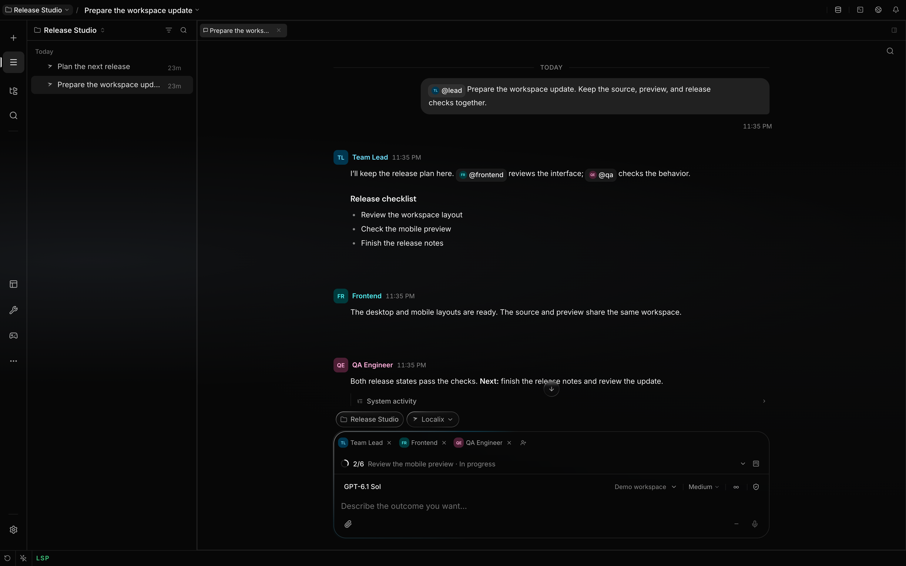

# Conversations with several agents

A conversation is one session with one shared public transcript. Its behavior follows its active
participants: one agent uses direct conversation behavior, while two or more agents use the
multi-participant strategy. Adding or removing an agent does not create another session or rewrite
its history.



## Addressing

In a message you send, `@handle` asks that agent to respond and `@all` asks every active agent.
Without an address, the conversation strategy selects one agent deterministically from the public
history. The highest-priority participant receives the first unaddressed turn and leads the
conversation. The priority is read from each agent's own settings at that moment, so changing it
applies to existing conversations at once; equal priorities keep the participants' order. When work
belongs to another participant or clearly matches that participant's role, the leader passes the
next turn through `conversation_control`; the user does not need to mention the specialist.
Repeating the same handle does not create duplicate turns.

An agent's public `@handle` is not a new scheduling command. Agents can quote a colleague, publish a
score table, or list the participants without accidentally starting another round. A recognized bare
handle is displayed as an agent chip too. Either reference may slightly promote that colleague only
when the colleague already has a positive-weight pending turn.

## Passing work between agents

In a conversation with two or more agents, every agent finishes its turn with exactly one successful
`conversation_control` call. It applies membership changes first and then schedules the requested
participants.

- `next: ["qa"]` adds QA to the pending queue.
- `invite: ["qa"], next: ["qa"]` adds QA to the conversation and immediately schedules it.
- `invite: ["qa"], next: []` only adds QA; it does not start QA's work.
- `remove: ["backend"], next: []` removes Backend and adds no turn.
- Handles work with or without `@`; immutable agent IDs work too.

Public text and queue control are independent. The transcript stores public text once, while tool
calls, tool results, reasoning and private notes remain in the author's own agent lane.

The user-visible transcript retains public text, plans and tool activity when a turn finishes, even
without a final text reply. Successful conversation-control calls are hidden individually; they do
not hide other actions in the same message. Failed or interrupted control calls remain visible. Only
turns with no text, plan or other tool activity can be hidden as silent acknowledgements.

Creating or assigning tasks and inviting participants are not execution. When the user asks for
work, the agent is instructed to act, explicitly hand off with the necessary public context, or
explain a concrete blocker. With `next: []` and no already queued or running work, the conversation
is idle; no timer automatically starts the backlog. The scheduler follows explicit requests rather
than inferring work from task titles, assignments or elapsed time.

A solo agent is told only what its inviting turn needs: publish the assignment, then name the
colleague in both `invite` and `next`. The full turn protocol applies from the first turn that
starts with two or more agents, the same membership snapshot that decides whether the call is
required. The protocol sits in the cached part of the system prompt and the participant roster in
the per-turn tail, so an invite does not rewrite the cached prefix. When to do the work yourself,
delegate a board card or invite a colleague is one `# Collaboration` rule.

For dependent work, the leader records the dependency on the board and schedules only the next
participant whose task is actionable. Results move through the chain one owner at a time. Status
broadcasts to the whole roster create redundant turns and are explicitly discouraged.

The `# Collaboration` rule follows the conversation. Alone, an agent does the work itself and
invites a suitable colleague when another role is needed. [Delegation](delegation.md) is off by
default in agent presets and can be enabled through the agent’s tool capabilities for root chats.
Once colleagues are present, every participant — not only the leader — does its own part and hands a
colleague's ready card to them with `conversation_control`, so the work happens where you can see
and redirect it. When enabled, delegation automatically invites its assignees into the parent chat
and executes their tasks in child sessions. Invitation alone does not schedule a duplicate turn
here.

The leader coordinates and does not do a colleague's part. Work that depends on a decision you have
not made yet, such as approving a mockup, waits for it. Whoever scheduled or delegated a piece of
work receives its report and ends with the outcome or the decision it needs from you.

Your change requests and any checks a report left unverified go back to the owner or QA. When you
ask for the team in a one-agent conversation, the agent routes the parts to roles instead of
finishing the work alone. For a new screen, flow or visible redesign the designer's first
deliverable is a rendered mockup opened in the visible preview, and implementation starts after you
approve it; a small change to an existing screen goes straight to the engineer.

`conversation_control` is also available in a one-agent conversation to change the topic or invite a
specialist. [Fixed participants](#fixing-the-participants) prevent invitations. In a multi-agent
conversation the runtime requires one successful call before the turn can finish and gives the model
a bounded repair opportunity if it omitted the call. Because it is the terminal protocol for a chat
turn, per-agent capability rules cannot disable it.

## The shared queue

All execution requests use the same durable queue infrastructure. User messages, agent requests,
jobs, timers and sub-agent results provide a typed source and an execution address; the producer
does not choose a numeric priority.

The queue runs work in bands, lowest first:

| Band                       | What                                                     |
| -------------------------- | -------------------------------------------------------- |
| Answers owed to the person | The addressed, default and `@all` turns of their message |
| The person's next message  | A message sent while the session was busy                |
| A colleague chain          | One participant handing the floor to another             |
| Machine wakes              | Loops, background jobs, reports, hooks                   |

A message you send during a long handoff chain therefore runs before the rest of the chain. Waiting
turns gain priority each time another agent is dispatched, but only inside their band: a chain never
ages past your next message. The queue merges duplicate pending turns for the same agent; the
stronger request's settings win and the reply lands after the newest message it answers. Each
explicit `@handle` in agent text adds a `0.10` promotion to an eligible pending answer; each
recognized bare handle adds `0.05`. References never create a ticket.

A chain of handoffs is bounded: after twelve handoffs in a row without a message from you, nobody
else is queued and a notice says the conversation is back with you.

Execution is serial inside one session and may run concurrently across different sessions. Empty
queues park their session dispatcher. They do not complete, archive or otherwise close the session.
Pending rows and their ordering survive process restart.

Only a visible user message may steer an already running response, and only when it is addressed to
the agent that is running: it names nobody, names that agent, or names `@all`. "@qa stop" typed
while @backend works waits for its own turn with @qa. Machine-generated wakes such as sub-agent
reports, webhooks and loops remain in the durable queue and receive a separate turn. This prevents a
late asynchronous tool update from overwriting a response row that was split for another run.

A slash command sent while the session is busy waits in the queue as a whole command — with its
badge, model and tool grants — and runs as its own turn.

## What each agent sees

Every agent reads the public messages with immutable author attribution. Each agent also receives
its own reasoning, tool activity, addressed runtime events and its own checkpointed view. It does
not receive another agent's reasoning, tool calls, tool results or private notes.

`tool_output` also enforces authorship for exact recovery and search. New results carry their
participant identity before message persistence; older results require an attributed stored message.
Outputs with no provable author are unavailable to participants.

Files in the shared workspace remain visible to every process that can access that workspace. Lane
isolation is context isolation, not a filesystem security boundary.

### Session objective and previous topic summary

Each session stores two shared fields alongside its title: `goal`, the current objective, and
`previousTopicSummary`, the important context carried forward from earlier topics. Both are included
in every participant's system prompt when a run starts, including conversations with one agent. They
belong to the session and remain available when history is checkpointed or the app restarts.

The first user message supplies a fallback objective. When automatic title generation is configured,
the same model call generates the title and objective together. A late response cannot replace a
topic that has already changed.

The conversation leader, or the sole participant, changes the topic through `conversation_control`:

```json
{
  "next": [],
  "topic": {
    "title": "Parser release",
    "goal": "Deploy the verified parser changes.",
    "previousTopicSummary": "Parser changes are complete and focused tests passed. Keep Bun. Deployment is still pending."
  }
}
```

All three values are required and saved together. The summary carries forward decisions, user
constraints, verified results, useful references and unfinished work, including anything still
relevant in the inherited summary. Goals are limited to 2,000 characters and summaries to 8,000.
Changing the topic ends the current turn; `next` can select the participant who continues. With a
topic change, the leader or sole agent can put its own handle in `next` to continue the new
objective in a fresh run with the updated system prompt. Ordinary handoffs cannot schedule their own
author.

The tool call and result remain in the author's private lane. Other participants receive the shared
fields through the session, without access to that lane's reasoning or raw tool output. A topic
change does not delete the transcript or reset a participant's checkpoint.

## Changing participants

The composer can add participants to any existing chat; there is no separate group-creation flow.
For a run that can invite a participant or delegate to an agent, the runtime context includes the
complete scope-aware agent directory as a compact table with IDs, leadership priorities and
`participant` / `available` state. An agent can invite or remove participants through
`conversation_control`. Adding a second agent changes the strategy of the existing session; removing
agents until one remains restores direct conversation behavior. The session ID, title and transcript
stay the same. The application imposes no numeric group-size ceiling.

Assigning a [Kanban](task-board.md) card to an agent records an owner and nothing else: it does not
add that agent to the conversation, start work or enqueue a turn. To bring the owner in, invite it
with `conversation_control` or the composer; the passive board and the conversation scheduler stay
separate layers.

### Fixing the participants

The lock button next to the add-participant button decides whether the list can change. It is open
by default. Click it to fix the participants and every change stops: the composer shows no add or
remove controls, and the membership writer refuses an agent's `invite` or `remove`. The participants
who are not answering are shown in grey.

You can change the setting only before the conversation starts, which means before the first message
that you or an agent writes. Lines the product writes itself, such as "@qa joined", do not count, so
you can still arrange the participants first. After that an open conversation shows no lock, and a
fixed one keeps a closed lock that can no longer be clicked, and a fork inherits the setting from
its source. The agents are told about it too. A fixed conversation with a single agent still gets
`conversation_control` to change its topic. A fixed group also schedules its participants, while the
tool schema excludes invitations and removals.

## Interruptions

A new user message drops pending colleague handoffs before the strategy addresses it; turns still
answering your earlier message stay. Editing a message or regenerating a reply drops every pending
turn, because those answer messages that are no longer on the branch. Stop cancels the active run
and its pending conversation turns. Cards on the chat's board keep their status; nothing on the
board was running.

## Source of truth

- [Conversation strategies](https://github.com/rsaryev/localix/blob/main/apps/api/src/features/chat/runtime/conversation-strategy.ts)
- [Durable execution queue](https://github.com/rsaryev/localix/blob/main/apps/api/src/features/chat/runtime/wake-queue.ts)
- [Queue priority policy](https://github.com/rsaryev/localix/blob/main/apps/api/src/features/chat/runtime/queue-policy.ts)
- [Agent turn tickets](https://github.com/rsaryev/localix/blob/main/apps/api/src/features/chat/runtime/agent-turn-ticket.ts)
- [Conversation control](https://github.com/rsaryev/localix/blob/main/apps/api/src/features/agent-core/tools/conversation-control.ts)
- [Fixed participants](https://github.com/rsaryev/localix/blob/main/apps/api/src/features/chat/roster-lock.ts)
- [Per-agent history projection](https://github.com/rsaryev/localix/blob/main/apps/api/src/features/chat/runtime/history/stages/participant-view.ts)
