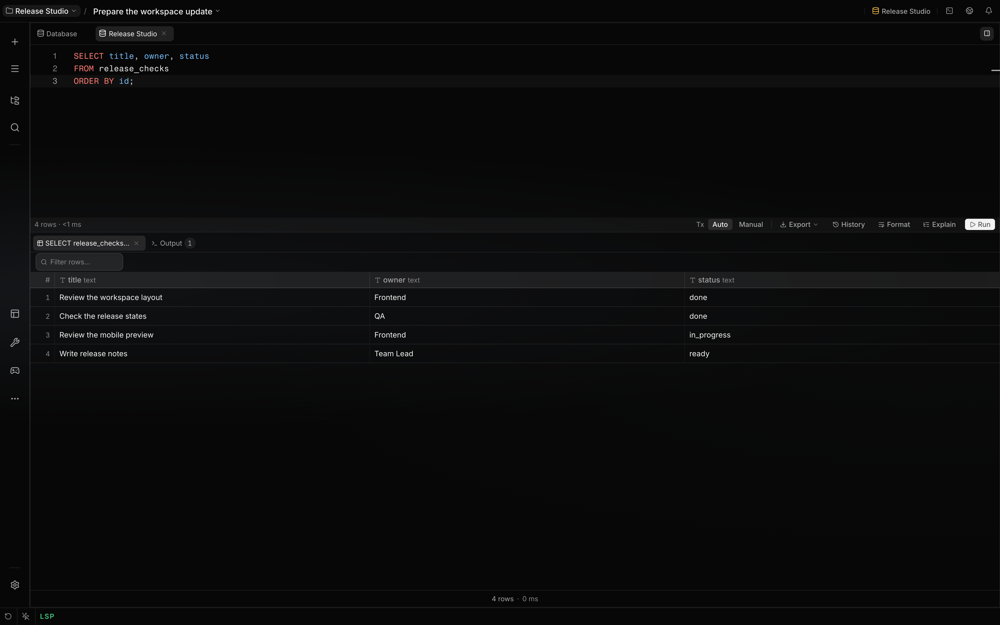

# Use Database Workspace

Database Workspace connects Localix to saved SQL and non-SQL data sources through a shared driver
catalog. Use it to inspect schema and data, run engine-native queries, and give a session bounded
database access.

The bundled `database` plugin is enabled by default. Live operations require an established
connection, and each driver decides which actions are available.

## What you can do

| Surface            | Mechanism                                                                             | Boundary                                                                  |
| ------------------ | ------------------------------------------------------------------------------------- | ------------------------------------------------------------------------- |
| Connections        | Save, test, edit, rename, color, disconnect, remove, or reconnect a data source       | Saved entries persist per user; live drivers exist only in process memory |
| Explorer           | Browse schemas, tables, views, columns, keys, indexes, collections, and keyspaces     | The tree shows only metadata returned by the selected driver              |
| Explorer filter    | Filter by table name; turn on column matching to also search column names             | Column matching reads at most 500 tables' columns                         |
| Query consoles     | Run SQL, Redis commands, MongoDB collection calls, or Elasticsearch Query DSL         | Parameters, transactions, explain, and cancellation vary by driver        |
| Live SQL checks    | See unknown names and engine compile errors before you run, counted in the run bar    | SQL engines only; a name is judged only once its schema has loaded        |
| Chat context       | The draft, the result on screen, recent output and errors reach the chat on their own | Bounded: 200 result rows, the last 12 output entries, one page of a table |
| Data browser       | Open bounded pages and edit rows from primary-key metadata                            | Row editing requires driver support and a connection not marked read-only |
| Structure views    | Create tables, alter supported columns, or render relationship diagrams               | Schema editing and relationships are driver capabilities                  |
| File associations  | Open SQLite files and use the database-aware editor for `.sql` files                  | A `.sql` file needs a live compatible connection before it can run        |
| Session references | Attach a `localix://resource/db` connection, schema, table, or object to the session  | A reference adds bounded metadata; it never includes stored credentials   |

## How it works

Saved connection configurations and live drivers have separate lifecycles. Connecting validates the
target before saving it; disconnecting closes the driver but keeps the saved entry; reconnecting
opens that entry on demand. Startup does not reconnect saved entries automatically.

A restart or a plugin reload drops every live driver. A saved connection stays saved, but the
workbench can still show it as connected. When a query, a table page, a grid commit or a structure
change then finds the connection gone, the workbench reconnects once and repeats the request. The
server refused the first request before running anything, so the statement runs only once. If a
manual transaction was open, it ended with the old driver. In that case the workbench reconnects but
does not repeat the statement outside the transaction. It reports the transaction as lost instead.

The driver catalog owns engine identity, URL schemes, query language, and capability flags. The UI
uses those flags to expose transactions, explain, cancellation, row editing, relationships, and
schema editing only where the adapter implements them.

Network engines use the client libraries packaged with the plugin. SQLite uses Bun's in-process
driver, and SSH tunnels use the bundled `ssh2` client. No database CLI is required.

Database credentials can be stored as `${secret:KEY}` references. The backend resolves those
references only while opening a driver or SSH tunnel; [Secrets](secrets.md) owns storage and trust
boundaries.

### Live SQL checks

The SQL console and `.sql` files check each statement against the connected schema as you type. The
editor underlines three kinds of problem. Each has a "Did you mean …" when a close spelling exists:

| Finding                             | Severity | Judged when                                                                              |
| ----------------------------------- | -------- | ---------------------------------------------------------------------------------------- |
| A table or view that does not exist | Error    | The schema tree has loaded. Names in an unlisted schema or a system catalog are skipped. |
| `alias.column` not on its table     | Error    | That table's columns have loaded. The editor requests them when a query names the table. |
| A bare column no table has          | Warning  | Every table in the statement is known and loaded, and there is no subquery or CTE.       |

When a statement fails, the editor also underlines what the database's own error names. That can be
a missing table or column, the token a syntax error stopped at, or an unbound alias. The engine
message is shown on hover. The engine's words locate the error, not its character offset, because
the text a driver sends differs from the editor's (placeholders are rewritten). This covers failures
the live checks cannot predict. The underline clears as soon as the failed statement is edited.

The name checks use a conservative browser-side heuristic, not a full SQL parser. Recognized
strings, comments, CTE names, table functions, and names the buffer creates are skipped. DDL
statements are skipped by these name checks. The findings have their own marker owner, so they sit
beside a language server's findings for the same file and do not replace them. The name checks run
in the browser against the cached schema and send nothing to the database.

After a 700 ms pause in typing, the editor requests the [engine check](#engine-checks), which can
catch a misspelled keyword such as `SELEC * FROM users`. A reported position marks the word there;
without a position, the first line of the failing statement is underlined. Newer text supersedes
older answers. Name and engine checks are skipped for buffers over 200,000 characters.

The run bar counts what all three sources found and shows the first reason, for example "2 problems
— line 3: Table "userz" does not exist." Selecting it moves the cursor to that problem.

Table names are links only while ⌘ (Ctrl outside macOS) is held: hovering a known table with the
modifier underlines it, and a click opens it. Without the modifier, an underline in the editor
always means a problem.

### Chat context

A console, a `.sql` file and a table tab give the chat what is on screen, with no drag:

| Tab           | What the chat receives                                                                                             |
| ------------- | ------------------------------------------------------------------------------------------------------------------ |
| Query console | The unsent draft, the open result with the query that produced it, and the last 12 Output entries, errors included |
| `.sql` file   | The file (or its selection or unsaved buffer), plus the open result and the Output entries                         |
| Table         | The visible page of rows, with the page number and filter, or the error the read raised                            |

A result carries at most 200 rows. Each item is also limited to 40,000 characters.

### Scripts

⌘/Ctrl+Enter and **Run** execute the statement under the cursor, or the selection. When the editor
holds more than one statement, **Run all (N)** runs every statement in order.

A query text with more than one top-level statement runs statement by statement. This applies to the
console, `.sql` files and the agent's `query` action. A `;` ends a statement only outside strings,
comments, parentheses and compound bodies, so a SQLite trigger, a MySQL routine or a PostgreSQL
`BEGIN ATOMIC` body is sent whole.

| Behaviour  | What happens                                                                                |
| ---------- | ------------------------------------------------------------------------------------------- |
| Session    | All statements run on one session: the open manual transaction, or one pinned session       |
| Failure    | The run stops at the first failing statement; the error names it and how many ran           |
| Result     | The last statement that returned rows, else the summed affected-row count                   |
| Parameters | Refused for scripts the service splits; native SQL Server batches use the driver’s handling |
| SQL Server | The batch is sent whole, because `DECLARE` and temp tables are scoped to one batch          |

The service does not wrap a script in an implicit transaction. Outside a manual transaction, do not
assume a later failure undoes earlier statements.

### Engine checks

The backend’s validation endpoint (`POST /:id/validate`) uses the engine’s prepare, parse, or
explain mechanism for diagnostics. It can catch errors the cached-schema checks cannot. Semantic
errors after an earlier statement that might change names are treated as unverified; this can also
suppress an unrelated missing-name error. A skipped check is not evidence that the SQL is valid.

SQLite is an exception to a general "no effects" promise: some PRAGMA settings apply during
preparation. The current validator prepares and finalizes on the live SQLite connection, so
validating `PRAGMA query_only = ON` can change that connection’s setting before you press Run. Do
not treat validation as a dry run for arbitrary PRAGMA text. See the
[SQLite PRAGMA contract](https://www.sqlite.org/pragma.html).

| Engine     | Mechanism                               | Finds                                                                |
| ---------- | --------------------------------------- | -------------------------------------------------------------------- |
| SQLite     | Prepare, then finalize                  | Syntax errors and unknown tables, columns and functions              |
| PostgreSQL | Protocol Parse on a separate connection | Syntax errors in any statement; unknown names in DML                 |
| MySQL      | Server-side prepare, then drop          | Syntax errors and unknown names in preparable statements             |
| SQL Server | `sys.dm_exec_describe_first_result_set` | Syntax errors in the batch; unknown names up to its first result set |
| ClickHouse | `EXPLAIN AST`                           | Syntax errors only                                                   |

SQLite skips a check while its connection lease is held by another operation or a manual
transaction. Network checks use separate connections or requests, but can still wait for pool
capacity or schema locks. A slow or unavailable check is reported as skipped. Redis, MongoDB, and
Elasticsearch have no validation check.

The service allows up to 50 compile units, with a five-second budget checked between units; a native
SQL Server batch is one unit. Network validators bound their wait for each unit to three seconds.
These are not a hard five-second deadline for the whole response or a guarantee that server-side
work stopped. SQLite preparation is synchronous and has no such timer race. SQL Server skips
standalone DDL and other batches its describe mechanism cannot handle.

### Agent access

The agent has one `database_client` tool. Its `action` picks the operation:

| Action                    | Primary behavior                                                        | Permission                                        |
| ------------------------- | ----------------------------------------------------------------------- | ------------------------------------------------- |
| `connections`             | List saved connections, connected or not, with their ids                | Read                                              |
| `schema`                  | Inspect bounded schema metadata of a connection, or one table in detail | Read; omits connection URLs and credentials       |
| `browse`                  | Sample 1–50 rows of a table, collection, index, or key                  | Read; SQL identifiers are quoted server-side      |
| `query`                   | Run the engine's query language and render up to 50 result rows         | Read when provably read-only, else external write |
| `test`                    | Check a connection config; nothing is saved                             | Read                                              |
| `connect`                 | Add a connection from a URL, a file, or host fields, and open it        | Host write (the saved-connection list)            |
| `reconnect`, `disconnect` | Reopen or close a saved connection by id                                | Host write                                        |
| `remove`                  | Forget a saved connection by id                                         | Host write, irreversible                          |

Every write `query` is classed as an external, irreversible effect: before the engine is known, an
`INSERT` and a `DROP TABLE` cannot be told apart, so the permission check assumes the worse one. A
rule that matches `irreversible` therefore catches every write query.

The permission check runs before the connection is resolved, so it does not know the engine. A
`query` counts as a read when it is a proven read in some engine's own language and not a write in
another's: a SQL read that calls only known side-effect-free built-ins (`count`, `lower`,
`date_trunc`, …), or a Redis, MongoDB or Elasticsearch read. A SELECT that calls any other function
— `nextval`, `pg_terminate_backend`, a function of your own — counts as a write, because a function
can write. `connect` and `test` with a SQLite file declare that path, so path rules apply to it.

`test` is classified as read and does not save a connection entry. It still opens the target: a
writable SQLite test can create a missing database file. Its declared path lets path rules apply;
read classification does not make the probe free of filesystem effects.

A write waits for confirmation when the agent’s matching permission rule says `ask`. `connect` goes
through the same validation as the connection form: the target is probed before it is saved,
re-adding a saved target reopens that entry, and a password may be a `${secret:KEY}` vault
reference. Connection summaries list the display name, engine and id while omitting configuration
fields. Error replies can include the underlying error text; that omission is not a general
redaction guarantee. `query` uses the same timeout and read-only checks as the query consoles.

The agent's changes show up in the Database workbench without a reload. After a successful write,
the tool tells the workbench what changed, and the workbench re-reads only that:

| The agent's call                               | What the workbench re-reads                        |
| ---------------------------------------------- | -------------------------------------------------- |
| `connect`, `reconnect`, `disconnect`, `remove` | The connection list                                |
| A DDL `query` (`CREATE`, `ALTER`, `DROP`, …)   | That connection's schema tree and open table pages |
| Another writing `query`                        | That connection's open table pages                 |

Reads and failed tool calls publish no change event. A failed write may still have applied changes
in the database, especially statements before a script failure. A schema or page that is not on
screen is re-read when next shown. The console’s own writes refresh open table pages the same way.
The connection list receives pushed store changes; when that live channel is unavailable, visible
surfaces poll every 60 seconds. Showing a surface again refreshes a list older than 30 seconds.

## Configuration

### Connections

| Engine               | Target form                 | Accepted URL schemes                                     | Transport options                             |
| -------------------- | --------------------------- | -------------------------------------------------------- | --------------------------------------------- |
| SQLite               | File path or `:memory:`     | File picker in the workbench                             | Local file                                    |
| PostgreSQL           | Host fields or imported URL | `postgres://`, `postgresql://`                           | TLS and SSH                                   |
| MySQL                | Host fields or imported URL | `mysql://`                                               | TLS and SSH                                   |
| Microsoft SQL Server | Host fields or imported URL | `mssql://`, `sqlserver://`                               | TLS and SSH                                   |
| ClickHouse           | Host fields or imported URL | `clickhouse://`, `clickhouses://`, `http://`, `https://` | TLS and SSH                                   |
| Redis                | Host fields or imported URL | `redis://`, `rediss://`                                  | TLS and SSH                                   |
| MongoDB              | Host fields or imported URL | `mongodb://`, `mongodb+srv://`                           | TLS; SSH only for direct `mongodb://` targets |
| Elasticsearch        | Host fields or imported URL | `http://`, `https://`                                    | TLS and SSH                                   |

The connection form imports supported URLs into editable fields. Default ports and available
operations come from the driver catalog rather than engine-name checks in the UI.

Saved configurations live in per-user JSON files in the plugin’s host data directory. Literal
passwords, credential-bearing URLs, TLS material, and SSH credentials are saved as supplied; this
configuration store does not encrypt them. A `${secret:KEY}` value stays a reference in that file,
and its resolved value is used to open the live driver or tunnel.

### Runtime options

| Option        | Primary behavior                                                    | Boundary                                                                                  |
| ------------- | ------------------------------------------------------------------- | ----------------------------------------------------------------------------------------- |
| Read-only     | Blocks input the engine-family classifier cannot prove is read-only | The form exposes it for SQLite, PostgreSQL, MySQL, and SQL Server only                    |
| Engine guard  | Adds a file- or session-level read-only layer where the adapter can | SQLite, PostgreSQL, and MySQL add this layer; SQL Server uses the classifier only         |
| TLS           | Uses library defaults or supplied CA, client certificate, and key   | Certificate verification follows the saved TLS policy                                     |
| SSH tunnel    | Forwards a local ephemeral port with password or private-key auth   | Direct network targets only; no local `ssh` binary is used                                |
| SSH host key  | Pins the bastion's key on first connect; later connects must match  | A changed key is refused until you choose "Forget host key"; moving the bastion unpins it |
| Query timeout | Requests cancellation after 30 seconds by default                   | A driver may finish later; reporting timeout does not prove remote work stopped           |
| Secrets       | Stores selected credentials as `${secret:KEY}` references           | Clearing the storage option saves the literal value in the connection configuration       |

### SSH host keys

The tunnel checks the bastion's host key the way OpenSSH's `known_hosts` does. The first successful
connect stores the key's SHA256 fingerprint on the saved connection. This is the same `SHA256:…`
form that `ssh-keygen -lf` prints, so you can compare it on the bastion. Every later connect must
present that key. This applies to the console, reconnects and the agent's database access. A
different key fails with an SSH error that names both fingerprints, and nothing is saved.

| Action                                | Effect on the pin                                                   |
| ------------------------------------- | ------------------------------------------------------------------- |
| Test connection on a new connection   | Shows the fingerprint a save would pin; stores nothing              |
| Connect again to a saved target       | Keeps and checks the saved pin                                      |
| Edit the connection and save          | Keeps the pin while the SSH host and port stay the same             |
| Change the SSH host or port           | Drops the pin; the next connect pins the new bastion's key          |
| "Forget host key" in the SSH settings | Drops the pin; the next connect trusts the key the bastion presents |

Connections saved before pinning existed are pinned on their next successful connect.

## Limits

- Disabling the `database` plugin removes its workbench, file associations, resources, and
  `database_client` tool. Listing saved connections and testing or opening a target need no existing
  live driver; schema, browse, and query operations do.
- Read-only is an accidental-write guard, not a substitute for database permissions. Use database
  credentials without write privileges when enforcement must survive another client or a missed
  classifier case.
- SQLite, Redis, MongoDB, and Elasticsearch do not implement query cancellation. Cancellation on
  other engines can still race with completion, so a timeout does not prove remote work stopped.
  Synchronous SQLite execution can also delay the event loop that runs the cancellation timer.
- `mongodb+srv://` cannot use the plugin's SSH tunnel because DNS discovers the target rather than
  naming one host and port.
- SQL Server has no explain action. ClickHouse and the non-SQL engines have no row or schema editor;
  capability flags hide those actions.
- The agent tool returns bounded model-facing results. A workbench query also has SQL row caps; use
  paged reads or a deliberate export method when you need a full dataset.
- A SQL query result holds at most 10,000 rows. A larger result shows its first 10,000, and the
  console, the `.sql` panel and the agent's `query` all say it was cut off. Browsing a table pages
  through it and is not capped. How each engine stops:

  | Engine     | A single read stops early                                        | Otherwise                                                              |
  | ---------- | ---------------------------------------------------------------- | ---------------------------------------------------------------------- |
  | PostgreSQL | Server-side cursor: the server sends 10,001 rows, then closes    | Rows stream and are dropped past the cap; the text runs to its end     |
  | MySQL      | The pinned connection is closed after 10,001 rows                | Rows stream and are dropped; transactions are never cut off            |
  | SQL Server | The request is cancelled after 10,001 rows                       | Rows stream and are dropped; transactions are never cut off            |
  | SQLite     | Iteration stops after 10,001 rows                                | A write, or a result with repeated column names, is read in full first |
  | ClickHouse | `max_result_rows` with `break`; the server stops at a block edge | Commands return no rows                                                |

  Early stopping applies only when the adapter classifies the statement as a read and its
  transaction path permits it; it is not a promise for every `SELECT`. The row cap does not
  deliberately interrupt a statement classified as a write. Explicit Stop or timeout is a separate
  cancellation path and can still interrupt execution. Where an engine reads everything before
  capping it, the memory is spent and only what is sent and shown is capped. The cap covers SQL
  engines only. A MongoDB `find` with no `limit` and a Redis `LRANGE key 0 -1` still return
  everything, so set a limit in the command. Elasticsearch returns its own page size unless `size`
  is set.

## Related guides

- [Secrets](secrets.md)
- [Plugins](../extending/plugins.md)
- [Workspace](workspace.md)

## Source of truth

- [Mini app manifest](https://github.com/rsaryev/localix/blob/main/mini-apps/database/.localix-app/app.json)
  ·
  [mini-apps/database/backend/index.ts](https://github.com/rsaryev/localix/blob/main/mini-apps/database/backend/index.ts)
- [Driver catalog and registry](https://github.com/rsaryev/localix/blob/main/mini-apps/database/shared/driver-catalog.ts)
  ·
  [mini-apps/database/backend/drivers/index.ts](https://github.com/rsaryev/localix/blob/main/mini-apps/database/backend/drivers/index.ts)
- [Connection lifecycle](https://github.com/rsaryev/localix/blob/main/mini-apps/database/backend/service.ts)
  ·
  [mini-apps/database/backend/service/establish.ts](https://github.com/rsaryev/localix/blob/main/mini-apps/database/backend/service/establish.ts)
- [Query and read-only enforcement](https://github.com/rsaryev/localix/blob/main/mini-apps/database/backend/service/run-query.ts)
  ·
  [mini-apps/database/backend/service/run-script.ts](https://github.com/rsaryev/localix/blob/main/mini-apps/database/backend/service/run-script.ts)
  ·
  [mini-apps/database/backend/service/run-validate.ts](https://github.com/rsaryev/localix/blob/main/mini-apps/database/backend/service/run-validate.ts)
  ·
  [mini-apps/database/backend/read-only/server-guard.ts](https://github.com/rsaryev/localix/blob/main/mini-apps/database/backend/read-only/server-guard.ts)
- [Engine validation and request budgets](https://github.com/rsaryev/localix/blob/main/mini-apps/database/backend/service/run-validate.ts)
- [Validation timeout behavior](https://github.com/rsaryev/localix/blob/main/mini-apps/database/backend/drivers/validation.ts)
- [SQL diagnostics and UI limits](https://github.com/rsaryev/localix/blob/main/mini-apps/database/ui/ui/sqlDiagnostics.ts)
- [Shared result cap](https://github.com/rsaryev/localix/blob/main/mini-apps/database/shared/result-cap.ts)
- [Agent action classification](https://github.com/rsaryev/localix/blob/main/mini-apps/database/backend/database-tool-schema.ts)
- [Saved connection storage](https://github.com/rsaryev/localix/blob/main/mini-apps/database/backend/store.ts)
- [Connection push and fallback polling](https://github.com/rsaryev/localix/blob/main/mini-apps/database/ui/model/useDbConnections.ts)
- [UI registration and connection form](https://github.com/rsaryev/localix/blob/main/mini-apps/database/ui/register.tsx)
  ·
  [mini-apps/database/ui/ui/connect-form/model.ts](https://github.com/rsaryev/localix/blob/main/mini-apps/database/ui/ui/connect-form/model.ts)
