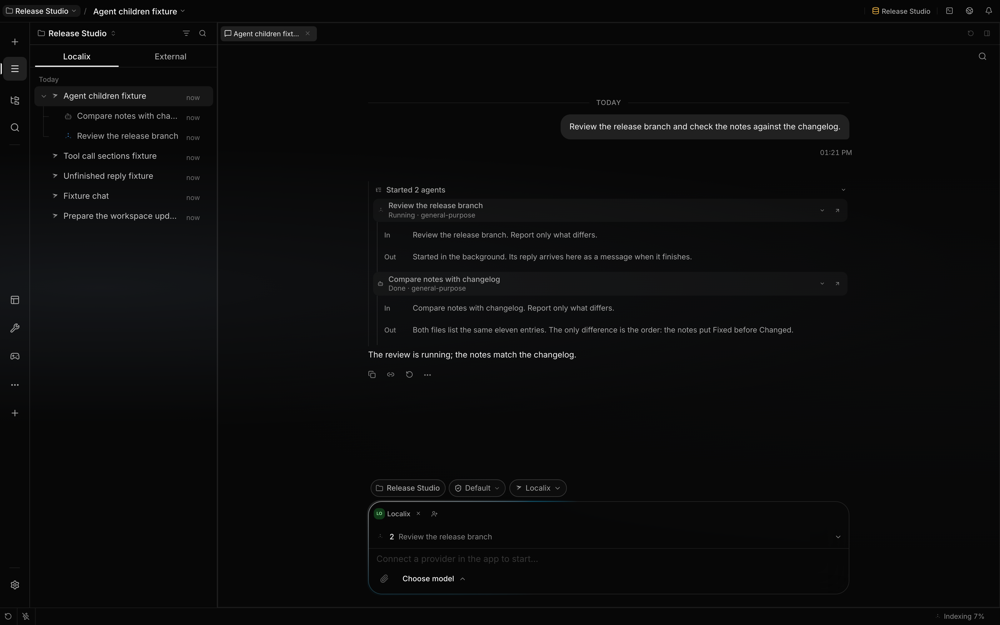

# Subagents

An agent hands a task to a **subagent**, a child session, with Claude Code's three tools:
**`Agent`** starts one, **`SendMessage`** talks to it, **`TaskStop`** stops it. They take Claude
Code's names and fields, so a skill, an agent file or a habit written for Claude Code works here
unchanged.

The subagent works in parallel while the agent continues, and its final reply comes back as a
message. Agents use subagents to keep their own context clean: searches and investigations, reviews,
long tasks and work off the critical path run in the child, and only its reply comes back.

A subagent is for a self-contained task whose reply is all the conversation needs. To bring another
agent's role to a task, name its file as the subagent type (see [Agents](agents.md#starter-agents));
the subagent runs as that agent in its own session, which you can open from the transcript.

`Agent` is **on by default** for every shipped agent, and only the main conversation has it. A
subagent does its task itself and returns one summary: it has no `Agent` and cannot start subagents
of its own. A fork keeps `Agent` in its tool list so its tools match the parent's, and the call
answers with an error; a fork cannot start another fork. A job or a forked skill cannot start
subagents either. Stopping the conversation stops its subagents.

## Model and effort are yours

Claude Code's `Agent` lets the model pick the subagent's `model` and `effort`. Localix does not. A
subagent runs on the model and effort you chose for that agent (its page in the Store, **Model** and
**Effort**), from the providers you connected; an agent with no choice of yours runs on its chat's
model and effort. Nothing else sets them: the `model` and `effort` of an agent file, of a plugin's
agent, of the call and of a workflow's `agent()` are ignored, and so are recent choices, the
project's model and environment variables such as `CLAUDE_CODE_SUBAGENT_MODEL`. A call that names
`model`, `effort`, `isolation`, `team_name`, `mode` or `cwd` still runs; those fields are dropped. A
fork runs on its parent's model.

## The tools

| Call                                                                       | Effect                                                                                                                                                                                                                                                                                                                                                                   |
| -------------------------------------------------------------------------- | ------------------------------------------------------------------------------------------------------------------------------------------------------------------------------------------------------------------------------------------------------------------------------------------------------------------------------------------------------------------------ |
| `Agent { description, prompt, subagent_type?, run_in_background?, name? }` | Starts a subagent. `prompt` is the task; `description` is a 3–5 word summary. `name`, as in Claude Code, is what the subagent is listed and addressed by (`SendMessage({to: name})`); without it, the description. `subagent_type` picks an agent from the directory, `"fork"` starts a fork, and omitted (or `general-purpose`) the calling agent runs the task itself. |
| `SendMessage { to, message, summary? }`                                    | `to` is a subagent's id, its name (the description when it was given none), or its task path. A running subagent reads the message at its next step; a finished one runs again with everything it knew, and replies again.                                                                                                                                               |
| `TaskStop { task_id }`                                                     | Stops the current run of a subagent, or a background job (a `Bash` command in the background, a monitor, a workflow). A stopped subagent can still be messaged later; no reply follows.                                                                                                                                                                                  |

A follow-up on the same task is a `SendMessage`, not a new `Agent`: the subagent keeps everything it
has already read and done. Every answer to `SendMessage` also says what the subagent has spent so
far. The running subagents are named in the agent's prompt each turn, with their ids, so it never
needs to list them; there is no list action to poll with.

A subagent is named by whatever the agent has in hand: its id, the `description` it was started with
(the name shown in the agent's roster each turn), or its task path (`/root/audit_repo`). A
description two subagents share is never guessed: the answer lists them with their ids. A name that
matches none lists the agent's subagents with their ids, descriptions and states, so one wrong guess
costs nothing more.

Calls of one step run together: several `Agent` calls in a response start their subagents at once,
and a `SendMessage` or `TaskStop` does not wait behind a subagent that a synchronous `Agent` call is
still holding. The agent's `Agent` description says what a subagent cannot do (it has no `Agent` or
`TaskStop`; it can `SendMessage` the agent), so a task that needs those stays with the agent.

Older chats used one `delegate` tool for all three; old transcripts show those calls as plain tool
calls, and a call in its spelling is refused with the fields `Agent` takes.

## What a child sees

By default a subagent starts from **its prompt alone**: it is told which agent started it, that its
final reply goes back to that agent, and nothing else. State everything it needs in `prompt`.

`subagent_type: "fork"` starts a **fork** instead: a copy of the calling agent that has seen
everything the agent has seen. It is that agent, on the model and reasoning effort it is running on,
with the same system prompt (it is the same for every run), and it reads exactly the conversation
the agent's own request carried up to the call: every message and tool result, and the work the turn
had done so far. Its one new message is the directive. Use it for work that needs all of that
context and would take too long to write down in `prompt`.

As in Claude Code, a subagent, a fork included, has fewer tools than the agent that started it: no
`AskUserQuestion`, `Workflow`, `Loops`, `Plan`, `Agent`, `SendMessage` or `TaskStop`, and none of
the tools only Localix has (such as `Browser` or `Vault`) unless its agent file lists them.

| A fork                                               | Why                                                                                 |
| ---------------------------------------------------- | ----------------------------------------------------------------------------------- |
| Is the calling agent                                 | Its model, effort and agent are its parent's; `run_in_background` still applies     |
| Cannot fork or start subagents                       | `Agent` is not among its tools, as in Claude Code                                   |
| Runs under the permission mode of the conversation   | A subagent is not a way to more permission                                          |
| Returns only its final reply                         | What it read and did stays in its own session; the parent receives the reply        |
| Reads the same bytes however long the parent goes on | The fork's history is the parent's line up to the call, read in place, never copied |

The fork's request is the parent's last request followed by the call, its answer and the directive,
so the provider's prompt cache serves the shared part instead of writing it again. The cache is warm
on providers that look up a prefix (Anthropic and Bedrock through an explicit breakpoint placed on
the end of the parent's request; Google and OpenRouter automatically) and on providers keyed by
session, which are given the parent's key (OpenAI-compatible providers and Codex). The `fork` name
is reserved: an agent file called `fork` is listed but is never what a task goes to.

A subagent runs under the conversation's permission mode, in the same workspace. Parallel edits must
therefore use disjoint files or coordinate their changes. Another agent is admitted only when its
policy allows the `delegation` invocation host; it runs with its own instructions and model.

A subagent appears under its conversation like any child session, in the sidebar and in the
composer's **Agent sessions** panel, where you can open it and talk to it directly.

## Background and waiting

| Mode                       | The call                                                             | The reply                                                        |
| -------------------------- | -------------------------------------------------------------------- | ---------------------------------------------------------------- |
| Background (default)       | Returns at once: started, queued, or an outcome from the first 1.2 s | Arrives later as its own message, headed **[Subagent finished]** |
| `run_in_background: false` | Holds the agent's turn until the subagent's run ends                 | Returned as the call's result; no separate message is sent       |

The first 1.2 s are only a window to catch a subagent that fails before it produces anything; the
call returns the moment the subagent starts streaming, so launching several in a row costs nothing.
The `Agent` result also reports the subagent's state as the call returns, which the conversation
shows on the call's card: **running** for a background start, **queued** (with its place) for one
waiting for a lane, and **completed**, **failed** or **stopped** after a call that held for the
reply. A subagent that messaged the agent and ended its turn to wait for the answer is headed
**[Subagent is waiting for your answer]** instead of finished.

The agent is told not to poll, sleep or guess while a subagent runs: it keeps working or ends its
turn, and the reply wakes it. Use `run_in_background: false` only when the very next step needs the
reply. A waiting call ends after ten minutes at most; the subagent keeps working, and its reply then
arrives as a message. Stop on the conversation ends the waiting call and, as for any run, stops the
subagents it started; no reply follows.

## Talking to the parent

A subagent that needs something only the agent that started it knows, or has a finding that agent
needs now, calls `SendMessage { to: "main", message }` and keeps working. The message reaches the
parent as **[Message from subagent]**: if the parent is running, it joins its next model request
after a completed tool step; if it is idle, it opens a turn. The parent answers with `SendMessage`
to the subagent. A subagent's final result is never sent this way: its final reply already goes
back.

Only `main` names the parent, as in Claude Code; "parent", "lead" and the parent agent's name do
not. For the agent that started it, `SendMessage` and `TaskStop` take a subagent's id, or the `name`
its `Agent` call gave it; a description alone is not a name.

## When a child reports

A report carries **everything the subagent wrote in that run**, not only its last reply. When the
agent amends a running subagent, the run is split at the message and the subagent may have written
its answer before it; the report joins every reply since the run began, and the subagent is told
that all of it, unread so far, is sent back. Every waiting message from the agent is delivered at
one step boundary, not one per step.

A reply is news the agent asked for, so a run reports only when it **finished or failed while the
agent was waiting to hear** from it. The agent waits from the moment it starts a subagent or sends
it a message, until one reply answers it.

| What happened                                      | Report                                                                                                                                            |
| -------------------------------------------------- | ------------------------------------------------------------------------------------------------------------------------------------------------- |
| The task, or a run answering a `SendMessage`, ends | Yes — completed or failed.                                                                                                                        |
| The agent stops the subagent with `TaskStop`       | No: its own tool result already said so. It stops waiting. A subagent withdrawn from the queue before it ever ran is never reported later either. |
| The person presses Stop on the child               | No. The wait stands: the parent hears once, when the child next finishes.                                                                         |
| The person talks to the child in its own chat      | No — that dialog answers the person. A `SendMessage` joining it does.                                                                             |
| The child is closed                                | No.                                                                                                                                               |

A **closed** child is refused at every door into a run: the agent's message, the person's send (the
composer shows it read-only), and any wake already queued, which the drain dismisses.

A report can prompt another message, so parent and child could keep each other running with nobody
in the loop. Both sides count that chain: at most twelve consecutive self-caused turns open on their
own, and the chain resets when a person writes.

## Limits: a queue, and a budget per message

| Limit                      | Value                                          | What happens past it                                      |
| -------------------------- | ---------------------------------------------- | --------------------------------------------------------- |
| Children running at once   | 10 per parent                                  | The next one **waits**, first come first served           |
| New children, unattended   | 24 since the person's last message in the chat | `Agent` is refused until the person writes again          |
| Depth                      | 1                                              | A subagent cannot start one; only root chats get `Agent`  |
| Self-caused turns in a row | 12 per session                                 | Further wakes wait for a turn caused by an external event |
| A waiting call             | 10 minutes                                     | The wait ends; the report arrives as a message            |

The queue governs every run an agent starts in a child — a new child and a message that wakes a
finished child alike. A child over the cap is reported as queued with its position, and the prompt
shows it as `queued (#N)`; `TaskStop` on it answers that it was withdrawn from the queue and it
never starts. Every `TaskStop` answer says what the subagent was doing when it was stopped. A person
writing into a child's chat is not queued. Lane scheduling, messages waiting for a lane and waiting
calls live in process memory; restarting the server does not restore them.

The budget counts children **created**, not runs: messaging an existing child creates none. Only a
message the person writes resets it. The context window shrinks with depth as well: a conversation
budgets against its full policy window, its child against at most 128k and every level below against
64k.

## Progress and report delivery

While any of its runs is in progress, a child is background work of the session that started it: the
composer's background-work strip and the `Jobs` tool list it as `sub-N`, and Stop there (or
`TaskStop`) stops that run. Progress comes from public assistant text or the last observed tool
name, never private reasoning or full tool output.

Each run's report has its own delivery key (the child and the run's final assistant message), and
the live and recovery paths send the same one. The report wake asks for a durable receipt, written
in the same transaction as queue admission, so a replay never enqueues another turn. A report a
waiting call took is recorded under the same key, so recovery does not send it again. A recovery
pass at startup re-sends the missing report of a child's latest run without rerunning it, routes it
to the agent that started the child, and bounds the text with a transcript link. Receipts are kept
for seven days.

Replies to one parent arrive together, so a parent that started several subagents answers once.
While it is idle, a finished child's report waits in its queue as long as the parent's other
children still owe a report. The composer lists it as "Waits for other reports". The last report
releases them all as one message, with each child's report numbered.

A child that is stopped or closed owes nothing and releases the others. A report waits five minutes
at most, so a child that runs for an hour does not keep finished work from its parent.

When the parent is already running, the reports addressed to the agent that started them join its
next model request together, after a fully completed tool turn. Disabling
`LOCALIX_MID_RUN_INTERJECT` keeps them for a separate turn. A completed child is not proof that the
requested outcome is ready: the parent reviews the reply before it calls the work done.

In the conversation, each `Agent` call is a card that follows its child: it is titled by the task
the child was given, and beneath it names its state (Queued, Running, Waiting for you, Done, Failed
or Stopped) with what it is doing now, or its agent type. The arrow beside it opens the child's
session. A background start says what happens next in its **Out** instead of the instruction the
agent received; a call that waited keeps the child's own report there. `SendMessage` and `TaskStop`
cards show the same state for the subagent they reached.

## Claude Code agent types

`subagent_type` names an agent from the one catalog every surface reads (see [Agents](agents.md)):

- **Agent files**: yours (`~/.claude/agents/`), the project's (`.claude/agents/` in the working
  directory and each parent up to the repository root, the closest definition of a name winning),
  managed ones and a plugin's `agents/*.md` (`<plugin>:<name>`), named by their `name` front matter.
  A file without a `name` or a `description` is skipped.
- **A child is that agent**: a fresh run of the named agent on its own prompt, tool ceiling,
  instruction files, model and skills, as in Claude Code, subject to its Access rules. An agent
  whose Access denies `Agent(<name>)` is hidden from the directory and refused.
- **Built-in types**: `general-purpose` and `claude` run the task as the calling agent itself;
  `Explore` and `Plan` run it read-only, without the project's instruction files. An agent file
  named `Explore` or `Plan` replaces the built-in.
- **Own files only**: `hooks`, `mcpServers` and `permissionMode` in an agent file of yours, the
  project's or a managed one apply to the child's runs, never to a plugin's agent or a fork; see
  [What your own agent files can set](agents.md#what-your-own-agent-files-can-set).
- **Memory**: `memory: user | project | local` gives an agent a folder
  (`~/.claude/agent-memory/<name>/`, `.claude/agent-memory/<name>/` or
  `.claude/agent-memory-local/<name>/`) whose `MEMORY.md` — its first 200 lines or 25KB — joins its
  instructions, with the file tools to keep it.

The prompt has one `# Agent directory`, listing the agents a tag can reach and those `Agent` can
start, with their tool lists. Hooks see the agent's name as `agent_type`, or `general-purpose`.

In an agent's `tools`, `Agent` and its former name `Task` mean `Agent`. An agent type whose `tools`
list names no tool available here is refused instead of starting with none.
`Agent(worker, researcher)` limits an agent running as the main thread to those types; a call with
no `subagent_type` is `general-purpose`. An `Agent(<name>)` permission rule judges a call with no
`subagent_type` as `general-purpose`, and `claude` too.

## Skills that run in a child session

A skill with `context: fork` in its frontmatter, invoked by the person as a slash command, runs in a
child session of its own as the conversation's agent. Its `model:` and `effort:` fields still choose
that child's model and reasoning effort. Its `agent:` field is not honoured: a skill always runs as
the agent that invoked it. Validation warns about the field, and the command's reply says it was
ignored. See [Skills authoring](../extending/skills-authoring.md).

## Source of truth

- [`Agent`: its input and the request it becomes](https://github.com/rsaryev/localix/blob/main/apps/api/src/features/agent-core/tools/agent/agent-tool.ts)
- [`SendMessage`](https://github.com/rsaryev/localix/blob/main/apps/api/src/features/agent-core/tools/agent/send-message.ts)
  and
  [`TaskStop`](https://github.com/rsaryev/localix/blob/main/apps/api/src/features/agent-core/tools/agent/task-stop.ts)
- [Child creation and waiting](https://github.com/rsaryev/localix/blob/main/apps/api/src/features/agent-core/tools/agent/agent-start.ts)
- [Messaging and stopping a subagent](https://github.com/rsaryev/localix/blob/main/apps/api/src/features/agent-core/tools/agent/agent-control.ts)
- [Port wiring, the parent line included](https://github.com/rsaryev/localix/blob/main/apps/api/src/features/chat/runtime/run/agent-options.ts)
- [Forks: the call and its plan](https://github.com/rsaryev/localix/blob/main/apps/api/src/features/agent-core/tools/agent/agent-fork.ts)
- [Forks: the request they share with the parent](https://github.com/rsaryev/localix/blob/main/apps/api/src/features/chat/runtime/fork/fork-port.ts)
- [Child-session host](https://github.com/rsaryev/localix/blob/main/apps/api/src/features/chat/runtime/run/task-delegation-options.ts)
- [Report waits](https://github.com/rsaryev/localix/blob/main/apps/api/src/features/agent-core/delegation-awaits.ts)
- [Creation budget](https://github.com/rsaryev/localix/blob/main/apps/api/src/features/agent-core/delegation-budget.ts)
- [In-memory lane queue](https://github.com/rsaryev/localix/blob/main/apps/api/src/features/agent-core/delegation-lanes.ts)
- [Per-run reports](https://github.com/rsaryev/localix/blob/main/apps/api/src/features/chat/runtime/run/child-run-report.ts)
- [Reply and message wording](https://github.com/rsaryev/localix/blob/main/apps/api/src/features/chat/runtime/delegation-report.ts)
- [Self-wake budget](https://github.com/rsaryev/localix/blob/main/apps/api/src/features/chat/runtime/wake-queue/self-wake-budget.ts)
