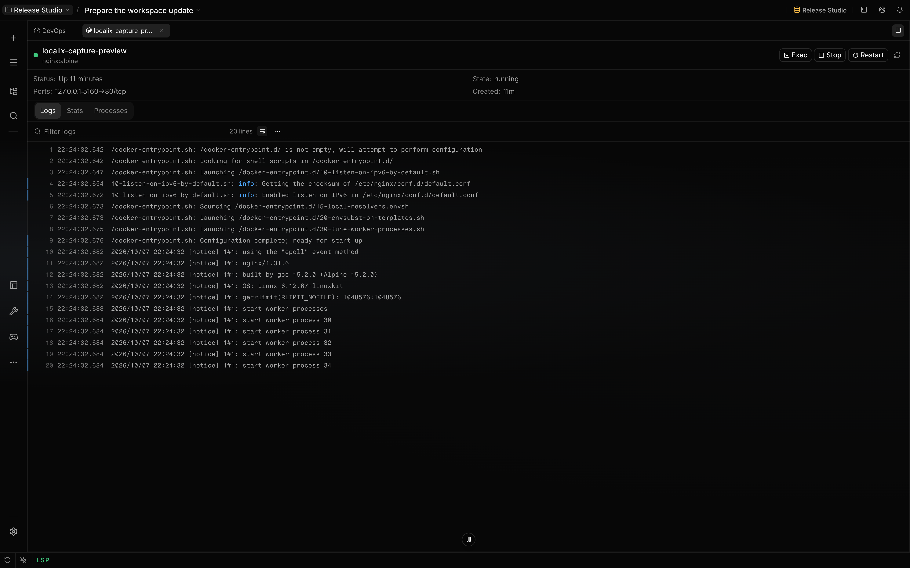

# Use DevOps Workspace

DevOps Workspace puts container and Kubernetes resources in one plugin-contributed workbench. Use it
to inspect runtime state, open logs and resource details, and start container or cluster actions
from the Localix workspace.

The bundled `devops` plugin is enabled by default. Containers require a reachable Docker-compatible
daemon, while Kubernetes requires a usable kubeconfig and cluster permissions.

## What you can do

| Area                        | Mechanism                                                                 | Boundary                                                             |
| --------------------------- | ------------------------------------------------------------------------- | -------------------------------------------------------------------- |
| Overview                    | Compare container counts, cluster readiness, and provider-specific health | Docker and Kubernetes load and report failures independently         |
| [Containers](docker.md)     | Browse containers, images, volumes, networks, logs, stats, and processes  | Actions depend on daemon reachability and sometimes the `docker` CLI |
| [Kubernetes](kubernetes.md) | Browse workloads, pods, deployments, services, nodes, and port forwards   | Reads and changes use kubeconfig credentials and cluster RBAC        |
| Resource references         | Attach `localix://resource/docker` or `localix://resource/k8s` context    | Linking adds bounded resource state, not an instruction to modify it |
| Global search               | Search containers, images, kubeconfig contexts, namespaces, and pods      | Each provider searches only the resources exposed by its backend     |

### Agent access

The workbench contributes no agent tools. Agents can run `docker` and `kubectl` through `bash` when
those CLIs are installed and their permission rules allow the commands.

`kubectl delete` and `kubectl drain` match bash's dangerous command patterns. The agent's permission
rules decide whether the gate allows, confirms, or denies those calls.

What the workbench does contribute stays: the panels, the routes, global search, and
`localix://resource/docker` / `localix://resource/k8s` references that expand into read-only
snapshots you can attach to a message.

Provider-owned actions and safety behavior are documented in [Containers](docker.md) and
[Kubernetes](kubernetes.md).

## How it works

The plugin entrypoint composes two backend subsystems. Docker mounts `/rpc/docker` and owns
`localix://resource/docker`; Kubernetes mounts `/rpc/kubernetes`, owns `localix://resource/k8s`, and
manages its watch, exec, and port-forward lifecycles.

The UI contributes one restorable DevOps Workspace with **Overview**, **Containers**, and
**Kubernetes** areas. Docker and Kubernetes resource tabs are transient because a daemon or cluster
object may disappear before the next application start.

The workspace and container/pod tabs belong to the root chat's display workspace. Docker image,
volume, and network detail tabs are global: they inspect daemon resources without a chat-bound
terminal or composer action. Tab placement does not isolate the selected daemon or cluster.

Docker selects the Engine API when it can negotiate a supported socket, pipe, or plain HTTP target.
It falls back to the `docker` CLI for SSH, HTTPS, incompatible, or unreachable API targets. Backend
selection is lazy, and a subsequent operation can retry Engine API negotiation after 30 seconds on
the CLI fallback.

Kubernetes talks directly to the cluster API. A context is selected per request, so choosing one in
the workbench does not change kubeconfig's current context.

## Configuration

| Input                   | Primary behavior                                                        | Boundary                                                      |
| ----------------------- | ----------------------------------------------------------------------- | ------------------------------------------------------------- |
| Plugin state            | Enables both provider backends, workbench areas, and resource providers | Disabling `devops` removes Docker and Kubernetes together     |
| `DOCKER_HOST`           | Selects an explicit Docker daemon endpoint                              | Overrides the selected Docker context and platform default    |
| Selected Docker context | Supplies its recorded endpoint when `DOCKER_HOST` is unset              | The `default` context uses the platform socket or pipe        |
| Docker platform default | Uses `/var/run/docker.sock` or the Windows `docker_engine` pipe         | An unreachable endpoint leaves the container provider offline |
| `KUBECONFIG`            | Loads and merges the configured kubeconfig files                        | Unset uses the Kubernetes client's platform default           |
| Kubeconfig context      | Selects cluster, user, and default namespace per request                | Omission uses kubeconfig's current context                    |
| Kubeconfig exec auth    | Runs the credential command named by kubeconfig                         | That command must exist on the Localix host                   |

## Limits

- Disabling `devops` removes both workbench areas and their resource providers. Docker and
  Kubernetes cannot be enabled independently. The separate `bash` tool remains governed by the
  agent's rules.
- Docker requires a reachable daemon. CLI fallback, Compose actions, Dockerfile or Compose run bars,
  and interactive container exec require the `docker` executable.
- Kubernetes requires readable kubeconfig data, valid credentials, network access to the API server,
  and sufficient RBAC. `kubectl` is not a fallback transport.
- A one-time bash approval covers the shown call. Choosing **This session** or **Always** can
  approve a wider program scope, such as `kubectl` commands. Review the scope on the confirmation
  card; Localix approval does not change cluster RBAC.
- Provider resource tabs are not restored after restart. Kubernetes port forwards and live watches
  are in-memory lifecycles rather than durable configuration.
- Linking a Docker or Kubernetes resource adds bounded context. It does not request a review,
  diagnosis, or modification.
- Manual workbench actions call provider routes and use their own UI confirmations. Agent permission
  modes govern agent tool calls; setting a chat to Plan does not make these manual controls
  read-only.
- Compose restart/stop addresses members independently, so some can succeed while others fail.
  Mutation handlers also refresh inventory after the action; a refresh error can appear after a
  successful mutation. Inspect current resource state before retrying instead of assuming rollback.

## Related guides

- [Containers](docker.md)
- [Kubernetes](kubernetes.md)
- [Plugins](../extending/plugins.md)
- [Workspace](workspace.md)

## Source of truth

- [Plugin composition](https://github.com/rsaryev/localix/blob/main/plugins/devops/plugin.json) ·
  [plugins/devops/backend/index.ts](https://github.com/rsaryev/localix/blob/main/plugins/devops/backend/index.ts)
- [Workbench registration](https://github.com/rsaryev/localix/blob/main/plugins/devops/ui/register.tsx)
- [Docker backend selection](https://github.com/rsaryev/localix/blob/main/plugins/devops/docker/backend/index.ts)
  ·
  [plugins/devops/docker/backend/backend-selection.ts](https://github.com/rsaryev/localix/blob/main/plugins/devops/docker/backend/backend-selection.ts)
- [Kubernetes backend composition](https://github.com/rsaryev/localix/blob/main/plugins/devops/kubernetes/backend/index.ts)
- [Provider UI contributions](https://github.com/rsaryev/localix/blob/main/plugins/devops/docker/ui/register.tsx)
  ·
  [plugins/devops/kubernetes/ui/register.tsx](https://github.com/rsaryev/localix/blob/main/plugins/devops/kubernetes/ui/register.tsx)
- [Docker action outcomes](https://github.com/rsaryev/localix/blob/main/plugins/devops/docker/ui/model/useDockerSidebarActions.ts)
- [Kubernetes action outcomes](https://github.com/rsaryev/localix/blob/main/plugins/devops/kubernetes/ui/model/useKubernetesSidebarActions.ts)
