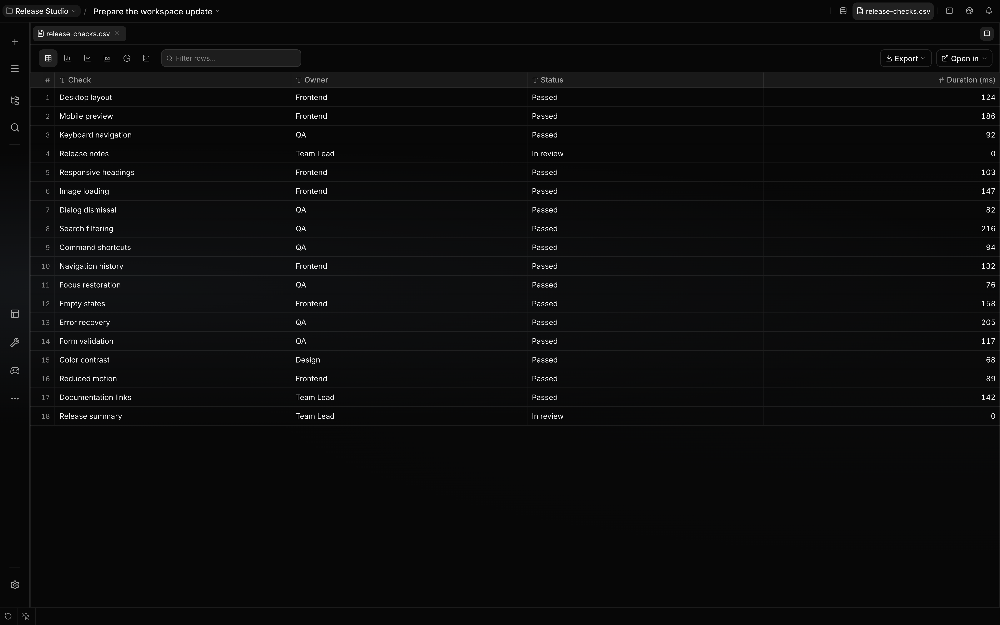

# Documents

The bundled Documents plugin supplies read-only viewers and extraction for office files, PDFs, CSV,
and workbooks. It is enabled by default and can be disabled independently of core.

## Capabilities

| Capability                 | Mechanism                                                                                  | Boundary                                                                        |
| -------------------------- | ------------------------------------------------------------------------------------------ | ------------------------------------------------------------------------------- |
| Read binary documents      | The plugin implements the standard `document.extract` SDK port used by core `read`.        | When the plugin is disabled, core reports its normal unsupported-binary result. |
| View PDFs and office files | Plugin file associations select PDF, Markdown, or table viewers.                           | Viewers do not edit the source.                                                 |
| Inspect spreadsheets       | CSV and workbook files are ingested into the plugin's paged table pipeline.                | Sort, filter, chart, and export operate on a plugin-owned copy.                 |
| Mention extracted content  | `localix://resource/doc/<cache-id>` expands a bounded cached extraction.                   | The resource contains extracted text/rows, not the original binary.             |
| Generate via HTTP          | `/rpc/documents/generate` produces DOCX, PDF, or XLSX and may store it through host media. | This is an application route, not an agent tool.                                |

The plugin contributes no model-facing tools. Agents use the generic core `read`, `write`, and shell
capabilities; the plugin augments `read` through a typed extension port.

## Styled document generation

The [Resumes workbench](resumes.md) uses a bounded `DocumentLayout` contract from
`@localixai/plugin-sdk/document-layout` to pass A4 typography, safe links, headers, rules, columns,
and portraits into Documents. `/rpc/documents/render` returns a PDF without storing a media item;
`/rpc/documents/generate` accepts the same layout for PDF or DOCX. Existing Markdown generation
remains available.

Fonts are embedded in PDF, with character coverage checked before rendering. DOCX embeds the
selected regular font and retains a linear reading order; its pagination depends on the Word
renderer. The document font endpoint supplies the same font assets for template thumbnails.

## Supported extraction

| Input                      | Result                          |
| -------------------------- | ------------------------------- |
| DOCX, ODT                  | Markdown                        |
| DOC                        | Plain text                      |
| PPTX                       | Markdown with slide structure   |
| PDF                        | Extracted Markdown text; no OCR |
| XLSX, XLS, XLSM, XLSB, CSV | Typed columns and rows          |
| Markdown formats           | Verbatim UTF-8 text             |

Extraction rejects inputs over 25 MiB. Each extraction response is windowed to at most 1,500,000
Markdown characters or 10,000 table rows, after parsing; the cache retains the full extraction.
These response limits do not bound parser memory or cached output size. Spreadsheet ingestion uses
that full cached table, so its viewer can page beyond the extraction response’s 10,000-row window.

Core `read` delegates the supported binary formats through the capability registry; CSV and Markdown
continue through normal text reading unless opened in the Documents viewer.

## Generated output

`/rpc/documents/render` responds with PDF bytes. `/rpc/documents/generate` responds with metadata
and a media id when the host’s media sink is available; it does not save a named file into your
project. A caller downloads or saves that media separately. Without a media sink the id is null.
DOCX and PDF accept Markdown or the styled layout; XLSX accepts a Markdown table or JSON rows.

The viewers and generators are separate surfaces. A read-only viewer does not make generation,
table-copy edits, or export read-only operations.

## Architecture

Registration returns generic `BackendSubsystem` contributions from the plugin SDK:

- `/rpc/documents`, the `document.extract` capability, and the document resource provider;
- `/rpc/table`, which owns spreadsheet ingestion, paging, export, and native opening.

The host injects `userId`, `dataDir`, media access, session storage, and desktop file intents
through `PluginContext`. The plugin never imports `apps/api` internals or computes host storage
paths.

## Related guides

- [Documents internals](https://github.com/rsaryev/localix/blob/main/docs/internals/subsystems/documents.md)
- [Native data view internals](https://github.com/rsaryev/localix/blob/main/docs/internals/subsystems/data-view.md)
- [Resumes](resumes.md)
- [Plugins](../extending/plugins.md)

## Source of truth

- [Extraction windows and full cache](https://github.com/rsaryev/localix/blob/main/plugins/documents/backend/documents/service.ts)
- [Full table ingestion](https://github.com/rsaryev/localix/blob/main/plugins/documents/backend/singleton.ts)
- [Generation responses](https://github.com/rsaryev/localix/blob/main/plugins/documents/backend/documents/routes.ts)
- [Generation input contract](https://github.com/rsaryev/localix/blob/main/plugins/documents/backend/documents/generate-contracts.ts)
- [Bounded resource expansion](https://github.com/rsaryev/localix/blob/main/plugins/documents/backend/resource-provider.ts)
