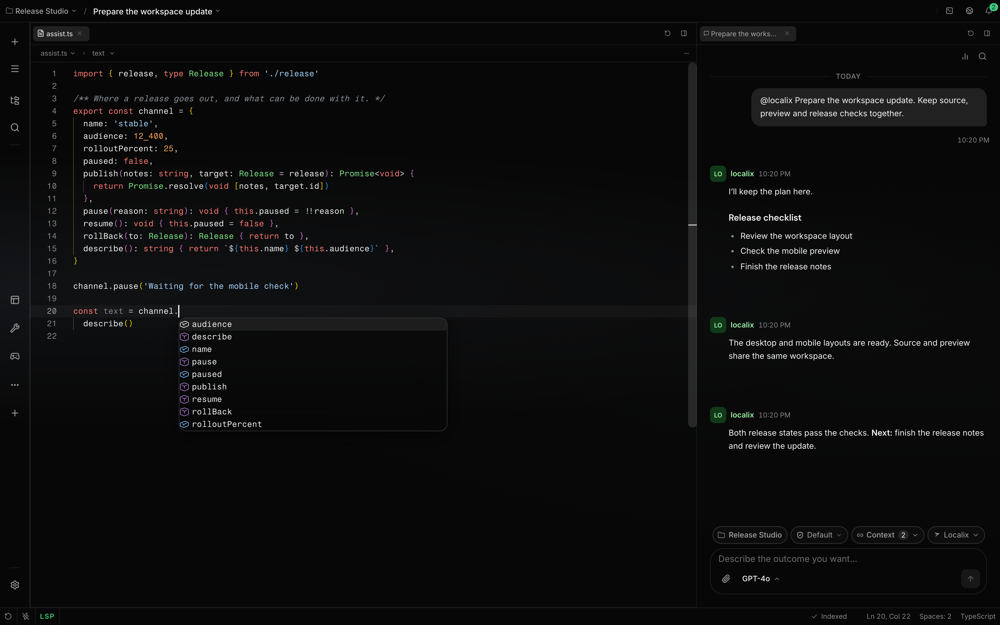

# Edit code in the editor

Files open in a code editor built on the engine behind VS Code, with syntax colors, completion,
diagnostics, go to definition, rename, formatting and Git markers. It loads the first time you open
a file, so a chat-only session does not pay for it.

**Availability:** Completion, hover, diagnostics and navigation come from a language server that
Localix installs the first time you open a file of that language. See [Language servers](lsp.md).
Colors, folding, find and multi-cursor work without one.

## Open a file

Pick a file in the file tree, press **Cmd/Ctrl+P** to go to a file by name, or click a path in a
terminal or in the agent's reply. Press **Cmd/Ctrl+Shift+P** for the command palette. The
[workspace](workspace.md) guide covers tabs, preview tabs and the editor grid.

## Write with completion and hints

- **Completion:** the list opens as you type, after `.`, quotes and `/`. Press **Ctrl+Space** to ask
  for it by hand.
- **Hover and signature help:** rest the pointer on a symbol for its type and docs. Parameter hints
  open inside a call.
- **Inlay hints:** parameter names and inferred types appear inline. Turn them off in **Settings →
  Editor → Annotations**.
- **Diagnostics:** errors and warnings are underlined. Unused code is faded and deprecated code is
  struck through.
- **Quick fixes:** press **Cmd/Ctrl+.** on a problem for fixes and refactors. On an error the menu
  also offers **Fix with Agent**, which sends the problem and the code around it to the file's chat.

## Move around

| Action                                | Keys                                      |
| ------------------------------------- | ----------------------------------------- |
| Go to definition                      | **F12**, or Cmd/Ctrl+click                |
| Find all references                   | **Shift+F12**                             |
| Go to implementation                  | **Cmd/Ctrl+F12**                          |
| Rename a symbol across files          | **F2**                                    |
| Change all occurrences                | **Cmd/Ctrl+F2**                           |
| Go to symbol in this file / workspace | **Cmd/Ctrl+Shift+O** / **Cmd/Ctrl+T**     |
| Go back or forward                    | **Alt+Left** / **Alt+Right**              |
| Format the document                   | **Alt+Shift+F** (Linux: **Ctrl+Shift+I**) |
| Add a cursor                          | **Alt+click**                             |

In the macOS desktop app, Cmd+T opens a new workspace tab, so workspace symbols are on
**Cmd+Option+Shift+O** there; Cmd+P still goes to a file. Go back and forward answer to Alt+Left and
Alt+Right when the caret is not in a text field, since inside the text they move by word; the
command palette lists them as **Go back** and **Go forward**. Every key can be changed in **Settings
→ Shortcuts**; see [Keyboard shortcuts](keyboard-shortcuts.md).

The breadcrumb above the file shows where the caret is. Open it to browse the file's symbols, or
click one to jump to its line.

## Suggestions as you type

Localix can also predict your next edit with a model. It is off by default and uses model usage when
on. Turn on **Inline completion** in the model picker's background workloads, and give it a model if
the chat's model is not the one you want.

After a pause, a suggestion appears as dimmed text at the caret, or as a small diff for a change
elsewhere in the file. Press **Tab** to accept and **Escape** to reject. `Alt+\` asks for one now,
and `Alt+]` and `Alt+[` step between several. The chat box and the commit message use the same
setting.

## Settings

**Settings → Editor** holds the rest:

- **Editing:** auto save after a delay, and reusable preview tabs.
- **On save:** format on save (on by default; it formats with the language server and saves as usual
  where that server cannot format), trim trailing whitespace and insert a final newline (both off).
- **Code display:** Git change markers on the scrollbar and bracket pair colors (both on), word wrap
  and visible whitespace.
- **Annotations:** inline Git blame (on) and inlay hints (on).

## When the agent edits a file

When the agent writes a file you have open, the editor updates in place and keeps your cursor and
undo history; changed lines are highlighted until you type. If you have unsaved edits, a banner
offers **Compare**, **Overwrite disk** or **Discard & reload**. The [workspace](workspace.md) guide
has the details.

## Limits

Syntax colors cover common languages such as TypeScript, JavaScript, Python, Rust, Go, Java, C, C++,
Ruby, shell, Dockerfile, YAML, JSON, HTML, CSS, SQL, TOML and Markdown. Other files open as plain
text. A language without a built-in server has colors but no completion; see
[Language servers](lsp.md) for the list and for adding more through a plugin.
