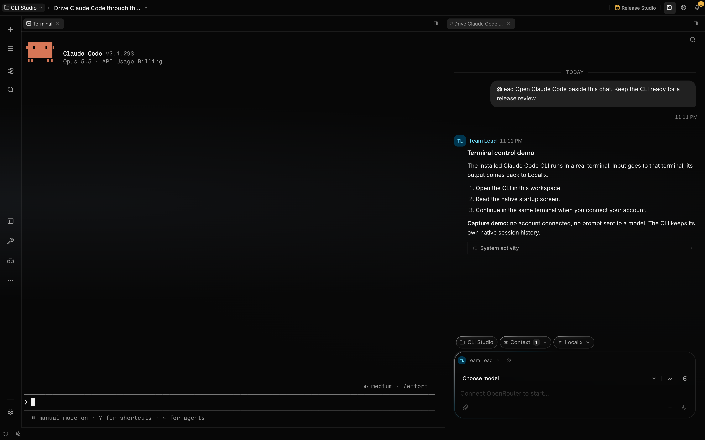

# External agent sessions

A Localix chat can have a coding agent linked to it. The chat keeps its normal messages, project and
controls; opening it also opens the linked CLI terminal. The external conversation remains in the
coding agent's own history.

## Sessions and projects

The history panel has two tabs. **Localix** lists Localix chats, including chats linked to a CLI.
**External** lists native CLI sessions recorded in the selected directory and its subdirectories.
Localix is the default; the panel remembers the selected tab on this device. Search, sorting and
grouping apply within the open tab, and message search runs only on the Localix tab. A project
without a folder shows no External tab. With no installed CLI or no recorded session, the External
tab says where this history comes from.

Agent icons before each title identify the linked agent. Default stays within the Localix workspace
tree; it never aggregates machine-wide CLI history. A native session already linked to a Localix
chat appears once, as that chat on the Localix tab. Archiving the chat does not bring back a native
duplicate.

All Localix chats share the same project selector, search, grouping, sorting, pinning, archive
controls, menus and batch actions. Opening a native history row first gives it a normal linked chat,
with those same controls. A newly created chat appears before the CLI writes a transcript.

Default shows only its own sessions. Like an ordinary Localix chat, each gets a separate directory
under the Localix workspace. Selecting a project shows its sessions and uses that project's folder.
The folder picker and project selector are shared with ordinary chats.

## Starting and opening a session

Use the main **New chat** action to create an ordinary chat in the selected project. The history
header has no duplicate creation button.

Above the composer, the agent pill shows **Localix** while no CLI is linked. Open it and choose an
installed coding agent. This links the selected CLI to the current chat and launches its terminal in
that chat's working directory. It keeps the same chat, messages and draft; it creates no second chat
and imports no external transcript. The Localix composer remains available alongside the terminal.

Opening an existing external session opens its Localix chat and requests its agent terminal. A live
terminal is reused. After Localix identifies the CLI's native session, it saves that identity; an
adapter resumes the exact native session in its recorded working directory when a new terminal is
needed. All six supported agents declare native continuation commands. A missing native session
reports an error rather than starting a different conversation.

Opening a native history row preserves its recorded timestamps in the linked chat. Viewing or
reopening it, including saving the CLI's native identity, does not move it to the top of history or
mark it as new activity.

Each different external session you open starts its own CLI process. Switching chats keeps those
processes running; reopening the same session reuses its live terminal. There is no global cap or
idle eviction for these processes, so opening many sessions increases resource use. Close an agent's
terminal tab when you want to stop its process. Browsing a native transcript alone starts no CLI.

A chat with a linked CLI shows an agent pill above the composer, beside the project and Git context.
Press it to reveal the running terminal or reopen that same native conversation. The Localix chat
and draft stay in place.

Only supported CLIs found on the machine's executable search path appear in the agent-link menu.
Localix supports Claude Code, Codex, opencode, Gemini CLI, GitHub Copilot and Hermes.

### Opening failures

The CLI link or native attachment can be saved before terminal launch fails. The Localix chat stays
available; a failed opening is not proof that nothing was linked. Use its agent pill to retry rather
than creating another chat for the same native session.

| Failure                                   | What it means                                                              | Next step                                                                                                                |
| ----------------------------------------- | -------------------------------------------------------------------------- | ------------------------------------------------------------------------------------------------------------------------ |
| Another CLI is already linked             | The link endpoint refuses switching providers in that chat                 | Use a new chat for a different CLI                                                                                       |
| Agent is not installed                    | The executable is absent from the backend's detected PATH                  | Restore the CLI's executable and reopen the linked chat                                                                  |
| Native identity is not identified         | The saved identity is still pending and there is no live terminal to reuse | Keep an existing live terminal open until its native history is identified; after it closes, use a new chat for new work |
| Native session is missing or incompatible | The saved identity cannot be continued                                     | Restore the matching native history or choose another session explicitly                                                 |

Concurrent openings for one user/chat share one launch attempt. Linking, native attachment, and
terminal launch are distinct operations; their failures do not roll back all earlier steps.

## Native transcripts

Clicking an existing native session creates or reuses an ordinary Localix chat linked to its native
identity, then opens that chat and the CLI terminal. The external conversation stays in the agent's
own history; its messages are not imported into the Localix chat.

You can separately browse native CLI history through **External Agents** under `@resource:` and
through external statistics. A native transcript opens with Localix's conversation renderer. Its
footer offers **Open in …** and **Link to chat** when opened from a chat. Reading a native
transcript does not start a CLI or create a chat; its explicit terminal action uses the same
linked-chat flow.

## Linked context

Drag a native transcript's last breadcrumb or its tab into a composer. You can also browse
**External Agents** under `@resource:`. These paths use the same canonical session URI:

```text
localix://resource/external-agent/codex/session-id
```

The resource browser and transcript breadcrumbs navigate through agent and project containers to the
session. Containers are navigation destinations; individual sessions are attachable context. Opening
a session link returns to its native transcript.

When you send a linked session, the agent receives a compact digest of recent turns, the original
session key and a pointer to `ExternalAgentSessions`. It can read additional transcript windows,
inspect recorded tool calls and results, and collect context from several sessions. The digest
states what it omitted; it does not pretend to contain the full history. The digest targets about
3,000 UTF-16 code units and includes at most six recent event summaries from a tail window; tool
activity can occupy those entries too.

The tool's model-facing fields use snake case. For example, one transcript window is:

```json
{ "action": "transcript", "key": "codex:session-id", "from": 0, "max_events": 100 }
```

Advance `from` using the returned continuation position, or use `tail: true` to read the latest
events. Do not combine `from` with `tail: true`. `transcript` reads the opening by default, returns
400 events unless `max_events` is supplied, and accepts at most 2,000 per call. Event positions
belong to the parsed source, rather than starting over at zero for each window. If a source read was
truncated, those positions describe the readable portion; increasing the event limit cannot recover
bytes the adapter did not read.

To gather context from several sessions, use:

```json
{ "action": "context", "keys": ["codex:session-id", "claude-code:other-session-id"], "tail": true }
```

`context` reads the end by default, removes duplicate keys, orders sessions by recency, and shares a
rendering budget across them. Missing keys contribute no section. `budget_chars` defaults to 120,000
UTF-16 code units and accepts 2,000–400,000; it limits the composed text, not the source-file read.
Read the range and truncation notices, then use `transcript` for a specific omitted window.

Reading a transcript supplies context to the agent; it does not open a terminal for you. To open or
continue a native session, the agent uses `resume` with its session key, then runs the returned
command with `Bash` action `open`. The lookup itself does not execute commands.

For agents with shell access, the runtime prompt includes a short list of installed external agents
and their basic launch commands. Starting or driving a CLI still goes through ordinary terminal
tools and permission rules. Linking history does not execute commands.



This isolated demo opens the installed CLI in its native terminal. No account is connected and no
model request is made. See [interactive terminal control](../recipes/drive-interactive-terminal.md)
for sending input and waiting for the resulting screen.

## Statistics

**Usage & Spend**, beside Settings in the navigation bar, has the same **Localix / External** tabs.
Both use a period selector, filters, four summary cards and charts. External statistics aggregate
the installed agents' recorded token usage by agent, project or model. Click a session breakdown to
inspect its conversation.

External numbers come from local history records. Missing usage remains unknown, and records without
timestamps are reported outside the selected period. These are recorded usage totals, not an account
quota or a bill; the External tab does not show account reset countdowns.

## Data boundaries

Localix reads machine-local history owned by the OS user running its backend. It does not edit those
history files. Reads and imports are bounded, and source truncation is disclosed. Linking a session
sends its expanded context to the model provider chosen for the Localix chat, like other attached
context. An uninstalled agent's sessions are hidden from history, statistics and resource browsing.

## Related guides

- [Run an external agent CLI](../recipes/bring-your-own-agent-cli.md)
- [Workspace and context](workspace.md)
- [Usage and cost tracking](cost-tracking.md)

## Source of truth

- [Core registration](https://github.com/rsaryev/localix/blob/main/apps/api/src/bootstrap/external-agents.ts)
- [Installed CLI detection](https://github.com/rsaryev/localix/blob/main/apps/api/src/features/external-agents/installed.ts)
- [History adapters and resume contracts](https://github.com/rsaryev/localix/tree/main/apps/api/src/features/external-agents/backend/adapters)
- [Model tool input](https://github.com/rsaryev/localix/blob/main/apps/api/src/features/external-agents/backend/agent-tool-schema.ts)
- [Transcript windows](https://github.com/rsaryev/localix/blob/main/apps/api/src/features/external-agents/backend/adapters/event-window.ts)
- [Read defaults and context collection](https://github.com/rsaryev/localix/blob/main/apps/api/src/features/external-agents/backend/service.ts)
- [Multi-session context budget](https://github.com/rsaryev/localix/blob/main/apps/api/src/features/external-agents/backend/context/compose.ts)
- [CLI link policy](https://github.com/rsaryev/localix/blob/main/apps/api/src/features/external-agents/backend/link-session-routes.ts)
- [Native attachment](https://github.com/rsaryev/localix/blob/main/apps/api/src/features/external-agents/backend/attach-session-routes.ts)
- [Owned terminal lifecycle](https://github.com/rsaryev/localix/blob/main/apps/api/src/features/external-agents/backend/owned-session-routes.ts)
- [Resource expansion](https://github.com/rsaryev/localix/blob/main/apps/api/src/features/external-agents/backend/resource-provider.ts)
