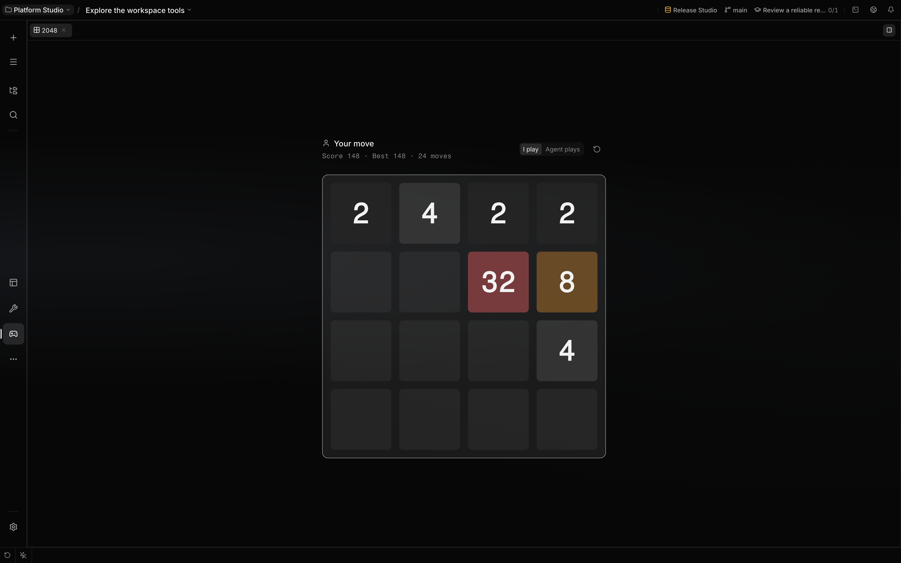

# 2048

Open **2048** from a chat's workbench rail. Each chat has its own board. Choose **I play** to move
tiles with the arrow keys or a swipe on the board, or **Agent plays** to hand the board to the agent
in that chat. A matching pair merges once per move and adds its new value to the score. A new tile
appears after each move that changes the board. Reach 2048 to win; the game also ends if no moves
remain. Each ending shows the final board, the score and a new game action.

Switching who plays keeps the current board and score. **New game** clears the board while keeping
the best score for that chat. Deleting the chat removes its game.

## When the agent plays

Handing the board to the agent starts a turn in the chat. The agent plays the whole game in that
turn through its `game_2048` tool, up to 32 moves per call, and the board replays each move as it
lands. The agent usually names an order of directions that keeps its largest tile in one corner;
each move then takes the first direction in that order that changes the board. It can also send an
exact list of moves, in which case a move that would not change the board is skipped rather than
refused.

The status shows how long ago the agent last moved; after 45 seconds without a move it offers
**Continue**, which asks the agent to go on. Choose **I play** at any time to take the board back:
the agent's next move is refused and it stops.
