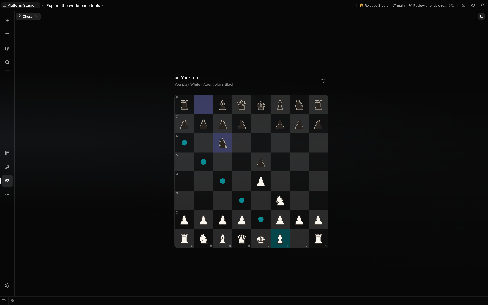
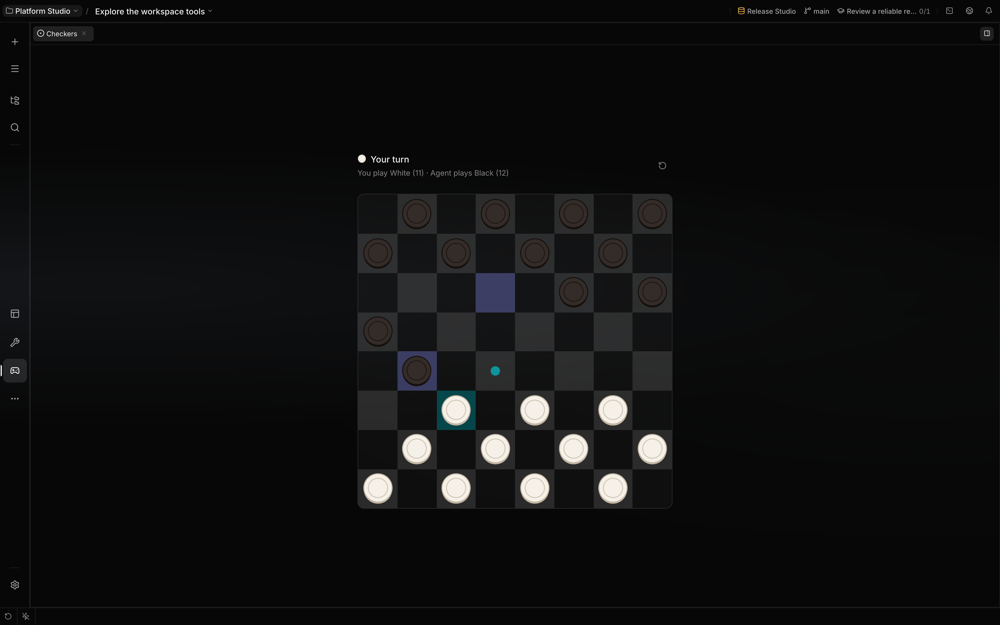
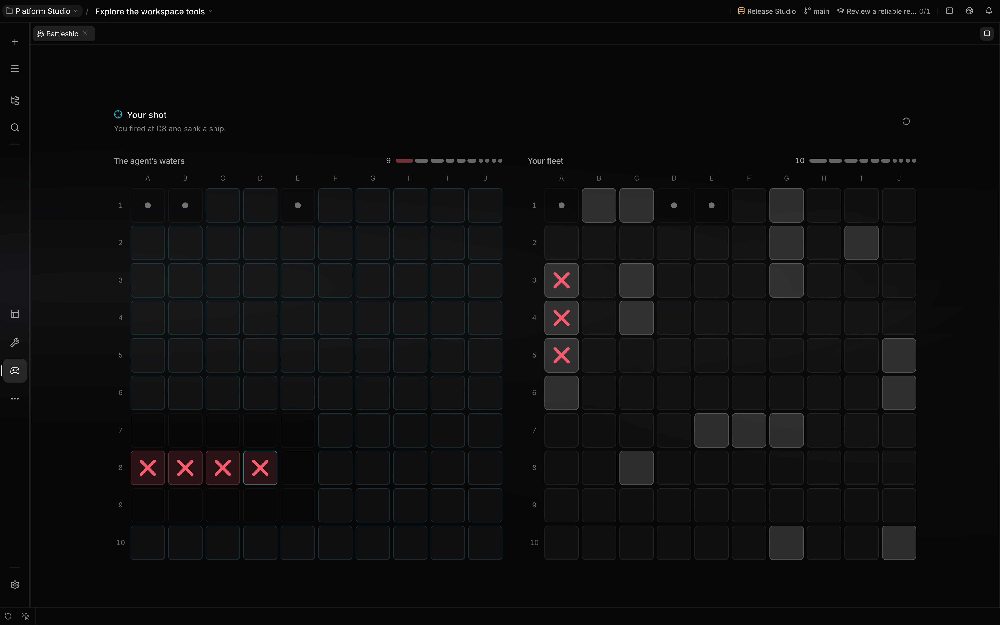
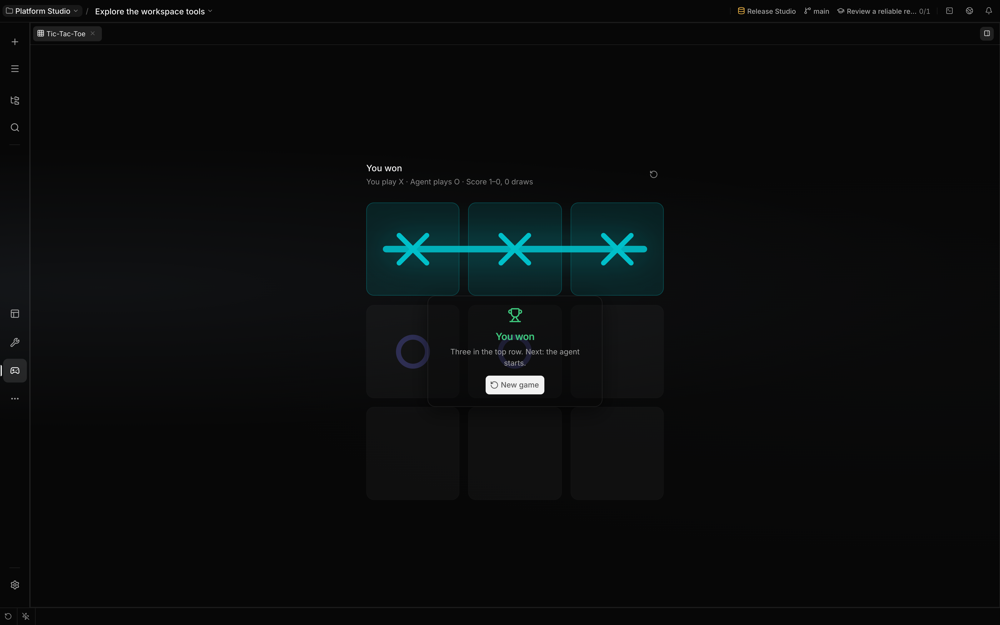

# Games with your agent

Open **Chess**, **Checkers**, **Battleship**, **Tic-Tac-Toe** or **Rock Paper Scissors** from a
conversation’s workbench rail. Each conversation has its own saved game. A new game starts the next
round, and deleting the conversation removes its game.

## Your opponent

The menu beside **New game** chooses who plays against you at this table:

- **Decision model**: the game asks a decision model (Jev through OpenRouter) for each move and
  plays its pick within a few seconds, without writing in the chat. Its spend is recorded under
  **Decisions** for the conversation.
- **Chat agent**: each move asks the conversation's agent, which answers through the game's tool.

A new table plays the decision model when a connected OpenRouter account can serve it, and the chat
agent otherwise. Your choice stays with the table from game to game. When the decision model cannot
answer, the board says why and offers **Ask again**.

These captures show legal saved demo positions in the actual workbenches. They demonstrate the board
and its controls; no model was called to produce the opponent’s moves.

## Chess

Click a piece to see its legal destinations, then choose a square. Promotion asks which piece the
pawn becomes. Your colour alternates between games, and the board faces your side.

## Checkers

The board uses Russian draughts rules. Select a piece and follow its available moves and captures.
The turn indicator keeps the human and agent’s moves in order.

## Battleship

Choose a square in the agent’s waters. The board shows the result while your own fleet remains
visible separately; the opponent’s hidden fleet is not sent to the browser.

## Tic-Tac-Toe

Choose an empty cell to play X. The result appears on the board when the game ends, with the table’s
score and a new game action.

## Rock Paper Scissors

Pick rock, paper or scissors. Whoever opens a round seals the move first, and the other side sees
only a digest until it has chosen too. When the agent opens, its card stays face down and the chat
shows its move as `[sealed]`. After your pick, both moves are revealed, and the table checks the
agent's move against the digest it showed you. Openers alternate from round to round.

For a tile puzzle with a separate human-play mode, see [2048](game-2048.md).
