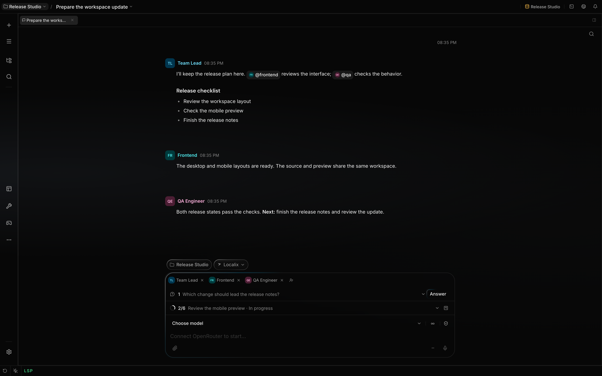
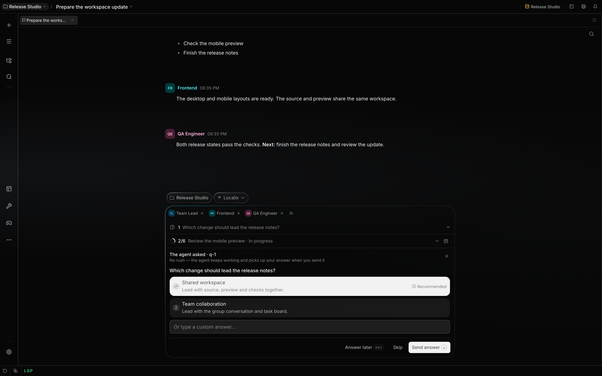

# Respond to human-in-the-loop requests

Human-in-the-loop requests collect an answer or approval before blocked work continues. Use Ask for
a structured decision and Confirm before permission-gated work proceeds.

## What you can do

| Request                     | Mechanism                                                                                      | Availability and boundary                                                                            |
| --------------------------- | ---------------------------------------------------------------------------------------------- | ---------------------------------------------------------------------------------------------------- |
| **Ask**                     | The built-in `ask` tool presents one or more single- or multi-select questions with free text. | Web/desktop and any channel plugin that implements HITL can answer it.                               |
| **Queued question**         | `ask` with `wait: false`: the agent keeps working and you answer whenever you like.            | Web/desktop. Open until answered or skipped, across restarts; it has no deadline.                    |
| **Confirm**                 | The permission gate or a foreground external CLI requests approval.                            | Web/desktop supports one-call and session grants. A channel plugin may support approve or deny only. |
| **Configuration change**    | The `configure` tool proposes a change to a tool, a plugin or an MCP server.                   | See [Propose configuration changes](configure.md).                                                   |
| **Cross-session attention** | One dialog raises a request, a plan or a mention from a chat you are not viewing.              | Closing the dialog snoozes it in that window; it does not resolve the request or decide the plan.    |

Every Ask question offers custom text in web/desktop, and the backend always accepts it. Each
question needs an `id`: the answer returns to the agent as `<id>: <choice>`. `loading_messages` is
optional; without it the card shows its own waiting line.

### One card, one vocabulary

Every request that blocks a run is answered the same way, whatever raised it.

| Element          | What it is                                                                                            |
| ---------------- | ----------------------------------------------------------------------------------------------------- |
| Title            | An imperative naming the act and its object — "Read useTheme.ts", "Run a command", "Start Tech Lead". |
| **Deny**         | Refuse. For approval cards, `Escape` and closing the card also deny. For a queueable Ask, they defer. |
| **Answer later** | Keep an Ask question in the queue and release the waiting tool without choosing an option.            |
| **Approve**      | Agree. `Enter`, and it is always the rightmost button.                                                |
| Middle buttons   | Only where they mean something — stepping through a multi-question form.                              |
| Deadline         | Blocking cards expire after five minutes without an answer. Queued questions have no countdown.       |

An expired card changes nothing — no rule is written, no secret stored, no agent started, no setting
touched — and the agent is told the refusal was automatic, in different words from the ones a
person's Deny produces. That difference matters: a model that cannot tell them apart either gives up
on work because a room was empty, or asks again after a real refusal.

The blocking deadline starts when the backend creates the request, rather than when its card becomes
visible. A request waiting behind an older one can therefore use part of its five-minute budget
before you see it. Expiration refuses the proposed action; it does not undo earlier work in the run.

Choose **Answer** to open the options. The selection stays explicit until you send it.

## How it works

### Routing and request order

The run's controller records a request and blocks the originating tool call. The chat runtime tracks
it, publishes `hitl.requested`, and returns all pending requests oldest-first in session detail.
Resolving the head exposes the next waiter.

A child session follows verified parent links to its root chat. The request is labelled with the
child title, while the child tool call remains blocked. A parentless automation job has no reachable
chat, so a permission decision that would ask fails closed.

Web/desktop reads cross-session attention from the server-owned list. The dialog ranks blocked
requests before plans and mentions, then shows the newest eligible item within that rank. Opening
the waiting session restores its in-session overlay. Dismissing the cross-session dialog snoozes
that item in the current window; the request stays pending.

### Ask

Each Ask question declares at least one option and may allow multiple selections. Web/desktop
preselects a valid recommended option. Submitted values are filtered against the original options,
and a single-select answer keeps at most one value.

An unanswered question is refused, never answered on your behalf. A timer that picked the
recommended option would put a choice nobody made into the transcript, and the agent could not tell
a considered answer from a timeout. So Ask reports that nobody chose, and the agent proceeds on its
own judgement — saying which assumption it made — or stops.

In web/desktop, **Answer later** saves a waiting Ask in the question queue and releases its tool
call. The agent continues with work that does not depend on the answer. No option is selected, and
the queued question has no deadline. Closing this card or pressing `Escape` also defers it. This
requires the chat's question queue; a host without it offers Deny and Approve only.

**Deny** rejects the tool call. Stopping the session aborts the pending request and run; the clients
clear the overlay when the request or run resolves.

### Queued questions

A blocking Ask is right for a decision the next step cannot be taken without. For a question whose
answer would only improve the result, the agent sets `wait: false`: the call returns at once with an
id (`q-3`), the agent keeps working, and the question waits for you.

| Where              | What you see                                                                                                                      |
| ------------------ | --------------------------------------------------------------------------------------------------------------------------------- |
| Above the composer | A **Questions** strip lists every open question. **Answer**, or a row click, opens it in the same composer area as a waiting Ask. |
| The card           | No countdown, and **Skip** instead of Deny. **Answer later**, ✕ and `Escape` restore message input and keep the question open.    |
| The sidebar        | A session with an open question shows a question mark in its status slot.                                                         |
| The transcript     | The `ask` card shows the id while open, then the answer, "skipped" or "asked again later".                                        |

Your answer is addressed to the agent that asked:

- if it is still working, at its next step, the way a message you type mid-run does;
- if it is idle, as a new turn, marked **via Answer**.

The answer is recorded first, which decides between two tabs answering at once — the second is told
the question is already closed. Its wake then carries a delivery receipt. A recovery pass at startup
retries answered records without a receipt from the last seven days; the receipt prevents duplicate
queue admission. It does not confirm that the agent completed a turn using the answer. If the
session can no longer accept that wake, delivery is marked decided and is not retried. An answer
that names none of the questions asked is refused.

If the agent opens a blocking card for an already queued question, a timeout or stopped run leaves
the original queued question open with the same id. Answering or explicitly denying that card closes
the queued copy; **Answer later** keeps it open without creating a second question.

A skip is not a turn: the agent's next prompt says it, once, and the agent goes on with its own
judgement. Each turn also lists the agent's still-open questions, so it neither asks one again nor
forgets one is outstanding. Asking the same question again — the same ids and the same wording —
replaces the open one; a reused id with a different question does not. A question whose `ask` call
an edit, a rollback or a branch switch took off the conversation is closed without waking anyone.

While you are away, an open question is also a row in the notification center, settled when the
question closes.

#### Asking again by id

The agent never has to write a question out twice. `from` replaces `questions` with the id of an
earlier one — a queued question's `q-N`, or the `tool_call_id` of an earlier `ask`, as `tool_output`
serves an earlier result:

| Call                               | What happens                                                                                                                       |
| ---------------------------------- | ---------------------------------------------------------------------------------------------------------------------------------- |
| `from: "q-3"`                      | A blocking card asks q-3's questions. Answered or denied, q-3 closes with it. **Answer later** or expiry leaves the same q-3 open. |
| `from: "q-3"`, `wait: false`       | If q-3 is still open, nothing new is queued. If it was closed, it is queued again under a new id.                                  |
| `from: "<call id>"`, `wait: false` | An expired blocking ask, left for later instead of written out again.                                                              |

An agent can only re-ask its own questions; in a room, a colleague's open question stays theirs.

Queued questions are stored in the database, so a restart does not lose them. Sub-agents and
automations cannot ask, blocking or queued.

### Cross-session attention

Everything waiting on you is one list, kept by the server and read again after a reload or a
reconnect. Three places read it: the dialog, the sidebar row's badge and the dock badge. Each kind
has a fixed rank. Blocked requests come first, then plans, then mentions, then queued questions.

| Kind                | What the dialog shows                                                                                                                                               | Sidebar badge     | Dock |
| ------------------- | ------------------------------------------------------------------------------------------------------------------------------------------------------------------- | ----------------- | ---- |
| **Blocked request** | The same card as in the chat, answered in place, with **Open chat**.                                                                                                | Hand, warning     | Yes  |
| **Plan**            | The chat, who presented which version, its title and the first lines of its body. **Approve ▾** (the mode, and the agent who starts), **Set aside**, **Open plan**. | Clipboard, info   | Yes  |
| **Mention**         | Who is asking and the question, with **Open chat**.                                                                                                                 | At sign, info     | Yes  |
| **Queued question** | Nothing: the agent did not stop, so it never interrupts.                                                                                                            | Question, warning | No   |

The dialog shows one item at a time. It picks the highest-ranked item in a chat you are not viewing,
newest first within a rank, and answering it reveals the next one. Escape, the overlay and opening
the chat snooze an item in that window only. The request keeps waiting, the badges keep counting,
and a new item in the same chat still raises the dialog. The dock badge counts the chats that have a
blocked request, a plan or a mention waiting.

### Confirm and session grants

A permission rule with action `ask` creates Confirm before the tool executes. The card shows what is
asked — the command, the path or the resource — and, for a sub-agent, which sub-agent asked. The
footer carries the two answers every card shares; how far an approval reaches is chosen above it.

A path card draws the path as breadcrumbs, and each folder it can widen to is a clickable segment.
Clicking one picks the level from which down not to ask — moving a **Once** answer to **This
session** — and the steps above it fade, so the trail reads as what the answer covers.

| Control             | Effect                                                                       | Boundary                                                                   |
| ------------------- | ---------------------------------------------------------------------------- | -------------------------------------------------------------------------- |
| **Approve**         | Runs this call with the chosen duration and level.                           | With **Once** it grants only this call.                                    |
| **Deny**            | Blocks this call.                                                            | Dismissal has the same result.                                             |
| Duration            | **Once**, **This session**, or **Always** (also written to the agent rules). | **Always** is disabled where the chosen breadth has no rule to write.      |
| Path segment        | On a path card: the file, or a folder above it, from which down not to ask.  | Stops before the home folder and before `~/.localix`; nearest six folders. |
| Reply (footer icon) | Words sent to the agent with the answer — "read `src/theme.ts` instead".     | Up to 2000 characters, delivered in the same tool result as the verdict.   |

What a widened answer covers follows the subject the card showed:

| Subject  | Breadth                                        | Rule **Always** writes |
| -------- | ---------------------------------------------- | ---------------------- |
| Command  | Every command of the same program: `bash(git)` | `bash(git *)`          |
| Path     | That path, or anything inside a chosen folder  | `read(/work/src/*)`    |
| Resource | That one declared resource                     | The resource itself    |

The host lists the breadths it will honour, and the answer names one of them; an answer naming
anything else widens nothing. A call that reduces to no breadth — an interpreter, a chained line, a
command substitution, a credential path — offers none, and the card then shows no **Allow** row: the
host approves the one call and asks again next time. An **Always** rule is offered only when it
would have allowed this very call, and it is written before the rules about dangerous commands and
secrets, so it can never silence those.

Session grants live in API-process memory, hold at most 64 scopes per requester, and disappear on
restart. Reloading a client does not remove them. When policy requires confirmation, a dangerous
shell command still asks even when its program has a session grant, and a folder grant never covers
a credential path inside it.

Confirm expires like every other card: five minutes, then denied. It does not wait indefinitely,
because a run that asked while nobody was at the keyboard would stay blocked until the process
restarted. When no confirmation channel is reachable at all, an `ask` permission decision becomes a
denial immediately rather than waiting for a deadline nobody could have met.

The time a card waits for a person is booked as human-in-the-loop time in the message and session
timing, never as the tool's own duration — a shell command approved after four minutes still reports
the seconds it actually ran.

## Configuration

| Control                      | Scope and behavior                                                           |
| ---------------------------- | ---------------------------------------------------------------------------- |
| Permission rule action `ask` | Produces Confirm for a matching tool call when a human channel is reachable. |
| Ask `recommended`            | Zero-based option index used for preselection only; it is never auto-chosen. |
| Ask `multi`                  | Allows more than one original option value.                                  |
| CLI `timeoutSeconds`         | Positive wall-clock cap; foreground defaults to 900 seconds.                 |
| CLI `background`             | Removes the Localix HITL binding; the default timeout becomes unlimited.     |

| Surface     | Select and submit                                                    | Dismiss                                                     |
| ----------- | -------------------------------------------------------------------- | ----------------------------------------------------------- |
| Web/desktop | Number keys `1`–`9` select Ask options; `Enter` advances or submits. | `Escape` dismisses in-session; inbox `Escape` only snoozes. |

Each client keeps a request visible while its response is in flight. A failed response remains
available for retry; `hitl.resolved` removes the matching request and exposes the next one.

## Limits

- The external CLI bridge requires a plugin to pass the run context and an adapter to wire the
  callback into a CLI that supports permission prompting.
- If the loopback server cannot start, the CLI run continues without the Localix binding. The
  adapter then owns its non-interactive permission posture.
- Background external CLI runs cannot pause for Localix approval overlays.
- A session grant matches a program, a path, a folder or one resource — never a whole tool, except
  for a call that names nothing at all. Dangerous shell commands and credential paths are the
  enforced exceptions to grant reuse; a policy decision requiring confirmation still asks.
- A channel plugin may expose only approve and deny, not the session-grant choice available in
  web/desktop.
- Plugin HITL lifecycle hooks observe requests and resolutions. They cannot answer, modify, or veto
  them.

## Related guides

- [Propose configuration changes](configure.md)
- [Capabilities and permission posture](capabilities.md)
- [Permissions](permissions.md)
- [Forks and background work](delegation.md)
- [Vault and secrets](secrets.md)

## Source of truth

- [Ask tool and timeout](https://github.com/rsaryev/localix/blob/main/apps/api/src/features/agent-core/tools/hitl/ask.ts)
- [Queued questions: what the agent reads](https://github.com/rsaryev/localix/blob/main/apps/api/src/features/agent-core/tools/hitl/ask-queue.ts)
- [Queued question registry](https://github.com/rsaryev/localix/blob/main/apps/api/src/features/questions/registry.ts)
- [Answering and delivering a queued question](https://github.com/rsaryev/localix/blob/main/apps/api/src/features/chat/service/question-facade.ts)
- [Delivery receipt and recovery horizon](https://github.com/rsaryev/localix/blob/main/apps/api/src/features/chat/runtime/delivery-receipts.ts)
- [Generic request controller](https://github.com/rsaryev/localix/blob/main/packages/agent/src/agents/human-in-loop.ts)
- [Request routing and queue registry](https://github.com/rsaryev/localix/blob/main/apps/api/src/features/chat/runtime/hitl-registry.ts)
- [Permission confirmation flow](https://github.com/rsaryev/localix/blob/main/apps/api/src/features/chat/runtime/run/confirm-requester.ts)
- [Web/desktop request mapping](https://github.com/rsaryev/localix/blob/main/apps/ui/src/features/chat/model/hitlInteraction.ts)
- [Requester-scoped grant storage](https://github.com/rsaryev/localix/blob/main/apps/api/src/features/chat/runtime/session-grants.ts)
- [Shared five-minute deadline](https://github.com/rsaryev/localix/blob/main/apps/api/src/features/agent-core/tools/hitl/decision-deadline.ts)
- [Attention selection](https://github.com/rsaryev/localix/blob/main/apps/ui/src/features/chat/model/attention/select.ts)
- [Attention ranking per kind](https://github.com/rsaryev/localix/blob/main/apps/ui/src/features/chat/model/attention/policy.ts)
- [Cross-session attention dialog](https://github.com/rsaryev/localix/blob/main/apps/ui/src/features/chat/ui/attention/AttentionDialog.tsx)
