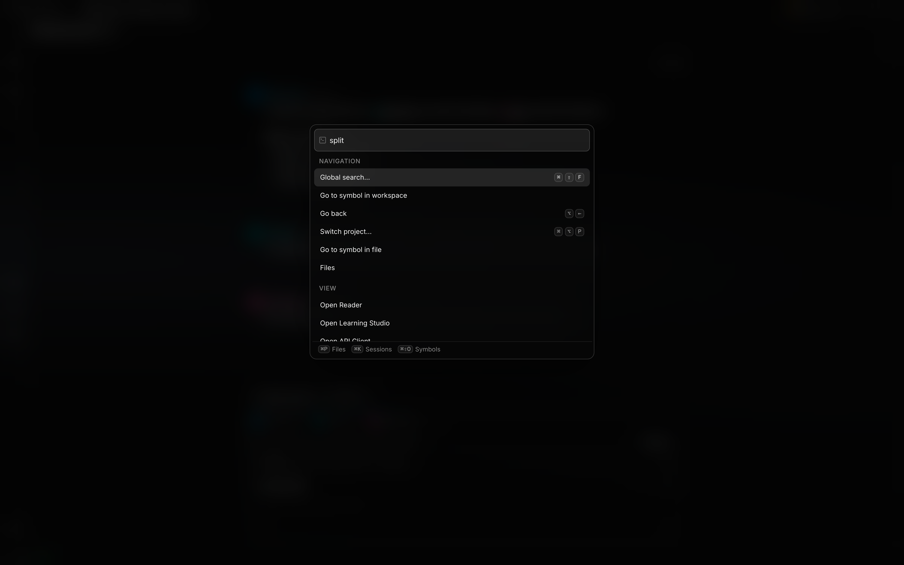

# Keyboard shortcuts

Choose a **Base keymap** in **Settings → Shortcuts**. Presets adapt existing Localix workspace
commands to familiar editor conventions. The selector includes 17 choices, counting Default. Search
settings by an editor name to find it.

The desktop [agent island](./agent-companion.md) uses the fixed global **Cmd+Shift+J** shortcut on
macOS. It works outside Localix when the OS accepts registration and is listed in Settings for
reference; workspace presets do not rebind it.

## Change one shortcut

1. Open **Settings → Shortcuts** and use **Search shortcuts…** to find a command by its name,
   description or displayed keys.
2. Select its keycaps, then press the new combination while **Press keys…** is shown. Changes apply
   locally without a separate Save button. Escape cancels recording rather than becoming a binding.
3. If the recorder names another command using those keys, choose **Assign anyway** to keep the
   conflict, or **Cancel rebind** to keep the current shortcut.
4. Try the command with its intended surface focused. The focused component or operating system can
   still own that combination; see [Focus and shortcut ownership](#focus-and-shortcut-ownership).

**Unassign** removes that command's keyboard binding. **Reset shortcut to default** restores its
Localix catalog binding, even if you previously selected another editor's preset. Reapply **Base
keymap** to restore that preset's whole batch; doing so replaces your individual overrides.
Reference-only rows have no recording control.

## Available keymaps

| Preset                   | Compatible workspace commands                                              | Scope                                                                                            |
| ------------------------ | -------------------------------------------------------------------------- | ------------------------------------------------------------------------------------------------ |
| Default                  | Localix’s built-in bindings                                                | Workspace                                                                                        |
| VS Code / VSCodium       | Navigation, editor tabs, terminal                                          | Uses native macOS or Windows/Linux variants                                                      |
| Cursor                   | VS Code conventions, new chat, cancel generation                           | Existing Localix actions                                                                         |
| Windsurf / Devin Desktop | Compatible VS Code workspace conventions                                   | Existing Localix actions                                                                         |
| Zed                      | Navigation, terminal, zoom                                                 | Uses native macOS, Windows, or Linux variants                                                    |
| JetBrains (IntelliJ)     | Actions, files, symbols, recent sessions, sidebar, terminal, tabs, history | IntelliJ IDEA-style keymaps used by PyCharm, WebStorm and Android Studio                         |
| Sublime Text             | Files, document/project symbols, tabs                                      | File and tab shortcuts adapt to the OS                                                           |
| Atom                     | File/symbol finders, sidebar, recent sessions                              | Archived Atom conventions adapted to Localix workspace actions                                   |
| TextMate                 | File finder, document symbols, sidebar                                     | The context-dependent symbol chord is reserved for document symbols                              |
| Visual Studio            | Command search, outline, sidebar, tabs, history                            | Windows-style conventions adapted to the current OS; macOS keeps the safe local palette shortcut |
| Eclipse                  | Quick Access, Open Resource, Search, tabs, history                         | Existing Localix actions                                                                         |
| Xcode                    | Open Quickly, document symbols                                             | Command+Shift+O and physical Control+6 on macOS; adapted modifiers elsewhere                     |
| Notepad++                | Next/previous document, find in files                                      | Windows-style workspace conventions                                                              |
| Emacs (workspace)        | M-x command palette, M-, back navigation                                   | Single-stroke workspace bindings                                                                 |
| Vim (navigation)         | Ctrl+O / Ctrl+I history                                                    | Workspace navigation                                                                             |
| Neovim (navigation)      | Ctrl+O / Ctrl+I history                                                    | Workspace navigation                                                                             |
| Helix (navigation)       | Ctrl+O / Ctrl+I history                                                    | Workspace navigation                                                                             |

These are workspace presets. They do not install an editor, add editor commands, or enable modal
editing. Vim, Neovim and Helix do not gain Normal/Insert modes or motions. Emacs multi-stroke
sequences such as C-x C-f are not represented by the single-stroke shortcut engine. Commands without
a compatible binding keep Localix’s defaults unless a conflicting chord must be reserved; those
commands remain available from the command palette.

Some actions have a different scope in Localix. JetBrains Recent Files and Atom's buffer finder open
the session switcher; their project/tree controls toggle the workspace sidebar. Visual Studio's
Document Outline chord opens document symbol lookup, and its Solution Explorer chord toggles the
sidebar. Eclipse's Search chord opens Localix global search. These mappings preserve familiar keys
while using Localix's existing surfaces and search behavior.

On macOS, terminal-editor history uses physical Control, while ordinary application accelerators use
Command. Option-letter equivalents are handled when macOS emits a symbol, so Emacs M-x works with an
Option-X event rather than requiring the generated ≈ character.

## Focus and shortcut ownership

Keyboard commands follow the focused component. Terminals, code editors, file trees, canvases and
form controls receive a key first. If that component handles the key, the workspace does not run
another command for it, including when a workspace binding has been customized.

Monaco also retains the default session-switch chord and, outside Linux, the default next/previous
group chords while code input has focus. A different explicit rebind can use those workspace
commands if the editor leaves the event unclaimed. In macOS Desktop, Command+T is reserved for a
native workspace tab: file lookup falls back to Command+P, workspace symbols to
Command+Option+Shift+O, and other conflicting assignments become unassigned.

In a terminal, Command/Ctrl+K clears the terminal instead of opening the session switcher.
Command/Ctrl+F opens terminal find, and Command/Ctrl+Shift+O opens its link picker. On macOS,
physical Control+K still belongs to the shell. Unclaimed workspace shortcuts remain available.

Reader, Code Graph and 2048 keyboard commands apply only inside their focused pane. Question-card
Enter, Escape and number shortcuts apply inside that card. Dialogs and menus block workspace
commands behind them, including while a field inside the overlay has focus. Ordinary typing, field
navigation, IME composition and AltGr character entry do not trigger workspace shortcuts. F1 opens
the command palette only when the focused component has not handled it and no overlay blocks
workspace keys.

## Editing and persistence

Applying a preset replaces the shortcut override batch. Editing an individual shortcut changes the
selector to **Custom** when the batch no longer matches. **Reset all shortcuts** confirms the reset
and returns both bindings and the selected identity to Default. Built-in interaction keys such as
Enter to send remain reference-only.

The chosen editor name is preserved when compatible bindings happen to be identical, such as VS Code
and Windsurf, or Vim and Neovim history. Untouched synchronized presets adapt to the current OS.
Custom overrides are preserved exactly. Old shipped JetBrains and Sublime batches retain their
identity and exact bindings; reapply the preset to use its current platform-specific bindings.

The preset validator checks configurable command IDs, chord syntax, duplicate override chords, and
same-category conflicts after resolving defaults for each declared platform batch. The recorder
warns about other configurable commands in the same category and lets you **Assign anyway**.
Cross-category duplicates and shortcuts owned by the OS, browser, or focused editor are outside that
conflict warning. A saved chord therefore does not guarantee that a workspace action receives it in
every context.

Bindings update locally and enter the shared user-profile save queue with an 800 ms debounce. Failed
saves retry with backoff while the app is running. Browser storage is a best-effort startup cache;
the API profile is authoritative. Before the first successful profile read, writes wait and an
existing server UI-settings value can replace cached or unsynchronized edits. Wait for profile
synchronization before relying on a new keymap across windows or devices.

## Upstream references

These primary-source references document upstream conventions and keymap formats. Localix's preset
definitions below own its implemented subset and platform adjustments; an upstream shortcut is not
automatically a Localix command.

- [VS Code default shortcuts](https://code.visualstudio.com/docs/reference/default-keybindings)
- [Zed platform and compatibility keymaps](https://github.com/zed-industries/zed/tree/main/assets/keymaps)
- [JetBrains default keymap](https://github.com/JetBrains/intellij-community/blob/master/platform/platform-resources/src/keymaps/%24default.xml)
  and
  [macOS keymap](https://github.com/JetBrains/intellij-community/blob/master/platform/platform-resources/src/keymaps/Mac%20OS%20X%2010.5%2B.xml)
- Archived Atom keymaps:
  [file and buffer finders](https://github.com/atom/fuzzy-finder/blob/master/keymaps/fuzzy-finder.cson),
  [symbol navigation](https://github.com/atom/symbols-view/blob/master/keymaps/symbols-view.cson),
  and [tree view](https://github.com/atom/tree-view/blob/master/keymaps/tree-view.cson)
- [Sublime Text key-binding format](https://www.sublimetext.com/docs/key_bindings.html); inspect the
  installed editor's `Default/Default ({PLATFORM_NAME}).sublime-keymap` for its actual defaults.
- [TextMate 2 Open Quickly](https://macromates.com/textmate/manual/opening-files#open-quickly)
- [Emacs M-x commands](https://www.gnu.org/software/emacs/manual/html_node/emacs/M_002dx.html) and
  [xref history bindings](https://github.com/emacs-mirror/emacs/blob/master/lisp/progmodes/xref.el)
- [Visual Studio shortcuts](https://github.com/MicrosoftDocs/visualstudio-docs/blob/main/docs/ide/default-keyboard-shortcuts-in-visual-studio.md)
- [Eclipse workbench keymaps](https://github.com/eclipse-platform/eclipse.platform.ui/blob/master/bundles/org.eclipse.ui/plugin.xml)
  and
  [IDE keymaps](https://github.com/eclipse-platform/eclipse.platform.ui/blob/master/bundles/org.eclipse.ui.ide/plugin.xml)
- [Notepad++ default shortcuts](https://github.com/notepad-plus-plus/notepad-plus-plus/blob/master/PowerEditor/src/Parameters.cpp)
- [Xcode Open Quickly](https://developer.apple.com/documentation/xcode/finding-and-refactoring-code)
  and [document symbol navigation](https://developer.apple.com/videos/play/wwdc2021/10194/?time=578)
- [Vim jump history](https://github.com/vim/vim/blob/master/runtime/doc/motion.txt),
  [Neovim jump history](https://github.com/neovim/neovim/blob/master/runtime/doc/motion.txt), and
  [Helix defaults](https://github.com/helix-editor/helix/blob/master/helix-term/src/keymap/default.rs)
- [Cursor shortcut reference](https://cursor.com/docs/reference/keyboard-shortcuts) and
  [Windsurf editor migration](https://windsurf.com/switch/cursor)

## Source of truth

- [Preset definitions](https://github.com/rsaryev/localix/blob/main/apps/ui/src/shared/lib/keybindings/presetDefinitions.ts)
- [Matching, OS adaptation and validation](https://github.com/rsaryev/localix/blob/main/apps/ui/src/shared/lib/keybindings/presets.ts)
- [Settings and runtime synchronization](https://github.com/rsaryev/localix/blob/main/apps/ui/src/features/settings/model/useKeybindings.ts)
- [Native-tab reservation and conflict scope](https://github.com/rsaryev/localix/blob/main/apps/ui/src/shared/lib/keybindings/resolve.ts)
- [Focused-surface routing](https://github.com/rsaryev/localix/blob/main/apps/ui/src/shared/lib/actions/ActionRegistryProvider.tsx)
- [Default editor ownership](https://github.com/rsaryev/localix/blob/main/apps/ui/src/shared/lib/keybindings/editorKeyOwnership.ts)
- [Terminal key ownership](https://github.com/rsaryev/localix/blob/main/apps/ui/src/features/terminal/model/terminalKeymap.ts)
- [Recorder conflict confirmation](https://github.com/rsaryev/localix/blob/main/apps/ui/src/features/settings/ui/keyboard/ChordRecorder.tsx)
- [Profile save and retry](https://github.com/rsaryev/localix/blob/main/apps/ui/src/features/settings/model/settingsStore.ts)
- [Initial profile precedence](https://github.com/rsaryev/localix/blob/main/apps/ui/src/features/settings/model/settingsSyncBarrier.ts)
