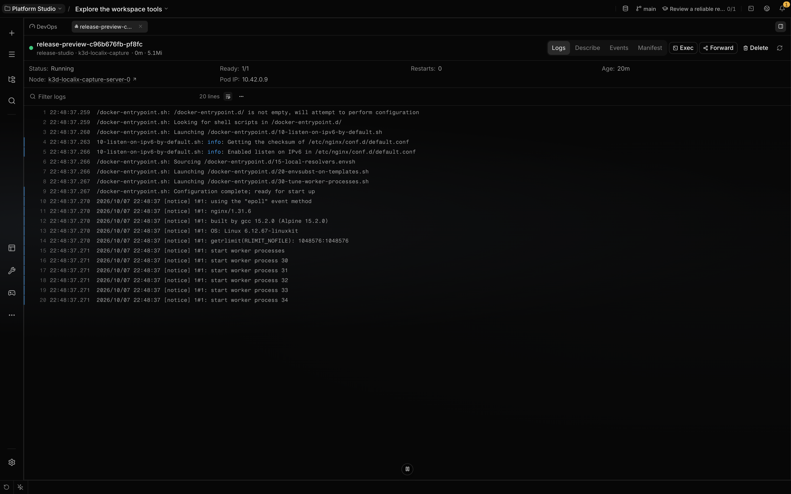

# Operate Kubernetes clusters

Kubernetes is the cluster provider in the bundled, default-enabled [DevOps Workspace](devops.md).
Use it to inspect workloads, logs, events, manifests, and metrics or to run confirmed deployment,
pod, node, and manifest changes against a selected kubeconfig context.

**Requires:** The plugin must stay enabled, and the Localix host needs kubeconfig credentials,
network access to the API server, and sufficient RBAC.

## What you can do

| Surface       | Mechanism                                                   | Boundary                                                   |
| ------------- | ----------------------------------------------------------- | ---------------------------------------------------------- |
| Workloads     | Group deployments with their current pods and readiness     | Data follows the selected context and namespace            |
| Pods          | Read logs, events, describe output, manifests, and usage    | Exec, delete, and port forward require live cluster access |
| Deployments   | Inspect owned pods; restart, scale, or edit the manifest    | Apply changes mutate the live cluster                      |
| Services      | Read describe output, events, and YAML; edit and apply YAML | The workbench has no generic editor for other kinds        |
| Nodes         | Read health, roles, versions, usage, pods, and YAML         | Cordon, uncordon, drain, and YAML apply mutate the cluster |
| Port forwards | List and stop Localix-managed loopback forwards             | Forward state lasts only for the Localix process           |

The workbench stores one namespace selection per context in local UI state. Selecting a context for
a request does not rewrite kubeconfig's `current-context`.

## How it works

The provider loads `@kubernetes/client-node` on first use and calls `KubeConfig.loadFromDefault()`.
The provider selects context on an in-memory config, cached by requested context for up to 60
seconds. Context discovery reloads the default config explicitly. Typed clients, object discovery,
metrics, watches, exec, and port forwarding all use that config; the provider does not invoke
`kubectl`.

HTTP calls run through a Bun transport that applies kubeconfig authentication, TLS material, and
`proxyUrl`. Watches use a reference-counted list/watch cache for each context and namespace. The UI
reconciles watch changes with REST polling, which becomes the primary feed when the watch is down.

Pod exec creates a single-use loopback WebSocket bridge and opens it in a terminal. Port forwarding
binds a local listener to `127.0.0.1` and tunnels through the Kubernetes port-forward subresource.
Closing a pod tab requests best-effort cleanup of forwards owned by that tab. Sidebar forwards have
no tab owner and remain until stopped. Plugin shutdown closes every watch, exec, and forward.

Kubernetes objects can enter chat as `localix://resource/k8s` references. The dedicated workbench
views cover pods, deployments, services, and nodes. API discovery lists other listable kinds,
including installed custom resources.

### Agent access

The workbench contributes no Kubernetes agent tools. An agent can use `kubectl` through `bash` when
it is installed and its permission rules allow the command. The workbench itself does not require
that CLI.

`kubectl delete` and `kubectl drain` match bash's dangerous command patterns. The agent's permission
rules decide whether the gate allows, confirms, or denies those calls.

Cluster context still reaches the agent as context rather than as a tool: `localix://resource/k8s`
resource references expand into read-only snapshots you can attach to a message.

## Configuration

| Input              | Behavior                                                                        |
| ------------------ | ------------------------------------------------------------------------------- |
| `KUBECONFIG`       | Loads and merges files separated by the platform path delimiter                 |
| Default kubeconfig | Uses the platform default when `KUBECONFIG` is unset; normally `~/.kube/config` |
| Context            | A request that names no context uses kubeconfig `current-context`               |
| Namespace          | The workbench remembers one namespace per context                               |
| Kubeconfig `exec`  | Runs the command named by the kubeconfig on the Localix host                    |

Static tokens, basic authentication, and certificates supported by the client need no `kubectl`
binary. A kubeconfig `exec` entry can still require its own credential helper.

The workbench restores a still-valid saved context first, otherwise kubeconfig's current context or
the first listed context. A missing saved namespace falls back to a valid current selection,
`default`, or the first namespace. **All namespaces** is retained as a special selection. These
choices are UI state; they do not alter kubeconfig files.

## Limits

- The provider does not create clusters or credentials. Invalid credentials, unreachable servers,
  and insufficient RBAC remain cluster errors.
- Kubeconfig `proxyUrl` is passed to HTTP requests. The custom WebSocket handler does not pass that
  proxy setting, so watches, exec, and port forwards may fail for proxy-only clusters.
- Pod and node usage is absent when `metrics.k8s.io` is unavailable or forbidden.
- Generic object listings return a bounded number of rows and expose `truncated` when the response
  contains an extra row. This is not a pagination or completeness guarantee for every dedicated
  workbench list.
- The workbench has dedicated views only for pods, deployments, services, and nodes. Other kinds and
  custom resources appear through API discovery, not a generic workbench editor.
- Port forwards are loopback-only and are not restored after Localix exits.
- Drain first cordons the node, then skips completed pods, mirror pods, and DaemonSet-owned pods. It
  retries disruption-budget rejections between eviction passes, with a 120-second deadline checked
  between passes. A failure can leave the node cordoned and some pods already evicted; drain does
  not undo those changes.
- Manifest apply performs a server-side dry run before server-side apply. The provider implements no
  rollback for the live change.
- Apply accepts one YAML object with `apiVersion`, `kind`, and `metadata.name`, rather than a
  multi-document bundle. It strips `status` and server-managed metadata such as `resourceVersion`,
  `uid`, and `managedFields`, then applies with field manager `localix-kubernetes` and no forced
  ownership override. Dry-run success does not guarantee the later live apply succeeds.
- Kubeconfig edits may remain unseen by ordinary calls until the 60-second cached config expires.
  That expiry governs later config reads, not automatic reconnection of existing watches.

## Related guides

- [DevOps Workspace](devops.md)
- [Containers](docker.md)
- [Workspace](workspace.md)
- [Plugins](../extending/plugins.md)

## Source of truth

- [Plugin default and boundary](https://github.com/rsaryev/localix/blob/main/plugins/devops/plugin.json)
- [Provider registry](https://github.com/rsaryev/localix/blob/main/plugins/devops/kubernetes/backend/index.ts)
- [API backend and kubeconfig](https://github.com/rsaryev/localix/blob/main/plugins/devops/kubernetes/backend/api-backend.ts)
- [HTTP and WebSocket transport](https://github.com/rsaryev/localix/blob/main/plugins/devops/kubernetes/backend/api-http.ts)
  ·
  [plugins/devops/kubernetes/backend/api-websocket.ts](https://github.com/rsaryev/localix/blob/main/plugins/devops/kubernetes/backend/api-websocket.ts)
- [API discovery](https://github.com/rsaryev/localix/blob/main/plugins/devops/kubernetes/backend/discovery.ts)
- [Port-forward lifecycle](https://github.com/rsaryev/localix/blob/main/plugins/devops/kubernetes/backend/api-port-forward.ts)
  ·
  [plugins/devops/kubernetes/ui/model/useForwardCleanup.ts](https://github.com/rsaryev/localix/blob/main/plugins/devops/kubernetes/ui/model/useForwardCleanup.ts)
- [Watch and exec lifecycle](https://github.com/rsaryev/localix/blob/main/plugins/devops/kubernetes/backend/api-watch.ts)
  ·
  [plugins/devops/kubernetes/backend/api-exec.ts](https://github.com/rsaryev/localix/blob/main/plugins/devops/kubernetes/backend/api-exec.ts)
- [Workbench contributions](https://github.com/rsaryev/localix/blob/main/plugins/devops/kubernetes/ui/register.tsx)
- [Context and namespace state](https://github.com/rsaryev/localix/blob/main/plugins/devops/kubernetes/ui/model/useKubernetesScope.ts)
- [Configuration cache and manifest cleanup](https://github.com/rsaryev/localix/blob/main/plugins/devops/kubernetes/backend/api-internals.ts)
- [Manifest apply calls](https://github.com/rsaryev/localix/blob/main/plugins/devops/kubernetes/backend/api-manifests.ts)
- [Manifest editor](https://github.com/rsaryev/localix/blob/main/plugins/devops/kubernetes/ui/model/useManifestEditor.ts)
