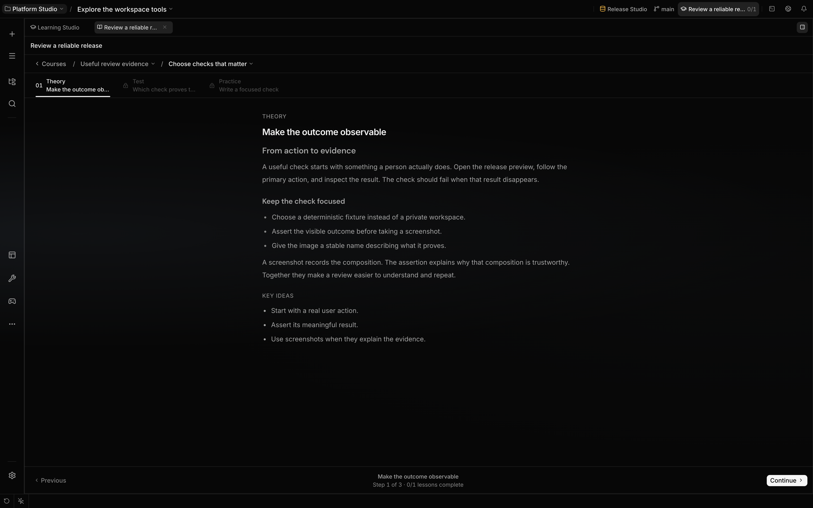

# Carry context into later work

Localix stores explicit memory notes, agent definitions, reusable skills, and searchable session
transcripts for later work. Use them to preserve durable facts, repeat procedures, or retrieve
evidence from an earlier session.

**Boundary:** Localix loads stored context, but it does not extract every durable fact or workflow
automatically.



## What you can do

| Surface             | Mechanism                                                                              | Boundary                                                                                               |
| ------------------- | -------------------------------------------------------------------------------------- | ------------------------------------------------------------------------------------------------------ |
| Memory              | Store keyed Markdown notes at session, project, or global scope                        | Use `/memory`, the `memory` tool, or deliberate file edits; tool writes enforce the note budget        |
| Skills              | Reuse project or global procedures stored as `SKILL.md` files                          | Saving is explicit or depends on the model choosing the `skill` tool; see [Skills](skills.md)          |
| Session recall      | Discover sessions by full-text query, browse recent sessions, or page around a message | Recall requires `history_search`; transcripts are not injected on every turn                           |
| Learning Studio     | Build, import, export, and study file-authored courses                                 | The bundled `learning` plugin is enabled by default but can be disabled; courses belong to one session |
| Memory-provider API | Let one enabled native plugin replace or append built-in prompt memory                 | Provider calls are bounded and best-effort; a disabled plugin contributes nothing                      |

## How it works

### Memory scopes

The table below describes **All available scopes**. An agent’s selected **Memory scope** restricts
prompt recall and `memory` reads/writes to that one scope. If it is unavailable, a write fails
rather than falling back. `/memory` is a direct user command with the separate behavior shown below.

| Operation                           | Scope behavior                                                                                        |
| ----------------------------------- | ----------------------------------------------------------------------------------------------------- |
| `memory.set` without `scope`        | Writes to the project, or the root session without a project; a selected agent scope takes precedence |
| `memory.set` with `scope: "global"` | Writes a value visible across sessions                                                                |
| `memory.get`                        | Checks visible session, project, then global entries and returns the narrowest duplicate key          |
| Prompt loading and `memory.list`    | Include entries from every visible scope; duplicate keys are not collapsed                            |
| `memory.delete`                     | Removes the key from every visible scope; the call’s `scope` field does not narrow deletion           |
| `/memory <fact>`                    | Saves project memory when a project exists, otherwise global memory; no agent run starts              |
| Bare `/memory`                      | Lists project and global memory; session memory is not included                                       |

Memory files use `## <key>` headings and optional `<!-- updated: ... -->` comments. A write that
would exceed one file’s budget is rejected without changing that file. The budget counts UTF-16 code
units in serialized headings, separators, and trimmed values; timestamp comments are excluded.
Reserve level-two headings for keys: a `##` heading inside a note starts another entry when read.
Direct file edits bypass the repository’s write-budget guard.

### Save and verify a note

With **All available scopes**, these are inputs to the `memory` tool. Save a project fact with an
explicit scope so moving the conversation to a different project does not change your intent:

```json
{
  "action": "set",
  "key": "project.test_runner",
  "value": "Use Bun Test for this project's tests.",
  "scope": "project"
}
```

Then inspect the visible entries and their scope labels:

```json
{ "action": "list" }
```

`get` returns the narrowest visible value for a key, so a conversation note can shadow the project
note you just saved. Passing `scope` to `get` or `list` does not narrow the read; select the agent's
**Memory scope** to restrict it. The same field does not narrow `delete`: deletion removes every
visible copy of the key. Check the listed scopes before deleting a duplicated key.

### Prompt snapshots

Each chat participant has a stored prompt snapshot for its context boundary. Memory and project
instructions normally stay frozen across later runs, including API restarts. A topic change, a
context checkpoint, or a new session creates a fresh boundary. Non-chat runs build fresh context
rather than using the chat snapshot.

Changing an agent’s memory scope refreshes its memory context on the next run without requiring a
checkpoint. The bounded skill catalog also refreshes when its discovered content or overrides
change. These exceptions do not make ordinary memory-note edits immediately visible in the frozen
prompt.

Writes update storage immediately and can be read with `memory` even while the prompt snapshot
remains frozen. Set `LOCALIX_FREEZE_CONTEXT=0` to rebuild the snapshot on each run.

### Recall and courses

`history_search` has three modes: a `query` performs SQLite FTS discovery grouped by session, a
`sessionId` reads a bounded window around a message, and no arguments browse recent sessions. The
tool returns previews and message identifiers rather than replaying a full transcript.

Learning Studio validates course bundles authored under `.localix/learning-drafts/`, imports valid
content into the owning session's plugin data, and exposes the course hierarchy as session-scoped
resources. Course creation, adaptation, import, export, and study progress are explicit actions.

Courses prepare one complete module at a time. The first module is ready at activation; course
activity can request the next pending module once half the current module's lessons are completed
(rounded up) or its last lesson opens. Pending material refreshes in the reader when ready. Wake
delivery and preparation can fail, and automatic requests stop after three attempts per module. If
preparation stalls, ask a reachable tutor to inspect the failure and prepare the pending module in
the same course. Readiness is not guaranteed by a fixed deadline.

Quiz options use a stable shuffled order. The backend checks selected option ids and preserves
first-attempt scores across retries. Practice submission saves the solution and wakes the agent
through the common plugin host interface in the owning conversation. The agent records feedback
against the acceptance criteria; continuation requires a passing review. That review does not
complete the step for you. It is tied to the submitted attempt; repeated reviews keep the original
result, and an outdated submission cannot overwrite a newer one. Course prose and code fences use
the same Markdown renderer as conversation messages.

With **All available scopes**, an external memory provider can run `loadContext` when a fresh prompt
snapshot is built. `loadContext` may append to built-in notes or replace their prompt
representation; it does not remove the built-in memory store or tool. A selected native memory scope
disables this unscoped provider’s prompt recall. The 8,000-code-unit cap applies to provider output;
append mode can produce a larger combined context with built-in notes.

An enabled provider’s `onRunEnd` hook can still receive the completed turn’s user and assistant text
when a native memory scope is selected. Scope selection disables provider recall, not the provider
or its completion hook.

## Configuration

| Store or control         | Current boundary                                                                       |
| ------------------------ | -------------------------------------------------------------------------------------- |
| Global memory            | `~/.localix/memories/MEMORY.md`; 2,200-code-unit write budget                          |
| Project memory           | `~/.localix/memories/projects/<projectId>.md`; 2,200-code-unit write budget            |
| Session memory           | `~/.localix/memories/sessions/<rootSessionId>.md`; 1,500-code-unit write budget        |
| Project skills           | `<workspace>/.localix/skills/<name>/SKILL.md`                                          |
| Global skills            | `~/.localix/skills/<name>/SKILL.md`                                                    |
| Prompt snapshots         | `LOCALIX_FREEZE_CONTEXT=0` disables the default freeze                                 |
| External memory provider | First enabled provider only; 8,000-code-unit provider-output cap and 10-second timeout |

The listed memory paths are for the default local user. Other users have a separate
`~/.localix/memories/users/<encoded-user-key>/` root; project and session filenames also use safe
encoded keys.

## Limits

- A model may decide not to call `memory` or `skill`. Use `/memory`, agent instructions, or an
  explicit skill save when persistence is required.
- `memory.delete` is classified as a host change and irreversible, even for a selected session
  scope. Session-scoped `set` is a session effect; project/global `set` is a host effect.
- Memory scope filters recall and tool access; it is not a filesystem sandbox for other tools.
- Memory Markdown is plaintext on disk. It is readable by processes with access to the same OS
  account and home directory.
- `history_search` must survive the active role and tool policy. Discovery also requires SQLite
  FTS5; an unavailable FTS table returns an error instead of falling back to transcript injection.
- A whole-tool denial without later argument exceptions removes `memory`, `history_search`, or
  `skill` from the roster. Conditional rules can retain a tool while refusing individual calls.
  Built-in memory remains a separate prompt input.
- A memory provider's `onRunEnd` hook is fire-and-forget. Failure or timeout does not roll back the
  completed chat turn. A hook timeout stops waiting; its work can continue because the hook port has
  no abort signal.
- Learning Studio progress, files, and resources stay within the owning session. They are not
  promoted into memory or skills automatically.

## Related guides

- [Skills](skills.md)
- [Sessions and projects](sessions-and-projects.md)
- [Context checkpoints](context-checkpoints.md)
- [Plugins](../extending/plugins.md)

## Source of truth

- [Shared memory scope policy](https://github.com/rsaryev/localix/blob/main/apps/api/src/features/memory/scope-policy.ts)
- [Persisted prompt snapshot and refresh exceptions](https://github.com/rsaryev/localix/blob/main/apps/api/src/features/chat/runtime/prompt-snapshot.ts)
- [Agent prompt and provider admission](https://github.com/rsaryev/localix/blob/main/apps/api/src/features/chat/runtime/prompt-agent-context.ts)
- [Memory tool](https://github.com/rsaryev/localix/blob/main/apps/api/src/features/agent-core/tools/memory/memory.ts),
  [repository](https://github.com/rsaryev/localix/blob/main/apps/api/src/features/memory/repository.ts),
  and
  [file format](https://github.com/rsaryev/localix/blob/main/apps/api/src/features/memory/file-store.ts)
- [Prompt loading](https://github.com/rsaryev/localix/blob/main/apps/api/src/features/chat/runtime/prompt-context.ts)
  and
  [snapshot cache](https://github.com/rsaryev/localix/blob/main/apps/api/src/features/chat/runtime/session-snapshot.ts)
- [History recall](https://github.com/rsaryev/localix/blob/main/apps/api/src/features/agent-core/tools/history/history-search.ts)
- [`/memory` command](https://github.com/rsaryev/localix/blob/main/apps/api/src/features/chat/service/command-handlers-listings.ts)
- [Skill tool](https://github.com/rsaryev/localix/blob/main/apps/api/src/features/agent-core/tools/skill.ts)
  and
  [filesystem discovery](https://github.com/rsaryev/localix/blob/main/apps/api/src/features/agent-core/skill-discovery.ts)
- [Completion hook invocation](https://github.com/rsaryev/localix/blob/main/apps/api/src/features/chat/runtime/run/finalize.ts)
- [Plugin memory lifecycle](https://github.com/rsaryev/localix/blob/main/apps/api/src/features/plugins/memory-hooks.ts)
- [Learning plugin manifest](https://github.com/rsaryev/localix/blob/main/plugins/learning/plugin.json),
  [course service](https://github.com/rsaryev/localix/blob/main/plugins/learning/backend/service.ts),
  and
  [resource provider](https://github.com/rsaryev/localix/blob/main/plugins/learning/backend/resource-provider.ts)
