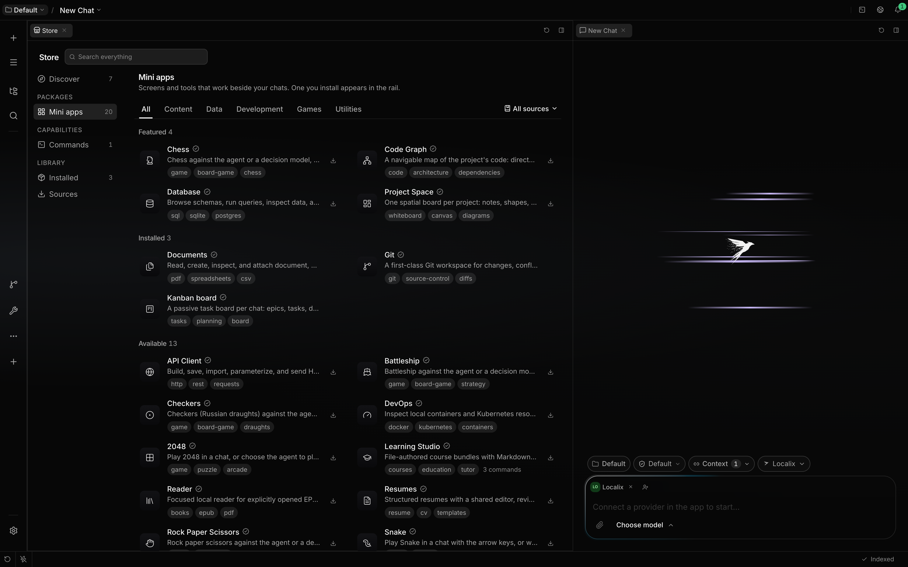
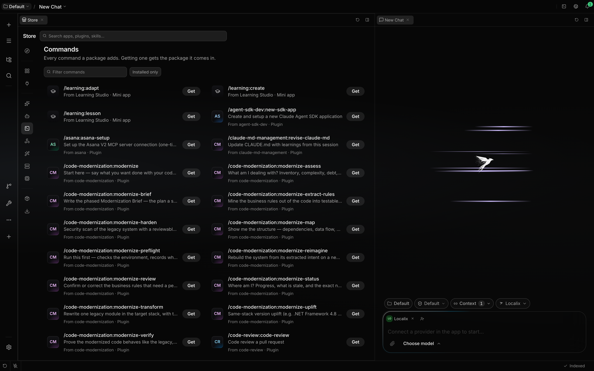
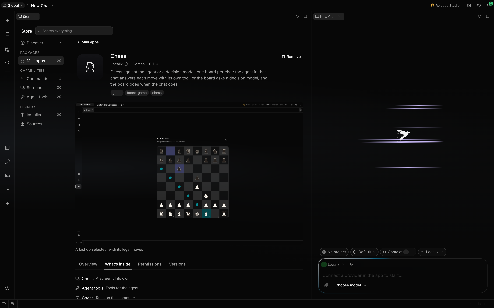

# Mini apps

A mini app is an application inside Localix: a screen of its own, tools the agent can call, and a
guide that tells the agent how to use it. The Database, DevOps, Trading and Kanban workbenches and
the games are mini apps. Use this page to see your mini apps, switch them on or off, change their
settings, and create one of your own.

Mini apps are not plugins. A [Claude Code plugin](../extending/claude-code-plugins.md) adds skills,
commands, hooks and servers to the agent and is managed in Settings → Capabilities → Plugins and
with `/plugin`; a mini app is managed here.

**Trust boundary:** A mini app's backend runs as trusted code in the Localix API process. One you
add yourself waits for your yes before its code runs; one the agent builds for you starts on.

## What you can do

| Outcome                      | How                                                                                 | Boundary                                                           |
| ---------------------------- | ----------------------------------------------------------------------------------- | ------------------------------------------------------------------ |
| See your mini apps           | `/mini-app list`, or Settings → Capabilities → Mini apps                            | The list shows the scope of the current chat's project.            |
| Add one from the Store       | The **+** button in the rail, **Open the Store** in Settings, or setup              | Only the recommended apps install without your choice.             |
| Get the recommended apps     | Nothing: a new installation installs them in the background                         | Once per app; one you remove is not added again.                   |
| Update all at once           | **Update all** in the line above the message box, or in the Event Center            | Only apps a catalog installed; your own folders are left alone.    |
| Update one                   | **Update** on its card in the Store, or wait for the automatic update               | Shown when the catalog offers another version than yours.          |
| See what an app is           | Choose its card in the Store                                                        | Its page shows screenshots, its README, contents and plan.         |
| Install with its desktop app | **Install as app** beside **Install** in the Store                                  | macOS desktop only, for an app with a screen of its own.           |
| Add a publisher's catalog    | Store → **Sources** → **Add a mini app catalog…**, or `/mini-app catalog add <url>` | Localix reads it first; nothing is added until you choose **Add**. |
| See or remove catalogs       | Store → **Sources**, a shelf's sources menu, or `/mini-app catalog list`            | The Localix catalog is built in and stays.                         |
| Turn one on or off           | `/mini-app enable <name>`, `/mini-app disable <name>`, or the row's switch          | A switch in Settings applies to the agent selected there.          |
| Change a mini app's settings | **Settings** on its row in Settings → Mini apps                                     | Secret settings are kept in the [vault](secrets.md).               |
| Remove one                   | `/mini-app remove <name>`, or **Remove** on its card or in Store → **Installed**    | Its data folder stays, so a reinstall finds it.                    |
| Have the agent build one     | `/mini-app create <what it should do>`                                              | See [Build with the agent](../extending/build-with-the-agent.md).  |
| Pick up edits to its files   | `/mini-app reload`                                                                  | Rebuilds your own mini apps, then reloads every mini app.          |
| Open the list from the rail  | **Manage mini apps…** in the rail's tools menu                                      | Opens Settings → Mini apps.                                        |
| Run one as its own Mac app   | **Install _Name_ as App** on its tab; see [Mac apps](mini-app-mac-apps.md)          | macOS only, for a mini app with a screen of its own.               |

Changes made with `/mini-app` take effect on the next turn.

## How it works

Mini apps are added in the **Store**, which opens in its own tab on its **Mini apps** shelf from the
rail's **+**, from Settings → Mini apps and from setup. A search across the whole Store sits on top,
and the shelves sit on the left: **Discover** (what Localix features and recommends), one shelf per
kind of package, one per kind of component you can look for (**Commands**, and for plugins
**Skills**, **Agents**, **Hooks** and the like), then **Installed**, **Updates** and **Sources**. A
shelf with nothing on it is not shown. In a narrow pane the shelves become one picker beside the
search, and the cards stay in one column.

On the Mini apps shelf, the apps the Localix catalog features and you have not installed come first,
once, then three groups: **Updates**, **Installed** and **Available**. Each card shows the app's
icon, name and check mark, what it does, up to three tags, what is inside only where that sets it
apart from the other apps (an app with commands says "3 commands"), and its action: **Install**,
**Update**, or how far a download has got. Category tabs narrow the shelf; choosing a tag shows only
the apps that carry it, with the tag as a chip beside the tabs until you remove it.

A capability shelf lists the components themselves, not the packages. **Commands** shows each
command with what it does and the app it comes from; filter it, or switch on **Installed only**.
Choosing a row opens that app's page on **What's inside** with the command marked, and its button
(**Install Kanban board**, say) installs the whole app.

A check mark means Localix verified the publisher. An app from an unverified publisher shows the
publisher's name, and its install asks **Install anyway?** first. An app built for a newer Localix
says so and cannot be installed.

Choosing a card opens the app's page: a large icon, the publisher, category, tags, version and the
action, then its screenshots at the resolution the app published them. Below them, **Overview**
shows the README beside the version, size, license, author, homepage and mini app API, **What's
inside** lists its screen, tools, backend and commands, **Permissions** says what would run on this
computer (and that it runs code) and warns about an unverified publisher, and **Versions** compares
the offered version with yours. Page the screenshots with the arrows, a swipe, ←/→ or the dots, and
choose one to see it full-window. The back button returns to the shelf where you left it, filters
and scroll kept.

On the macOS desktop, an app with a screen of its own has two buttons on its card: **Install**, and
**Install as app**, which also makes it an app with its own window, Dock icon and place in Spotlight
once the install has landed. If the desktop app cannot be made, the install stays and the card says
why. An installed app's page has **Add desktop app** or **Remove desktop app**. See
[Mac apps](mini-app-mac-apps.md).

**Installed** lists every install with its kind, scope, version and switch; its menu updates it,
opens its settings (**Configure**) or removes it. **Updates** lists the ones with a newer version
and **Update all**.

The Store reads the Localix catalog and any catalog you added. **Sources** lists them under **Mini
app catalogs**, each with how many apps it offers. It removes a catalog you added, and **Add a mini
app catalog…** reads the address you paste, shows who publishes it and how many apps it holds, and
adds it only when you choose **Add**. The sources menu beside a shelf's tabs narrows the shelf to
one catalog and offers the same actions. A catalog is an HTTPS address or a `file://` path to its
`mini-app-catalog.json`. A publisher can link to theirs with
`localix://ui/work-item/mini-app-store/add-catalog?url=<address>`, which opens the Store with that
dialog filled in.

`/mini-app catalog list` shows the catalogs and how many apps each offers,
`/mini-app catalog add <url>` reads one and adds it, replying with its publisher and app count or
why it was refused, and `/mini-app catalog remove <url>` removes one you added; the composer offers
your catalogs for it.

### Recommended apps

On a new installation, Localix installs the apps its catalog recommends in the background, without
asking: today **Git**, **Documents** and **Kanban**. They come from the Localix catalog like any
other app, and the Event Center's **In progress** shows each download; when they are in, one entry
says so ("Installed 3 mini apps").

Offline, nothing is installed and Localix tries again later. Each recommended app is installed once:
remove one (`/mini-app remove <name>` or **Remove** in the Store) and it is not added again, and a
folder of your own by the same name is never replaced. An installation that already had mini apps
when this arrived gets nothing new.

Setup's **Add mini apps** slide shows the recommended apps with where each stands, a few more of
Localix's own to install in place, and **Open the Store** last; setup stays open.

Only the Localix catalog can recommend an app: a catalog you added cannot, whatever it says.

### Installing and updating in the background

An install or an update in progress shows in the Event Center's **In progress** with its progress,
and the bell shows a thin ring while anything runs. Updates on offer appear there too and in one
line above the message box: **2 mini app updates — Update all**, or **3 updates** when plugins have
updates too, since the Store offers every kind together. Localix's own update always comes first.
The line can be hidden with × until what it offers changes. When an install or update finishes, the
Event Center keeps one line: "Installed Git", "Updated 3 mini apps", or "Could not install Kanban"
with the reason and **Try again**.

A catalog's app arrives as an archive whose checksum the catalog pins. An archive that does not
match is discarded, and the version you had keeps running. Apps installed from a catalog take its
newer versions by themselves, a minute after start and then every six hours.

Each row in Settings → Capabilities → Mini apps shows the app's version, project scope, category and
what it brings: tools, screens, commands, a guide. A row marked **awaiting your yes** came from
outside Localix and has not run yet; **runs code** means its backend runs while it is on.

| Where it lives                         | What is there                                             |
| -------------------------------------- | --------------------------------------------------------- |
| `~/.localix/mini-apps/<name>/`         | Your mini apps, in every project, and the catalog's ones  |
| `<project>/.localix/mini-apps/<name>/` | A project's own mini apps                                 |
| `~/.localix/mini-apps-data/<name>/`    | What a mini app keeps; it outlives updates and reinstalls |

When a project's mini app has the same name as one of yours, yours wins and the project's copy is
hidden. To add a mini app by hand, copy its folder (with its `mini-app.json`) into one of these
places and run `/mini-app reload`.

A mini app's commands appear in the slash menu as `/<app>:<command>`, with chips and pickers for
their arguments. The agent sees one line per enabled mini app and reads the app's guide before it
first uses it.

When a mini app fails to load, or reports a problem itself, the Event Center shows it with an action
that opens the app's row in Settings → Mini apps. The entry clears once the app works again.

## Limits

- A mini app's backend is not sandboxed. Turning one on is consent, not isolation.
- `/mini-app enable` and `/mini-app disable` change whether the app runs; they do not delete it or
  its data.
- In a development checkout the Store offers the checkout's own `mini-apps/` in place of the hosted
  Localix catalog; the featured and recommended apps come from `mini-apps/catalog-picks.json`.
- Which apps were already offered is remembered in `~/.localix/mini-app-recommended.json`. Deleting
  that file does not reinstall anything while you have other mini apps.
- Apps from a catalog you added are always shown as unverified.
- Earlier versions kept mini apps under `~/.localix/plugins`. Those copies are removed at startup,
  and settings saved under the old names are not carried over.

## Related guides

- [Build a mini app](../extending/mini-apps.md)
- [Build a mini app with the agent](../extending/build-with-the-agent.md)
- [Mini apps as Mac apps](mini-app-mac-apps.md)
- [Install Claude Code plugins](../extending/claude-code-plugins.md)
- [Settings](settings.md)

## Source of truth

- [The Store](https://github.com/rsaryev/localix/tree/main/apps/ui/src/features/store)

- [The `/mini-app` command](https://github.com/rsaryev/localix/blob/main/apps/api/src/features/chat/service/command-handlers-mini-apps.ts)
- [The mini apps feature](https://github.com/rsaryev/localix/tree/main/apps/api/src/features/mini-apps)
- [Where mini apps live](https://github.com/rsaryev/localix/blob/main/apps/api/src/features/mini-apps/paths.ts)
- [Settings → Mini apps](https://github.com/rsaryev/localix/blob/main/apps/ui/src/features/settings/ui/MiniAppsSettings.tsx)
- [Mini app conditions in the Event Center](https://github.com/rsaryev/localix/blob/main/apps/api/src/features/notifications/conditions/mini-apps.ts)
- [The contract for plugins and mini apps](https://github.com/rsaryev/localix/blob/main/docs/internals/plugins-and-mini-apps.md)
