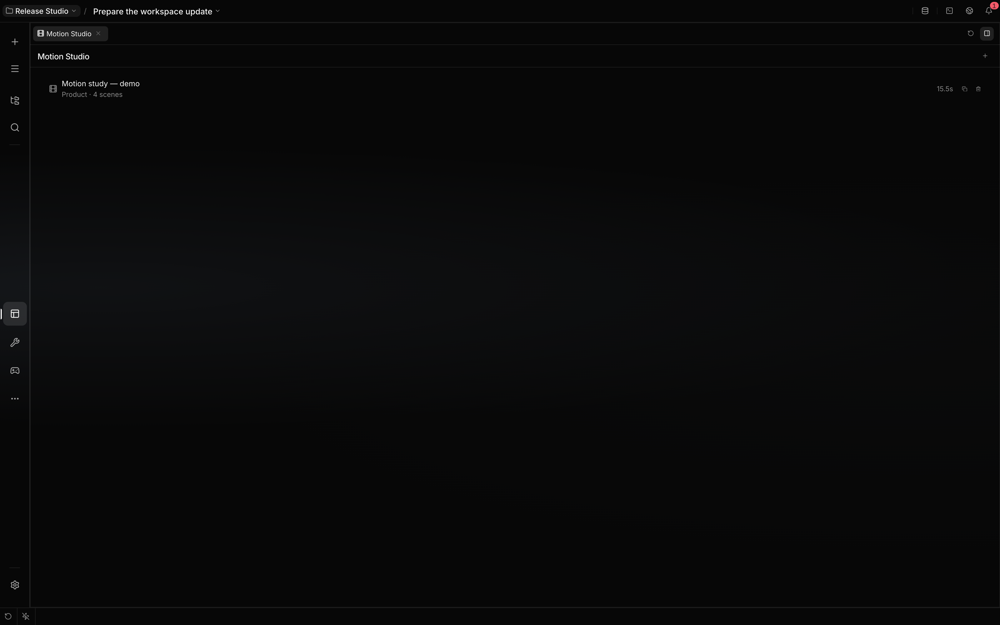
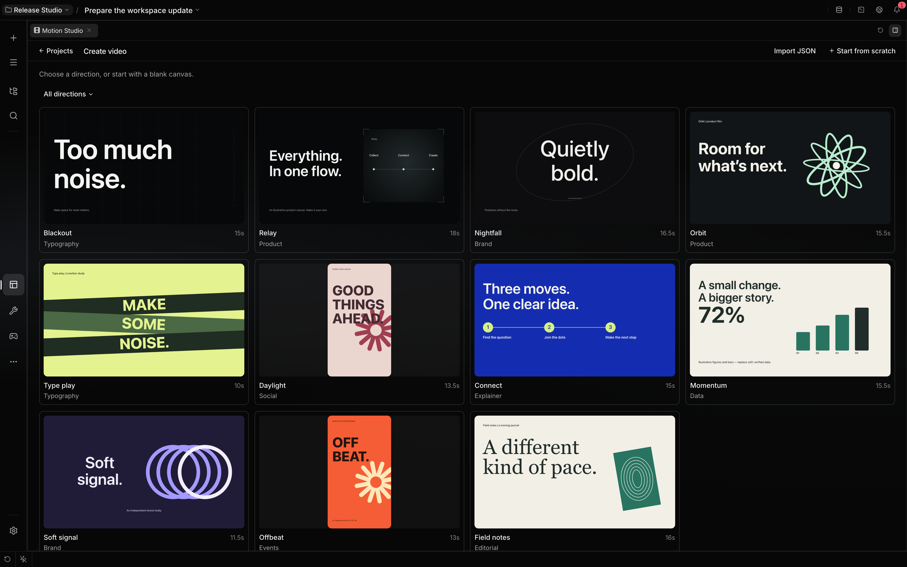
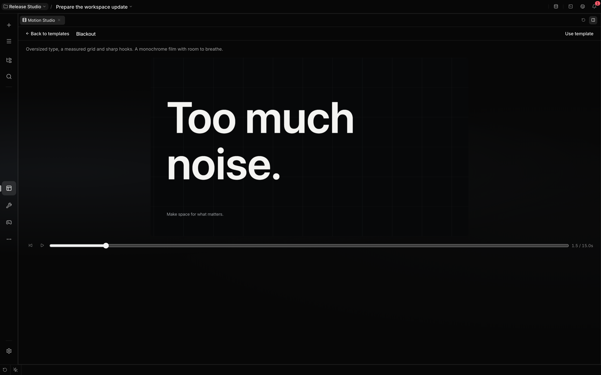
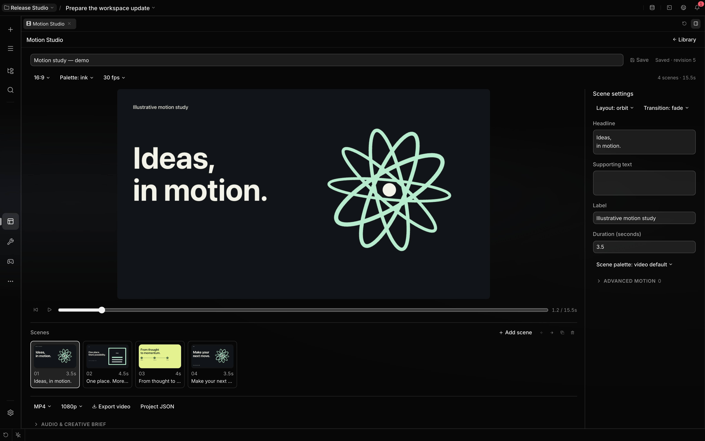

# Motion Studio

Motion Studio gives you and the agent one editable motion video. Open **All tools → Motion Studio**
to reopen a saved video. The library shows your projects; use the **+** action to create a video.
When the library is empty, that action sits in the center. Creation opens a separate screen in the
workbench. Choose a template, play its preview, then select **Use template**, or choose **Start from
scratch** for an empty scene. The library includes product launches, kinetic typography, social
campaigns, explainers, data stories, brand reveals, event posters and editorial films. Template text
and figures are illustrative; replace them with your own story and verified evidence.

**Back to templates** or Escape returns from a preview to the chooser. Your direction filter,
selected tile and scroll position remain; keyboard focus returns to that tile. Close the creation
screen with **Projects** to return to your library. **Use template** creates one saved project and
opens its editor. **Library** returns to projects, where you can reopen it.

For a dark film, try **Blackout** for oversized typographic hooks, **Relay** for a connected product
reveal, or **Nightfall** for a slower brand signature. Their editable Hook, Focus and Wordmark
layouts use masked type, a measured stage, aperture frames and readable holds.

## Shape your video

Edit the title, creative brief, aspect ratio, palette and frame rate. The brief supplies agent
context and stays out of the rendered video. Choose landscape (16:9), portrait (9:16) or square
(1:1), with 30 or 60 fps. Review each format: a new aspect ratio can need shorter copy or a
different layout.

Each scene has a layout, headline, supporting text, optional label, duration and transition. Scene
tiles seek directly to their beat. Use the playhead to inspect any frame. Add, duplicate, reorder or
remove scenes; at least one remains. A scene lasts 1–20 seconds and a film lasts up to 180 seconds.
Cards and connected steps use up to six items. Data scenes use an explicit value and suffix; bar
charts have editable labels and values. Each scene can override the video palette. Custom scenes and
layers support text, rectangles, circles, rings, rosettes, orbital marks, lines, grids, aperture
frames and images with keyframed position, scale, rotation and opacity.

Expand **Advanced motion** to add layers and edit their size, color and keyframes with labeled
controls. Apply Pop, Glide, Pulse or Turn as a starting motion, then set each keyframe's time,
position, scale, rotation, opacity and easing. **Layer JSON** provides an optional authoring surface
for agent-generated compositions; **Apply layers** validates it.

Product scenes accept PNG, JPEG and WebP images. Upload MP3, WAV or Ogg audio for a soundtrack.
Files may be up to 25 MiB. Uploaded media remains available to other videos in your library. In a
populated library, expand **Media library** to remove unused files; media referenced by a saved
video is protected. Soundtracks start at the film's beginning and fade at its boundaries; shorter
tracks end naturally.

**Save** publishes your changes to the shared project. If the agent edits the saved version while
you have a draft, your draft is preserved and saving is blocked until you reconcile the versions.
Export the draft as JSON before discarding it if you want to keep both. Library navigation asks
before discarding unsaved changes. Duplicate a video to explore an independent variant.

## Work with the agent

Describe the audience, platform, message and desired action. The agent uses `motion_studio` to read
the template/schema guide, author a complete project and revise it against the current revision. You
can attach a saved video as context; the editor publishes clearly labeled unsaved draft evidence
when you are still changing it. Agent writes update open views through the plugin's store feed.

The built-in renderer draws validated data rather than executing generated JavaScript. Use normal
source-reading tools to supply actual brand copy, screenshots and evidence. For animation reference
sources and license observations, see the
[research collection](https://github.com/rsaryev/localix/blob/main/plugins/motion/REFERENCE.md).

## Export and reuse

**Export video** renders the current preview, including unsaved draft changes, at 720p or 1080p into
MP4 or WebM. Encoding runs locally in your browser using the same frame renderer as preview. The
file includes the selected soundtrack and volume. A progress indicator and Cancel action remain
available during rendering. The browser must support the selected video codec and, with a
soundtrack, the audio codec. Audio encoders may add a small padded tail after the last video frame.
If export is unavailable, try another format or smaller size. Authoring a project through the tool
alone does not produce an encoded video file.

**Project JSON** downloads the editable document. Use **+ → Import JSON** to create a project from
it. Image/audio references are IDs in your media library, not embedded files; when moving between
workspaces, upload media and replace its IDs before import. Like Resumes, working files persist in
the conversation workspace: `.localix/motion/library.json` and `.localix/motion/assets/`.
Conversations using the same workspace share this library. Other workspaces have separate files;
Localix resolves access from the authenticated conversation. Video exports download to the location
selected by your browser, as resume exports do.
