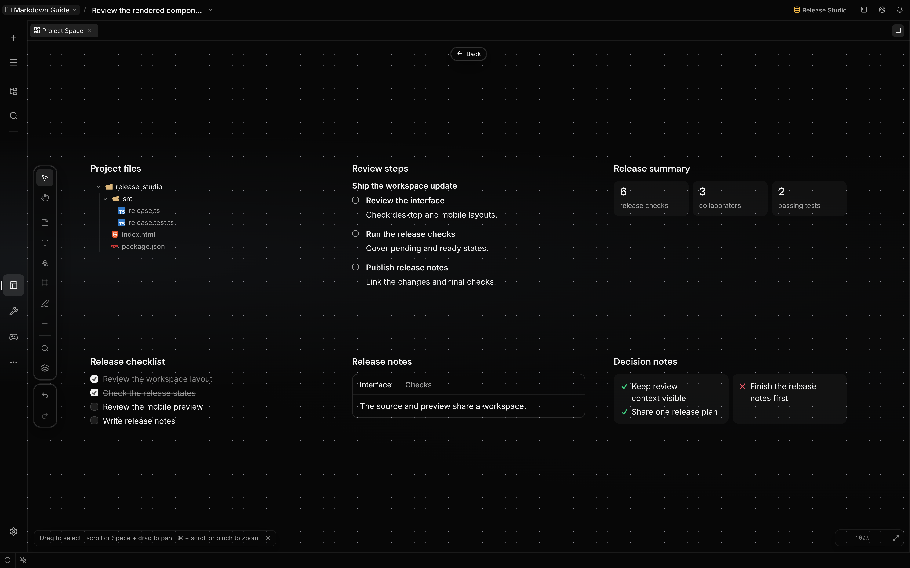
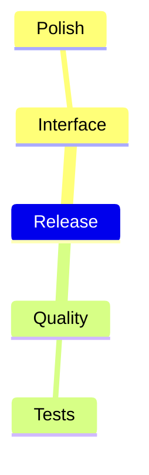

# Project Space

Project Space is one spatial board per project. It holds notes, text, shapes, flowcharts, 2×2
matrices, tables, mind maps, freehand drawings, frames and connectors beside live references to the
project's files, folders, images and documents. You and the agent edit the same board: lay out how a
feature fits together, sketch a flow, or collect what a task touches.

## Terminology

| Term      | Meaning                                                                 | Boundary                                                              |
| --------- | ----------------------------------------------------------------------- | --------------------------------------------------------------------- |
| Board     | The project's one board, a JSON file inside the project                 | `.localix/project-space/space.json`; it travels with the repository.  |
| Element   | One thing on the board: a note, a shape, a file reference, …            | Every element has a type, a position, a size and type-specific props. |
| Reference | A file, folder, image or document element; it points at a path          | Nothing is copied. Paths inside the project are stored relative.      |
| Frame     | A titled area; it holds every element whose corners are all inside it   | Moving a frame moves what it holds; deleting it keeps them.           |
| Group     | Elements that select, move, align and stack as one piece                | Groups nest. A group left with one element is no group.               |
| Layer     | Where an element stacks: frames beneath, then everything else in order  | Each element has its own place in the order; the file keeps it.       |
| Connector | A line between two elements, attached to the sides that face each other | It follows the elements as they move; a side can be pinned.           |

## What you can do

| Operation            | How                                                                                                            | Boundary                                                                                                                          |
| -------------------- | -------------------------------------------------------------------------------------------------------------- | --------------------------------------------------------------------------------------------------------------------------------- |
| Open the board       | **Project Space** in the rail, or ask the agent to show it                                                     | Opened from a chat; the board is that chat's project's.                                                                           |
| Place an element     | Pick a tool on the left rail or in the searchable **+** catalog, then click the board                          | Back to Select after one; Q keeps the tool armed. Shortcuts: N note, T text, S shape, F frame, D sequence, C code.                |
| Add a note           | Double-click the empty ground                                                                                  | A new note opens for typing; choose Text size above the selection. Long text scrolls.                                             |
| Draw a flow          | Shapes (11 kinds: step, decision, database, document, cloud, …) and connectors                                 | The "+" on each side of a selected shape adds a connected twin; ⌘/Ctrl+arrow too.                                                 |
| Draw a flowchart     | The flowchart tool (W), or paste a Mermaid `flowchart`; ask the agent for one                                  | It lays itself out; **Direction** and **Spacing** on the bar restyle it. See [Flowcharts](#flowcharts).                           |
| Draw a sequence      | The sequence tool, or paste a Mermaid `sequenceDiagram` block                                                  | Participants, lifelines, calls, async messages and returns.                                                                       |
| Style                | The bar above a selection: colour, shape kind, fill, line, the **Text** menu, lock, order                      | Only what every selected element shares is offered.                                                                               |
| Set text             | **Text** on the bar: font (sans, serif, mono, handwritten), size, alignment, vertical alignment, text colour   | A note's **Fit to note** size (the default) shrinks the text as it grows.                                                         |
| Format while writing | ⌘/Ctrl+B bold, I italic, U underline, E code; ⇧⌘/Ctrl+Shift+X strikethrough, H highlight                       | Notes and shape labels draw the marks; the text stays plain in the board file.                                                    |
| Style a connector    | Select it (or click its label); the bar sets the label and, under **Line**, route, ends, style and weight      | Drop a connector on empty ground to create a connected element there.                                                             |
| Move a label         | Drag a connector's label along its line                                                                        | The label sits beside the line, never on it.                                                                                      |
| Insert into a line   | **Insert a shape** on the connector's bar or right-click menu                                                  | The connector becomes two through a new step; both keep its look.                                                                 |
| Place files          | Drag from the file tree, an editor tab or the desktop, or **Add files** on the rail                            | Folders become folder cards; images, PDFs and Office files theirs.                                                                |
| Paste                | ⌘/Ctrl+V: a screenshot, a URL, a fenced code block, Mermaid, or text                                           | A screenshot is saved in `.localix/project-space/files/`.                                                                         |
| Link anything        | Drag anything the chat can link: a session, a message, a tool call, a sent or composer link, a tab, a resource | See [App links](#app-links).                                                                                                      |
| Edit in place        | Double-click, or Enter on the selected element                                                                 | Double-clicking a file or folder opens it in the editor instead.                                                                  |
| Select and move      | Drag the ground to select; drag an element; Space + drag or H to pan                                           | A drag snaps to other elements' edges and centres; hold ⌘/Ctrl to place freely.                                                   |
| Nudge                | Arrow keys move the selection 1 px, Shift + arrow 10 px                                                        | Locked elements stay.                                                                                                             |
| Frame a selection    | ⌥⌘/Ctrl+Alt+G, or **Frame the selection** in the right-click menu                                              | The new frame holds what it covers; its title opens for typing.                                                                   |
| Keep a look          | Restyle an element or a connector from its bar                                                                 | The next one of that kind takes the same colour, font and size; a new connector takes the last line style. Until the app reloads. |
| Copy a style         | ⌥⌘/Ctrl+Alt+C on one element, then ⌥⌘/Ctrl+Alt+V on others (also in the right-click menu)                      | Colour, fill, line, size, font and alignment, each only where the other kind takes it.                                            |
| Switch type          | **Switch type** on the bar: sticky note, shape or text                                                         | Keeps the text, colour, place and connectors.                                                                                     |
| Filter a selection   | **Filter the selection** on the bar when it mixes kinds                                                        | Keeps only the notes, the shapes, … of what you selected; each row counts them.                                                   |
| Present              | **Present the frames** on the rail                                                                             | Frames in reading order, one per slide; ←/→ or Space to move, Esc returns to where you were.                                      |
| Group                | ⌘/Ctrl+G, or the group button on the bar; ⇧⌘/Ctrl+Shift+G takes a group apart                                  | A click takes the whole group; click again (or Enter) to reach inside, Esc out.                                                   |
| Stack                | `⌘/Ctrl+]` forward, `⌘/Ctrl+[` backward; with ⌥/Alt or Shift, to the front or the back                         | A step goes past the next element that overlaps; frames always sit beneath.                                                       |
| Align and arrange    | The bar's align menu, or ⌥/Alt + A, H, D (left, centre, right), W, V, S (top, middle, bottom)                  | ⌥⇧H / ⌥⇧V distribute; Tidy up lays the selection out as a grid.                                                                   |
| Fade                 | The bar's opacity menu: 100 % to 10 %                                                                          | The element fades; its selection ring does not.                                                                                   |
| Lock                 | ⇧⌘/Ctrl+Shift+L, or the lock button                                                                            | A locked element lets the pointer through; its badge or the layers panel unlocks.                                                 |
| Layers               | L, or the layers button on the rail                                                                            | Every element as a row in its frame, top first; click a row (or Enter) to go to it.                                               |
| Use a picture        | Drop or paste it: it takes its own proportions; **Fill and crop** on the bar lets it fill any box              | For a background: fill and crop, send to the back, lock.                                                                          |
| Copy, duplicate      | ⌘/Ctrl+C then ⌘/Ctrl+V; ⌘/Ctrl+D duplicates                                                                    | Connectors come along when both ends are copied.                                                                                  |
| Undo and redo        | ⌘/Ctrl+Z and ⇧⌘/Ctrl+Shift+Z                                                                                   | Your own changes; the agent's are its own.                                                                                        |
| Share with the agent | Select elements; the selection is linked to the chat                                                           | The agent reads the rest with `space_read`.                                                                                       |
| Be shown something   | Ask the agent to show a part of the board                                                                      | It moves your camera there with `space_view`; the board itself is unchanged.                                                      |

Paste a website URL to create a link card, or choose **Link** in the **+** catalog, enter its
address and click the board to place it. The card's arrow opens the website; **Edit** changes its
address and optional title. In notes, click an underlined web address to see the URL and choose
**Open website**. Editing a note keeps its text and URLs as plain text.

Use **Add to Project Space** on a settled chat fragment to place it on the project board. The board
opens on what you added: the camera flies to it, lights it up and selects it, once. Code and tables
become native elements; headings, prose, lists, quotes, callouts and formulas retain their Markdown.
A text element grows or shrinks to the height its Markdown renders at, so an answer form arrives
whole rather than cut off. A table that exceeds the native parser's capabilities stays Markdown.

File trees retain their `tree` fence and render with the chat's file icons, folding and keyboard
navigation. Steps, tabs, headline figures and pros/cons use the same renderer on the board. Pasting
a tree, heading, quote or checklist also creates rendered text, even when the source is short. Plain
short prose still creates a sticky note. These copied forms keep their own source; they do not track
later changes to the reply or represent live project files.

Click folders to fold them, use the arrow keys to walk a tree, and switch tabs without opening the
text editor. Checklists store ticks in the element's Markdown, so undo restores the earlier text.
Double-click ordinary prose to edit the source; use the element's **Edit** action to change an
interactive form's source. Narrow elements wrap figures and stack pros/cons, and their height
follows the visible content.

Interacting with a component still brings its element into view. Buttons, links, trees and fields
keep their own double-clicks and keyboard input, so using them does not open the element's source
editor or move the element. Dragging an element starts after five screen pixels of movement; smaller
movements remain clicks at every zoom level. Use **Edit**, Enter with the element itself focused, or
double-click ordinary content to edit it.

The add button disappears while that fragment is on the board and returns after deletion or undo.
Adding the same fragment from two surfaces creates one element. Returning to the source chat
preserves its reading position. A saved addition reaches an open board immediately; remote edits
arrive through the shared connection. Visible readers share one board read and subscription; an edit
made directly to the board file arrives through the workspace file watcher. The client starts that
subscription only after the backend advertises support. A ten-second reconciliation runs only while
one of the two is not live: an older backend, a dropped connection, or a chat whose files are not
watched.

Mermaid uses a native `mermaid` element with `source` and `title`: all supported Mermaid grammar is
preserved, including constructs outside the sequence editor's grammar. Double-click to edit its
source; `space_read` with its `ids` returns the complete definition, and `space_apply` can update
it. It renders through the same Mermaid engine and theme as the chat. Move, resize, connect or undo
the element like other board content; individual Mermaid nodes are edited through the source.

Images carried by Localix messages are saved under `.localix/project-space/files/`; external images
remain URL references. Links to recognised image extensions become images; other web links become
link cards. File links use the board's file, image or document reference types and keep the file
line when applicable. Remote images depend on the original URL remaining available.

The agent's broad `space_read` remains a compact roster. Reading explicit `ids` also returns
complete validated properties, including code, table cells and image references, so an agent can
inspect an imported fragment before changing it.

Choose **Table / Grid** (B) in the catalog, paste a Markdown table, or paste cells copied from a
spreadsheet (the first row becomes the header). **Make sticky notes** on a table's bar puts each
filled cell beside it as a note, one coloured column of notes per table column, grouped.

Double-click the card to enable its cells, then double-click a cell to edit it; Enter saves the
value. **Add row** and the row's delete action change rows. **Add column** appends a column;
double-click a column header to rename it. Its **Column options** menu inserts a column before or
after it, moves it left or right, or deletes it together with its cells. The last column cannot be
deleted. **Edit as Markdown** in the header edits the complete table as text; ⌘/Ctrl+Enter saves it
and Escape cancels. Each cell or structural edit is one undo step.

Choose **Mind map** (M) or paste a Mermaid `mindmap` outline. Double-click the map to edit it
visually: click an idea to select it, then double-click it or press Enter to edit its text. Use
**Add child idea**, **Add sibling idea**, **Move branch** and **Delete branch** in the header.
Moving a branch keeps its children; it cannot move under itself or its descendants. The root cannot
be deleted. Enter or ⌘/Ctrl+Enter saves a label, Shift+Enter adds a line, and Escape cancels.
**Done** leaves visual editing. Insert adds a child; Shift+Enter adds a sibling while an idea has
keyboard focus.

**Edit as Mermaid** remains available in the header. Indentation makes children, and each map has
one root. It supports plain labels and labels in square brackets or parentheses, including
JSON-quoted labels. Icons and classes are not supported. For example:

Choose **Pen** (P), then drag to draw. The preview follows the actual stroke; releasing the pointer
saves one element and one undo step. Escape cancels an unfinished stroke. The selection bar changes
its colour and stroke width, and the usual resize handles resize the drawing. Q keeps the tool armed
for more strokes. Tables, maps and drawings use the same board file and operations as other
elements, so the agent can read and edit their native props.

The pen tool on the rail also offers **Highlighter**, a wide translucent stroke in marker yellow,
and **Eraser**: drag over freehand strokes and they fade as you pass, then disappear together when
you let go, one undo step. The eraser takes only strokes, never a note or a shape.

The camera works as on every board in the app: scroll pans, pinch or ⌘/Ctrl + scroll zooms, Shift+1
fits everything and Shift+0 shows 100%. On this board it also helps:

| Camera help          | How                                                                       | Boundary                                                                                                                  |
| -------------------- | ------------------------------------------------------------------------- | ------------------------------------------------------------------------------------------------------------------------- |
| Go to the focus      | Click an element, Tab / Shift+Tab, or click it in the layers panel        | It comes to the middle at a reading size; a frame is fitted whole. Already closer, the zoom stays and it is only centred. |
| Keep it in view      | The focus changes otherwise (drag-select, the agent moves it)             | The camera slides only as far as it takes to show it whole.                                                               |
| Zoom to selection    | Shift+2: the selection at 100 %; pressed again at 100 %, the whole of it  | What it came to show glows for a moment.                                                                                  |
| Back and forward     | ⌥/Alt+← and ⌥/Alt+→, or **Back** above the board after a jump             | Every jump is remembered: a click, Tab, the layers panel, the agent's, ⇧2.                                                |
| Settle at 100 %      | A zoom you end close to 100 % settles at exactly 100 %                    | Only your own gestures; text is crispest there.                                                                           |
| See the agent's work | A change on screen glows; one off screen is counted: **N changes · Show** | **Follow** takes the camera to each change until you scroll, zoom or click the board.                                     |

With reduced motion set on your system, the camera lands at once instead of flying. The trip is
still remembered for ⌥/Alt+←, and what it came to show still glows.

## Flowcharts

A flowchart is one element written as Mermaid and drawn by the board: steps in boxes, decisions in
diamonds, stores as cylinders, subgraphs as titled areas, every line at right angles with rounded
corners and its label beside it. Double-click it to edit the Mermaid text; the drawing follows. On a
selected flowchart, double-click a step to rename it in place: the first line is its name, the lines
after it its sublabels.

| Mermaid                                  | Drawn as                                                     |
| ---------------------------------------- | ------------------------------------------------------------ |
| `A[Step]`, `B(Rounded)`, `C([Start])`    | A box, a rounded box, a pill                                 |
| `D{Ready?}`, `E[(Database)]`, `F((Hub))` | A decision, a store, a circle                                |
| `A -->`, `A -.->`, `A ==>`, `A ---`      | An arrow, a dotted arrow, the headline path, a plain line    |
| `A -->\|yes\| B`, `A -- yes --> B`       | A labelled line                                              |
| `A:::focal`, `:::store`, `:::optional`   | A focal step in the element's colour, a store, a dashed step |
| `api[API hono:5151]`                 | A name with a technical sublabel                             |
| `subgraph api [API] … end`               | A titled area around its steps                               |

A decision's branch that turns aside leaves by its corner, and a line that runs back against the
flow goes around the outside instead of through it. Pasting a Mermaid flowchart creates one when the
board can draw every line of it. Lines that only style Mermaid's own renderer (`classDef`, `style`,
`click`) are ignored; an unknown shape or another diagram type keeps the full Mermaid element. On a
Mermaid element that holds a flowchart the board can read, **Draw natively** replaces it in place.

**Convert to shapes** takes a flowchart apart into shapes, connectors and frames where it drew them,
grouped, so you can move one step by hand or connect a step to a file. Connectors attached to the
flowchart itself are removed with it.

## 2×2 matrix

**2×2 matrix** in the catalog, or a pasted Mermaid `quadrantChart`, places items by two judgements —
impact against effort, by default. Each quarter is named in its corner; the one or two items marked
focal are drawn in the element's colour and their quarter is tinted. Select the matrix and drag an
item to move it, or Tab to an item and move it with the arrow keys (Shift for longer steps); each
move is one undo step. Double-click to edit it as Mermaid (`Item:::focal: [0.3, 0.8]`, x and y from
0 to 1).

## Format text

Notes, shape labels and text elements read light Markdown from their own text, so the board file
stays readable to the agent and in git:

| You type                                    | You see                                          |
| ------------------------------------------- | ------------------------------------------------ |
| `**bold**`, `*italic*`, `++underline++`     | Bold, italic, underlined words                   |
| `~~strike~~`, `==highlight==`, `` `code` `` | Struck-through, highlighted and code words       |
| `# Heading` (in a note)                     | A heading line                                   |
| `- item`, `1. step` (in a note)             | Bullets and numbered steps; Enter continues them |
| `- [ ] task` (in a note)                    | A task box you tick on the board                 |

Only the box ticks a task; a click on its words selects the note. A ticked box is an edit of the
note's text, one undo step. Fonts are roles, not files: **Handwritten** uses the handwriting face
the system provides, so a board reads the same on another machine.

## App links

Anything you can link into the chat can go on the board, and it lands as what it is:

| You drop                                                   | It becomes                                               |
| ---------------------------------------------------------- | -------------------------------------------------------- |
| A file or folder link, a path in a tool card               | The file or folder card, which reads the file            |
| A snippet                                                  | A code card holding its text                             |
| A session row or `@session:…`                              | The session: its title, state, model and last message    |
| A message (drag its Link button) or `@message:…`           | The message, rendered as in the chat                     |
| A tool call's header or `@call:…`                          | The tool call's own card from the transcript             |
| A terminal, a project, a resource (`localix://resource/…`) | A card with its name, its kind or provider, and **Open** |
| An image or file attached to a message                     | A card with its preview                                  |

Sent links under a message and the links in the composer's **Context** list drag out the same way.
Pasting text that is nothing but links (`@session:LOCALIX-42 @call:…`, a `localix://…` URI) works
like dropping them. Text with words around its links becomes a note.

The card is a live link, not a copy. It shows the session or call as it is now, and **Open** takes
you there. Its grip drags the link back into the composer. On a machine that does not have the
session, the card keeps its name and says the target is not there.

## Read the board

| Reading              | How                                                                               | Boundary                                                                                                     |
| -------------------- | --------------------------------------------------------------------------------- | ------------------------------------------------------------------------------------------------------------ |
| What it touches      | Select one element: its connectors light up                                       | Nothing else changes, so a click to edit is still just a click.                                              |
| Its connections      | The connections button on the bar: where its arrows lead, where they come from    | Pick one to go to the element at its other end.                                                              |
| Trace                | **Trace upstream** or **Trace downstream** in that menu or the right-click menu   | Everything reachable along the arrows stays lit and the rest fades; Esc ends it.                             |
| Find                 | `/`, or the search button on the rail                                             | Matches every word of text, file path or type; the agent's `query` matches the same way.                     |
| Replace              | `/`, then **Replace…**: the phrase and what replaces it                           | In notes, labels, frame titles and connector labels; never a diagram's text or a file path. One undo.        |
| Every shortcut       | `?`, or the keyboard button on the rail                                           | The same list the board's keys are tested against.                                                           |
| Small print          | Zoom out                                                                          | Below 90 % a card's line and item counts fade; below 50 % connector labels too. What is selected keeps them. |
| Right-click          | An element, a connector or the empty ground                                       | Opens where the press ends; a right-drag still pans.                                                         |
| Copy as image        | Right-click → **Copy as image** (the selection) or **Copy the board as image**    | A PNG at reading size, without the selection; saved as a file when the clipboard refuses it.                 |
| Save as image        | Right-click → **Save as image…** or **Save the board as image…**                  | The same PNG, written to a file.                                                                             |
| With a screen reader | The board says what the agent changed, what it showed you, and what a trace found | Politely, after what is being read.                                                                          |

A trace follows the arrowheads you see, not the order a connector was drawn in. A connector with a
head at both ends, or at neither, is followed both ways. Only drawn connectors count: two cards side
by side, or a file inside a frame, are not a connection.

## How it works

The board is a file, and every change is an operation on it. The view, the agent's `space_apply`
tool and undo all speak the same operations. An agent batch accepts 1–200 operations: a refused
operation is reported without changing the board, while accepted operations are saved together in
one board write. The store serializes its own changes per project and rereads the file before each
change. Direct file edits outside that queue can still race a read and write; avoid simultaneous
editing of the board JSON through unrelated file tools.

A reference card shows its target as it is now. When the file changes on disk the card reads it
again; when the file is gone the card says so and keeps the path until you point it elsewhere or
delete it.

The agent reads the board as a roster, bottom to top: each element's id, type, place, frame, groups
and a short excerpt. It reads referenced files with its own file tools, so a large board stays small
in its context. It lays elements out with the same align, distribute and arrange operations the bar
uses, rather than computing coordinates.

The agent can also move the camera of the board you have open, with `space_view`: zoom into one
element, frame several, a group, a frame, an area or the whole board, zoom, or slide the view. The
tab glides there, lights up what the agent pointed at, and tells the agent what is now in view, so
it can walk you through a board without a screenshot.

Every framing uses one rule: one element is brought close enough to read (up to 125 %), and several
are fitted whole (up to 100 %). The rule is the same whether the agent, a click, Tab, a search or
the layers panel asked. Shift+2 is the exception on purpose: it shows the selection at exactly 100
%. The camera never changes the board.

## Configuration

| Setting      | Where                               | Effect                                                       |
| ------------ | ----------------------------------- | ------------------------------------------------------------ |
| Board file   | `.localix/project-space/space.json` | Commit it to share the board, or ignore it to keep it yours. |
| Pasted files | `.localix/project-space/files/`     | Screenshots and other pasted files the board references.     |

## Limits

- Tables have at most 20 columns and 200 rows; mind maps have at most 200 nodes; a pen stroke
  records at most 4,096 points.
- One board per project. A chat in a git worktree uses the worktree's board.
- A file that cannot be read at all (not JSON, another format) is shown as a problem and is not
  written until it is repaired; parts of a readable file that cannot be drawn are kept as written.
- Renaming a file does not update the board; the card reports the old path as missing.
- An element made by a newer version of the app is shown as a placeholder and is read-only.
- A PDF previews on the board; other document formats show their name and open in the app viewer.
- A copied image leaves out a picture served from another origin without permission to read it.
- The right-click menu does not reach a locked element; select and unlock it in the layers panel.
- Links inside a message's text (a Markdown file link, an `@path` chip) do not drag yet; use the
  message's own links or its tool cards.
- **Open** on a capability resource does nothing on the board yet; open it from the chat.

## Related guides

- [Workbench UI](../extending/plugin-ui.md#a-board) — the board every graph in the app is drawn on
- [Code Graph](code-graph.md) — the generated map of the same project

## Source of truth

- [Plugin](https://github.com/rsaryev/localix/tree/main/plugins/project-space)
- [Board file format](https://github.com/rsaryev/localix/blob/main/plugins/project-space/shared/format/schema.ts)
- [Element type contract](https://github.com/rsaryev/localix/blob/main/plugins/project-space/shared/registry/contract.ts)
