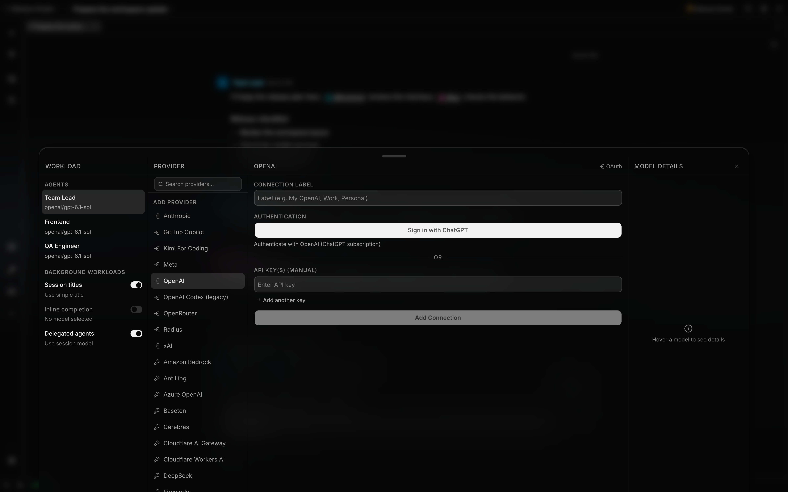

# Connect model providers

Use the model picker to connect a provider and choose the model for the current session. The same
connection path supplies chat, auxiliary model tasks, and delegated agents.

**Availability:** Providers and models come from the active runtime catalog. API-key connections
need a catalog entry, and sign-in appears only when that runtime reports an OAuth flow.

## What you can do

| Capability                | Mechanism                                                                            | Boundary                                                             |
| ------------------------- | ------------------------------------------------------------------------------------ | -------------------------------------------------------------------- |
| Connect with an API key   | Store a key from the model picker's provider form                                    | A provider must exist in the runtime catalog                         |
| Sign in through OAuth     | Start the interaction advertised by the runtime adapter                              | Availability and interaction style depend on the provider definition |
| Keep separate connections | Add and label more than one connection for the same provider                         | A session stores one preferred connection                            |
| Manage connection keys    | Add, remove, enable, or disable masked keys                                          | Cannot remove the only key or disable the last enabled key           |
| Choose a session model    | Bind a catalog model and connection from the composer                                | The model must belong to the connection's provider                   |
| Inspect model fit         | Compare capabilities, modalities, limits, wire protocol, and pricing including tiers | Catalog records can be partial or change with the active runtime     |
| Narrow the model list     | Search models, or filter by tools, reasoning, vision, priced caching, or free        | A facet appears only when some model in the list matches it          |
| Find a provider           | Search the provider column; it filters connections and providers to add              | It never narrows the model list                                      |
| Choose reasoning effort   | Pick a level in the model details panel's Settings, remembered per agent and model   | A model that publishes none offers only "off"                        |
| Route auxiliary work      | Select model slots for session titles, inline completion, and delegated agents       | Each unset route uses its documented fallback                        |

## How it works

Each participant's seat stores its model, connection, and reasoning effort explicitly; nothing is
inherited after the seat exists. The details panel shows the running model's stored level. For any
other model it shows the level that model would start at: the level last chosen for that agent on
that model, otherwise the default, limited to the levels the model supports. Every level change,
from the picker or the composer, is remembered for that agent and model.

The runtime adapter projects its provider definitions, text models, image models, authentication
methods, limits, modalities, and pricing into engine-neutral catalog records. The API caches that
projection, and the model browser groups models by live connections. Its workload column lets the
user choose what the next model assignment is for before choosing the provider and model. On a
narrow window the workload and provider columns open from switchers in the model list's header, and
the model details panel, with its settings, opens in place of the list.

Creating a connection writes its label, provider id, authentication type, key order, and enabled
state to SQLite. API keys and OAuth token fields are stored separately in the encrypted credential
vault. Connection responses contain only a masked key suffix and metadata.

Localix does not read provider API keys from environment variables such as `OPENAI_API_KEY`, either
when you connect a provider or when a request runs. A request authenticates only with the credential
stored for its connection. To rotate a key, add or replace it in Localix.

If you close the browser before finishing sign-in, return to the provider form and start sign-in
again. A new attempt cancels your pending login for that provider and waits for its local callback
listener to close before opening a fresh sign-in page.

A conversation stores a connection id and a namespaced model id **per participant**, and only when
someone actually chose one there. At run time, Localix verifies that the provider owns the model,
tries the stored connection first, and can resolve another usable connection for the same provider
if that one no longer works. It never crosses to a different provider or model.

### Which model a participant runs on

A new seat's route is decided once, when the participant joins, and then stored. Its model comes
from the first source that names one:

| Order | Source                              | Set from                      |
| ----- | ----------------------------------- | ----------------------------- |
| 1     | An explicit choice                  | The model picker, or `/model` |
| 2     | Your last choice **for this agent** | Learned from the picker       |
| 3     | The agent's default                 | **Settings → Agents**         |
| 4     | The project                         | **Settings → Project**        |
| 5     | The conversation's main model       | Its first participant         |

Its **reasoning effort** is the explicit choice, otherwise the level last chosen for that agent on
that model, otherwise the agent's default, otherwise **medium**. It never copies another
participant's level or another model's level, and it is never capped.

Later changes to defaults reach new seats only. Conversations created before this rule may hold a
seat with no model; it is filled once by the same rule on first read and stored. A delegated child
snapshots its assigned participant's route from the parent. Filled-in defaults never count as your
last choice for an agent.

A model that cannot reason receives no reasoning request. For models that support it, the runtime
clamps the requested effort to a supported level; that runtime adjustment does not rewrite the
conversation's stored preference.

The model browser offers these optional workload settings:

| Workload          | Current runtime behavior                                                                                                                                                                                              |
| ----------------- | --------------------------------------------------------------------------------------------------------------------------------------------------------------------------------------------------------------------- |
| Session titles    | Requires an enabled route with an assigned model; otherwise keeps the simple title and objective. Missing route effort uses **medium**, never the session effort.                                                     |
| Inline completion | Disabled by default. When enabled, tries the assigned model, then the session model if resolution fails. Always requests effort `off`, clamped to the model's minimum if necessary.                                   |
| Delegated agents  | The setting is persisted and displayed, but current delegated-session creation does not apply it. Children snapshot their assigned participants' effective parent routes. Tool availability follows capability rules. |

Each workload stores its own effort; picking a model for it starts at the level last chosen for that
workload and model, otherwise the default.

The board has no route of its own. A worker's model is its agent's — **Settings → Agents** — so it
applies on every dispatch path rather than only on a card; a card that names no model inherits the
session that owns the board, like any other unrouted workload.

Within one connection, the runtime selects the enabled key with the lowest numeric priority.
Disabling the last enabled key and removing the only remaining key are separate guards. Removing an
enabled key while disabled keys remain can leave the connection with no runnable key; enable its
replacement before removing it. OAuth refresh runs through a connection-scoped credential store;
refresh updates for one key are serialized so concurrent runs do not overwrite rotating tokens.

The catalog adapter can enrich existing OpenRouter model records with public release dates for
sorting. It never creates a model that is absent from the runtime's built-in catalog.

### Sign-in lifecycle

Browser and device-code sign-in finish in the API process. The interface looks for a new or changed
connection for the provider: up to 40 polls, with three seconds between attempts. Slow requests can
extend this beyond the roughly two-minute wait shown in the interface. Navigating away can stop
polling, and starting another sign-in stops the previous poll; this does not itself cancel the
server's login.

The server allows up to 15 minutes for a flow and 30 seconds for its first interactive event. If the
interface times out, check the connection list before retrying: server-side sign-in may still
finish. Pending flows are held in memory and do not survive an API restart. A retry replaces only
that user's pending flow for the same provider and waits for the adapter's cleanup.

Signing in again with the same provider and exact connection label adds an enabled key to the
existing connection. It does not replace older keys: the new key receives a higher numeric priority,
so an older enabled key remains first. If you intend to replace the old credential, enable the new
one and disable or remove the old one. Use a different connection label for a separate account.

Runtime login prompts have a limited adapter: a selection uses the first offered option, text
prompts receive an empty answer, and interactive secret prompts are rejected. Flows needing custom
answers to those prompts cannot be completed through the current provider form.

## Configuration

The `OpenAI` provider supports **Sign in with ChatGPT** for subscription authentication. New browser
authorizations identify the application as **Localix** on ChatGPT's connection screen. The browser
sign-in finishes in the background. Once the connection is saved, the desktop app comes to the
foreground and shows the model list for that connection, including after signing in again. Close the
success page manually. The browser login uses a stable installation UUID, created on first use and
retained in `~/.localix/oauth-device-id` across restarts and projects. `OpenAI Codex (legacy)`
remains a separate provider using the older ChatGPT backend transport; existing connections keep
their provider identity.

| Control or value       | Contract                                                                                |
| ---------------------- | --------------------------------------------------------------------------------------- |
| Provider source        | Runtime catalog projected by the engine's `listCatalog()`                               |
| API-key connection     | Requires at least one non-empty key                                                     |
| OAuth connection       | Uses the runtime-reported browser, loopback-server, or device-code interaction          |
| Connection label       | User-editable; does not change provider identity                                        |
| Key display            | Masked to the final four characters                                                     |
| Key selection          | Enabled keys ordered by ascending numeric priority                                      |
| Model identity         | Stored as `<providerId>/<modelId>`                                                      |
| Catalog metadata cache | `~/.localix/catalog-metadata.json`                                                      |
| Required route         | Chat sessions                                                                           |
| Context routes         | Session titles, inline completion                                                       |
| Worker route           | Delegated-agent setting is saved; current child creation uses parent participant routes |
| Reasoning preference   | Stored for the workload plus provider/model pair when supported                         |

The onboarding provider step embeds the same model browser used by the workspace. It can create an
API-key or OAuth connection, and remember the selected connection and model for the first session.

## Limits

- “Provider-flexible” means the providers and models in the runtime catalog, not every provider,
  endpoint, protocol, or model.
- OAuth is not synthesized for API-key-only providers. The available sign-in methods are exactly
  those reported by the adapter's provider definitions.
- Multiple keys do not provide automatic rotation or request failover. A run selects the
  highest-priority enabled key; a provider failure does not retry the next key.
- If vault data is missing, corrupt, or unreadable, Localix keeps the connection metadata visible
  but excludes the credential from runnable connection state.
- The same-provider connection fallback occurs during model resolution. A failed provider request
  does not switch connections, providers, or models silently.
- Model requests send the assembled prompt and context to the selected provider. Connected providers
  remain outside Localix's local trust boundary; see [Privacy](../getting-started/privacy.md).
- Advertised capabilities, modalities, limits, dates, and pricing are catalog metadata rather than a
  Localix guarantee about provider behavior or availability.
- A stored reasoning preference does not add reasoning support to a model that does not advertise
  it, and one provider can expose fewer effort levels than another. The catalog publishes the levels
  each model offers, so the picker shows only those; a preference carried over from a finer-grained
  model is clamped to the nearest level the new one has — upward first, then down. The runtime
  clamps again before the request, so a level from an older client or an unpublished capability
  degrades instead of failing the run.
- Release dates and published reasoning levels come from OpenRouter's public model list. Localix
  starts a background refresh on the first catalog projection in a process, then can refresh on
  another projection after five minutes. This is demand-driven, not a periodic timer. Each fetch has
  a 1.5-second timeout. Nothing waits for the answer: the catalog is served from the last saved
  answer, or from the generated metadata on a first launch or when the network is unreachable. When
  the answer arrives, the next catalog read uses it and it is saved for the next launch. A failed
  request is never saved.
- The catalog endpoint answers with an `ETag`. A client that already holds the current catalog gets
  `304 Not Modified` instead of the full list.
- Providers that offer no chat models, such as classifier-only ones, are not offered for connection.
- Ambient cloud credentials, such as AWS profiles or Google application-default credentials, are not
  used. Connect those providers through the provider form.
- When a chosen model cannot run, the error says why: the catalog no longer lists the model, the
  provider has no enabled key, or the connection's credential could not be loaded. The model picker
  shows `<model> is no longer available` when the catalog has dropped the model you chose.

## Related guides

- [Onboarding](onboarding.md)
- [Secrets](secrets.md)
- [Privacy](../getting-started/privacy.md)

## Source of truth

- [Runtime catalog projection](https://github.com/rsaryev/localix/blob/main/packages/agent-runtime-pi/src/models.ts)
- [Provider transports and metadata](https://github.com/rsaryev/localix/blob/main/packages/agent-runtime-pi/src/providers.ts)
- [Background catalog metadata refresh](https://github.com/rsaryev/localix/blob/main/packages/agent-runtime-pi/src/catalog-metadata.ts)
- [Unresolved model reasons](https://github.com/rsaryev/localix/blob/main/apps/api/src/features/chat/runtime/model-resolution-miss.ts)
- [Runtime authentication bridge](https://github.com/rsaryev/localix/blob/main/packages/agent-runtime-pi/src/auth.ts)
- [Connection API and DTOs](https://github.com/rsaryev/localix/blob/main/apps/api/src/features/provider-connections/contracts.ts)
- [Credential storage and refresh](https://github.com/rsaryev/localix/blob/main/apps/api/src/features/provider-connections/service.ts)
- [OAuth flow lifecycle](https://github.com/rsaryev/localix/blob/main/apps/api/src/features/provider-connections/oauth-flow-manager.ts)
- [OAuth completion polling](https://github.com/rsaryev/localix/blob/main/apps/ui/src/features/chat/ui/prompt-input/oauthConnectionPolling.ts)
- [Model and connection resolution](https://github.com/rsaryev/localix/blob/main/apps/api/src/features/chat/runtime/model-resolution.ts)
- [Participant model and effort precedence](https://github.com/rsaryev/localix/blob/main/apps/api/src/features/chat/agent-route-resolution.ts)
- [Participant birth and reseating](https://github.com/rsaryev/localix/blob/main/apps/api/src/features/chat/service/participant-routes.ts)
- [Recent model and effort selection](https://github.com/rsaryev/localix/blob/main/apps/api/src/features/chat/repository-recent-routes.ts)
- [Inline workload resolution](https://github.com/rsaryev/localix/blob/main/apps/api/src/features/autocomplete/resolve-model.ts)
- [Title workload](https://github.com/rsaryev/localix/blob/main/apps/api/src/features/chat/service/title-generation.ts)
- [Key-selection policy](https://github.com/rsaryev/localix/blob/main/apps/api/src/features/chat/runtime/provider-keys.ts)
- [Model browser](https://github.com/rsaryev/localix/blob/main/apps/ui/src/features/chat/ui/prompt-input/model-select/ModelBrowser.tsx)
- [Workload route catalog](https://github.com/rsaryev/localix/blob/main/apps/api/src/features/chat/model-task-catalog.ts)
- [Model route persistence](https://github.com/rsaryev/localix/blob/main/apps/ui/src/features/chat/ui/prompt-input/model-select/useModelTaskRouting.ts)
- [Per-model reasoning control](https://github.com/rsaryev/localix/blob/main/apps/ui/src/features/chat/ui/prompt-input/model-select/ModelReasoningControl.tsx)
