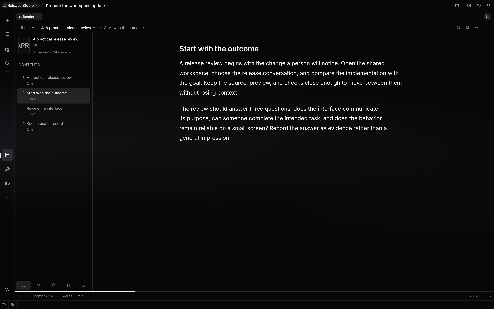

# Reader Workspace

Reader turns books and long-form documents into first-class Localix context. Open **Reader** from
the navigation rail and choose a book, open it from the file tree, or drop it into the workspace.

## Supported documents

Reader recognizes `.epub`, `.pdf`, `.mobi`, `.azw3`, `.fb2`, `.cbz`, `.md`, `.markdown`, `.html`,
`.htm`, and `.txt`. Reader is a read-only viewer and does not copy or alter the source file. An
explicitly selected absolute path may be anywhere on the computer; it does not have to live in the
active project. Dropped books also open directly through Localix's media store; the file does not
need an on-disk project path.

PDFs appear as extracted, selectable, searchable text in a reflowed reading view. Reader does not
perform OCR or preserve the original page layout. Localix's exact-layout PDF viewer remains
available through the shared **Open With** chooser. MOBI and KF8/AZW3 use a pinned format engine,
preserve metadata and TOC labels, and inline bounded book images and covers. Reader rejects
DRM/password-protected or structurally invalid input rather than rendering active content.

The library never scans the workspace or home directory. It lists only books explicitly opened or
dropped by the user. EPUB archives and extracted chapter content have size and entry limits.

The gallery supports persistent multi-book collections, including empty shelves; a book may belong
to more than one collection. Selection mode provides bulk collection assignment and bulk removal.
Catalog title/author edits are stored as reversible overrides over parsed metadata, so restoring the
book's original metadata is one action and neither editing nor library removal changes the source
file.

The book segment in the reading breadcrumb is a searchable switcher for the explicit library. For
long shelves it focuses the filter as soon as the menu opens, announces the result count, moves from
the filter into the result list with Arrow keys, and selects the first match with Enter. Opening the
switcher revalidates the explicit shelf; concurrent requests use latest-response ownership and a
transient refresh failure preserves the last usable list instead of flashing empty.

## Reading and annotations

The center column is the reading surface. Switch between continuous scrolling and a paginated,
viewport-aligned column layout. The footer and left/right arrow keys turn pages in page mode and
cross chapter boundaries at either end. Font size, view mode, and reading position are restored
locally; switching modes and resizing the pane preserve the same relative passage while snapping to
a complete page instead of leaving two partial columns on screen.

For long sessions, Reader provides three local focus aids. Paragraph focus follows the block nearest
the reading line and exposes roving Arrow/Home/End keyboard navigation; the reading ruler follows
the pointer; and user-started auto-scroll supports pause, stop, selectable pace, and automatic
chapter continuation. The visual speed-reading view starts at the current passage, aligns each word
on its recognition point, adds punctuation-aware pauses, supports keyboard pacing and stepping, and
returns to the corresponding book position. These modes use Localix theme tokens and never send book
text to an external service.

The table of contents is a single-tab-stop tree with Arrow/Home/End navigation, and the cover
gallery uses the same roving spatial model. Internal links, search hits, and saved annotations move
focus to the revealed passage after layout settles. Position announcements report chapter/page
changes without announcing every scroll pixel; the reading viewport is a named keyboard stop, and
paginated mode keeps links, code scrollers, and annotations from off-screen columns out of the
sequential Tab order. The panel drawer and breadcrumb book switcher restore trigger focus when
dismissed.

EPUB cross-chapter and percent-encoded fragments resolve through Reader anchors; MOBI `filepos` and
KF8 Kindle positions are translated by the format engine into the same bounded chapter/fragment
contract before sanitization. Unsupported or unresolved schemes never reach the reading DOM.
Browser, mail, and telephone links route through the desktop host on primary or middle click;
delegated events already handled by the shared Markdown renderer are never opened twice, and
book-authored attributes cannot impersonate Reader's internal chapter route.

The status bar keeps a bounded browser-style Back/Forward trail (`Alt+Arrow` or `Mod+Bracket`) so a
link jump can return to the exact prior page fraction and revisit the resolved anchor. In paginated
mode an exact-link jump snaps the revealed anchor to one complete viewport page instead of leaving
two partial columns.

EPUB/DPUB footnotes, endnotes, definitions, and references keep their safe semantic metadata.
Activating a note reference opens a collision-aware Localix popover at the reference without losing
the reading position; it supports exact navigation, copy, and focus return. **Add context** attaches
the note as a bounded snippet beside its canonical chapter resource, without writing prompt text.
Semantic note, tip, caution, and warning callouts inherit the current Localix theme.

Safe embedded illustrations stay inline and bounded by the reading measure. Reader does not add a
second image-viewer surface or image-specific toolbar; linked illustrations keep ordinary in-book or
external-link navigation.

Select text to open a compact, collision-aware Localix toolbar beside the complete visible range. It
stays inside the reading surface, follows scroll/reflow, preserves the native selection while a menu
or popover owns focus, and uses Left/Right/Home/End without leaking those keys into page turns. From
the toolbar the reader can highlight in one of five theme-aware colors, attach an editable note, or
copy.

Clicking elsewhere simply clears the toolbar and native selection without moving the reading
position or rewriting surrounding text. The same anchors disambiguate repeated passages when
reopening annotations. Saving the same anchor updates the existing annotation instead of creating a
duplicate. Notes and highlights persist locally, can be removed without changing the book, and can
be exported per book as versioned JSON.

Search is available inside the open book (whole book or current chapter) and across the explicitly
opened shelf. Contains, whole-word, nearby-word, case/diacritic, and bounded regular-expression
modes share one platform-agnostic search engine. Results are grouped by chapter and reopen the exact
passage with a transient highlight.

## Agent context and links

Reader uses the same context model as the rest of Localix:

- The visible chapter is published as a `reader` resource binding, accompanied by a bounded snippet
  of the actual visible passage (or numbered page in page mode).
- A text selection adds a bounded snippet binding beside the chapter resource.
- The user asks naturally in the shared chat. Reader does not manufacture prompt text or duplicate
  chat actions in its toolbar; the agent receives the current resource and snippets through the
  normal context pipeline. Whole-book work can use the read-only `reader_research` tool to inspect
  the explicit shelf, outline, bounded chapters, and exact search passages.
- Books and chapters have stable `localix://resource/reader/...` links that can reopen the exact
  surface.
- The agent can browse the Reader resource tree and expand a library, book, or chapter through the
  context fabric.
- Titles and paths of explicitly opened books participate in global search.

This keeps one conversation and one binding system across code, documents, and reading material;
there is no separate assistant history inside Reader.

## Storage and limits

The shelf, collections, metadata overrides, and reading statistics are saved in the mini app's local
data directory. Preferences, progress, bookmarks, highlights, and notes use browser storage.
Clearing that storage removes those reading records; they are not synchronized across browsers or
devices. Removing a book from the shelf leaves its source file intact.

Sources are limited to 64 MiB. EPUB/CBZ archives accept at most 3,000 entries and 160 MiB of
uncompressed content. Documents retain at most 400 chapters; PDFs above 400 pages are rejected.
Oversized chapter text is truncated, and oversized markup falls back to bounded text. Books that
exceed those limits may be rejected or only partly available for reading and agent context.

The research tool reads up to 32,000 characters per call and returns a continuation offset. Resource
expansion is capped at 48,000 characters, so attaching a book does not promise that the agent
receives its complete text in one turn.

Reading insights show active time, sessions, positions, progress, and streaks. The activity trail
contains the latest 14 active dates. Events are deduplicated by ID, capped at two minutes each, and
retained up to 50,000 records; aggregates describe that retained history.

Reader currently has no external catalog, dictionary, translation, text-to-speech, audiobook, or
handwriting adapter. These are availability limits, not a release schedule.

## Related guides

- [Workspace context](workspace.md#explicit-and-automatic-context)
- [Context checkpoints](context-checkpoints.md)
- [Reader implementation guide](https://github.com/rsaryev/localix/blob/main/mini-apps/reader/README.md)

## Source of truth

- [Format recognition](https://github.com/rsaryev/localix/blob/main/mini-apps/reader/shared/formats.ts)
- [Parser limits and path containment](https://github.com/rsaryev/localix/blob/main/mini-apps/reader/backend/library.ts)
- [PDF text extraction](https://github.com/rsaryev/localix/blob/main/mini-apps/reader/backend/pdf.ts)
- [Shelf and metadata persistence](https://github.com/rsaryev/localix/blob/main/mini-apps/reader/backend/service.ts)
- [Browser reading records](https://github.com/rsaryev/localix/blob/main/mini-apps/reader/ui/readerStorage.ts)
- [Reading statistics](https://github.com/rsaryev/localix/blob/main/mini-apps/reader/backend/stats.ts)
- [Research tool](https://github.com/rsaryev/localix/blob/main/mini-apps/reader/backend/research-tool.ts)
- [Resource expansion](https://github.com/rsaryev/localix/blob/main/mini-apps/reader/backend/resource-provider.ts)
- [Search policy](https://github.com/rsaryev/localix/blob/main/mini-apps/reader/shared/search.ts)
- [Reading interactions](https://github.com/rsaryev/localix/blob/main/mini-apps/reader/ui/ReaderReadingPane.tsx)
