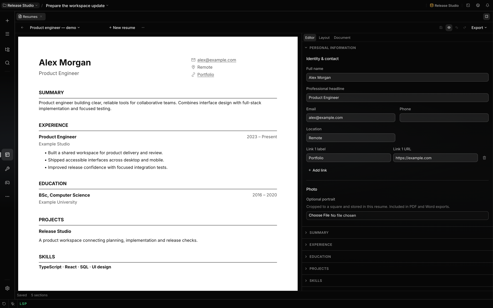

# Resumes

The bundled Resumes mini app gives you and the agent one editable resume in your project. Open **All
tools → Resumes** to browse your library, search by name, or create a resume. The library uses
compact rows with a title, optional target role, edit date, and actions. Saved resumes live in
project files, so ordinary agent file tools and the editor work on the same content.

## What you can do

- Start with a blank resume, an explicitly fictional sample, or an imported file.
- Choose Awal, Ketat, Luasa, Tebal, Klasik, or Ketik from document thumbnails.
- Edit contact information, summary, experience, internships, projects, organizations, education,
  certifications, skills, languages, and custom sections. Descriptions support bold, italic, links,
  and lists.
- Reorder sections and entries, hide a section, sort dated entries, or reset section order. Skills
  and languages support one or two columns and optional proficiency labels. Custom sections can
  contain rich prose or a list of entries.
- Adjust the document font, name and heading sizes, body size, line height, letter spacing, and
  section spacing. Add a portrait and set its size, corner radius, and vertical alignment; toggle
  contact icons and choose English or Indonesian default headings.
- Keep independent variants for different roles. Target-role notes and a job description supply
  tailoring context without appearing in the printed resume.

The editor adapts to its pane inside Localix. The **PDF preview** button beside Save toggles the
preview. It opens automatically when the pane is wide enough, unless you choose a mode yourself.
Wide panes show the document and form beside each other when preview is enabled. Smaller panes show
the preview in place of the form; toggling it off restores your draft, editor selection, and scroll
position. The A4 preview renders the actual PDF pages, with selectable text, page numbers, and a
scale that follows the pane width.

## Import and review

The creation dialog accepts Localix JSON or YAML and Lanjut `lanjut-resume` version 1 interchange.
Native Localix JSON and YAML retain the complete document, including hidden sections and role
context. Text and Markdown can also be imported. With Documents enabled, PDF, DOCX, DOC, and ODT are
extracted into text before import; the file limit is 25 MiB.

Source-text import recognizes common section headings and date ranges. Review the proposed content
and any unassigned text before creating the resume. You can retain unassigned text in an **Imported
notes** section. Extraction does not perform OCR; scanned PDFs require readable text or an
agent-assisted transcription. Ask the agent to help reconcile ambiguous fields rather than assuming
source formatting proves a qualification.

## Export

Save your draft before exporting. The editor and library offer:

| Format                | Result                                                                                                                                                               |
| --------------------- | -------------------------------------------------------------------------------------------------------------------------------------------------------------------- |
| PDF                   | A4 pages using the selected template, typography, portrait, and section layout. Preview and download share the renderer and reuse bytes while that layout is cached. |
| Word                  | An editable DOCX with the selected typography, portrait, and a linear reading order. Word may paginate differently from PDF.                                         |
| Markdown / plain text | Visible content in document order, without private tailoring notes.                                                                                                  |
| Localix JSON / YAML   | The complete structured resume for backup and reimport. These files include role context.                                                                            |
| Lanjut JSON           | Version 1 interchange for representable reference fields. Export rejects fields it cannot preserve; use Localix JSON or YAML for a complete backup.                  |

PDF and Word generation use the bundled [Documents mini app](documents.md). PDF fonts are embedded
and checked for missing characters; supported fallback glyphs preserve Cyrillic even when the chosen
font lacks them. Unsupported glyphs produce an error instead of a corrupted export. A template does
not guarantee acceptance by an applicant tracking system.

## Work with the agent

Ask the agent to initialize a resume from a template, edit existing content, or create a variant for
a role. The `resume` tool provides validated initialization, reads, revision-safe edits,
duplication, history, and text or structured exports. It links its result back to the resume tab.
The agent writes a whole resume in one `init` call and fills in identifiers and empty fields itself.
A field that the section type does not take is moved or dropped, and the result reports it. The call
is not refused for it. The agent should use your supplied facts and ask for missing information.

Saved files are located at `.localix/resumes/<id>/resume.json` in the chat’s effective working
directory. A chosen project keeps these files after chat deletion. A root chat in **Default** uses a
scratch directory, whose cleanup can remove them; save a copy in a chosen project to keep it.
Reading a resume file over 500,000 bytes is refused.

UI saves and agent updates validate the same schema and check the current file revision. If saved
content changes while you edit, a native file-change notification refreshes the saved version
without regular polling while the watcher is healthy. Your draft remains available: merge
independent edits or save a variant.

Unsaved draft recovery uses browser local storage in the current app/profile and is best-effort;
unavailable or full storage can lose recovery. It is separate from a project save. Undo and Redo
keep up to 60 local edit steps, grouping consecutive typing within 700 ms; the undo stack is not
recovered with the draft. **History** restores a saved version as a new revision and keeps up to 60
history snapshots beside the resume file.

Ordinary file edits change the content revision and can appear as the current state in History, but
do not automatically snapshot every intermediate edit. The agent's `export` returns content; it does
not write a download file. Use file tools to save that content or the workbench export controls for
downloads.

## Related guides

- [Documents](documents.md)
- [Build a mini app](../extending/mini-apps.md)
- [Workspace](workspace.md)
- [Sessions and storage](sessions-and-projects.md)

## Source of truth

- [Workspace resolution](https://github.com/rsaryev/localix/blob/main/mini-apps/resume/backend/index.ts)
- [Saved files and size guard](https://github.com/rsaryev/localix/blob/main/mini-apps/resume/backend/files.ts)
- [Saved history retention](https://github.com/rsaryev/localix/blob/main/mini-apps/resume/backend/revisions.ts)
- [Draft recovery](https://github.com/rsaryev/localix/blob/main/mini-apps/resume/ui/useResumeDraft.ts)
- [Local undo grouping](https://github.com/rsaryev/localix/blob/main/mini-apps/resume/ui/history.ts)
- [Shared PDF cache](https://github.com/rsaryev/localix/blob/main/mini-apps/resume/ui/pdf.ts)
