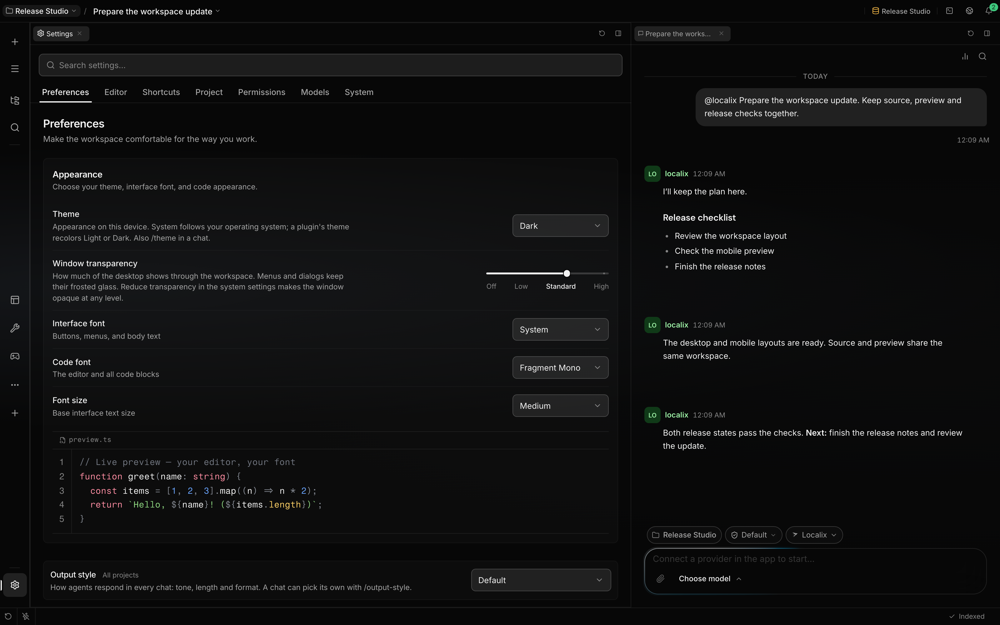

# Settings

Settings opens as a workspace pane. Every section shares the same layout at any pane width: a search
field above a scrollable strip of section tabs, and the section's page below them. Application
search finds individual controls across sections and opens the owning group, including advanced
controls.

## Settings map

| Group       | Section                     | Controls and destinations                                                                                | Applies to                                                                          |
| ----------- | --------------------------- | -------------------------------------------------------------------------------------------------------- | ----------------------------------------------------------------------------------- |
| Personal    | Preferences → Appearance    | Theme, window transparency, interface font, code font, font size, live code preview                      | Theme and transparency stay on this device; fonts use synchronized UI settings      |
| Personal    | Preferences → Recent views  | Recent views: collapsed, expanded, hidden                                                                | This browser or desktop webview                                                     |
| Personal    | Preferences → Notifications | Interruption condition, waiting count or Windows taskbar indicator; terminal protocol under Advanced     | This browser or desktop webview; app icon indicators require desktop support        |
| Personal    | Preferences → Spend alerts  | Session spend threshold in US dollars                                                                    | Local advisory alert; wholly subscription sessions are skipped                      |
| Personal    | Editor → Editing            | Auto save, preview tabs                                                                                  | Stay local to this device                                                           |
| Personal    | Editor → On save            | Format, trim trailing whitespace, insert final newline                                                   | Synchronized save policy for all projects                                           |
| Personal    | Editor → Code display       | Git scrollbar markers, bracket colors, word wrap, render whitespace                                      | Markers and bracket colors are synchronized; wrap and whitespace display stay local |
| Personal    | Editor → Annotations        | Inline Git blame, inlay hints                                                                            | Git blame is synchronized; inlay hints stay local                                   |
| Personal    | Shortcuts                   | Base keymap, command search, editable chords, conflicts, reset                                           | Keyboard commands; interaction keys are reference-only                              |
| Workspace   | Project                     | Project selector, display name, project instructions, delete                                             | The selected project                                                                |
| Security    | Permissions                 | Ordered rules, argument patterns, allow/ask/deny, apply, restore defaults; Claude Code rules, read-only  | The selected agent; Claude Code settings apply to every agent                       |
| Application | Models                      | Provider connections, model defaults and workload routing                                                | See the model selection and details panel                                           |
| Application | System → Application        | Updates, model list check, terminal command, storage usage, reviewed conversation removal, retention     | This installation and local conversation storage                                    |
| Application | System → Access & context   | Private/local research URLs, context exclusion paths                                                     | Current user profile; applies across that user's agents and projects                |
| Application | System → Diagnostics        | Scope, refresh, validation, resolved models, tool policy, permissions, values and provenance, extensions | Read-only resolved runtime configuration                                            |

Choose an editor-style preset in **Shortcuts → Base keymap**. The
[keymap inventory](keyboard-shortcuts.md) lists compatible commands, platform differences, and
source references for all 17 choices.

Permissions initially uses the current conversation's agent when it is available in the picker;
otherwise it falls back to the default assistant. A manual choice stays selected while that page
remains mounted. Check the agent name before changing permission rules.

Spend alerts never stop a run. A session with mixed cost sources is summarized as estimated and can
trigger an alert even when some calls use a subscription. See [cost tracking](cost-tracking.md) for
price provenance and alert limits.

## Agents and other items

Settings keeps preferences. Agents, skills, MCP servers, plugins and mini apps are managed in the
[Store](store.md): browse its shelves (Mini apps, Plugins, MCP servers, Skills, Agents), see what
you have under **Yours** and **Installed**, and add catalogs under **Sources**. Each item has its
own Store page. An agent is a Claude Code agent file, edited on its Store page; the switches for its
tools, skills, MCP servers, plugins and mini apps are on that page's **Access** tab. Tool permission
rules live in **Settings → Permissions**. See [Agents](agents.md), [Mini apps](mini-apps.md) and
[Install Claude Code plugins](../extending/claude-code-plugins.md).

Write shared project conventions in **Project → Project instructions**. There is no personal profile
or global response-style form. A forward database migration removes retired personal data while
retaining UI and runtime settings.

Provider connections, model defaults and workload routing are owned by the
[model selection and details panel](providers.md). Credentials live in the [Vault](secrets.md).
Theme selection is available in Preferences → Appearance.

**Window transparency** sets how much of the desktop shows through the workspace: Off, Low, Standard
or High. Off makes the window opaque, and menus and dialogs keep their frosted glass at every level.
The operating system's Reduce transparency setting makes the window opaque whatever level is chosen.
On macOS the desktop shows through the native window material; in a browser and on Windows and Linux
it is a painted backdrop.

## Access and context

**System → Access & context** keeps global research access visible independently of the agent
selected in Permissions. Private/local URL access is a user-profile runtime preference shared by
that user's agents and projects; it does not change another user's profile.

Context exclusions are root-relative path prefixes, one per line. Apply validates, trims and
deduplicates them. They affect file context expansion for every project; project-specific exclusions
also apply. The list accepts up to 64 paths, each at most 240 UTF-16 code units; a leading `/`,
backslashes and `..` segments are rejected. These exclusions do not prohibit file tools. Use agent
permission rules for tool access decisions.

## Saving and states

Synchronized UI and runtime preferences belong to the current API user profile. The app first reads
a best-effort browser cache, then the authoritative server profile. Changes made before the first
successful read wait to save; an existing server settings envelope can replace those unsynchronized
edits. Later profile reads preserve this window's pending edits while adopting committed peer keys.

Ordinary switches and selectors update the visible local value immediately. Profile writes debounce
for 800 ms and run in order; failures retain pending edits and retry after one second, doubling up
to 30 seconds while the app remains running. A visible change is not proof of a completed server
save. Saves merge top-level fields; simultaneous changes to a nested value such as the whole
keybindings map can still replace one another.

Local preferences stay in the browser or desktop webview and do not become agent instructions.
Project text fields save on blur. Record editors have explicit save actions and show errors beside
the relevant field or action. A running record save reports its activity and locks its actions.

A registry shows an empty state only after a successful load. Failed loads offer Retry and retain
their problem in the Event Center. Diagnostics is read-only. Storage removal first counts affected
conversations, then asks for confirmation; automatic removal is disabled until configured.

## Source of truth

- [Section order and groups](https://github.com/rsaryev/localix/blob/main/apps/ui/src/features/settings/model/settingsNavigation.ts)
- [Search catalog](https://github.com/rsaryev/localix/blob/main/apps/ui/src/shared/lib/settings-index/settingsIndex.ts)
- [Shared workspace layout](https://github.com/rsaryev/localix/blob/main/apps/ui/src/features/settings/ui/SettingsWorkspace.tsx)
- [Shared section geometry](https://github.com/rsaryev/localix/blob/main/apps/ui/src/features/settings/ui/SettingsScaffold.tsx)
- [Settings synchronization](https://github.com/rsaryev/localix/blob/main/apps/ui/src/shared/lib/user-settings/settingsStore.ts)
- [Initial server precedence](https://github.com/rsaryev/localix/blob/main/apps/ui/src/shared/lib/user-settings/settingsSyncBarrier.ts)
- [Peer refresh and pending edits](https://github.com/rsaryev/localix/blob/main/apps/ui/src/shared/lib/user-settings/settingsSyncResult.ts)
- [Profile patch boundaries](https://github.com/rsaryev/localix/blob/main/apps/api/src/features/user/service.ts)
- [Context exclusion validation](https://github.com/rsaryev/localix/blob/main/apps/api/src/contracts/context-exclusion-schema.ts)
- [Runtime settings contract](https://github.com/rsaryev/localix/blob/main/apps/api/src/features/user/contracts.ts)
- [Spend alert suppression](https://github.com/rsaryev/localix/blob/main/apps/ui/src/entities/chat/ui/prompt-input/SpendAlertStrip.tsx)
- [Mixed usage provenance](https://github.com/rsaryev/localix/blob/main/packages/agent/src/usage-summary.ts)
