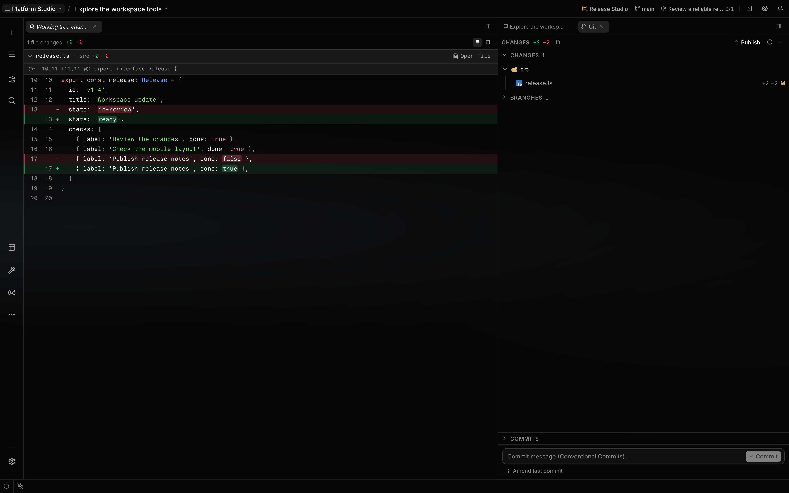

# Use Source Control

Source Control reads and changes Git repositories from a chat's working directory. Use it to inspect
diffs, stage work, commit, manage branches and stashes, and synchronize tracking remotes without
leaving the workspace.

**Scope:** Git is the only backend. Every operation targets the chat the Git tab or control belongs
to, or one repository discovered beneath that chat's working directory.

## What you can do

| Action                     | Mechanism                                                                                    | Boundary                                                                                                                         |
| -------------------------- | -------------------------------------------------------------------------------------------- | -------------------------------------------------------------------------------------------------------------------------------- |
| Review changes             | Browse staged and unstaged files, line totals, file diffs, or one repository-wide diff       | Projects with several discovered repositories are grouped; singular actions follow the focused group                             |
| Stage work                 | Stage or unstage a file, folder, whole section, or change block                              | Block operations carry a diff fingerprint and fail when the underlying diff has changed                                          |
| Discard work               | Restore files, folders, or change blocks after confirmation                                  | **Nuke** restores all tracked changes and can remove untracked files; ignored files remain                                       |
| Commit changes             | Create a commit or amend `HEAD` from the panel's commit box                                  | With no staged files, Commit or Amend stages every current change in the focused repository first                                |
| Manage branches            | Switch, create, rename, and delete local branches                                            | A branch checked out in another worktree cannot be switched to, renamed, or deleted here                                         |
| Inspect history            | Filter commits by message, author, or path; open commit diffs; compare two commits           | The log loads 40 commits at a time in the panel                                                                                  |
| Rewrite or recover history | Revert, cherry-pick, reset, reword, fix up, rebase, or bisect from commit controls           | Destructive and conflict-prone operations remain Git operations; recovery banners expose continue, skip, abort, or reset actions |
| Set work aside             | Stash current changes including untracked files, inspect the patch, then apply, pop, or drop | Dropping a stash is destructive                                                                                                  |
| Synchronize a remote       | Fetch tracking refs, fast-forward pull, or push the current branch                           | A first push without an upstream retries as `git push -u origin HEAD`                                                            |
| Work with pull requests    | List open pull requests, inspect a pull-request diff, or open creation in the browser        | Requires an authenticated `gh` CLI and a GitHub remote                                                                           |

## Review and synchronize

The panel header offers **Open full diff**, incoming **Pull** and outgoing **Push** counts, and
**Refresh**. **More actions** contains Fetch, Pull, Push, Stash all changes, and Discard all
changes. A branch without an upstream offers **Publish** through the existing first-push flow.
Remote actions are disabled while a fetch, pull, or push is running.

Diff layout and change navigation occupy a toolbar above the code. Choose unified or side-by-side
layout; the choice persists across diff views. Long source lines retain their spacing and scroll
horizontally while file names, hunk headers and line actions stay in view. In side-by-side layout
each side is half the pane and both sides' code scrolls together from one bar under the diff (or a
sideways trackpad swipe), while line numbers stay in place. The current file and hunk headers stay
pinned at the top while you scroll; `j`/`k` (or F7/Shift+F7) step between changes. Select a line
number to open that repository's file.

Large diffs render only visible rows and compute syntax colours as rows scroll into view. Reading
and parsing the patch still depend on its size. In a repository-wide diff, a file longer than 1,500
lines starts collapsed behind **Show diff**, and a binary file is listed without content. A diff
larger than the read cap (8 MB) opens with a **Diff truncated** notice and the complete files that
fit, instead of opening empty or failing. A single line longer than 10,000 characters shows its
first 10,000 and a count of the rest.

Tracked file diffs offer block staging actions and a file-wide Stage or Unstage action in the
toolbar. Block actions appear at the right edge of a change block on hover. Plain `s`, `u`, and `d`
shortcuts apply only inside the staging view; shortcuts with modifiers retain their normal editor
behavior.

## How it works

The API resolves the working directory of the session the request names. If that directory is inside
a repository, operations run at its nearest repository root and can affect files outside the session
subfolder. An optional repository root must match a repository found beneath that directory, so a
request cannot redirect an operation to an unrelated server path.

Repository discovery scans breadth-first to four directory levels and returns at most 200
repositories. It skips hidden, dependency, build, coverage, target, and vendor directories. A
repository found below the scan root becomes a boundary and is not searched for further nested
repositories.

The Git tab belongs to the chat it was opened from and always shows that chat's repository, even
after you switch to another chat. A chat's repository is read while that chat's pane is focused and
while its Git tab is visible. It refreshes about two seconds after files change in the chat's
project — a branch switch or a `git add` in the terminal included — and when the session's project
changes, the window regains focus, or a run ends. A change made while the surface is hidden is read
when it shows again.

For a local project a slow two-minute poll is only a backstop; for a remote session, or when the
file watcher is unavailable, it polls every 6 seconds during a run or pending directory resolution
and every 30 seconds while idle. Non-repositories keep the idle discovery probe, so a new repository
appears automatically after `git init` without reopening the chat. The changed-file pill appears
only when there are uncommitted changes; the branch control remains available for a clean
repository.

Mutations return a freshly read repository status. Local Git commands run as argument arrays without
a shell, with terminal prompting disabled, a 30-second deadline, and an 8 MB output ceiling. Fetch,
pull, and push use a ten-minute deadline instead. HTTP transfers also abort when their speed stays
below 1,000 bytes per second for 60 seconds. This low-speed guard does not cover SSH transfers.

Commits and amends made through the panel append `Co-Authored-By: Localix <noreply@localix.ai>`. The
service also writes best-effort provenance to `refs/notes/localix`; commits made from a terminal do
not use this annotation path.

### Staging and discard boundaries

A file or folder **Discard** restores tracked working files from the index, preserving staged
content, and removes untracked files within the selected paths. If you staged version A and then
edited it to B, Discard restores A. Ignored files remain. Block discard reverse-applies only the
selected changes, subject to the diff-drift guard.

**Nuke** with an existing `HEAD` resets tracked staged and unstaged changes to that commit. Its
optional untracked cleanup uses `git clean -fd`, preserving ignored files. Before the first commit,
it clears the index instead of restoring tracked files from a nonexistent `HEAD`; file removal then
depends on the untracked option.

The service serializes its own writes per working directory and briefly retries index-lock
contention. Terminal commands and other processes remain independent. Multi-step operations are not
transactions: if Commit stages everything and then signing or a hook fails, those files stay staged.
A failed later step does not undo earlier successful Git commands.

## Configuration

| Control                 | Default                                                            | Effect                                                                              |
| ----------------------- | ------------------------------------------------------------------ | ----------------------------------------------------------------------------------- |
| Source Control access   | Title-bar action or **Open Source Control** in the command palette | The title-bar action appears when its session resolves to a Git repository          |
| Commit shortcut         | `Mod+Enter`                                                        | Runs Commit or Amend from the focused commit box; configurable in keyboard settings |
| Inline completion route | Off                                                                | Completes commit text when the route is enabled and a provider/model resolves       |
| GitHub pull requests    | Unavailable without `gh` authentication                            | Run `gh auth login`; the repository must also resolve through a GitHub remote       |

## Limits

- Source Control requires an open session and the Git executable. The backend-neutral contracts do
  not provide another version-control implementation.
- Ahead and behind counts come from local tracking refs. They can remain stale until Fetch
  completes.
- A rejected Push may offer **Force push**, implemented as `--force-with-lease`. The lease compares
  the remote against local tracking refs; review and fetch before rewriting published history.
- Pull uses `git pull --ff-only`. Divergent history is refused instead of creating a merge commit or
  starting a rebase.
- The panel cannot answer Git credential, signing, SSH passphrase, hook, or editor prompts.
  Configure those flows to run non-interactively.
- GitHub is the only forge backend. Missing `gh`, missing authentication, or a non-GitHub remote
  removes pull-request data without disabling ordinary Git operations. The GitHub availability check
  is cached for a minute, so a fresh `gh auth login` can take up to a minute to appear.
- There is no dedicated merge-conflict editor. Resolve conflicts in the editor or terminal, stage
  the result, then use the recovery banner where one is available.
- Discard, Nuke, stash drop, hard reset, branch force-delete, and history rewrites can remove work.
  A confirmation cannot recover data that Git no longer retains.

## Related guides

- [Workspace](workspace.md)
- [Sessions and projects](sessions-and-projects.md)

## Source of truth

- [Source-control routes](https://github.com/rsaryev/localix/blob/main/plugins/git-workspace/backend/source-control/routes.ts)
- [Source-control service](https://github.com/rsaryev/localix/blob/main/plugins/git-workspace/backend/source-control/service.ts)
- [Git mutation and synchronization policy](https://github.com/rsaryev/localix/blob/main/plugins/git-workspace/backend/source-control/git/actions.ts)
- [Git process boundary](https://github.com/rsaryev/localix/blob/main/plugins/git-workspace/backend/source-control/git/cli.ts)
- [Repository discovery](https://github.com/rsaryev/localix/blob/main/plugins/git-workspace/backend/source-control/repos/discovery.ts)
- [Source Control panel](https://github.com/rsaryev/localix/blob/main/plugins/git-workspace/ui/source-control/ui/SourceControlTab.tsx)
- [Interactive staging](https://github.com/rsaryev/localix/blob/main/plugins/git-workspace/ui/source-control/ui/DiffStagingView.tsx)
- [Commit history operations](https://github.com/rsaryev/localix/blob/main/plugins/git-workspace/ui/source-control/ui/CommitGraph.tsx)
