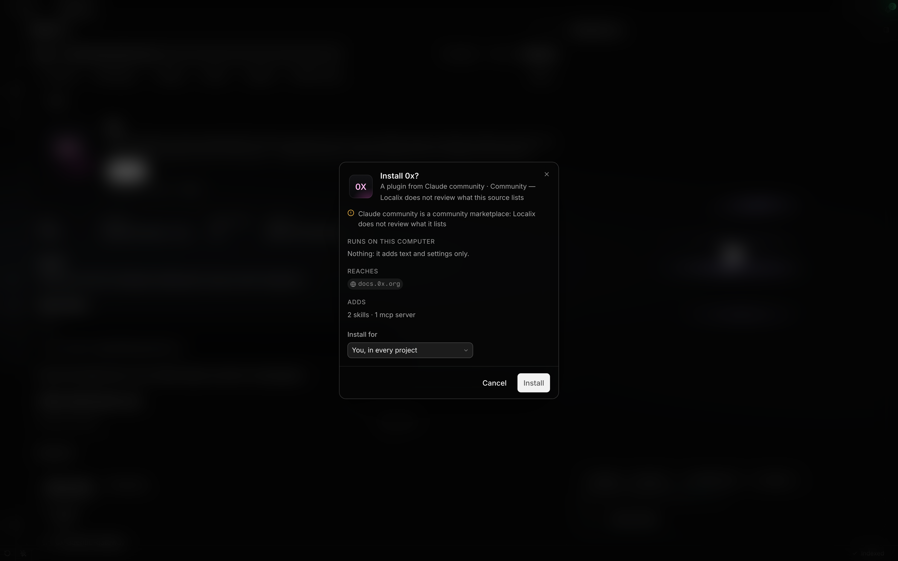
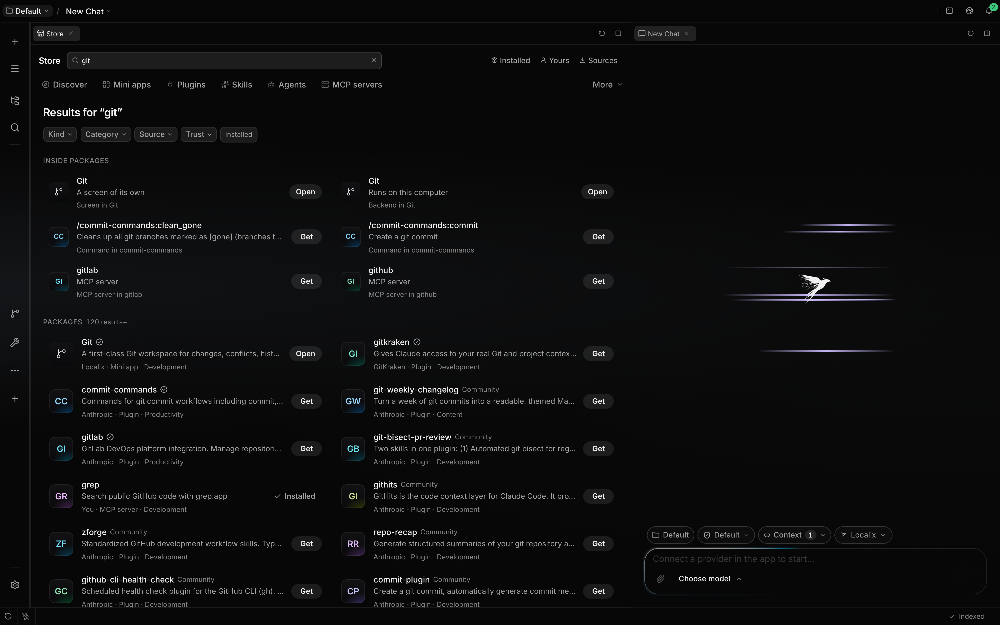
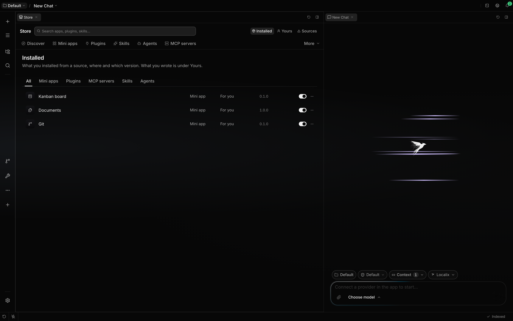
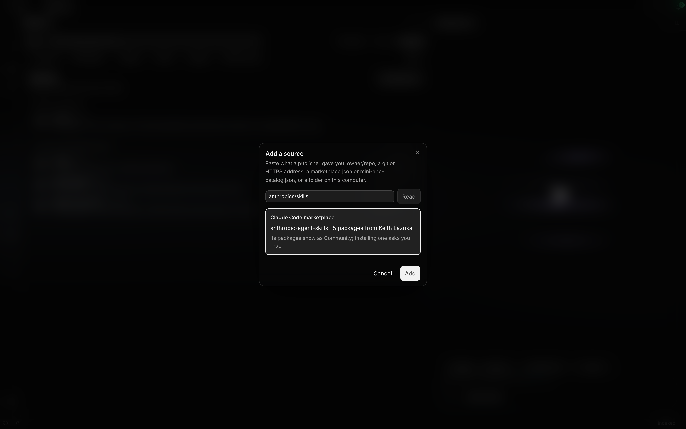

# Store

The Store is where you find, install, update and remove what Localix can add: mini apps and Claude
Code plugins, from the Localix marketplace and from Anthropic's official and community plugin
marketplaces. Use this page to see where its packages come from, how its search works, and what
happens before anything is installed.

## What you can do

| Outcome                            | How                                                                 | Boundary                                                                  |
| ---------------------------------- | ------------------------------------------------------------------- | ------------------------------------------------------------------------- |
| Open the Store                     | The rail's **+**, **Open the Store** in Settings, or the palette    | It opens in one tab of its own, on Discover.                              |
| Browse plugins                     | The **Plugins** shelf, or a capability shelf such as **Skills**     | Every plugin of every marketplace you have, one card per package.         |
| Search everything                  | The search field at the top of the Store                            | Finds by words and, once the built-in model is ready, by meaning.         |
| Find a package from anywhere       | Type in the search palette: a **Store** group follows what you have | At most five packages you have not installed; Enter opens its Store page. |
| See what a plugin adds and runs    | Open its card; **Permissions** shows its plan                       | A plugin from another repository is fetched once to read it.              |
| Install a plugin                   | **Get** on its card or page                                         | A community plugin, or one that runs programs, asks for your yes first.   |
| Add or remove a plugin marketplace | Store → **Sources**                                                 | One you remove from the defaults is not added back.                       |

## How it works

### Agents

**Agents** is a package kind of its own: each agent is a Claude Code agent file, listed under
**Yours**, **This project**, **Managed**, **From plugins** and **Built in**. **Add agent** makes
one; an agent's page has **Overview**, **Settings** (its definition, written back to the file) and
**Access** (its per-agent switches). The `team` plugin from the Localix marketplace, Recommended
here, adds a starter team. See [Agents](agents.md).

### Finding your way

The Store opens in its own tab. The top row holds a search across everything and your library on the
right: **Installed**, **Updates** (with how many wait), **Yours**, **Project** and **Sources**.
Under it the catalog is a row of tabs: **Discover**, a tab for each kind of package you install
(**Mini apps**, **Plugins**), then **Skills**, **Agents** and **MCP servers**. The rarer things
packages give, such as **Commands**, **Hooks** and **Mods**, are under **More**, which takes the
name of the one you chose. A section with nothing on it is not shown.

A skill, an agent or an MCP server has one shelf: it lists the ones you or your project have and the
ones inside plugins, each saying where it is from (**Your skills**, **In Lint · Plugin**), so no
name appears twice.

The Store lays itself out by its own width, not the window's. In a narrow pane the library shows
only its icons, and the catalog's tabs scroll sideways if they still do not fit. Rows of tiles show
only whole tiles, as many side by side as fit, and **See all** opens the rest. In a narrow tab lists
have one column and a package page pins **Get** to the bottom. Nothing ever scrolls the page
sideways.

### Discover

Discover is one answer from the Store, top to bottom: a strip of updates when there are any, **Start
here**, **For your work**, a row for the open project when its languages match something, editorial
**Collections**, a row per kind and **New & updated**, then the categories.

**For your work** is ten packages you have not installed. First come the ones that suit what you
work on: your open tabs, the chips in the composer, the open project and what you already installed.
Localix finds them by meaning with the built-in embedding model, which runs on your computer, and
works them out in the background as you open things. Trusted packages fill the rest, so the row is
never empty. **See all** lists every recommendation, best first. When something new suits your work,
the strip above the composer says **Recommended for you**; **See** opens the list in the Store, and
hiding it keeps it hidden until there is something new.

### Shelves and lists

A shelf is a list read a page at a time as you scroll, and only the rows on screen exist, so a shelf
of thousands of plugins opens at once. Category tabs narrow it, with the ones that do not fit under
**More**, and a source menu narrows it to one marketplace. A plugin without an icon shows its first
letters on a tile, in a colour taken from its name. A shield means Localix or Anthropic publishes
it; a package from a community source says **Community**.

A capability shelf lists the components themselves. **Commands** shows each command with what it
does and the package it comes from; choosing a row opens that package's page on **What's inside**
with the command marked.

### A package's page

A page opens with the icon, name, publisher and trust, and **Get**, with a menu beside it to get a
plugin for the open project alone. Under it come the facts (kind, category, version, size, source,
whether it runs code, where else it is listed), the screenshots, the description as the chat renders
Markdown, and what's new. Tabs list **What's inside**, **Permissions** (the plan) and **Versions**,
followed by **More from** the publisher and **You might also like**. The page opens at once from
what the shelf knew, and a plugin whose files live elsewhere fills in its contents when they have
been read.

### Get

**Get** is one button for every state: it shows progress while it installs, becomes **Open** once
installed and **Update** when a newer version is offered, and **Retry** after a failure. On the
macOS desktop an app with a screen of its own also offers **Install as app**; see
[Mac apps](mini-app-mac-apps.md).

### Where packages come from

A fresh profile starts with these sources, registered for browsing only: nothing from them is
installed or switched on. The first two are one repository, the
[Localix marketplace](https://github.com/rsaryev/localix-marketplace): its releases publish the mini
app catalog, and its `plugins` folder is the plugin marketplace. The core names none of their
packages.

| Source                                | Trust     | Shown as                                                |
| ------------------------------------- | --------- | ------------------------------------------------------- |
| The Localix marketplace's mini apps   | Localix   | Localix's mini apps; its picks reach **Discover**.      |
| The Localix marketplace's plugins     | Localix   | Localix's own plugins; its picks reach **Discover**.    |
| `anthropics/claude-plugins-official`  | Official  | Anthropic's reviewed plugins.                           |
| `anthropics/claude-plugins-community` | Community | Plugins by their authors; Localix does not review them. |

A marketplace you add yourself counts as community. One that is already registered, by you or by
your Claude Code settings, is reused rather than added twice. With
`CLAUDE_CODE_DISABLE_NONESSENTIAL_TRAFFIC` set, none is fetched. The Store fetches its sources again
every six hours.

When two sources list the same package (the same repository and folder, or the same npm name), it
shows once, under the more trusted source, and its page says where else it is listed.

### Search

The Store's search and the palette ask the same search. Words are matched in each package's name,
tags, description and contents, and a name that says what you typed comes first. While the built-in
embedding model is ready, packages are found by meaning too, so "kubernetes" also finds a plugin
that deploys Helm charts. Among equally good matches, Localix's own come before official ones, and
official before community ones. The open project counts too: a TypeScript project sees its language
servers first.

### Before an install

A plugin's page lists what it adds (skills, commands, agents, hooks, servers) and its plan lists
what runs on your computer: hooks, a mod, a local MCP or language server, programs in `bin/`. A
plugin from a community marketplace, or one that runs programs, installs only after you say yes to
its plan. **User** installs it for you everywhere; **Project** for the open project only.

A plugin whose files live in another repository says "unknown" until its page is opened: Localix
fetches it then, reads what it contains, and the install that follows uses that fetch.

### Through the assistant

The assistant's `Store` tool works over the same service and only the sources you added: it can
search, read a package's plan, install, update, remove, enable, disable, and create an agent or a
skill, but it cannot add or remove a source. Each change shows a card with the plan and waits for
your yes; the plan's consent goes to the Store only after it. An install or update starts a job, so
the assistant reads the package again to see the result. A run nobody can answer refuses every
change. `/plugin install` shows the same plan for a plugin from a Store source, and installs once
you repeat it with `--yes`.

One `Store` search can carry up to eight queries, so the assistant looks several things up in one
call: the answer comes back grouped by query, five packages each, and a package two queries find is
listed once.

### Search results

Typing in the Store's search replaces the section with results after a short pause, and cancels what
you typed past. **Packages** lists the matches, **Inside packages** the skills, commands and other
components that match. Chips narrow them by kind, category, source, trust and whether you have them.
With no match, the Store suggests categories.

### Library

**Installed** lists every install of every kind with its scope, version and an enabled switch; its
menu updates it, opens its settings (**Configure**) or removes it, and chips filter by kind. A
package installed for one project says which. **Updates** lists what has a newer version with
**Update all**.

### Sources

**Sources** lists each source under its kind (mini app catalogs, plugin marketplaces) with its
publisher and trust, how many packages it offers, when it was last read and an automatic update
switch. A source that cannot be read says so quietly on its row. Its menu updates or removes it;
removing a default says it will not come back. Choosing a source opens the Store filtered by it.

**Add source…** is the one way in. Paste `owner/repo`, a git address, a `marketplace.json` or
`mini-app-catalog.json` address, or a folder. The Store reads it, shows the publisher, the count and
sample icons, asks which kind you mean when both fit, and adds it only when you choose **Add**.

## Limits

- No ratings, reviews or install counts: Localix has no server to hold them.
- A community plugin's contents are unknown until its page has been opened once.
- Search by meaning needs the built-in embedding model; until it is ready, search is by words.

## Related guides

- [Mini apps](mini-apps.md)
- [Claude Code plugins](../extending/claude-code-plugins.md)
- [Plugin marketplaces and updates](../extending/plugin-updates.md)
- [Semantic search](semantic-search.md)

## Source of truth

- [Store feature](https://github.com/rsaryev/localix/tree/main/apps/api/src/features/store)
- [Default sources](https://github.com/rsaryev/localix/blob/main/packages/store/src/default-sources.ts)
- [Plugins in the Store](https://github.com/rsaryev/localix/blob/main/apps/api/src/features/plugins/store-provider.ts)
