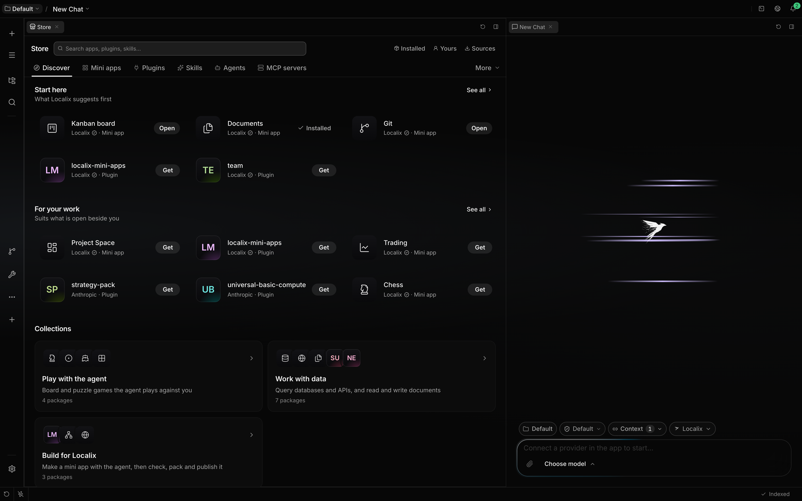
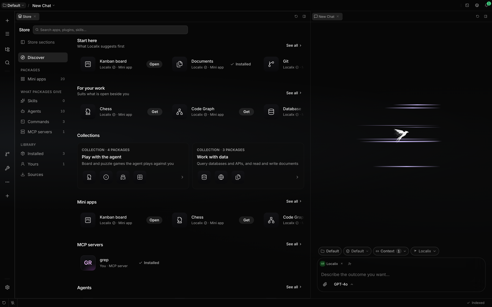
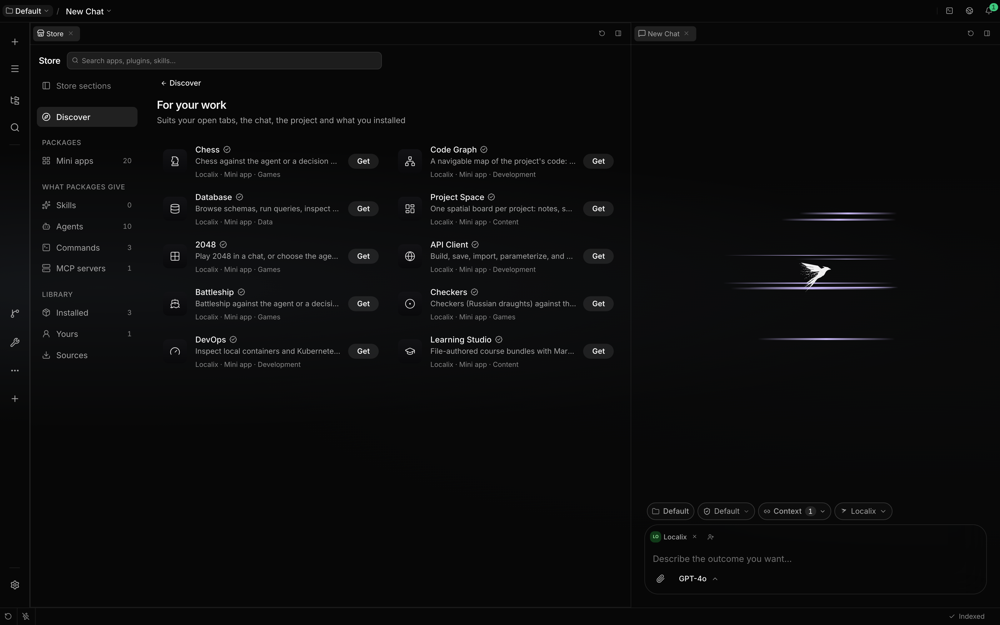
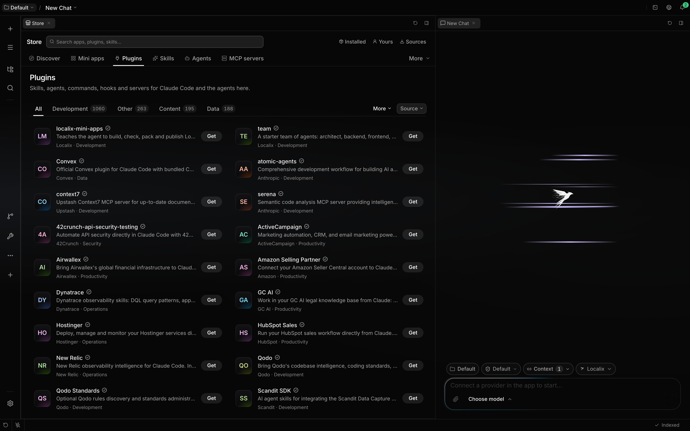
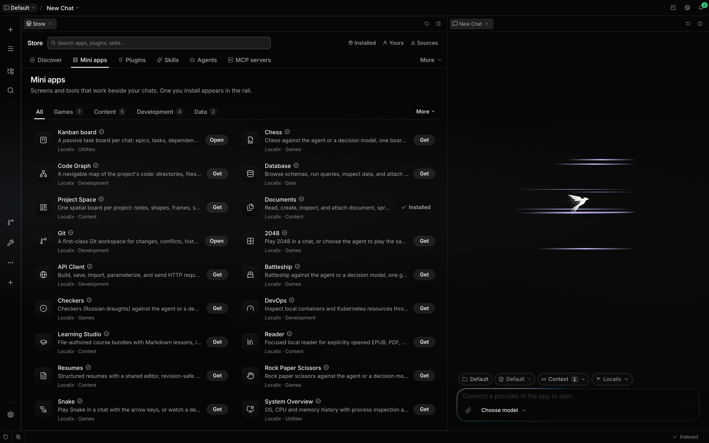
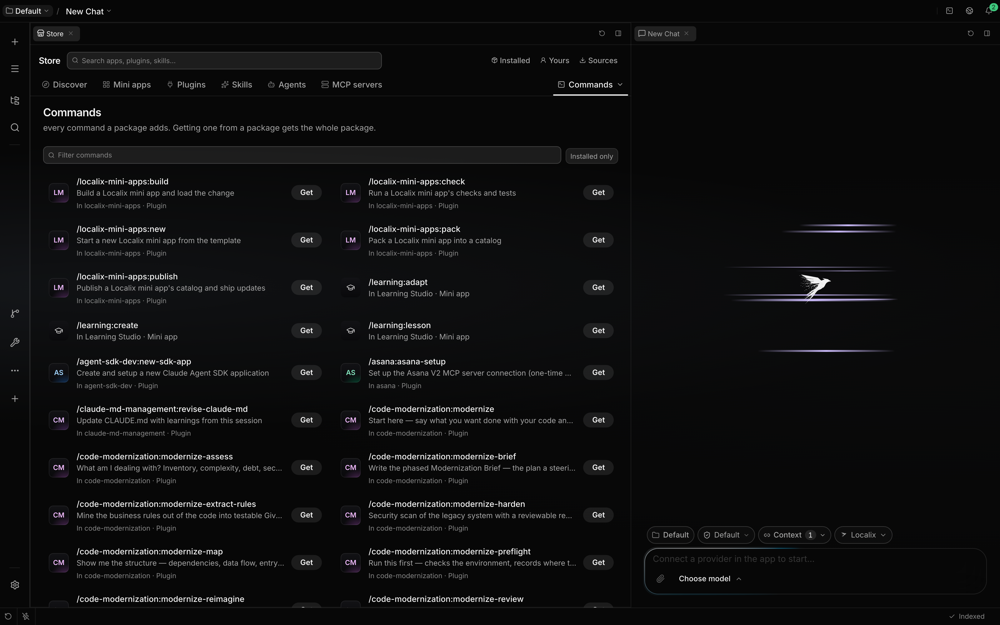
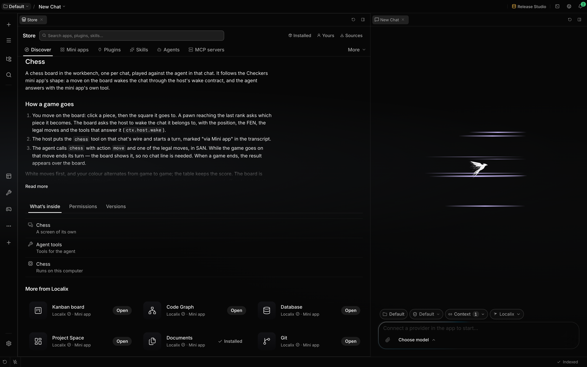

# Store

The Store is where you find, install, update and remove what Localix can add: mini apps and Claude
Code plugins, from the [Localix marketplace](https://github.com/rsaryev/localix-marketplace) and
from Anthropic's official and community plugin marketplaces. Use this page to see where its packages
come from, how its search works, and what happens before anything is installed.

## What you can do

| Outcome                            | How                                                                 | Boundary                                                                  |
| ---------------------------------- | ------------------------------------------------------------------- | ------------------------------------------------------------------------- |
| Open the Store                     | The rail's **+**, **Open the Store** in Settings, or the palette    | It opens in one tab of its own, on Discover.                              |
| Browse plugins                     | The **Plugins** shelf, or a capability shelf such as **Skills**     | Every plugin of every marketplace you have, one card per package.         |
| Search everything                  | The search field at the top of the Store                            | Finds by words and, once the built-in model is ready, by meaning.         |
| Find a package from anywhere       | Type in the search palette: a **Store** group follows what you have | At most five packages you have not installed; Enter opens its Store page. |
| See what a plugin adds and runs    | Open its card; **Permissions** shows its plan                       | A plugin from another repository is fetched once to read it.              |
| Install a plugin                   | **Get** on its card or page                                         | A community plugin, or one that runs programs, asks for your yes first.   |
| Add or remove a plugin marketplace | Store → **Sources**                                                 | One you remove from the defaults is not added back.                       |

## How it works

### Agents

**Agents** is a package kind of its own: each agent is a Claude Code agent file, listed under
**Yours**, **This project**, **Managed**, **From plugins** and **Built in**. **Add agent** makes
one; an agent's page has **Overview**, **Settings** (its definition, written back to the file) and
**Access** (its per-agent switches). A starter team from the Localix marketplace is Recommended
here. See [Agents](agents.md).

### Finding your way

The Store opens in its own tab. The top row holds a search across everything and your library on the
right: **Installed**, **Updates** (with how many wait), **Yours**, **Project** and **Sources**.
Under it the catalog is a row of tabs: **Discover**, a tab for each kind of package you install
(**Mini apps**, **Plugins**), then **Skills**, **Agents** and **MCP servers**. The rarer things
packages give, such as **Commands**, **Hooks** and **Mods**, are under **More**, which takes the
name of the one you chose. A section with nothing on it is not shown.

A skill, an agent or an MCP server has one shelf: it lists the ones you or your project have and the
ones inside plugins, each saying where it is from (**Your skills**, **In Lint · Plugin**), so no
name appears twice.

The Store lays itself out by its own width, not the window's. In a narrow pane the library shows
only its icons, and the catalog's tabs scroll sideways if they still do not fit. Rows of tiles show
only whole tiles, as many side by side as fit, and **See all** opens the rest. In a narrow tab lists
have one column and a package page pins **Get** to the bottom. Nothing ever scrolls the page
sideways.

### Discover

Discover is one answer from the Store, top to bottom: a strip of updates when there are any, **Start
here**, **For your work**, a row for the open project when its languages match something, editorial
**Collections**, a row per kind and **New & updated**, then the categories.

**For your work** shows the packages you have not installed that suit what you work on: your open
tabs, the chips in the composer, what you chose to install and the open project. Localix asks about
each of them on its own, so one large file does not crowd out the rest, and finds packages by
meaning with the built-in embedding model, which runs on your computer.

What you installed lately counts for more than what you installed long ago, and a package whose
marketplace says it is for a file you have open (`*.tf`) or a package your project uses (`prisma`)
comes first. Localix works them out in the background as you open things; no single publisher or
file takes the whole row while others fit too, and a package shown day after day that you never open
makes room for the next.

**See all** lists ten recommendations, best first, each saying why it is there: _Because
compose.yaml is open_, _Because you use Pen_, _Suits this project: typescript_. Trusted packages
fill the rest of the ten and say _A trusted pick_. **Not interested** (the thumbs-down beside
**Get**) takes a package off your recommendations for good; one you remove through the Store is not
recommended again either. Search and the shelves still list both, and **Not recommended**, under the
list, holds them with **Recommend again**.

When something new suits your work, one quiet line above the composer says so — _Recommended ·
Docker tools and 2 more for compose.yaml_ — and the tip line waits until it is gone. **See** opens
the list in the Store, and hiding it keeps it hidden until there is something new.

What was shown, opened and installed from recommendations is kept on your computer for 90 days, so
the Store can rest what you pass over; it is never sent anywhere.

### Shelves and lists

A shelf is a list read a page at a time as you scroll, and only the rows on screen exist, so a shelf
of thousands of plugins opens at once. Category tabs narrow it, with the ones that do not fit under
**More**, and a source menu narrows it to one marketplace. A plugin without an icon shows its first
letters on a tile, in a colour taken from its name. A shield means Localix or Anthropic publishes
it; a package from a community source says **Community**.

A capability shelf lists the components themselves. **Commands** shows each command with what it
does and the package it comes from; choosing a row opens that package's page on **What's inside**
with the command marked.

### A package's page

A page opens with the icon, name, publisher and trust, and **Get**, with a menu beside it to get a
plugin for the open project alone. Under it come the facts (kind, category, version, size, source,
whether it runs code, where else it is listed), the screenshots, the description as the chat renders
Markdown, and what's new. Tabs list **What's inside**, **Permissions** (the plan) and **Versions**,
followed by **More from** the publisher and **You might also like**. The page opens at once from
what the shelf knew, and a plugin whose files live elsewhere fills in its contents when they have
been read.

**What's inside** groups the parts by kind, in the order you meet them: screens and commands, skills
and agents, then what the agent gets (tools, MCP servers) and last what runs on its own (hooks,
monitors, a backend). Each group is headed with its count (**Skills · 6**, or just **Hook** for
one), and each row says what the part does: a skill's own description, or when a hook runs
(`PostToolUse` is _After each tool the agent uses_).

### Get

**Get** is one button for every state: it shows progress while it installs, becomes **Open** once
installed and **Update** when a newer version is offered, and **Retry** after a failure. Turned off
with **Disable** in the menu beside it, a package stays installed and the button says **Enable**. On
the macOS desktop an app with a screen of its own also offers **Install as app** in the menu beside
**Get**; see [Mac apps](mini-app-mac-apps.md).

### Where packages come from

A fresh profile starts with these sources. Only the Localix marketplace installs anything on its own
(see below); from the others nothing is installed or switched on. The first two are one repository,
the [Localix marketplace](https://github.com/rsaryev/localix-marketplace): its releases publish the
mini app catalog, and its `plugins` folder is the plugin marketplace. The core names none of their
packages.

| Source                                | Trust     | Shown as                                                |
| ------------------------------------- | --------- | ------------------------------------------------------- |
| The Localix marketplace's mini apps   | Localix   | Localix's mini apps; its picks reach **Discover**.      |
| The Localix marketplace's plugins     | Localix   | Localix's own plugins; its picks reach **Discover**.    |
| `anthropics/claude-plugins-official`  | Official  | Anthropic's reviewed plugins.                           |
| `anthropics/claude-plugins-community` | Community | Plugins by their authors; Localix does not review them. |

A marketplace you add yourself counts as community. One that is already registered, by you or by
your Claude Code settings, is reused rather than added twice. With
`CLAUDE_CODE_DISABLE_NONESSENTIAL_TRAFFIC` set, none is fetched. The Store fetches its sources again
every six hours.

When two sources list the same package (the same repository and folder, or the same npm name), it
shows once, under the more trusted source, and its page says where else it is listed.

### Installed on their own

The Localix marketplace names a few of its mini apps and plugins as recommended, and Localix
installs them in the background without asking: the mini apps on a new installation, the plugins on
any. Each is installed once; one you remove is not added back, and one the marketplace recommends
later is installed once too. Plugins go to Localix's own folder (`~/.localix/plugins`), not Claude
Code's. Progress shows in the Event Center's **In progress**. Updates also arrive on their own: mini
apps a minute after start and then every six hours, plugins from a source with auto-update on (the
Localix marketplace is) one to ten minutes after start and then every six hours. See
[Recommended apps](mini-apps.md#recommended-apps).

### An app for a file

When you open a file that no installed app opens and a mini app in the Store says it does, one line
above the file names it: **Documents opens this file**, with **Install Documents**. Localix's own
apps install at once and the file switches to them; one that must ask first opens its page in the
Store, where you read what it runs and say yes.

Over a file the editor shows (a CSV) the line also offers **Keep in editor**; over one Localix can
only call a binary (a Word document, an e-book, a SQLite database), **×** does the same. Either
answer is for that kind of file (every `.csv`, not a PDF) for good. The line goes once an app that
opens the file is installed. Only what a mini app declares in its `fileAssociations` counts, never a
guess, and a kind it ranks `None` (a reader that also shows Markdown) is not offered.

## Limits

- No ratings, reviews or install counts: Localix has no server to hold them.
- A community plugin's contents are unknown until its page has been opened once.
- Search by meaning needs the built-in embedding model; until it is ready, search is by words.

## Related guides

- [Mini apps](mini-apps.md)
- [Claude Code plugins](../extending/claude-code-plugins.md)
- [Plugin marketplaces and updates](../extending/plugin-updates.md)
- [Semantic search](semantic-search.md)

## Source of truth

- [Store feature](https://github.com/rsaryev/localix/tree/main/apps/api/src/features/store)
- [Default sources](https://github.com/rsaryev/localix/blob/main/packages/store/src/default-sources.ts)
- [Plugins in the Store](https://github.com/rsaryev/localix/blob/main/apps/api/src/features/plugins/store-provider.ts)
