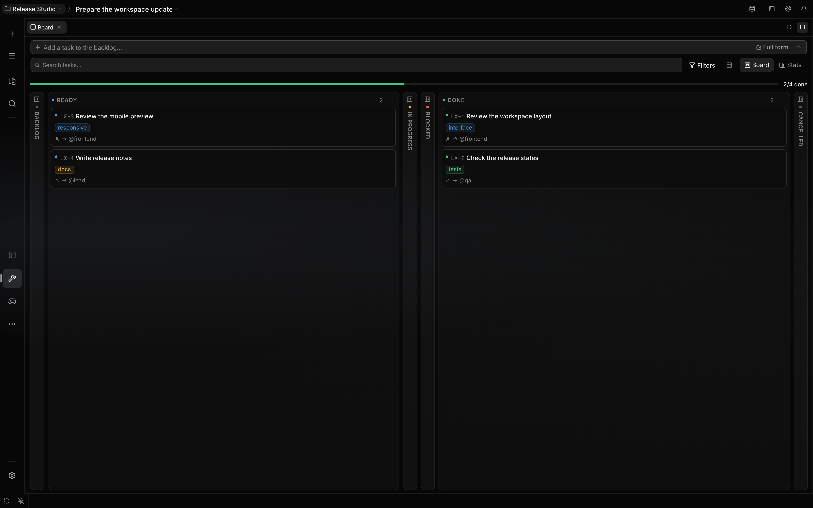

# Kanban board

The Kanban board is a bundled mini app that gives every chat its own passive task board: epics,
tasks, dependencies, checklists, owners and blockers, kept by you and the agent in that chat. Use
this page to plan multi-part work so its state stays visible and durable.

The 9 October capture uses four illustrative cards in an isolated demo chat. A real keyboard move
placed **Write release notes** in Ready; the Done cards were seeded, not completed by an agent run.
Empty columns are collapsed to keep the cards readable.

## Terminology

| Term    | Meaning                                                                  | Boundary                                                           |
| ------- | ------------------------------------------------------------------------ | ------------------------------------------------------------------ |
| Board   | The tasks of one chat, stored in that chat's mini app folder.            | There is no global or project board; deleting the chat deletes it. |
| Card    | One task or epic on the board, addressed as `LX-<n>`.                    | Numbers are per board; ordinary deletion does not reuse them.      |
| Epic    | A card that groups tasks.                                                | An epic cannot be taken; take one of its tasks.                    |
| Take    | The agent's act of claiming a card: it becomes the owner, `in_progress`. | Refused while a dependency is not `done`.                          |
| Passive | The board records work and never starts it.                              | No card state starts a run, wakes an agent or invites anyone.      |
| Review  | A member's finished card, waiting for the leader to verify it.           | Not `done`: it does not release dependents or finish its epic.     |
| Leader  | The group chat's leading agent, or the only agent in a chat.             | Sees and edits the whole board.                                    |
| Member  | Any other agent of a group chat.                                         | Sees and works only the cards assigned to it.                      |

## What you can do

| Action                           | How                                                                         | Boundary                                                          |
| -------------------------------- | --------------------------------------------------------------------------- | ----------------------------------------------------------------- |
| Open the board                   | The **Board** rail button, a board link in the transcript, or search.       | The board follows the chat it belongs to.                         |
| Add and edit cards               | The board's create dialog and task panel, or ask the agent.                 | A card's owner must be an enabled agent of the chat's scope.      |
| Move cards                       | Drag, keyboard moves or the card menu; a drag of many cards lands together. | You cannot cancel a card; only the agent closes one as cancelled. |
| Approve a reviewed card          | **Approve** on a card in **Review**, or move it to **Done**.                | Moving it to **Ready** sends it back for more work.               |
| Turn review comments into a card | **Task** beside **Send** in a comment batch.                                | The card lands in the backlog with the commented files attached.  |
| Link a card into a message       | `@resource:` → **Board**, or drag the card into the composer.               | The agent receives the card's brief, not a live view.             |
| Search cards                     | Global search, the **Tasks** group (`task:` prefix).                        | Searches only the board of the chat the search runs in.           |

## How the agent works with it

An agent allowed to use the mini app gets its `kanban` tool. Its actions are `list`, `search`,
`create`, `update`, `take`, `complete`, `block`, `reorder`, `delete` and `detail`. While the board's
tab is linked to the message, the tool is on the wire. Without the tab it is deferred like every
mini app tool: the agent loads it once with `activate_tools`, and the session remembers that.

1. The agent puts multi-part, durable work on the board; a small single deliverable needs no card. A
   `create` batch may wire dependencies to earlier entries by title. Its result offers the board,
   which the agent links when the person should see it.
2. To do a card itself, the agent calls `take`. The host names the agent taking it, so a model
   cannot take a card in someone else's name. `take` accepts tasks in `backlog`, `ready` or
   `blocked`, with all dependencies `done`. If another agent owns the card, reassign it first or
   give its owner the work.
3. For a card another agent should do, the agent addresses that participant with `@handle` and the
   assignment. For isolated side work, the agent can `delegate` the card's `detail` as the task. A
   child knows nothing about the board: the card stays the parent's to complete or block after it
   reviews the report.
4. While it works, the agent ticks checklist items with `update`: `items` is the whole list, and an
   entry written as `{ text, done }` sets that item's tick.
5. The agent calls `complete`, which names the cards it released and any checklist items still
   unticked, or `block` with the obstacle. `items_done: true` ticks the whole checklist in the same
   call, and completing a card that is already done changes nothing.
6. In a group chat, a member's `complete` moves its card to `review`, and the leader verifies it:
   `complete` moves it to `done`, `update` with `status: ready` sends it back. A member cannot send
   a card to review with unticked items, and an epic is created without a checklist of its own.
7. An epic is never taken, and its status is its own: the board does not close it. The completion
   that finishes an epic's last task says so, and the agent closes the epic with `complete`.

A tool `create` batch saves entries one by one. If a later entry is refused, the earlier cards
remain and the reply names the refused entry; retry only the missing work. A filesystem or other
unexpected failure can also leave earlier entries saved. This differs from a multi-card drag, which
validates and saves the complete move batch together.

### Roles in a group chat

The host names the speaking agent's role with every call: `solo` when it is the chat's only agent,
`leader` for the group's leader, `member` for everyone else. A call without a role acts as the
leader.

| Action                      | Leader or solo agent          | Member                                                       |
| --------------------------- | ----------------------------- | ------------------------------------------------------------ |
| `list`, `search`            | Every card.                   | Only its own cards, each with its epic's title.              |
| `detail`                    | Any card.                     | Only its own cards; a lookup never names a colleague's card. |
| `take`, `block`, `complete` | Any card it may take or owns. | Only its own cards; `complete` sends the card to `review`.   |
| `update`                    | Every field.                  | Only `items` and `priority` on its own cards.                |
| `create`                    | As requested.                 | Unassigned, in `backlog`, for the leader to triage.          |
| `delete`, `reorder`         | Allowed.                      | Refused.                                                     |

Reassigning a card that is `in_progress` or in `review` puts it back to `ready`, so its new owner
can `take` it.

### Cards for you

The board's directory lists you as `human`. A card assigned to `human` waits for you: the board
shows it with a person icon and "you (@human)", and assigning it raises a mention notification (and
the `onHumanAssigned` mini app hook). Agents cannot `take` or `complete` such a card; the tool
answers "LX-n is for @human; it waits for the person." Move your own cards on the board as usual.

Each workflow move has one action. `update` changes a card's text, owner, epic, priority,
dependencies and checklist, and moves it only to `backlog`, `ready` or `cancelled`: `in_progress` is
reached through `take`, which checks dependencies, `done` through `complete` and `blocked` through
`block`. An action refuses, by name, a field it does not read, rather than ignoring it.

## Statuses

| Status        | Meaning                                      |
| ------------- | -------------------------------------------- |
| `backlog`     | Recorded work that nobody has selected yet.  |
| `ready`       | Prepared for an agent to take.               |
| `in_progress` | An agent took responsibility.                |
| `blocked`     | Work cannot continue; the card explains why. |
| `review`      | A member finished; the leader verifies it.   |
| `done`        | Work was marked complete.                    |
| `cancelled`   | Work was explicitly abandoned; final.        |

A cancelled card cannot change status again, but its fields can still be edited or it can be
deleted. Create a new task to resume its work. A `done` card can be reopened. Moving a blocked card
back to `ready` clears its blocker.

## How it works

The board is stored as one JSON file per chat under that chat's mini app folder, which the host
removes when the chat is deleted. Every write runs one at a time per board, validates its
dependencies and parent before it lands, and is announced to every open view only after it reached
the disk. The agent's tool and the board's routes run in separate backend loads and still share one
write queue.

| Surface        | Mechanism                                                                             |
| -------------- | ------------------------------------------------------------------------------------- |
| Agent tool     | `kanban`, acting on the chat the call runs in.                                        |
| View routes    | `/rpc/kanban/*`, served only for a chat the user owns.                                |
| Live updates   | A mini app websocket stream (`b` frames) per chat, checked against the socket's user. |
| Composer strip | The chat's open cards above the composer.                                             |
| References     | A `kanban` resource provider and a `kanban:tasks` search provider.                    |

## Configuration

| Control                         | Effect                                                                         | Default      |
| ------------------------------- | ------------------------------------------------------------------------------ | ------------ |
| The **Kanban board** mini app   | the Store (Mini apps), `/mini-app disable kanban`, or a `mini-app:kanban` rule | On (bundled) |
| The `kanban` tool for one agent | A `tool:kanban` rule with effect `deny` removes it                             | Allowed      |

See [Capabilities](capabilities.md#mini-app-tools-and-plugins) for how a mini app rule and a tool
rule differ.

## Limits

- A missing, unreadable, or invalid `board.json` reads as an empty board. A later successful write
  can replace it and restart card numbering; the store does not preserve or repair malformed
  contents. If an existing board unexpectedly appears empty, inspect or restore its file before
  creating new cards.
- Tool `list` and `search` return at most 50 cards in board order and report when there are more.
  Narrow the search or request a known card with `detail`; an absent list entry is not proof that
  the card does not exist.
- Deleting a card removes its dependency edges from other cards. Deleting an epic leaves its child
  tasks on the board without that parent; it does not delete their work.
- The board never runs anything. Nothing checks a `done` card; the agent's report and the chat are
  the record of what changed and how it was verified.
- The volatile board digest the core prompt once carried is gone: the agent reads the board with
  `list` when it needs it.
- Card usage and cost are not attributed per card. Delegated runs are billed to their own sessions;
  see [Cost tracking](cost-tracking.md).

## Related guides

- [Delegation](delegation.md)
- [Conversations](conversations.md)
- [Capabilities](capabilities.md)
- [Mini apps](../extending/mini-apps.md)

## Source of truth

- [Mini app manifest](https://github.com/rsaryev/localix/blob/main/mini-apps/kanban/mini-app.json)
  and
  [backend registration](https://github.com/rsaryev/localix/blob/main/mini-apps/kanban/backend/index.ts)
- [Board operations](https://github.com/rsaryev/localix/blob/main/mini-apps/kanban/backend/operations.ts)
  and
  [workflow rules](https://github.com/rsaryev/localix/blob/main/mini-apps/kanban/shared/rules.ts)
- [Per-chat store](https://github.com/rsaryev/localix/blob/main/mini-apps/kanban/backend/store.ts)
  and [service](https://github.com/rsaryev/localix/blob/main/mini-apps/kanban/backend/service.ts)
- [Agent tool](https://github.com/rsaryev/localix/blob/main/mini-apps/kanban/backend/tools.ts)
- [Resource and search providers](https://github.com/rsaryev/localix/blob/main/mini-apps/kanban/backend/references.ts)
- [UI registration](https://github.com/rsaryev/localix/blob/main/mini-apps/kanban/ui/register.tsx)
