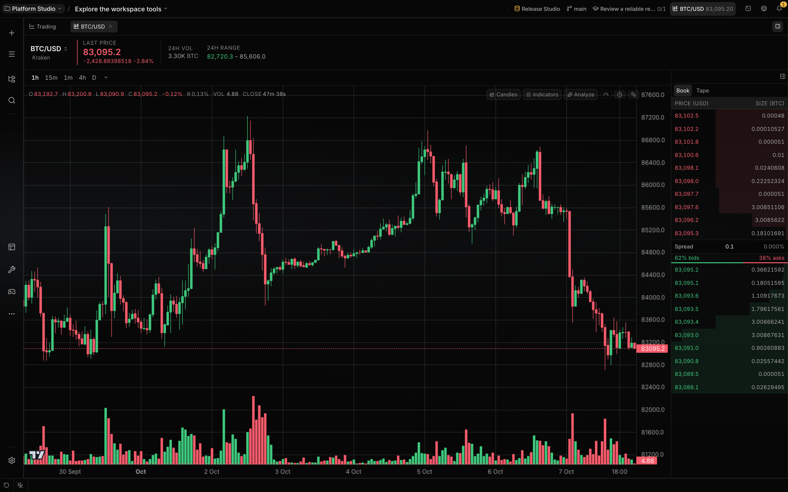

# Research public markets

Trading Workspace is a bundled workbench for read-only public market data. Use it to browse venues,
chart markets, inspect order books and trades, run technical analysis, or attach market context to a
session.

**Availability:** The bundled `trading` plugin is enabled by default and requires network access to
a venue. The registered surface has no credential, account, or order route.

## What you can do

| Capability                             | Mechanism                                                                              | Boundary                                                                       |
| -------------------------------------- | -------------------------------------------------------------------------------------- | ------------------------------------------------------------------------------ |
| Browse venues and markets              | Select a catalog venue, filter its roster, or keep per-venue favourites                | A listed driver can still reject public reads or omit a market-data capability |
| Open a market chart                    | Create or focus a `trading-chart` workspace item for a connection and unified symbol   | Timeframes come from the selected venue                                        |
| Change the price view                  | Switch among candles, OHLC bars, line, and area views                                  | Chart type is stored per chart tab                                             |
| Add analysis                           | Configure indicators, drawings, scale mode, or open the separate technical-ratings tab | Calculations use the candles available for the selected timeframe              |
| Inspect market activity                | Switch between the order book and recent public trades beside the chart                | Each feed depends on venue support; neither is an order ticket                 |
| Add market context                     | Drag a market surface or choose a `localix://resource/trade/...` reference             | Context capture accepts only ephemeral public profiles                         |
| Search markets                         | Select the lazy Trading scope in global search                                         | The provider queries live venue rosters only when selected                     |
| Ask an agent to read or control charts | Use `market_data` or `manage_chart`                                                    | The registered tool connection roster contains only the default public venue   |

## How it works

### Public connection boundary

The UI addresses a venue as `public:<exchange>`. The connection registry creates that profile on
first use with `readonly: true` and agent trading off; it does not save the profile or attach
credentials.

The current driver uses ccxt for REST reads and ccxt.pro when a venue supplies a websocket
implementation. Driver responses are normalized into Localix market, ticker, candle, order-book,
trade, funding, and open-interest contracts before they reach the UI or agent tools.

The service caches normalized reads briefly and persists venue market tables beside the Localix
database. Selecting **Refresh** bypasses the market-table cache and asks the venue for a fresh
roster.

### Charts and live feeds

A chart tab loads the venue description, market metadata, candle history, and ticker. Funding and
open interest are requested only after candle history settles and only when the venue reports the
capability.

The websocket registry pools one client per public connection and one loop per connection, channel,
symbol, and timeframe. When a stream is unavailable or down, the UI's data hooks fall back to REST
polling; hidden chart tabs pause their live reads.

The chart keeps the selected timeframe per connection. Chart type, indicators, drawings, and visual
configuration are stored per tab in client-side preferences.

### Context and agent tools

Trading owns a reference tree from venue to market type, market, and leaf. Leaves include ticker,
candles, order book, trades, funding, and technicals. The Context Fabric adapter resolves public
references at send time and records a revisioned snapshot for the session.

| Tool           | Main actions                                                                                                                                           | Boundary                                                                                           |
| -------------- | ------------------------------------------------------------------------------------------------------------------------------------------------------ | -------------------------------------------------------------------------------------------------- |
| `market_data`  | List the tool's connection roster, quote one market or up to 20 symbols, read candles and depth, compute indicators, or estimate visible-book slippage | Read-only; one-market candle windows cap at 200 and depth at 50 per side                           |
| `manage_chart` | Open or inspect a chart, set timeframe, indicators, chart type, and scale, navigate, manage drawings, or run server-side detection                     | UI mutations use the session command stream; snapshot and detection can read without opening a tab |

The host classifies `snapshot` and plain `detect` as reads. Chart-changing actions, including
`detect` with `auto_draw: true`, have effect `view`; permission rules and the conversation's mode
still apply. None of these calls places an exchange order.

`manage_chart` commands are emitted as replayable `plugin.command` session events. The Trading UI
accepts commands for its plugin and chart channel, opens or focuses the matching chart when
required, and applies the command through the chart control bus.

## Configuration

| Control             | Default                                      | Effect and boundary                                                                                                   |
| ------------------- | -------------------------------------------- | --------------------------------------------------------------------------------------------------------------------- |
| Plugin state        | Enabled                                      | A scoped disable removes that scope's UI and tools; the process-global backend remains while another scope enables it |
| Public venue        | Hyperliquid                                  | The UI can select another catalog venue; the two agent tools currently register only `public:hyperliquid`             |
| Market list refresh | Cached read                                  | **Refresh** forces a venue reload and rewrites the cache                                                              |
| Timeframe           | Stored per connection; initial fallback `1h` | The venue's advertised list validates the stored value                                                                |
| Chart type          | Candles                                      | Stored per chart tab; alternatives are bars, line, and area                                                           |
| Indicators          | None selected                                | Each chart tab stores its own parameterized indicator set                                                             |
| Side panel          | Open                                         | Collapse state is shared across Trading chart tabs                                                                    |

## Limits

- The registered plugin backend exposes public market-data routes and streams only. Account,
  credential, portfolio, and order code elsewhere in the plugin tree is not mounted or returned from
  `register()`.
- The UI can construct an ephemeral profile for a catalog venue, but public access is not
  guaranteed. Authentication requirements, symbols, timeframes, and feed capabilities remain
  venue-defined.
- `market_data` and `manage_chart` currently list only `public:hyperliquid`. They cannot target
  another venue selected in the UI because that venue is absent from their registered connection
  roster.
- Websocket availability is per venue and channel. REST fallback is polling, not a guarantee of
  tick-by-tick delivery.
- Market data can be absent, delayed, rejected, or rate-limited by the venue. The service preserves
  read failures instead of converting them to an empty market or a zero value.
- Technical calculations describe the candle window they receive. They do not create account state,
  place orders, or verify that a displayed market is executable.
- Public context capture is capped by a five-second provider timeout and an 8,000-token provider
  quota. Saved connections and account references are rejected by this adapter.
- Global Trading search is lazy because it can require a live market-roster read. It does not run as
  part of the default cross-workspace query.

## Related guides

- [Workspace](workspace.md)
- [Sessions and projects](sessions-and-projects.md)
- [Plugins](../extending/plugins.md)
- [Trading subsystem notes](https://github.com/rsaryev/localix/blob/main/docs/internals/subsystems/trading-workbench.md)

## Source of truth

- [Mini app manifest](https://github.com/rsaryev/localix/blob/main/mini-apps/trading/.localix-app/app.json)
- [Registered routes, tools, references, search, and streams](https://github.com/rsaryev/localix/blob/main/mini-apps/trading/backend/index.ts)
- [Public profile contract](https://github.com/rsaryev/localix/blob/main/mini-apps/trading/backend/public-connection.ts)
- [Read-only service](https://github.com/rsaryev/localix/blob/main/mini-apps/trading/backend/service.ts)
- [HTTP routes](https://github.com/rsaryev/localix/blob/main/mini-apps/trading/backend/routes.ts)
- [Live-stream registry](https://github.com/rsaryev/localix/blob/main/mini-apps/trading/backend/stream.ts)
- [Workbench registration](https://github.com/rsaryev/localix/blob/main/mini-apps/trading/ui/register.tsx)
- [Chart workspace](https://github.com/rsaryev/localix/blob/main/mini-apps/trading/ui/TradingChartTab.tsx)
- [Public context adapter](https://github.com/rsaryev/localix/blob/main/mini-apps/trading/backend/context-provider.ts)
- [`market_data`](https://github.com/rsaryev/localix/blob/main/mini-apps/trading/backend/market-data.ts)
  and
  [`manage_chart`](https://github.com/rsaryev/localix/blob/main/mini-apps/trading/backend/manage-chart.ts)
