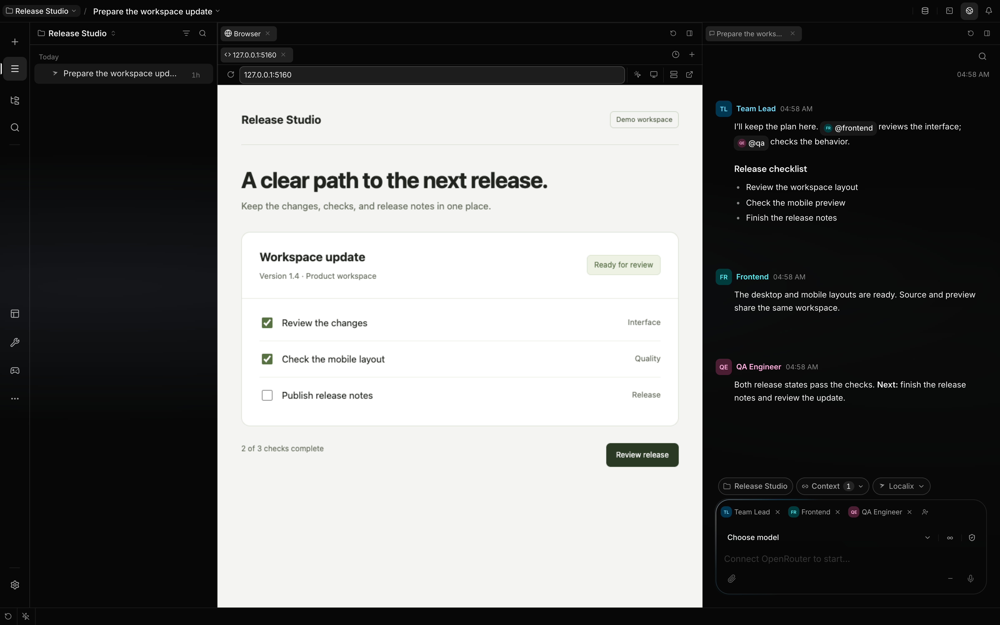

# Annotate a live preview

Visual Feedback captures element context and available source locations from a Localix preview and
adds them to the session. Use it to point at a live element, describe a visual change, and give the
agent DOM details and any source hints the page provides.

**Scope:** A probe-connected Localix preview is required. Arbitrary browser tabs and desktop windows
are outside this boundary.



_Preview captured on 9 October 2026 after **Just browse → Review release** changed the demo page
status to **Ready for review**. The conversation is seeded; this frame does not show a feedback
attachment or a model run._

## What you can do

| Action                   | Mechanism                                                                                           | Boundary                                                                           |
| ------------------------ | --------------------------------------------------------------------------------------------------- | ---------------------------------------------------------------------------------- |
| Comment on one element   | Click an element to capture its selector, DOM path, text, role, styles, rectangle, and source hint. | Source resolution and the automatic JPEG are best-effort.                          |
| Add selected text        | Select page text in Visual Feedback mode; it attaches as context immediately.                       | Text quick-add creates no screenshot.                                              |
| Mark empty space         | Drag a rectangle to capture its viewport coordinates.                                               | A region has no element selector or source location.                               |
| Mark several elements    | Drag across elements to retain leaf selectors and discard wrapping ancestors.                       | The capture records one primary element plus a bounded member list.                |
| Comment on the screen    | Sweep across most of the window to capture the whole page instead of a part of it.                  | A sweep that wide discards any text selection it crossed on the way.               |
| Collect review comments  | Each observation becomes one attached context item in the composer, with an optional screenshot.    | Attaching does not send a turn. Commented elements carry a quiet page tint.        |
| Revisit a comment        | Point at a tinted element to read its number and note; click it to edit or delete the comment.      | Removing its context item withdraws the comment and its tint; sending clears both. |
| Check responsive layouts | Pin the iframe to a named CSS viewport size and rotate its width and height.                        | This changes layout size only, not browser or device identity.                     |

### Let the agent drive the preview

The same in-page probe serves the agent's `browser` tool, so the agent works in the preview you are
looking at. It starts no separate browser, and nothing is installed in your app.

| Agent action          | What it returns                                                                               | Boundary                                                                           |
| --------------------- | --------------------------------------------------------------------------------------------- | ---------------------------------------------------------------------------------- |
| `snapshot`            | The page as a compact indented text tree whose elements carry `eN` refs, capped at 800 nodes. | A reload invalidates refs; the agent takes a fresh snapshot.                       |
| `steps`               | One ordered batch of `click`, `hover`, `type`, `press` and `scroll`, validated whole first.   | Events are synthesized, so controls that demand a trusted gesture can reject them. |
| Any drive action      | A short diff of what changed, with the full tree on request (`snapshot_after`).               | Settling waits two animation frames, plus up to 400 ms for root animations.        |
| `take_screenshot`     | The page, or one element by ref, rendered in the page.                                        | A DOM re-render of the viewport, not compositor pixels; capture can fail.          |
| `console`, `evaluate` | Console output and errors, and a page-side expression result.                                 | Native dialogs are stubbed: `confirm` returns true and `prompt` returns null.      |
| `viewport`            | The frame resized to a named CSS size, checked against the page's real size.                  | Layout only; no device pixel ratio, touch or user agent.                           |

A ref that goes stale heals itself: the probe retries by its saved selector, then by role and
accessible name, and says so in the result. A click that a dialog covers returns an `intercepted`
error with the tree it needs to dismiss it. Whether this is faster than another way of driving a
page is not measured here; the design avoids sending raw HTML or pixels where a few hundred tokens
of tree will do. The tool needs a connected Localix application with a Preview host; an API-only
headless run cannot complete it. The action and recovery contract belongs to
[Preview control internals](https://github.com/rsaryev/localix/blob/main/docs/internals/subsystems/preview-control.md).

### Resize through the agent tool

The agent can set the same frame dimensions controlled by the toolbar:

```json
{
  "action": "viewport",
  "preview_id": "http://localhost:5173",
  "viewport": { "width": 375, "height": 667 }
}
```

Use the `preview_id` returned by `open`, not an invented target. An ID that names no open tab
returns a `not_found` error listing the open tab IDs and URLs. Width and height are integer CSS
pixels, each from 240 to 3840. The reply reports the page's actual dimensions; a mismatch is an
error. Set `viewport` to `null` to restore **Fill panel**, or swap width and height for landscape.

Tabs stay responsive by default: `open` without `viewport` fits the page to the pane and reports the
actual CSS size. A fixed size is for checking one width. It applies to every later command on that
tab, so a `snapshot` after `viewport` measures the same frame, and each result reminds the agent to
reset it. `viewport: null` or an `open` without a size restores fit-to-pane, and when the agent's
run ends, every tab it pinned returns to fit-to-pane. A size you choose in the toolbar is kept.

To view a local HTML file, `open` it with `file_path`. Localix serves the file's folder, so relative
assets such as `style.css` and `game.js` load without a separate server. When a local URL does not
answer, `open` reports that the page did not load (for example, connection refused) and suggests
checking that its server is still running.

For checks in a delegated child, `open` with `background:true` mounts a native Preview host without
selecting its conversation or revealing the panel. This requires a connected Localix application,
not a standalone headless browser. Opening reports probe readiness separately from URL availability.
Layout resizing does not establish real-device touch behavior.

## How it works

The API injects a browser probe into HTML before the preview loads. Static files receive the probe
from the loopback static server. HTTP and HTTPS previews can receive it through a loopback reverse
proxy that forwards page requests, assets, and WebSocket traffic.

The probe and host UI establish a per-load `postMessage` channel. Turning Visual Feedback on sends a
mode change through that channel, so it does not reload a connected preview. A page reload creates a
new handshake; a comment being written survives it, and the new page is asked to find its element
again so the card follows it.

While commenting, the page receives no presses: clicks, mouse and touch presses stop at the probe,
so a control under the pointer is picked rather than operated. The probe draws in its own shadow
root above the page and re-measures on scroll, resize and DOM changes, so outlines and tints follow
layout shifts and re-rendered elements.

### Capture and source resolution

| Priority | Source mechanism                                                                         | Result                                                        |
| -------- | ---------------------------------------------------------------------------------------- | ------------------------------------------------------------- |
| 1        | Source attributes such as `data-source-loc`, inspector attributes, or `data-source-file` | File, line, column, or component id when supplied             |
| 2        | React fiber `_debugSource` or the JSX `__source` property                                | File, line, column, and component when the dev build has them |
| 3        | The static entry file served by Localix                                                  | File-level fallback without a resolved line                   |

The capture also records a generated selector, readable DOM path, component ancestry when React
exposes it, nearby text, an identifying opening tag, and a compact computed-style snapshot. The host
captures each observation as a bounded Markdown snippet binding whose screenshot rides as a nested
asset, so the normal context pipeline budgets the note and its picture together. The message text
stays untouched and focus stays in the preview.

Picking an element opens a note card anchored to it, the way commenting on a sentence does. The note
is optional: the screenshot already identifies the element, so an empty note attaches "look at
this", and typing sharpens it. Selecting text needs no card or extra attach button: the words become
a comment immediately, bounded to 500 UTF-16 code units. Text quick-add captures no screenshot.

The composer's attached-context list is the one place an observation is reviewed and removed. Each
row expands to the full comment text and its screenshots, which open full size. Removing a row
removes the comment everywhere. On the page itself, every commented element carries one quiet tint —
the preview's version of a highlighted sentence. Text surfaces and the preview run the same
review-comment mechanism end to end.

Capture text is clamped before it reaches the agent. Secret-shaped tokens are replaced, and URL
credentials, queries, and fragments are removed. The host repeats this scrub when building the
message.

### Element screenshots

For an element pick, the probe rasterizes the element and surrounding page context into a JPEG. It
waits briefly for loaded web fonts, embeds them into the render, preserves the cloned page's own
background, and uses the nearest painted ancestor only as the JPEG alpha backdrop. The render
happens inside the preview page, so it does not request screen-capture permission or include the
surrounding Localix workspace. Probe outlines are filtered from the cloned DOM.

A shot of the page root is the VIEWPORT, not the document: it renders the root at window size,
offset by the current scroll. Rendering a long document instead was slow enough to exceed the
eight-second budget and return no picture at all, and a comment about the screen means the part of
it you can see.

### Server state

The preview shows whatever its URL returns. It does not watch the server, start it, or stop it: a
stopped server shows the browser's own error page until you start it again yourself and choose
**Reload page**.

## Configuration

If the **Live preview** introduction appears, choose **Just browse** to interact with the page or
**Visual Feedback** to select an element for an observation. You can change mode later in the
toolbar.

The compact browser toolbar keeps navigation and actions in one row. Enter an HTTP(S) address, a
local host and port, a relative route, or search text in **Browser address** and press Enter. Escape
discards address edits. Reload stays beside the address; Visual Feedback and the frame size form one
group on the right, dev-server ports and the external browser another. Tabs close from the tab
strip. Frame-size and port menus use separate aligned columns for names and dimensions.

Scrolling a selected element keeps the same comment draft and focus. The comment card adapts to the
available frame width; text context can be attached with keyboard activation as well as a pointer.
The attach action waits for screenshot preparation to finish.

Visual Feedback has no settings key. Its controls live in the preview toolbar; what has been
attached is reviewed in the composer's attached-context list.

| Control             | Effect                                                                 | Availability                                           |
| ------------------- | ---------------------------------------------------------------------- | ------------------------------------------------------ |
| **Visual Feedback** | Toggles element selection without reloading a connected preview.       | Enabled when a probe is connected or can be loaded     |
| **Page frame size** | Chooses responsive fill, phone, tablet, laptop, or desktop dimensions. | Available on every page                                |
| **Rotate frame**    | Swaps the selected fixed width and height.                             | Hidden for responsive fill                             |
| **Attach feedback** | Attaches the observation as context, screenshot nested inside it.      | Requires a selected capture and session; note optional |

| Preview input                 | Probe path                                                                 | Boundary                                                                              |
| ----------------------------- | -------------------------------------------------------------------------- | ------------------------------------------------------------------------------------- |
| Static HTML served by Localix | The loopback static server injects the probe into the HTML response.       | Only files below the selected static root are served.                                 |
| HTTP or HTTPS preview         | A loopback reverse proxy injects the probe and relays the upstream origin. | The proxy removes response CSP and frame-blocking headers for the preview.            |
| Frame-blocked preview         | The UI shows a blocked-state card and can engage the injecting proxy.      | Frame-busting script, bot protection, or an unreachable origin can still prevent use. |

## Limits

- Source mapping is best-effort. Production React bundles and non-React pages may provide no
  file-and-line data; a Localix-served static file supplies only a file-level fallback.
- Element screenshots re-render DOM through a canvas path rather than copying compositor pixels.
  Cross-origin images without suitable CORS access can be omitted, and rasterization can fail.
- The redaction pass recognizes configured secret patterns; it is not a general classification
  system for every sensitive string visible in a page.
- Fixed frame sizes do not emulate a mobile user agent, device pixel ratio, touch input, sensors, or
  browser-specific rendering.
- The injecting proxy binds to loopback, forwards upstream cookies and request bodies, and removes
  CSP and frame-blocking response headers. Use it only with preview origins you trust.
- A probe build or handshake failure leaves the page viewable but removes element picking and agent
  control from that preview.

## Related guides

- [Use the workspace](workspace.md)
- [Kanban board](task-board.md)
- [Preview control internals](https://github.com/rsaryev/localix/blob/main/docs/internals/subsystems/preview-control.md)
- [Human in the loop](hitl.md)

## Source of truth

- [Selection gestures and text bound](https://github.com/rsaryev/localix/blob/main/packages/visual-feedback/src/selection/fsm.ts)
- [Probe capture](https://github.com/rsaryev/localix/blob/main/packages/visual-feedback/src/probe/capture.ts)
- [Layered source resolution](https://github.com/rsaryev/localix/blob/main/packages/visual-feedback/src/source/index.ts)
- [Capture redaction and limits](https://github.com/rsaryev/localix/blob/main/packages/visual-feedback/src/core/redact.ts)
- [Host bridge](https://github.com/rsaryev/localix/blob/main/apps/ui/src/features/inspector/ui/useVisualFeedback.ts)
- [Comment batching](https://github.com/rsaryev/localix/blob/main/apps/ui/src/features/inspector/ui/VisualFeedbackLayer.tsx)
- [Static and proxied probe injection](https://github.com/rsaryev/localix/blob/main/apps/api/src/features/agent-core/tools/preview/preview-probe.ts)
