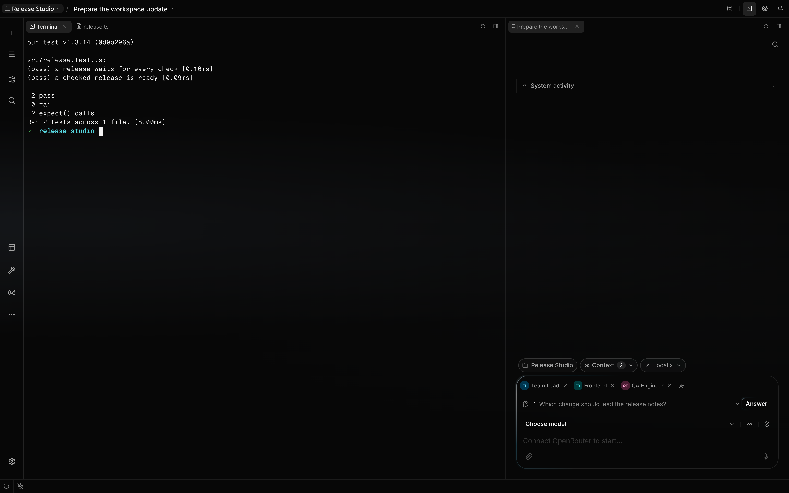
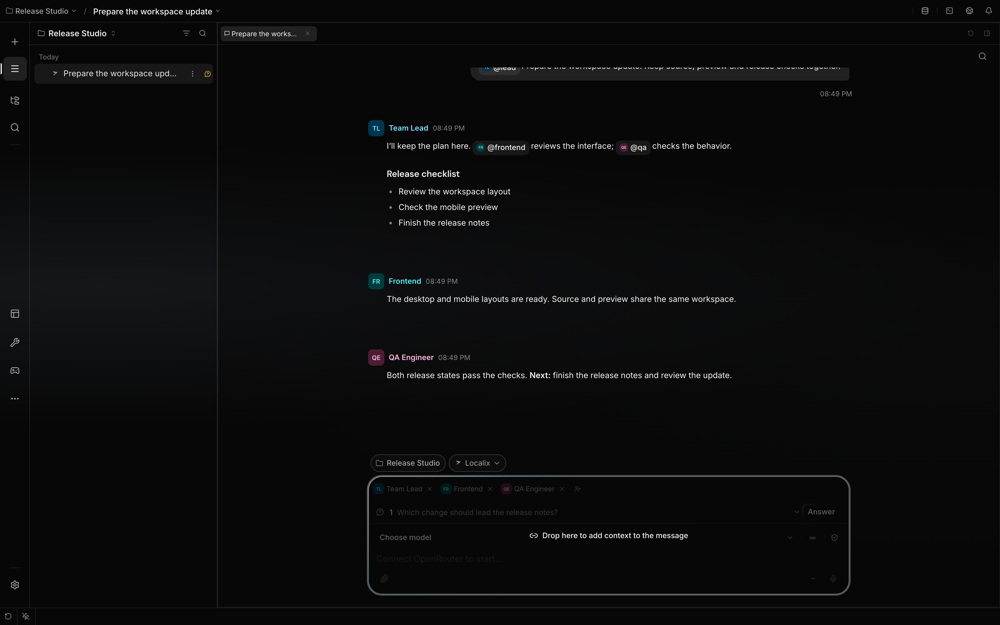
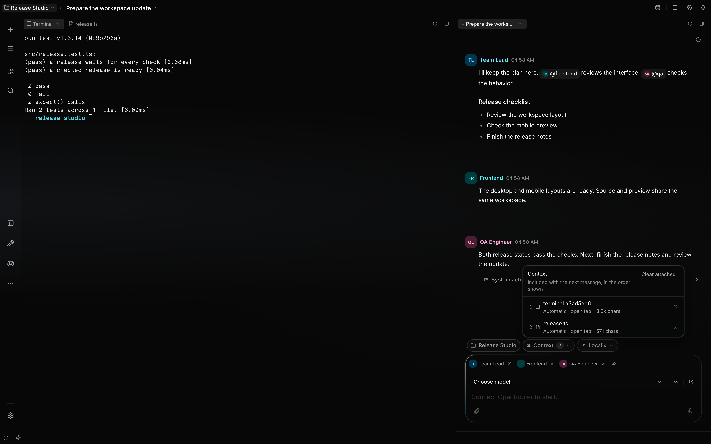

# Use the workspace

The Localix workspace keeps files, Browser pages, terminals, diffs, and workbench views in a main
column on the left, with chat and companion views on the right. Each column has its own tab strip.
Resize the divider to give the work you are using more space.

**Availability:** The grid is a desktop/web surface. Headless clients use the same backend without
this layout.

## Native workspace tabs on macOS

In the macOS desktop app, **Command+T** opens another complete workspace in the current window. Each
native tab keeps its own project, conversation, editor layout, and Browser strip while sharing one
API runtime. Editor and Browser tabs can move between native workspaces.

Use [Native workspace tabs](native-workspace-tabs.md) for drag destinations, window and tab closing,
restoration, and reserved shortcuts. Browser, Windows, and Linux clients use the editor grid.

## What you can do

All available plugin tools, **Usage & Spend**, and **Vault** are pinned to the left navigation rail
by default. The middle rail combines them into three groups: **Workspace** (development, data and
content), **Tools** (utilities, Usage & Spend, Vault, and uncategorized plugins), and **Games**. One
or two pinned tools in a group keep their individual buttons; three or more share a category menu.
Only pinned tools count toward this grouping. A category highlights when one of its views is active.

At launch the workspace reopens the tabs you left. If no chat tab was open, or on a first run, no
chat opens on its own.

A new chat with no model selected, and any editor group with nothing open, shows a carousel of
workspace tips, most important first: connecting a model, approvals and permission modes, project
folders, `@` references, base keymaps, the command palette, agents in one chat, and appearance. Each
tip animates the real surface; four carry the control itself. The carousel never takes focus and
remembers the last tip you viewed on this device.

Open **All tools** (**…**) to browse the complete catalog and toggle the pin beside each tool. Pin
changes keep the menu open and persist on this device. Right-click an individual button to unpin or
move it. Pinned tools do not also appear in the recent-tools list; recently opened, unpinned tools
remain behind the recent-views disclosure button. **Manage plugins…** opens the plugins section in
Settings.

Category menus and All tools open on hover or press; moving into a hover-open menu keeps it open.
Only one rail menu opens at a time. Pressing a category keeps menus open as you move between
categories; pressing it again, selecting a tool, clicking outside, or Escape closes the menu. Long
lists scroll within a bounded panel, with Manage plugins fixed below the catalog.

| Outcome                        | Mechanism                                                                                                | Boundary                                                    |
| ------------------------------ | -------------------------------------------------------------------------------------------------------- | ----------------------------------------------------------- |
| Arrange work side by side      | Resize the main and companion columns; reorder tabs within their strips                                  | Mobile shows only the focused group at one time             |
| Keep session tabs together     | Session tabs appear in the named conversation's root workspace                                           | Settings, Usage and agent profiles are app-wide             |
| Step into a sub-session        | Its chat opens as a tab beside its parent's; the files, terminals and Browser around it stay             | A sub-session has no workspace of its own; start a new chat |
| Restore a working layout       | The grid saves its split tree, active group, and restorable tabs locally                                 | Ephemeral and non-restorable tabs are omitted               |
| Reuse an open surface          | Browser, Problems, Activity and Search reuse their tab in the root workspace                             | Another root workspace gets its own copy                    |
| Attach explicit context        | Type a supported reference or drag a conversation, result, message, or selection to composer             | Each source publishes a bounded structured binding          |
| Link eligible open-tab context | Mounted workbench tabs can publish visible, dismissible context candidates                               | Only registered bindings from visible Localix surfaces join |
| Review the send set            | The composer lists automatic and explicit context with status and estimated size                         | Server expansion at send time remains authoritative         |
| Use terminal output directly   | Recognized file links open the editor; URLs, command marks, quick fixes, and workflows remain actionable | Parsing and shell integration are capability-dependent      |
| Open workbench views           | Enabled plugins register file editors and workspace item types                                           | Disabled or unavailable contributions do not render         |

## How it works

The bottom status bar uses a 28 px height and offers separate **Claude Code** and **Codex** buttons.
The default order is Reset layout, Keep awake, Claude Code, then Codex. Each agent button starts its
CLI in the current chat's terminal. These are core shortcuts and remain available when the External
Agents plugin is disabled. Drag either button to reorder it or move it between the status bar and
rail; its context menu offers placement and unpinning. Open a chat before launching; the login shell
reports a missing CLI in its terminal. The top bar keeps Terminal, Browser and Event Center; the
command palette remains available through its shortcut.

### Groups and placement

The main column holds files, diffs, terminals, Browser, settings, and full workbench views as tabs.
Chat, source control, review, tasks, and problems share the companion column. A column fills the
workspace when the other has no tabs for the current conversation.

Drag a tab within its strip to reorder it. The divider resizes the two columns; double-click it to
give both equal space. Tabs do not create extra stacked panels when dragged to an edge. Older
layouts with additional splits are arranged into the two columns when restored, keeping their tabs.
**Arrange panels** restores the default column proportions while keeping open tabs and conversation
context. Maximizing a panel temporarily hides the other column; restoring it brings the layout back.
A maximize belongs to the conversation it was made in: switching to another conversation restores
the layout, so a file, terminal or Browser opened there appears beside its chat.

Every group has a small panel button at the right end of its tab strip, level with the tabs. It
maximizes the group — the whole panel, whatever tab it shows — and restores the layout, the same as
`Cmd/Ctrl+J`. With a single group there is nothing to maximize over, so the button stays in place
but is disabled.

### Session scope and restoration

Session tabs are placed in their root conversation's workspace; [Kanban](task-board.md), Browser,
Problems, Activity and Search are among them. Each open names its session — the chat a tool card, a
link or a command belongs to — and a tab never takes the session of whichever chat happens to be on
screen. Only app-level tabs (Settings, Usage, an agent profile, and plugin views registered as
global) belong to no session and stay available in every chat. A saved layout drops a session tab
that names no session.

A session's workspace is its ROOT conversation's (`apps/ui/src/shared/lib/workspaceOf.ts`). A
sub-session of any kind — a delegated agent, a thread, a fork — has none of its own: what it opens
lands in its root's tabs and its root's Browser strip, still marked with the session that opened it,
and its chat is one more chat tab beside its parent's. Moving between them changes only the chat.
Showing a sibling's chat tab (a click, or closing the shown one) makes that conversation the active
one, as the sidebar would (`apps/ui/src/widgets/editor-grid/model/workspaceChats.ts`). Deleting a
sub-session closes its chat tab and leaves what it opened; deleting the root closes the workspace. A
conversation that needs a workspace of its own is a new chat.

Only the conversation on screen takes focus (`openPolicy`). What a sibling of the same workspace
opens — a sub-agent beside its parent, or the parent while you read a sub-session — joins the
workspace without coming forward, so several sub-agents at once do not take turns pulling the
workbench away. When a delegated run ends, its pages and its interactive terminals are closed
(`apps/api/src/features/chat/runtime/run/child-surfaces.ts`).

The grid writes restorable items and layout state to browser storage. Chat, files, previews,
terminals, source control, settings, and several global views opt into restoration. A terminal tab
reattaches to its backend PTY by id; it never creates a replacement silently.

When a command finishes, its terminal retains its output for one minute, including successful
commands and failed shells. The input is disabled, while scrolling, finding and copying remain
available. The terminal closes after that minute and leaves the reopen history, including when its
conversation is hidden. A normal shell exit (`exit` or Ctrl+D with code 0) closes its tab
immediately.

Right-click the exited terminal's tab and choose **Restart terminal** to start the same program
again, or a fresh shell for an interactive terminal, using the original launch directory. Restart
keeps the old output available until the replacement starts. A failed restart preserves the output
for another minute. Use the tab's close action to dismiss it earlier; exit status does not add a
footer over the terminal.

A workspace-wide check marks missing processes as unavailable, including hidden conversations and
restored layouts, starting their one-minute retention period. Connection failures trigger
reconnection attempts and do not prove that the process has exited. Finished tabs can be reopened
from the tab history during their retention period. Final output is kept in a bounded in-memory
cache while the app is open, with a short-lived server archive for reattachment. It is not saved to
browser storage and may be unavailable after reload or cache eviction.

Recently used session scopes and tabs can remain mounted but hidden for faster switching. The
keep-alive lists are bounded; an older surface can remount when you return to it.

### Surface ownership

The grid arranges surfaces; the owning feature controls their behavior. The editor delegates
language actions to [LSP integration](lsp.md). Preview supplies the browser surface, while
[Visual Feedback](visual-feedback.md) owns source-mapped selection. Enabled plugins can contribute
workbench tabs or choose a file editor for matching files.

Terminals are PTY processes managed by the API and streamed into terminal tabs. Every terminal
belongs to the session that opened it and starts in that session's working directory; the API
refuses a terminal that names no session, so no pane runs unbound in the home directory. Source
control reads the working directory of the chat its tab or pill belongs to. Both follow that
directory when it is enabled.

### The browser

Each root workspace has a Browser work item and page strip. Pages opened by its root or child
sessions share that strip; a page retains the session that opened it. Another root workspace has a
separate strip. A tab shows a web page, the history list, or a new tab waiting for an address.
Browsing history is shared across workspaces: an entry opens in the workspace you open it from.

| Control         | What it does                                                                       | Boundary                                                  |
| --------------- | ---------------------------------------------------------------------------------- | --------------------------------------------------------- |
| New tab         | Opens a tab with its address field focused, above the pages visited most recently. | Eight recent pages; **All history** opens the rest.       |
| History         | Opens one History tab: pages grouped by day, searchable, removable one by one.     | Keeps the 150 most recent pages, in this app only.        |
| Address field   | Loads a web address, a local host and port, a relative route, or a Google search.  | Idle it shows a readable address; editing, the exact URL. |
| Tab strip       | Drag a tab to reorder it; right-click for reload, pin, and close actions.          | The right-click menu is part of the desktop app.          |
| Browser toolbar | Reload, back and forward, frame size, dev-server ports, and the system browser.    | Back and forward follow a native page's own history.      |

In the desktop app an external site opens as a native system WebView, which looks and behaves like
the platform browser. A local dev server opens framed, which is what lets
[Visual Feedback](visual-feedback.md) reach into it. A page that cannot be opened is reported in the
Event Center rather than over the page.

Native pages follow the visible bounds of their pane and step aside for app overlays and tab drags.
Switching pages or hiding a Browser keeps its page state; closing the Browser releases its native
pages while retaining the saved addresses for reopening.

### Search across the workspace

Press **Cmd+Shift+F** on macOS or **Ctrl+Shift+F** elsewhere to open quick search; the shortcut is
remappable. Use **Open in Search** to keep the query in this chat’s Search tab. Choose a scope or
type a known prefix, such as `f:` for files or `msg:` for messages. File results use the search’s
own chat working directory. **Show all** opens one domain’s paged results.

**All** searches eager domains; live Docker, Kubernetes, and trading domains need their explicit
scopes. A failed domain can leave other results available, with a problem shown alongside them.
Results are bounded previews, so a displayed total is not a count of every possible source match.

### Explicit and automatic context

Drag a conversation from the sidebar into the message composer to add its context link. Sidebar rows
only create links. Workbench tabs and Browser page tabs only reorder or move into another window or
native workspace tab; dropping those tabs into a composer does not add message context. The window
destination hints share a compact glass surface with aligned edges and a larger hit area than their
visible stroke.

This capture shows a sidebar conversation hovering over the composer, with no workspace window
destinations.

The composer accepts typed references for supported files, folders, diffs, commit history, projects,
sessions, terminals, tool calls, and plugin-owned resources such as the chat's Kanban cards
(`@resource:` → **Board**). Structured-only references cover selected snippets, transcript messages,
linked conversations, and plugin-owned resources without inserting expanded blocks into the visible
prompt. File and folder references resolve in the directory the server assigns to the sending
session, after checking that you own it; browsing `@resource:` with a session you do not own is
refused.

The context popover captured on 9 October 2026 lists the open `release.ts` file and terminal as
automatic sources, including the file in the inactive tab. The terminal contains output from the
fixture's actual tests; the conversation is seeded illustrative content. No message was sent.

Eligible mounted tabs can publish live context candidates. Those candidates appear as automatic
context in the composer; explicit attachments take precedence over a duplicate automatic link. The
context popover shows the ordered send set, its source, expansion status, and estimated size. A user
can remove one item, dismiss an automatic tab link, or clear the set before sending.

The client performs a size preflight for feedback, while the API resolves references again at send
time. This keeps the visible transcript compact and avoids treating a stale preview as
authoritative.

### Addressable resource links

Resource URIs remain opaque to the core: the enabled provider or plugin owns expansion and the UI
destination that opens when the resource is followed. The same link can move through search,
composer context, agent activity, and workbench tabs without replacing the resource identity with a
detached text copy.

### Terminal as a working surface

Terminal tabs attach to server-owned PTYs and replay retained scrollback after a supported
reconnection to the same live API process. A restored layout does not restore a PTY after an API
restart. The UI keeps a bounded in-memory output tail for remounts; an explicit relaunch starts a
new process. See [Interactive terminals](interactive-terminals.md#lifetimes-and-limits) for
retention and closing rules.

Recognized `file:line` output opens the file in the grid, while recognized URLs open through the
client platform boundary. Shell integration can add command outcome marks, prompt navigation, sticky
command headers, output-aware quick fixes, and copy or rerun actions.

The terminal confirms unsafe multiline paste when bracketed-paste handling cannot make it harmless.

## Configuration

Open **Settings → Shortcuts** to rebind configurable commands. The defaults below come from the
shared shortcut catalog. Stored chords are platform-neutral: `mod` resolves to Command on Apple
platforms and Control elsewhere, while `secondary` resolves to Control on Apple platforms and
Meta/Windows/Super elsewhere. Matching remains exact, so the non-primary modifier cannot trigger a
primary shortcut.

| Command                         | Default                   |
| ------------------------------- | ------------------------- |
| Go to file                      | `Cmd/Ctrl+P`              |
| Switch session                  | `Cmd/Ctrl+K`              |
| Toggle sidebar                  | `Cmd/Ctrl+B`              |
| Maximize or restore a group     | `Cmd/Ctrl+J`              |
| Open a terminal                 | `Cmd/Ctrl+\``             |
| Focus next or previous group    | `Cmd/Ctrl+Alt+Down/Up`    |
| Cycle tabs in the focused group | `Cmd/Ctrl+Alt+Right/Left` |
| Move between workspace parts    | `F6` / `Shift+F6`         |

## Limits

- The grid is not a filesystem-isolation boundary. Session tabs are separate UI state, but sessions
  can use the same working directory.
- On mobile, the stored column widths remain intact, but only the focused group is rendered at full
  width.
- Layout persistence is local browser storage. It does not synchronize between clients, and only tab
  kinds marked restorable return after reload.
- Each group keeps at most 12 file and live-change tabs. Opening more closes the oldest non-active
  capped tabs in that group.
- A disabled plugin can leave a saved tab pending until plugin activation resolves. Once the plugin
  is authoritatively unavailable, the grid removes that contributed tab.
- Editor diagnostics, completion, rename, code actions, and formatting require a matching language
  server. The grid itself does not provide those operations.
- After an agent write, patch, or edit the language server is asked for diagnostics and the tool
  waits up to 6 seconds for them. A project whose server twice in a row answers nothing within that
  window stops waiting for two minutes — the file is still pushed to the server — and resumes as
  soon as an answer arrives.
- When an agent's `write` or `edit` finishes, every open editor of that file updates. This works
  even outside the session's watched folder, and for tabs owned by another session. A clean tab
  takes the new text and keeps the cursor and undo history. The changed lines are highlighted in the
  text and on the scrollbar until you next edit the file. A tab with unsaved edits shows the
  reconcile banner instead.
- In a local session, opening a file starts the watcher of the session's folder — the one the file
  tree uses — even when the tree was never opened.
- A message sent while a file tab is active includes the caret line and the file's current errors
  and warnings. A selection includes its exact `path:line:column` span. The agent's `file.open`
  location can select an exact span (`line`, `column`, `endLine`, `endColumn`) to show you what it
  means.
- **Fix with Agent** sends the diagnostic's `path:line:column`, its rule (such as `ts(2552)`), a
  numbered code window fenced in the file's language with a caret under the span, and any other
  problems in that window.
- A preview tab does not make Visual Feedback available. Source-mapped capture still requires a
  Localix preview with the probe connected.
- One message carries at most 20 structured context references. The composer warns as estimated
  expansion grows and blocks a send when it crosses the configured high-water boundary for the
  selected model context window.
- Context previews can fail or become stale. The send-time expansion is authoritative, and a linked
  live resource can still disappear or lose permission before use.
- Terminal command marks and output-aware actions depend on supported shell integration and parsed
  output. A dead or unreachable PTY can require an explicit replacement terminal.

## Related guides

- [Files and images in chat](attachments.md)

- [Your first session](../getting-started/first-session.md)
- [Sessions and projects](sessions-and-projects.md)
- [Plugins](../extending/plugins.md)

## Source of truth

- [Global search scopes](https://github.com/rsaryev/localix/blob/main/apps/ui/src/features/search/model/scopes.ts)
- [Search surface and partial results](https://github.com/rsaryev/localix/blob/main/apps/ui/src/features/search/ui/GlobalSearchTab.tsx)

- [Surface registry](https://github.com/rsaryev/localix/blob/main/apps/ui/src/widgets/editor-grid/ui/registry.tsx)
- [Split rendering](https://github.com/rsaryev/localix/blob/main/apps/ui/src/widgets/editor-grid/ui/GridView.tsx)
  ·
  [apps/ui/src/widgets/editor-grid/ui/GroupView.tsx](https://github.com/rsaryev/localix/blob/main/apps/ui/src/widgets/editor-grid/ui/GroupView.tsx)
- [Placement policy](https://github.com/rsaryev/localix/blob/main/apps/ui/src/features/workspace-grid/model/placement.ts)
- [Scope and restoration](https://github.com/rsaryev/localix/blob/main/apps/ui/src/features/workspace-grid/model/scope.ts)
  ·
  [apps/ui/src/features/workspace-grid/model/persistence.ts](https://github.com/rsaryev/localix/blob/main/apps/ui/src/features/workspace-grid/model/persistence.ts)
- [Restorable surface contract](https://github.com/rsaryev/localix/blob/main/apps/ui/src/features/workspace-grid/model/capabilities.ts)
- [Tab operations and cap](https://github.com/rsaryev/localix/blob/main/apps/ui/src/features/workspace-grid/model/itemOps.ts)
- [Shortcut catalog](https://github.com/rsaryev/localix/blob/main/apps/ui/src/shared/lib/keybindings/catalog.ts)
  ·
  [platform chord engine](https://github.com/rsaryev/localix/blob/main/packages/kit/src/keyboard/chord.ts)
  ·
  [cross-platform contracts](https://github.com/rsaryev/localix/blob/main/apps/ui/src/shared/lib/keybindings/chord.test.ts)
- [Composer context state](https://github.com/rsaryev/localix/blob/main/apps/ui/src/features/chat/model/useContextRefs.ts)
- [Live tab context](https://github.com/rsaryev/localix/blob/main/apps/ui/src/features/workspace-grid/model/liveTabMessageContext.ts)
- [Context reference grammar](https://github.com/rsaryev/localix/blob/main/apps/api/src/features/chat/context-refs.ts)
- [Interactive terminal](https://github.com/rsaryev/localix/blob/main/apps/ui/src/features/terminal/ui/TerminalPane.tsx)
