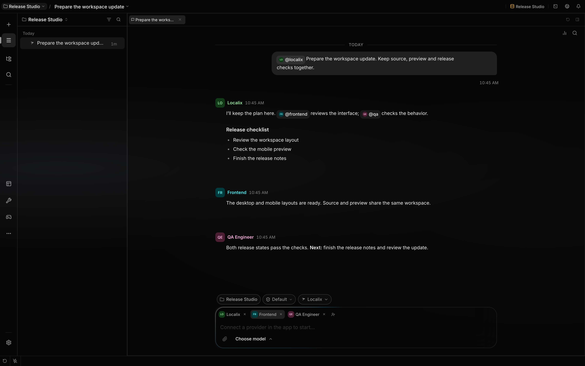

# Start your first session

A Localix session keeps a conversation, agent configuration, and access to a working folder. This
walkthrough connects a model, opens a project, runs one bounded request, and shows you where to
inspect it.

_Demo workspace captured on 15 October 2026. The conversation is seeded; it does not demonstrate a
successful model request or provider setup._

## Terminology

| Term                | Meaning here                                                             |
| ------------------- | ------------------------------------------------------------------------ |
| Session             | A persisted transcript and runtime configuration for one stream of work. |
| Project             | A Localix record for a working directory and shared project settings.    |
| Provider connection | Saved configuration and credentials for a model provider.                |
| Agent               | The instructions plus capability rules that decide what a run may use.   |

## What you can do

| Action                | Mechanism                                                                                   | Boundary                                                                       |
| --------------------- | ------------------------------------------------------------------------------------------- | ------------------------------------------------------------------------------ |
| Connect a model       | The setup wizard stores a provider connection and model selection.                          | **Ready** confirms saved configuration, not a live model response.             |
| Open a folder         | **Add project folder** creates or selects a project whose working directory is that folder. | Project selection does not copy or isolate the folder.                         |
| Start work            | Your first message creates or reuses a session for the selected project.                    | A model request needs a usable provider connection and model.                  |
| Inspect a change      | The transcript shows tool activity; Source Control opens repository changes.                | Source Control appears only when the working directory is a Git repository.    |
| Correct an active run | A follow-up message enters the session's backend queue.                                     | Text can steer at a safe boundary; attachments remain queued for a later turn. |

## How it works

1. [Install and launch Localix](installation.md) with your chosen desktop or source workflow.
2. Complete `/setup`: choose a provider connection and model, then finish the wizard. The
   [onboarding guide](../features/onboarding.md) owns the complete setup and replay flow.
3. Select **Add project folder** and choose a disposable repository or confirm that `git status` is
   clean before using a mutating example. Selecting a previously added directory switches to its
   existing project.
4. Check the model selector for the new conversation. Setup saves its Chat pair on the default
   project (or first loaded project when no default exists); opening another folder does not copy
   those settings. Select a usable connection and model if the conversation has no resolved pair.
   Agent or session choices can take priority over project defaults.
5. Send a request with a small, visible outcome. For example: _“Add one sentence to the installation
   section in `README.md`, then show me the diff.”_
6. Read the transcript as tools run. Open Source Control to inspect the resulting Git diff; use the
   [workspace guide](../features/workspace.md) for the editor, terminal, preview, and diff surfaces.
7. If the run heads in the wrong direction, send a short text correction. The backend gives user
   messages priority over internal wake work and retains queued items across reconnects.

Use **Attach file** or drop material into the composer when your request needs a document or image.
The [attachment guide](../features/attachments.md) explains stored uploads, original paths,
previews, and format limits.

## Configuration

| Control        | What it changes                                          | Boundary                                                          |
| -------------- | -------------------------------------------------------- | ----------------------------------------------------------------- |
| Model selector | The connection and model for a participant's route.      | The saved connection must still exist.                            |
| Participants   | **Add participant** chooses agents for the conversation. | Available tools depend on the answering agent's effective policy. |
| `/help`        | The built-in command list and command-specific help.     | Plugin and surface-specific commands can add to this catalog.     |

The [capabilities guide](../features/capabilities.md) owns policy details. The
[commands guide](../features/hooks-and-commands.md) owns the current slash-command catalog. Use the
[conversation guide](../features/conversations.md) for addressing participants and choosing who
answers.

## Limits

- You can skip provider setup. A skipped or structurally complete wizard does not prove that a model
  request will succeed.
- A project records a working directory. Sessions using the same project can act on the same files
  by default.
- Queued text is delivered only at a safe runtime boundary. Pending human input, attachments, and
  control operations can delay delivery.
- Capability and permission rules gate Localix tool calls. They do not provide process, filesystem,
  or network isolation.
- Model calls and enabled network tools can send data off the machine. Review
  [Localix data flow](privacy.md) before using sensitive material.

## Related guides

- [Onboarding](../features/onboarding.md)
- [Workspace](../features/workspace.md)
- [Providers](../features/providers.md)
- [Capabilities](../features/capabilities.md)
- [Sessions and projects](../features/sessions-and-projects.md)

## Source of truth

- [Onboarding steps](https://github.com/rsaryev/localix/blob/main/apps/ui/src/features/onboarding/model/steps.ts)
- [Project-folder selection](https://github.com/rsaryev/localix/blob/main/apps/ui/src/features/chat/model/useAddProjectFolder.ts)
- [Session lifecycle](https://github.com/rsaryev/localix/blob/main/apps/api/src/features/chat/service/session-lifecycle.ts)
- [Turn entry and durable queueing](https://github.com/rsaryev/localix/blob/main/apps/api/src/features/chat/service/turn-entry.ts)
- [Queue selection and steering](https://github.com/rsaryev/localix/blob/main/apps/api/src/features/chat/runtime/wake-queue-selection.ts)
- [Built-in slash-command catalog](https://github.com/rsaryev/localix/blob/main/apps/api/src/features/chat/slash-catalog.ts)
