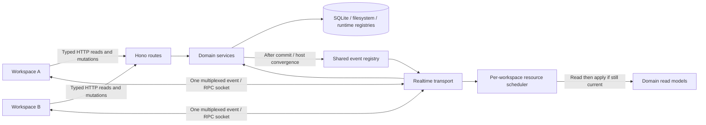

# Client/server interaction and workspace synchronization

Localix has one runtime and database per installation. Each native workspace has its own webview,
React state, HTTP client and multiplexed `/rpc/ws` connection. Opening a native tab creates a
workspace, not a backend. The shell prepares and starts the runtime in `src-tauri/src/lib.rs`;
`workspace_windows.rs` copies the shared initialization script into each new view. Runtime status
and the attested API port are delivered to every workspace by `sidecar.rs`; a newly opened view also
requests that status through `runtimeReady.ts`.

## Interaction map

| Boundary                  | Owner                                                                   | Contract                                                                                                         |
| ------------------------- | ----------------------------------------------------------------------- | ---------------------------------------------------------------------------------------------------------------- |
| API address and readiness | Native shell; `shared/lib/runtimeReady.ts`                              | One attested runtime endpoint; reconnect waits for runtime readiness.                                            |
| HTTP                      | `shared/api/internal.ts` and domain client modules                      | Typed Hono RPC, centralized credentials, error classification and instrumentation.                               |
| Event/RPC socket          | `shared/api/eventSocket/`                                               | Reference counted connection, reconnect backoff, cursor, scope declarations, frame batching and RPC correlation. |
| Event delivery            | `chat/runtime/session-stream-registry.ts`                               | Serialize once; fan out by user and watched session; explicitly classify replay and delivery scope.              |
| Shared resource changes   | `realtime/resources.ts`                                                 | `resources.changed` identifies read models, without transmitting private entity data.                            |
| Mutation announcements    | `bootstrap/resource-sync.ts`                                            | Explicit typed service-method maps; successful mutations announce for HTTP and internal callers alike.           |
| Read coordination         | `shared/api/resourceSync.ts`                                            | Coalesce bursts; one read in flight per adapter; skip superseded results; bounded retries.                       |
| Feature adapters          | `app/workspaceResourceSync.ts` and feature hooks                        | The application binds resources to their owning stores. Shared code never imports feature stores.                |
| Notification delivery     | Server notification journal and `shared/lib/notifications/inboxSync.ts` | Durable journal cursor plus live `n` frames on the existing socket.                                              |
| Plugin streams            | WS contribution registry and plugin SDK                                 | Registered tagged frames on the same socket; plugin-specific snapshots and recovery remain plugin-owned.         |
| Terminal bytes            | Terminal service and terminal transport                                 | Dedicated PTY stream; high-volume bytes do not enter the application event replay ring.                          |

## State ownership and synchronization

| Read model                           | Mutation/read boundary                               | Cross-workspace behavior                                                                                                                                                                                        |
| ------------------------------------ | ---------------------------------------------------- | --------------------------------------------------------------------------------------------------------------------------------------------------------------------------------------------------------------- |
| Conversation roster                  | `/rpc/sessions`, chat service                        | Root creation and metadata use `session.updated`; children use `child_session.updated`; both upsert by ID.                                                                                                      |
| Conversation deletion                | Chat deletion service                                | `session.deleted` carries the committed subtree IDs, including grandchildren; every window drops rows, cached bodies, drafts and grid/preview handles.                                                          |
| Open conversation body               | Session detail, messages and session panels          | Full stream only for watched sessions; reconnect reconciles loaded watched bodies, including background grid surfaces.                                                                                          |
| Projects                             | Projects service                                     | Create, resolve/revive, edit and soft deletion invalidate `projects`. Project setting edits also invalidate affected capability and conversation projections.                                                   |
| Provider connections                 | Provider service                                     | Connection, key and sign-in mutations invalidate `providers`; related capability, route and Vault projections also refresh. Secret values never enter change events.                                            |
| Account preferences                  | User profile service                                 | Committed profile changes invalidate `profile` in browser and native workspaces alike. Pending local edits retain the profile merge policy. UI-only changes do not reload conversation history or capabilities. |
| Capabilities                         | Capability snapshot, agent registry, plugin/MCP host | One document owns tools, plugins, agents, MCP and skills. Shared invalidation marks all scopes stale; mounted readers load their scope. Plugin changes announce after host convergence.                         |
| Vault                                | Secrets service                                      | Metadata changes invalidate visible lists, item version caches and audit views. Secret values use their existing isolated APIs.                                                                                 |
| Storage                              | Session deletion and storage APIs                    | Committed deletions refresh visible storage usage. Retention preferences synchronize through the profile.                                                                                                       |
| System controls                      | System toggle service                                | Process-wide controls invalidate `system`; mounted readers refresh.                                                                                                                                             |
| Files and diagnostics                | Session file events and LSP                          | Existing scoped events and file-read recovery own these views. A resource-list invalidation does not reload editor bodies.                                                                                      |
| Attention, plans, questions and work | Existing session/global events                       | Their typed reducers and authoritative reconnect reads retain ownership.                                                                                                                                        |
| Plugin-owned business data           | Plugin HTTP/WS contributions                         | Each contribution owns its payload, subscription and recovery; core does not interpret plugin records.                                                                                                          |
| Layout, navigation and unsent drafts | Each workspace                                       | Focus, selected chat, grid layout, open tabs and unsent input remain window-owned. Data synchronization never selects a newly created chat in another window.                                                   |

This separates shared facts from view choices. An archived chat updates everywhere; the other
window's active project stays its own. An account preference updates everywhere; typing a draft does
not broadcast its text. Deleting an open conversation clears its focus rather than selecting another
conversation automatically.

## Starting a conversation

Every one-agent entry point uses the same creation lane. Concurrent requests within a window join
one in-flight creation, including the unresolved-to-canonical default-project transition. Reuse is
restricted to chats created by that window within the last 24 hours: a matching project and agent,
exactly one participant, a known persisted count of zero, no user messages or unsent input, and no
custom title, archive or pin. Saved history and another window's drafts never stand in for New chat.
The server event and the creating window's RPC response upsert the same ID, preventing duplicate
roster rows. Unsent text remains attached to its original chat.

## Event and read ordering

1. Persist a mutation through the owning service. Publish only after its successful commit. A
   deletion publishes immediately after row removal, before filesystem cleanup that may fail.
2. Deliver through the existing socket. Resource changes and roster events reach every connection of
   the user; detailed message streams reach declared watchers.
3. Apply compact roster snapshots directly. Existing bodies, pending interaction state and
   optimistic messages survive metadata updates. Repeated delivery does not create duplicate IDs.
4. For an invalidated read model, schedule one refresh for a burst of changes. If another change
   arrives during its read, discard that result and perform one follow-up read.
5. Reconcile on every connection, including the first one. Initial HTTP bootstrap can precede the
   socket; the connected read closes that gap. Reconnect also repairs state beyond the bounded
   replay ring or after a backend restart.
6. A disconnect or unmount invalidates outstanding results and aborts cancellable reads. Automatic
   resource reads retry at 1, 2 and 4 seconds, then report the failure; a subsequent invalidation or
   connection can retry. Existing bootstrap, capability and feature-specific retry policies remain
   responsible for their own reads.

The cursor is an epoch and sequence, not a timestamp. Sequence numbers need not be consecutive for
one subscriber because watched-session filtering deliberately skips unrelated frames. The replay
ring is a bounded delivery aid, not durable application history; authoritative snapshots repair
missed state. There is no claim of distributed exactly-once execution: RPC failures and replayed
state need their existing idempotency and conflict policies.

Snapshots may overlap stream delivery. Conversation list reconciliation preserves rows changed since
the request began, and excludes a row removed during that request. A stale detail response must not
revive a deleted conversation or steal focus after a newer navigation. Capability reads also carry
per-scope generations so a retired request cannot populate a newly invalidated cache.

## Database read models

The roster must scale primarily with sessions, not transcript length:

- `agent_sessions.message_count` is a database-owned projection, backfilled by the forward migration
  `20261014T000000_workspace_read_models.ts`. Insert, delete and session-move triggers update it in
  the same transaction as message changes. Payload/token updates do not change the count.
- The roster obtains message counts from the selected session rows, removing the full-history count
  aggregation and its separate query. The obsolete count API is removed.
- `repository-last-message.ts` uses one SQL statement that seeks each session's newest visible
  message through the existing unique `(session_id, sequence)` index. Hidden internal messages are
  skipped; each session contributes at most one preview row.
- `agent_sessions_user_project_updated_idx` matches project filtering and descending update order,
  avoiding an extra sort for project navigation and digests.

These are read projections, not a second write authority. Counts must never be set by API callers.
There is no new process-local roster cache requiring another invalidation protocol. SQLite's
transactions, foreign keys and schema validation remain authoritative. Existing migration files are
immutable, and startup backs up a persisted database before applying new migrations.

## Extending the model

For a new shared read model, add its key in `realtime/resources.ts`, list its successful mutations
in the composition map, and register an adapter or a mounted feature read effect. A resource key
must name an owned read model, not an arbitrary route or a UI component. Define dependent resource
keys at composition time; the scheduler must not know feature relationships.

For a new direct event, extend the typed union, classify its delivery/replay policy, add a reducer
or explicit routing handler, and exercise its publisher. Keep high-frequency deltas scoped and out
of general resource invalidation. Do not add BroadcastChannel, per-feature EventSource connections
or a second backend to synchronize views of the same installation.

Tests cover two independent user-scoped subscriptions, user isolation, creation/archive/deletion,
burst coalescing, stale reads, disconnect and unmount, preserved optimistic bodies, project moves,
transactional count maintenance and query plans. Native tab grouping itself still belongs to the
desktop shell's Rust tests and platform verification.
